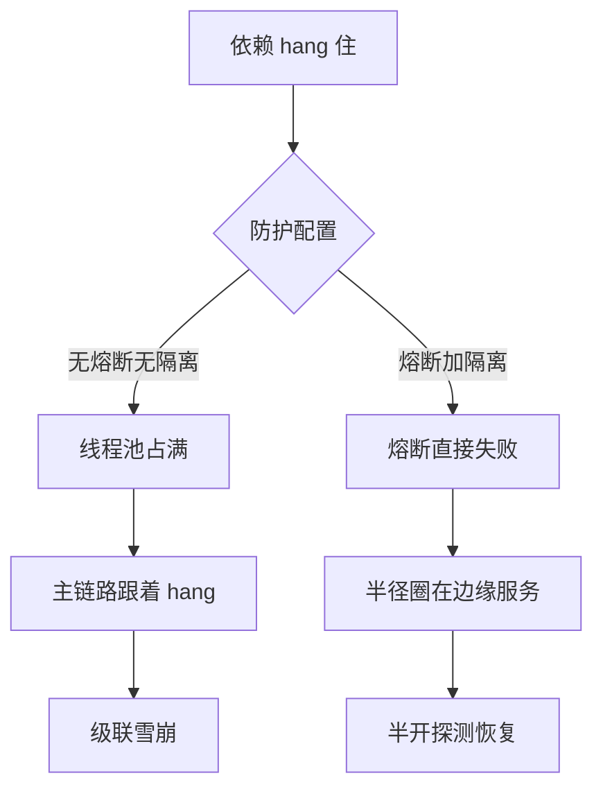

# 限流熔断与隔离控制故障半径

它解决的是**过载和依赖故障沿重试、队列、线程池（预先建好一组线程反复取用、避免频繁创建销毁）扩散成级联故障的问题**。**限流先控制进入量，熔断停止已证明无效的调用，隔离保留关键资源**；**效果是故障半径和恢复时间可控，代价是拒绝部分流量并可能降低瞬时利用率**。读完你能按本文顺序给自己的服务配出限流、熔断与隔离，并用故障注入（主动向系统注入故障来验证容错能力的测试方法）**验证故障半径是否可控**。**用逐步压测和半故障注入验证拒绝速度、核心租户容量、恢复和成本上界**。

**过载和依赖故障会通过队列、连接池（预先建好连接反复取用、省去反复握手建连的开销）、线程池和重试扩散**。**限流控制进入量，熔断停止无意义调用，舱壁/资源池隔离让一个租户或依赖不能耗尽全部容量**；**它们都不能替代修复根因和定义降级（主动牺牲部分功能或精度，保住核心链路）结果**。

## 过载故障为什么会扩散成级联故障？

一个下游服务开始变慢之后，上游仍按原速率送入请求，排队长度与内存同步上涨，故障从一个接口扩散到整条链路。本篇回答：限速、并发上限、有界队列与负载丢弃各自约束什么、自适应门禁为什么必须有硬上限、熔断之后怎样恢复，以及哪些路径会绕过入口的门禁。

## 限速、熔断、隔离各自管住什么？

打个比方：熔断像电路里的保险丝——下游烧起来了先断开，别让整栋楼跟着停电；限流像景区限流入场，超出承载就不放人进来；隔离像船舱的水密隔门，一个舱进水不至于沉船。这个比喻到"三种手段各自管什么"为止：阈值怎么定、半开状态怎么探测恢复、舱位怎么划分，要看正文，比喻只帮你记住三者的分工。


| 机制 | 控制 | 关键参数 |
| --- | --- | --- |
| rate/concurrency limit | 请求速率或并发 | 租户、优先级、突发、拒绝码 |
| timeout/deadline | 等待时间 | 总预算、传播、取消 |
| circuit breaker | 暂停失败依赖 | 错误分类、窗口、半开探测 |
| bulkhead | 资源池故障域 | 线程/连接/队列、保留容量 |
| load shedding | 超载时丢弃低价值工作 | 优先级、降级、可恢复性 |

**重试必须计入限流和总预算，否则「恢复机制」会制造重试风暴（重试流量层层放大、让故障雪上加霜）**。AI 服务还要**限制输入/输出 token（模型处理文本的最小单位，约相当于一个词或半个词）、Agent（会自主调用工具的多步推理程序）步数、工具并发和 GPU 队列**（显卡任务排队，对应后文的 GPU slot），而不是**只限制 HTTP QPS**（每秒查询数）。


来源：[美团技术团队《Java线程池实现原理及其在美团业务中的实践》](https://tech.meituan.com/2020/04/02/java-pooling-pratice-in-meituan.html)（CC 4.0 BY-SA）


## 限流、熔断、隔离应该按什么顺序组合？

限流先把涌入的量削到系统扛得住的水位，**超过阈值的部分被挡在外面**：

**路口的红灯是"挡在外面"最日常的实物：红灯亮起时每个方向的车都被拦在停止线外，被拦的是超过路口当前通行容量的正常流量，车本身没有故障——红灯的价值恰恰在于它拒绝得一视同仁、每个被拒者都明确知道自己为什么等**。**限流的拒绝码（429/503）就是服务发给调用方的红灯：拒绝必须显式、可区分、可计量，让上游能按红灯调整自己的发送速率**，而不是**把超时误当网络抖动**（性能指标不稳定的起伏）**继续硬闯；上游若忽略红灯继续重试，拒绝会进一步堆积，直到触发更严重的拥塞**：


*图源：Wikimedia Commons，Gary，CC BY-SA 2.0，https://commons.wikimedia.org/wiki/File:UK_Red_Traffic_Light_Signal_-_geograph.org.uk_-_5264304.jpg。*

削不掉的那部分故障，交给熔断器处理。熔断器的状态迁移决定了**它什么时候放流量、什么时候完全不放：闭合时正常放行**，**打开时全部拒绝**，**半开时放少量请求试探恢复情况**：

**顺序不能颠倒：先熔断不限流，故障来时系统已经在超载状态里才切断；先限流不熔断，被依赖方已经不可用时调用方还在持续施压**。

先用准入控制（admission control，即前文的门禁，按预算在入口处拒绝超额工作）**拒绝已经超出预算的工作，再用有界队列和 deadline（截止时间）限制等待**；**依赖错误持续出现时熔断，关键租户或操作使用独立资源池**。**顺序反过来会让请求先占满线程和连接，再由熔断器报告故障，已经太晚**。

最小实验：逐步把依赖延迟从正常值提高到超过 deadline，同时发送高、低优先级流量；比较无门禁、只限 QPS、加入并发隔离和熔断四种配置的 p99、拒绝率、核心租户成功率、队列长度和恢复时间。

## 限流、熔断、隔离分别该放在哪四个控制位置？

熔断器的状态迁移是这套控制里唯一有状态的部件：正常时放行，连续失败后打开直接拒绝，冷却一段时间后进入半开试探，试探成功才回到闭合。Martin Fowler 的示意图把三种状态和迁移条件画在了一起：


限流维度的官方实例是多租户配额节流：按租户计量每秒请求数，正常租户照常通过，超限租户收到 Throttled 错误——限流的拒绝是显式、可预期、按配额执行，与熔断的「整体断路」分属两个维度：


*图源：[Microsoft Learn 中文文档《限制模式》](https://learn.microsoft.com/zh-cn/azure/architecture/patterns/throttling)，CC BY 4.0，文档引用。*

*图源：[Martin Fowler · CircuitBreaker](https://martinfowler.com/bliki/CircuitBreaker.html)。*

1. **入口限速**控制单位时间接受多少请求，**适合按租户和优先级分配配额**。
2. **并发上限**控制同时占用多少线程、连接、GPU slot（显卡上的算力配额）或工具调用，**通常比只限 QPS 更有效**。
3. **有界队列让上游看到下游已经跟不上；队列满时拒绝、降级或丢弃低价值工作，不能继续堆内存**。
4. **负载丢弃在系统接近失控前保住核心请求；被拒绝的结果要明确可重试、不可重试或转异步**。

**自适应门禁可以根据排队时间和尾延迟（P99 一类的慢请求耗时指标）收缩并发，但仍要有硬上限**。**没有硬上限的「动态调整」会在观测延迟期间继续放大过载**。

## 怎么自己动手验证

**验证前要先预写预期，再与实测对账：因为注入的故障类型与实测结果可能不一致**。预期例如「依赖超时后拒绝应快速返回」「核心租户容量应保留」。**实测如果显示慢调用把线程池占满，与预期对不上，就说明限流没有真正生效**。

**逐步提高到饱和，注入依赖超时、错误、半故障和恢复；测拒绝是否快速、核心租户是否保留容量、熔断是否恢复、降级是否可用、队列/内存/成本是否有界**。**检查重试、缓存回源（缓存未命中时去后端或源站取数据）和后台任务不会绕过门禁**。

关系：[[工程知识/后端系统：在并发、失败与变化中维持服务/分布式可靠性/超时、重试与幂等共同定义调用语义]] · [[工程知识/AI 系统工程：从模型能力到生产能力/推理服务与平台/推理服务的核心矛盾是延迟、吞吐、显存与质量]]

## 动手跑一遍会看到什么：故障半径的账

```text
三件套的分工与配置（通用形态）：

限流（入口端，挡多余的量）：
  单机 1000 QPS × 8 副本 = 8000 容量 → 全局限流 7200（留 10% 余量）
  超出部分快速失败（返回 429 + Retry-After），不是排队慢慢磨

熔断（调用端，断传染链）：
  依赖 C 错误率 >50%（10 秒窗口、至少 20 个样本）→ 熔断打开 30 秒
  打开期间直接失败（不再打 C）→ 半开探测 → 成功则恢复
  没有熔断：C hang 住 → 调用方线程池全被占住 → 调用方也 hang → 级联雪崩

隔离（舱壁，圈住半径）：
  线程池/信号量按依赖分池：核心库 100 线程、推荐服务 30、报表 10
报表依赖挂起只耗尽它的 10 线程，核心交易不受影响
  不隔离：一个边缘依赖占满共享线程池或连接池，其余请求拿不到资源，整个进程被拖垮
```

**缺熔断的实录——推荐服务 hang 住（某次配置推送让它全量阻塞），调用它的主链路线程池随之耗尽，主业务跟着不可用（故障半径从边缘服务扩到核心链路），按依赖隔离 + 熔断上线后同类事故半径缩到边缘服务自身**。**限流配置错位的实录——限流值拍脑袋设 1 万（单机容量 800 × 8 = 6400），流量 7000 时服务已过载但限流未触发，限流值要按实测单机容量乘副本数算**（与 [[工程知识/性能工程：从用户等待到资源瓶颈/存储与网络/节流参数与容量匹配：全局限流值要按单点容量乘副本数算.md]] 同一公式）。**三类防护的验证姿势：故障注入逐项验证（限流阈值、熔断窗口、隔离池各打一轮，实测行为与配置对账）**。

同一依赖 hang 住，防护配置不同，故障半径分岔见下面这张图：



## 这套说法在哪儿会失效

- **限流只约束请求进入的速率**：**它管不住下游自身的产能，下游已经饱和时，进入量再少也救不回处理，过载仍会从下游继续传导**。
- **自适应门禁需要硬上限**：**只依据观测到的延迟收缩并发，观测窗口内的请求仍在继续放大过载**。
- **有界队列是前提**：**队列没有上限时，排队的请求持续占用内存与文件句柄，积压越多内存涨得越快，过载就此转化为内存增长与整体延迟上升**。
- **熔断恢复依赖探测流量**：**半开状态的探测比例过高会再次打穿下游，过低则恢复缓慢**。
- **重试、缓存回源与后台任务会绕过入口门禁**：**只对入口限流时，这些路径仍能压满下游**。

## 接着读哪几篇：讲穿透/击穿/雪崩各自的首选防御

- [[工程知识/后端系统：在并发、失败与变化中维持服务/服务设计/缓存穿透击穿与雪崩是三种不同的失效模式|缓存穿透击穿与雪崩是三种不同的失效模式]]——讲穿透/击穿/雪崩各自的首选防御，与限流互补成缓存失效的防线
- [[工程知识/后端系统：在并发、失败与变化中维持服务/分布式可靠性/重试的正确姿势：退避、抖动与重试预算.md]] —— 持续性故障时重试的止血搭档
- [[工程知识/后端系统：在并发、失败与变化中维持服务/服务设计/连接池的容量数学：池大小与排队等待的权衡.md]] —— 池作为天然限流器
- [[工程知识/后端系统：在并发、失败与变化中维持服务/服务设计/背压的传递链路：从下游饱和到上游减速.md]] —— 过载三类防线的分工
- [[工程知识/后端系统：在并发、失败与变化中维持服务/服务设计/健康检查的三层语义：存活就绪与深度.md]] —— 错误率侧的摘除搭档
- [[工程知识/后端系统：在并发、失败与变化中维持服务/服务设计/分布式限流的四种算法：计数漏桶令牌与滑动窗口.md]] —— 限流在过载防御中的位置


- [[工程知识/后端系统：在并发、失败与变化中维持服务/服务设计/服务降级是有损服务，损什么损多少要变成业务决策]] —— 限流之后的降级阶梯
