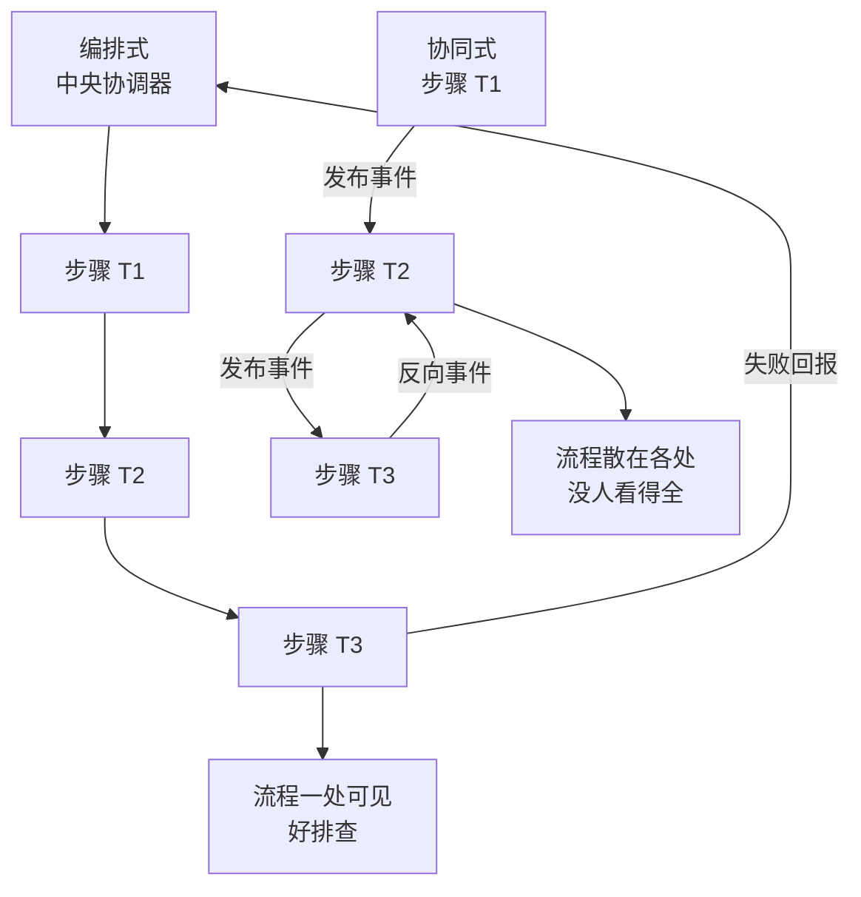
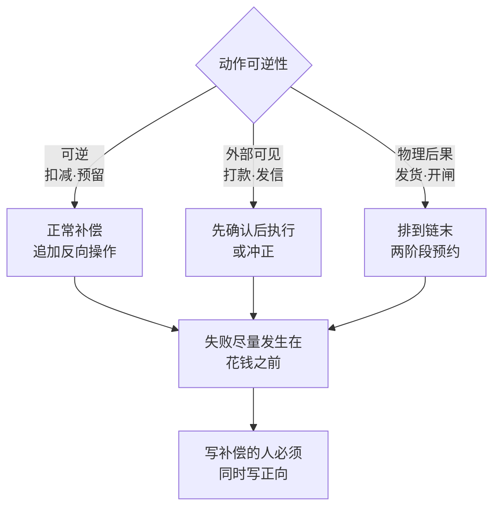

# Saga把长事务变成补偿链，代价是失去隔离性

跨多个服务的业务操作（下单 = 扣库存 + 创建订单 + 扣款 + 发通知）无法放进一个数据库事务——各服务有自己的库，**两阶段提交（协调多个数据库分准备、提交两步一起生效的协议）在跨服务场景的可用性与性能代价过高**。Saga 的解法是**把原子性（一个操作要么全部成功、要么全部不做）变成补偿链**：**每一步本地提交，失败时执行前面各步的补偿动作（回滚——把系统状态退回到改动之前的版本）扣减、取消订单，用一串本地事务加补偿换掉一个全局事务**。
读完这篇你能**判断一个跨服务操作能不能用补偿链，也知道中间状态被别人看见时该怎么兜**。

这个交换的账要算清楚：**原子性保住了，隔离性丢了**。隔离性指**一个事务进行中，其他请求看不到它的中间状态**。

本地事务逐个提交意味着**中间状态对其他请求可见**——库存已扣、订单还没建成的窗口里，**并发请求看到的是半成品状态**，像餐厅先划账再上菜的空档里，另一桌看到「有座」就也坐下，结果前者撤单、后者坐了不存在的位子——**读到的中间态可能随时消失**。这个比方到「读到的中间态可能消失」为止。

Saga 的定位是**"用隔离性换可用性"的明确取舍**，**把它当作更灵活的事务会误判它的适用场景**。可以把它想成一笔已经发出去的汇款：**钱到账了才发现问题，只能再发一笔退回来，中间这段时间对方的账上确实是多的**。

这个比方到「要再发一笔才能抵消」为止。汇款退不回来就是退不回来；**Saga 的补偿同样如此：补偿动作本身也是一次独立的事务，它也可能失败，失败要由重试与人工兜底**。

## 要解决的问题是什么：长事务的两种形态怎么取舍

| 形态 | 驱动方式 | 优点 | 代价 |
| --- | --- | --- | --- |
| 编排式 | 中央协调器逐步调用（协调器是一个中央服务，负责按顺序调用各步骤并收集结果） | 流程一处可见，好排查 | 协调器是单点，逻辑集中 |
| 协同式 | 各服务订阅事件自行决定（没有中央协调者，靠事件触发串联） | 无单点，服务解耦 | 流程散在各处，没人看得全 |

编排与协同的差别不在能力，在拓扑——一个是协调器扇出（一个节点把请求或消息分发给多个下游），一个是事件串联，失败回报的路径也跟着不同：



**拓扑决定了流程归属：扇出结构流程一处可见**，**链式结构没人看得全**，**选择判据就落在流程是不是业务资产上**。

编排式把控制权集中在一个协调器里，协调器逐步下发命令、收集结果，失败时逆序触发补偿。下面的官方示例把编排器画成 Step Functions 状态机（状态机是一张定义「当前在哪一步、下一步去哪」的规则表，由引擎按规则自动推进），订单、库存、支付各服务只接收命令并返回结果：


图源：[AWS 预设指导《Saga orchestration pattern》](https://docs.aws.amazon.com/prescriptive-guidance/latest/cloud-design-patterns/saga-orchestration.html)。这张官方架构图展示了编排式的典型形态：协调器集中控制流程，每个服务只负责本地事务，补偿由状态机统一调度——与上文的扇出拓扑对照阅读。图中消息代理是负责把消息从发送方送到接收方的中间服务；Command Handler 是接收命令并执行的服务端处理器。

编排式适合**流程常变、排查优先**的场景；协同式适合**服务自治性要求高**的场景。选择判据是**流程归属**：**流程是业务资产、需要频繁审视修改时，编排把流程集中在一处，改起来最省事，所以选编排；流程稳定且分散时，协同的解耦更合适，所以选协同**。

两种形态的差异在官方图里一目了然。协同式没有中心协调者，订单服务发事件、客户服务回事件，服务各自订阅自己的通道，流程分散在双方的订阅关系里：


*图源：[microservices.io《Saga pattern》](https://microservices.io/patterns/data/saga.html)，Chris Richardson，文档引用。*

编排式则由 Create Order Saga 集中发命令、收回执，流程全部写在协调器里：


*图源：同上（[microservices.io《Saga pattern》]）。*

## 补偿到底和回滚有什么不同？

**补偿不是回滚（把系统恢复到上一个可用版本）**。**回滚恢复到"从未发生"，补偿是追加一个反向操作**：扣了 100 元再存 100 元，账面恢复但流水多了两条。这个差别决定了 Saga 的适用边界：

- **补偿后的最终状态与回滚等价（可逆动作：扣减、预留）→ 适合 Saga**。
- **动作外部可见即不可逆（钱已打给用户、邮件已发出）→ 补偿只能"冲正"不能"撤销"，必须设计成先确认后执行或人工介入**。
- **动作触发物理后果（发货、开闸）→ 补偿语义不存在，这类步骤要么排最后（前面全成功才执行），要么引入两阶段预约**。

设计补偿链时的排序规则因此是：**可逆步骤在前，不可逆步骤在后**——**不可逆步骤就是真正花钱的动作，把它排到链尾，前面可逆步骤一旦失败，还没到花钱那步就停了，失败尽量发生在花钱之前**。

补偿链上每一步按可逆性分流，处置各不相同：




来源：[CSDN @bjmayor《图解分布式事务模式》](https://bjmayor.blog.csdn.net/article/details/154004146)（CC 4.0 BY-SA）


## 隔离性丢了之后怎么防御？

中间状态可见带来的经典问题是**脏读（读到了别的事务还没真正完成、随时可能消失的数据）与重复扣减**，防御机制三层：

1. **语义锁**：**业务状态标记"处理中"（订单状态 PENDING），并发请求读到该标记就知道在途事务存在，选择等待或拒绝**。这是**应用层隔离**这一层的含义：数据库隔离级别（并发事务互相可见程度的分级）由数据库自动隐藏未提交数据，**语义锁则由业务自己在状态字段上做标记来提示其他请求**。

2. **幂等（同一个操作执行一次和执行多次的结果相同，重复执行不会产生额外副作用）执行**：**补偿与正向步骤都可能被重试触发（超时后重发），每一步必须幂等，否则补偿链自身制造重复扣减**。幂等的设计与调用语义见 [[工程知识/后端系统：在并发、失败与变化中维持服务/分布式可靠性/超时、重试与幂等共同定义调用语义]]。

3. **对账兜底**：**防御性机制都可能失效，最终防线是定期对账——每条 Saga 实例的终态（流程结束后不再变化的状态）要么"全部完成"要么"补偿到底"，停在中间的实例清单就是对账的输出**。对账作为静默失败的最终检测，方法见 [[工程知识/缺陷分析：从个案到体系/正确性/静默失真的检测靠对账与不变量而不是报错]]。

## 消息发出去和业务提交怎么保证一致？

Saga 的每一步跨服务调用都要面对**消息投递与业务提交的一致性问题**[[工程知识/后端系统：在并发、失败与变化中维持服务/分布式可靠性/消息投递与业务提交需要显式的一致性边界]]：**本地事务提交了但"下一步"消息没发出，链就断了**。工程答案是**事务性发件箱**（本地事务里写发件箱表，后台中继发送）——**Saga 每步的实现都要过这道检查**。

## 动手跑一遍会看到什么：补偿链的账

```text
订票 Saga（订机票 → 订酒店 → 订租车）的两种走向：

正向链：T1 订机票 ✓ → T2 订酒店 ✓ → T3 租车 ✗（无车）
补偿链：C2 退酒店 ✓ → C1 退机票 ✓ → 用户收到"预订失败"
  补偿的语义：每个 T 必须配一个 C（业务上的反向操作，非数据库回滚）
  C 的要求：必须成功（重试到成功），否则中间态永久留存

失去隔离性的实录形态（与其他事务并发时）：
  T1 订了机票（ Saga 未完成），另一事务读到"已有机票"做了联动决策
  → T3 失败整链补偿，机票退了 → 联动决策基于了一个从未"提交"的事实
  → 隔离性缺失的代价：中间态对外可见，别的读者不知道这是半成品

缓解：中间态显式化（状态字段"预订中"让读者知情）、
  业务上允许补偿（订票可退）、读侧容忍（联动决策加确认步骤）
```

**补偿不幂等的实录——退票补偿接口重复执行（补偿消息重投），第一笔真退款 + 第二笔报错（单号已退），补偿停在半途，整链状态悬置；补偿幂等化（按原单号去重）后重投安全**。**补偿不重试的实录——补偿调用超时后任务直接标记失败（没有重试），机票扣着酒店没订，用户资金占用两天才发现；补偿必须配重试与最终对账（每天对账任务扫悬置链）**。**适用边界的实录——强一致场景（资金实时扣减对账）勉强套上 Saga，中间态可见引发业务纠纷，改二阶段提交 + 缩短事务范围才对**，与 [[工程知识/后端系统：在并发、失败与变化中维持服务/分布式可靠性/消息投递与业务提交需要显式的一致性边界.md]] 的一致性边界选择衔接。

## 这套说法在哪儿会失效

Saga 的适用前提是**步骤可枚举、补偿可定义**。**探索型流程（步骤由运行时决定、补偿依赖不可预测的上下文）不适合预定义补偿链，这类流程的正确性要靠工作流引擎的显式状态机**[[工程知识/软件构建：让变化可以理解、验证与交付/架构与代码/状态机把隐式状态变成显式约束]]。

**Saga 不解决并发同一业务对象的问题：两个 Saga 同时操作同一订单，语义锁只防"读到中间态"，不防"两个都成功但业务上互斥"——互斥约束要么前移到单点（库存服务串行化），要么靠业务规则事后裁决**。这再次印证**事务边界应覆盖完整业务用例的原则**[[工程知识/数据系统：在并发与故障中保存事实/事务与存储/事务边界应覆盖完整业务用例]]：**能放进单库事务的，不要改用 Saga**。

## 怎么自己动手验证

**失败注入实验**：给 Saga 链的第 3 步注入失败，**检查补偿链是否按逆序执行、语义锁是否释放、对账清单里该实例是否收敛到"已补偿"**。**再注入补偿自身的失败（第 2 步补偿超时），确认重试幂等且最终对账可见**。

**并发实验**：同一业务对象并发起两个 Saga，**确认语义锁行为符合预期（拒绝或排队），没有出现双份扣减**。

## 接着读哪几篇：编排器的实现骨架

- 关系：[[工程知识/后端系统：在并发、失败与变化中维持服务/分布式可靠性/消息投递与业务提交需要显式的一致性边界]] · [[工程知识/后端系统：在并发、失败与变化中维持服务/分布式可靠性/超时、重试与幂等共同定义调用语义]] · [[工程知识/数据系统：在并发与故障中保存事实/事务与存储/事务边界应覆盖完整业务用例]] · [[工程知识/后端系统：在并发、失败与变化中维持服务/分布式可靠性/分布式事务的分类与各自失败形态]]
- [[工程知识/软件构建：让变化可以理解、验证与交付/架构与代码/状态机把隐式状态变成显式约束]] —— 编排器的实现骨架
- [[工程知识/缺陷分析：从个案到体系/正确性/静默失真的检测靠对账与不变量而不是报错]] —— 中间态悬置实例的对账兜底
- [[工程知识/后端系统：在并发、失败与变化中维持服务/分布式可靠性/部分失败决定分布式系统的设计]] —— 补偿链要处理的故障模型
- [[工程知识/后端系统：在并发、失败与变化中维持服务/任务与并发/幂等性的完整谱系：从操作语义到删除接口的天然陷阱.md]] —— 补偿操作的幂等前置：从语义层到键实现
- [[工程知识/后端系统：在并发、失败与变化中维持服务/服务设计/事件驱动架构的解耦代价：最终一致与可追溯性.md]] —— 长流程的编排化方案