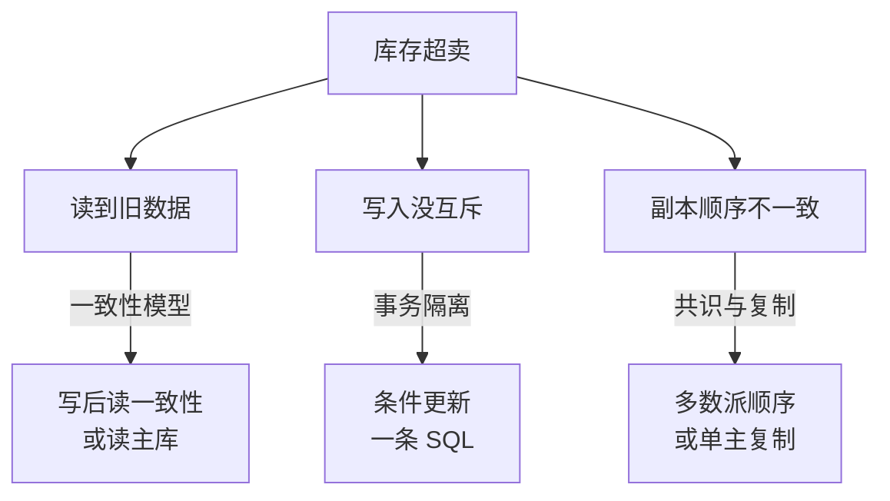
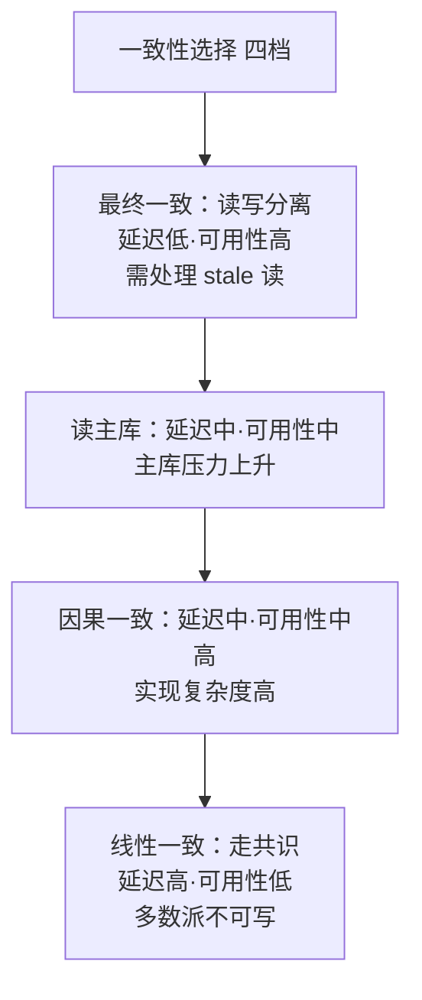

# 一致性模型与共识解决不同问题

"一致性"这个词在日常讨论里**至少混着三件不同的事**：**读到的值是不是新的**（副本之间的新鲜度）、**并发写入会不会互相踩**（事务之间的隔离）、**多个节点能不能对顺序达成唯一决定**（共识）。三者需要不同的解法，**混为一谈就会开错药方**。
读完这篇你能把"不一致"归到新鲜度、隔离和顺序中的哪一类，也知道该用哪种解法。

第三件事（多节点对顺序达成唯一决定）已有成熟协议，Raft（一种共识算法，让多台机器对同一份日志的顺序达成一致）论文把这类协议必须保证的性质汇总成一组可逐条核对的陈述：


*图源：[Raft 论文中文翻译 · 图 3](https://github.com/maemual/raft-zh_cn)。*

这一页把它们分开来看，各自讲清楚：一致性模型有哪些、分别承诺什么；线性一致性和可串行化为什么是两回事；Raft 这类共识算法到底解决什么、不解决什么；以及生产环境里遇到"读到旧值""超卖""跨服务对不上账"时，分别该用什么手段。

默认建议是：**不要一上来就上共识**。多数所谓的一致性问题，用条件更新、写后读一致性、对账就能解决，**代价低一个数量级**。

## 要解决的问题是什么：库存显示还有 1 件，为什么两个人都买到了

库存只剩 1 件。用户 A 和用户 B 同时下单，都看到"还剩 1 件"，**都下单成功**。

**结果：超卖，库存变成 -1。**

排查时发现三个不同的问题被混在一起讨论，逐条列开：

1. **读到旧数据**：主库（负责处理写入的数据库节点）已经扣减，但从库（异步复制主库数据的节点，复制需要时间）还没同步，B 读到的是旧值
2. **写入没互斥**：两个扣减操作都基于"库存 = 1"做判断，都通过了
3. **副本顺序不一致**：两个从库应用更新的顺序不同，最终值不一样

这三个问题分别属于**一致性模型**、**事务隔离**、**共识**——是不同的东西，**需要不同的解法**。把它们统称为"一致性问题"，**就会开错药方**。

同一个症状三个病根，各走各的药方，见下图：



共识落到具体协议上时，参与者是分角色的——谁可以投票、谁只接收日志、谁负责推进。只有具备投票权的节点才计入多数派，所以角色怎么分配，直接决定凑齐多数派要联系哪些节点。etcd（一个用 Raft 协议做共识的分布式键值存储）的实现把这种分工画了出来：


*图源：etcd 官方文档 learning/design-learner 页。*

## 一致性到底是什么：从零开始

打个比方：一致性模型像餐厅承诺"你点的菜一定是你点过的那份"（顺序与可见性），共识像后厨几个人商量"今天 Special 到底是哪道菜"（对一件事达成一致）。两件事都要有，**但问的不是同一个问题**——后厨商量好了，端到你面前的也未必是你以为的那一份。这个比喻到"两者问的问题不同"为止。线性一致与可串行化到底怎么区分？多数派为什么一定有交集？答案在下面各节。


先把形状说成一件事：一致性模型是银行对"存折余额"的承诺方式——有的柜台承诺"上一笔存款入账后，任何分行都能立刻查到新余额"（线性一致性）；有的只承诺"今天之内各家分行总会对上账，中间几分钟可能看到旧余额"（最终一致性）；还有的承诺"每个柜员自己的账本顺序不乱，但柜员之间可能互相看不见"（因果一致性）。**承诺越强，柜台之间要打的电话越多，办业务越慢**。这个比喻到"打电话"为止。现实里四种模型的确切边界，见「一个具体场景怎么区分四种模型」一节。

### 一致性模型一句话怎么定义？

**一致性模型 = 一个系统在有多个副本、多个客户端并发读写时，承诺"看起来像什么"。**

最强的承诺是：**"看起来只有一个副本，且操作按真实时间顺序发生"**（线性一致性）。
最弱的承诺是：**"最终大家会一样，但中间可能看到任何东西"**（最终一致性）。

### 一个具体场景怎么区分四种模型

假设：主库写入 `x = 1`，然后客户端 A 读，客户端 B 读。

**线性一致性（Linearizability）** —— 最强

- t=0：主库写入 x=1，返回成功
- t=1：A 读，一定是 1
- t=2：B 读，一定是 1

写入返回成功后，**之后的所有读都必须看到新值**，就像只有一个副本。这个比方到「读到自己刚写的」为止——单副本没有同步延迟，真实主从架构里从库有追平窗口，延迟多大、怎么等追平，要看正文。

**顺序一致性（Sequential Consistency）**

- A 写 x=1，A 写 x=2
- B 读，看到 2
- B 再读，一定不会看到 1（不能倒退）

所有操作排成一个全局顺序，且**每个客户端自己的操作顺序被保持**。但不要求这个顺序符合真实时间。

**因果一致性（Causal Consistency）**

A 发帖，B 回复了 A 的帖。C 读时不能只看到回复而看不到原帖，有因果关系的操作顺序不能颠倒。

只有**有因果关系**的操作保证顺序。并发的操作，**不同副本可以有不同的顺序**。

**最终一致性（Eventual Consistency）**

主库写入 x=1 之后，从库同步完成前的读取结果随时间变化，走一遍这条时间线：

- t=0 时 B 读，可能是 0（还没同步）
- t=500ms 时 B 读，是 1

没有新写入后副本最终收敛，但**不承诺什么时候、以什么顺序**。

### 四种模型差异在哪一张表

| 模型 | 承诺 | 典型实现 | 延迟 |
| --- | --- | --- | --- |
| 线性一致 | 像单副本，尊重真实时间 | etcd/ZooKeeper（走 Raft）、单主同步复制 | 高（要等多数派） |
| 顺序一致 | 有全局顺序，不管真实时间 | 较少单独提供 | 中 |
| 因果一致 | 有因果的不乱序 | 部分 Geo 数据库（如 CockroachDB，一个支持跨地域部署的分布式 SQL 数据库） | 中 |
| 最终一致 | 最终收敛 | MySQL 异步主从、DNS、CDN（Content Delivery Network，内容分发网络：把内容提前放到离用户近的节点） | 低 |

这四种模型不是并列的菜单，Jepsen 官方的一致性模型图谱把常见模型画成了一棵包含关系树：箭头从强指向弱，满足上层的模型必然满足下层；左侧一支是事务隔离家族（可串行化往下），右侧一支是单对象操作家族（线性一致往下），两支在顶端的严格可串行化会合；颜色标的是网络故障时各档位的可用性——粉色要停服等待、橙色粘住同一节点可用、蓝色任意非故障节点可用：


*图源：Jepsen 官方文档《Consistency Models》模型关系图（改编自 Bailis、Davidson、Fekete 等人与 Viotti & Vukolić 的综述），https://jepsen.io/consistency/models。*

表里四行在这张图上各占一档：线性一致在右侧第二层，顺序一致在其下，因果一致再下；「最终一致」在图上对应最底层的那些弱保证——承诺越往上走，颜色从蓝到橙再到粉，延迟与不可用窗口正是按这条色带涨上来的。

## 线性一致性和可串行化为什么常被混为一谈？

这是面试和工程里都最容易搞混的一对：**线性一致性 vs 可串行化（Serializability，让并发事务的执行结果等同于某个串行顺序）**。

| | 管什么 | 针对什么 |
| --- | --- | --- |
| **线性一致性** | 单个对象、读写的新鲜度 | 副本之间 |
| **可串行化** | 多个对象、事务之间的顺序 | 并发事务 |

用一个库存扣减的例子来区分两种一致性：

库存 = 1，两个事务同时扣减。

可串行化保证了什么：两个事务等价于串行执行。

- T1：读 1，写 0
- T2：读 0，拒绝（或读到 1 也写 0）
- 结果：不会超卖

线性一致性保证了什么：读操作能看到最新的写。

- 不加事务时，两个读都读到 1，都写 0
- 仍然超卖（线性一致不保证"读-改-写"原子）

这个例子收出的结论有三条：

- 防止超卖需要**可串行化（或行锁/原子操作）**，不是线性一致性
- 防止"读到旧值"需要**线性一致性（或读主库）**，不是可串行化
- 两者都想要 → **严格可串行化（Strict Serializability）**，代价最高

## 共识到底在解决哪些问题：多个节点对顺序达成一致

### 共识到底解决什么

Raft/Paxos（经典的分布式共识算法）解决的问题很具体：**在部分节点故障、网络分区的情况下，让多个节点对"一串值的顺序"达成一致，并且这个决定不可撤销。**

它的核心机制是**多数派（Quorum，即超过半数节点点头，一次读写才算通过）**，票数分配如下：

```text
3 节点：需要 2 个同意
5 节点：需要 3 个同意
```

**为什么多数派能工作**：任何两个多数派一定有交集。用 3 节点举例：一个 2 节点多数派做过的决定，另一个 2 节点多数派至少和它共享 1 个节点，这个节点两边的决定都知道，所以新 leader 一定能从交集里看到上一个任期的决定。

分区时的实际行为，etcd 官方文档的这张图给出了对照。图中现象是：3 节点集群里 leader 被隔离到少数侧，多数侧在下一个任期选出新 leader 继续服务；旧 leader 拿不到多数确认，提交不了写入。结论是：「多数派不可用就拒绝写入」是共识在按设计工作。


### 共识到底不解决什么

| 误解 | 实际情况 |
| --- | --- |
| "用了 etcd，业务数据就强一致了" | etcd 只保证**它存的那份数据**一致。你的业务数据库的一致性要自己保证 |
| "共识能让并发写入不冲突" | 共识只决定**顺序**，不判断**业务上是否允许**。两个扣减都会被提交，只是有先后 |
| "共识能保证读到最新" | 从 follower 读可能 stale。**要线性一致读必须走 leader，或用 ReadIndex（向 leader 确认自己仍是主再本地返回）/Lease Read（在租约有效期内本地直接返回）** |

### Raft 要付哪三个关键代价

先理解 Raft 的三个代价，再判断该不该上共识：

1. **每次写入要等多数派 fsync（强制把操作系统缓存里的数据写到磁盘的调用）** → 写入延迟 = 网络 RTT（Round-Trip Time，一个数据包从发出到收到应答的往返时间） + 磁盘 fsync
2. **多数派不可用就拒绝写入** → 5 节点挂 3 个就不可写（这是**正确的**设计，不是缺点）
3. **Leader 切换有不可用窗口** → 选举期间（通常 1-10 秒）不可写

## 生产环境里该怎么选一致性方案？

### 场景 1：读写分离的 stale read 出在哪儿（最常见的问题）

- 写走主库
- 读走从库（异步复制，可能有 50-500ms 延迟）
- 用户改完昵称，立刻刷新，**读到旧值**

这个场景有四种解法，做法与适用边界按下表对照：

| 解法 | 做法 | 适用 |
| --- | --- | --- |
| **读主库** | 写后立即读走主库 | 简单，但主库压力大 |
| **写后读一致性（Read-your-writes）** | 客户端记住自己的写入版本（如 LSN/binlog 位点），读时要求从库至少追上该版本 | 推荐，通用的做法 |
| **延迟读主** | 写入后 1 秒内读主库 | 粗暴但有效 |
| **会话一致性** | 同一会话内保证单调读 | 折中 |

**生产建议**：用**写后读一致性**。MySQL（开源关系型数据库）可以用 `GTID_WAIT()` 或等待从库追上 binlog（MySQL 服务层日志：记录逻辑变更、用于主从复制与恢复） 位点（消费进度的记账标记，记录处理到哪一条）；PostgreSQL（另一个开源关系数据库）类似。

### 场景 2：防超卖靠什么（需要原子性，不是一致性）

```sql
-- 错误：先查后写，两个事务都读到 1
SELECT qty FROM stock WHERE id=?;  -- 1
UPDATE stock SET qty = qty - 1 WHERE id=?;

-- 正确：条件更新，让数据库保证原子
UPDATE stock SET qty = qty - 1
WHERE id = ? AND qty >= 1;
-- 影响行数 = 0 就是没抢到
```

**关键**：把"检查 + 修改"放进**一条 SQL**，让行锁保证原子。**这一条 SQL 就够了，不需要分布式锁、不需要共识**。

### 场景 3：哪些情况真的需要共识（etcd/ZooKeeper）

| 场景 | 需要共识吗 |
| --- | --- |
| 选主（哪个实例是 leader） | **需要** |
| 分布式锁（正确性要求高） | **需要** |
| 服务发现（有哪些实例） | 需要（但要接受短暂 stale） |
| 配置管理（少量、强一致） | 需要 |
| 业务数据（订单、库存） | **不需要** —— 用数据库事务 |
| 缓存 | 不需要 |

**判断标准**：需要"多个节点对同一件事达成唯一决定，且不可撤销" → **用共识**。其他情况**用数据库事务就够了**。

### 场景 4：跨服务的数据一致性怎么处理

跨服务的强一致要把所有参与者绑进同一个提交，**任一参与者不可用就整体不可用**，且协调者本身也要保证不丢状态；换成最终一致可以把不可用范围收敛到单个服务。不要追求跨服务的强一致（2PC 代价高且脆弱）。用：

- **Saga（把长事务拆成一串本地事务、每步配一个补偿动作的模式）**：分成一系列本地事务加补偿
- **Outbox（发件箱模式：业务数据与待发事件同库落盘、再异步投递，保证不丢）**：保证"写库"和"发消息"原子
- **对账**：最终一致 + 定期对账兜底

**对账是被低估的兜底手段**：接受短暂不一致，但每天跑一次对账发现并修复。这比追求强一致便宜得多。

## 选不同一致性模型，收益从哪来、代价是什么？

| 选择 | 延迟 | 可用性 | 复杂度 |
| --- | --- | --- | --- |
| 最终一致 + 读写分离（写入走主库、查询走从库的架构） | 低 | 高 | 低（但要处理 stale） |
| 读主库 | 中 | 中 | 低 |
| 因果一致 | 中 | 中高 | 高 |
| 线性一致（共识） | 高（+RTT+fsync） | 低（多数派不可用就拒绝） | 高 |

**默认建议**：从最终一致开始，用**写后读一致性**解决用户可见的 stale 问题。**只在真的需要"唯一决定"时才上共识。**

四种选择在两个维度上的位置：延迟与可用性基本同向，复杂度随之一路抬高——线性一致要等多数派确认，既增加了每次写入的延迟，也让部分节点故障时直接拒绝写入，**延迟上升和可用性下降来自同一处**；一致性承诺越强，通常需要在更多节点之间做同步确认，**协调范围和实现复杂度随之上升**：

「围观一局棋各说各的棋谱」的实物原型是街头象棋摊：观棋的人各有记法，谁也不拦谁——复盘时各人复述的次序略有出入（最终一致），但棋盘上的定盘星只有一个（线性一致的锚点在主裁判）；分歧只在旁观者之间，执棋者（主库）落子次序是唯一的：


*图源：Wikimedia Commons，作者 Daniel Schwen，CC BY-SA 4.0，https://commons.wikimedia.org/wiki/File:Xiangqi_in_Columbus_Park.jpg。*

一致性模型挑的正是这份"记法约定"：线性一致要求每个观棋者回答别人提问前，都先打电话问执棋者当前局面（读主库）；最终一致允许观棋者按自己的笔记答（读从库），笔记迟早与棋盘对上；共识协议管的则是执棋者换人时（leader 切换）谁能接着落子。这个比喻只到「旁观者各有记法、执棋者次序唯一」为止。至于换人规则的唯一性为什么比笔记的新鲜度更难保证，见「共识到底在解决哪些问题」一节。



## 动手时从哪儿开始

**第一步：把"一致性问题"分成具体是哪一类**

- 读到旧值 → 一致性模型问题
- 超卖/重复扣 → 事务隔离/原子性问题
- 多个节点要选主 → 共识问题
- 副本数据不同 → 复制/冲突解决问题

**用不同的解法，不要统称为"一致性"。**

**第二步：明确每个接口的读写要求**

对每个 API 问："允许读到多久之前的数据？"

- 用户信息：写后必须立即可见 → 读主或写后读
- 商品列表：允许 1 秒延迟 → 读从库
- 报表：允许 5 分钟 → 随便读

**第三步：用条件更新替代"先查后写"**

搜代码里所有 `SELECT ... 然后 UPDATE` 的地方。**这是超卖和并发 bug 的主要来源。**

**第四步：只在需要"唯一决定"时引入 etcd/ZooKeeper**

选主、分布式锁、服务注册。**业务数据一致性用数据库事务，不要用 etcd。**

**第五步：加对账**

对于资金、库存这类，**每天对账**。这是最后一道防线，能发现所有你没想到的一致性问题。

## 怎么知道系统实际提供什么保证：验证

系统实际提供什么保证要靠实测确定，文档上的承诺以默认配置的行为为准。

最后是最小验证（推荐都做一次），按以下步骤走：

```text
1. 起 3 节点存储（比如 etcd 或主从 MySQL）
2. 并发写入同一个 key，记录每次写入的时间戳和值
3. 同时从所有节点读
4. 注入网络分区（iptables 或 tc）
5. 分区期间继续读写，记录：哪些写被接受、读到什么版本
6. 恢复分区，检查：有没有丢写、有没有冲突、最终值是什么
```

**会发现的真相**：很多号称"强一致"的系统，在默认配置下提供的是最终一致（比如 MySQL 默认的异步复制、etcd 的 follower 读）。

## 哪些认识一看就错？

**错误 1：以为用了共识就等于业务强一致**

etcd 保证它自己的数据一致。**你的订单表的一致性，etcd 管不到。**

**错误 2：混淆线性一致和可串行化**

以为"线性一致"能防超卖 —— **不能**，防超卖需要事务隔离或原子操作（不可分割、要么全做要么不做的操作）。

**错误 3：从 follower 读却期望线性一致**

etcd 默认从 leader 读才是线性一致。**从 follower 读要用 `linearizable` 选项或 ReadIndex。**

**错误 4：用 2PC（两阶段提交协议）追求跨服务强一致**

2PC 在协调者故障时会阻塞，且性能差。**用 Saga + 对账。**

**错误 5：认为 CAP（一致性、可用性、分区容忍性三者的取舍定理）是"三选二"的产品标签**

CAP 只在**网络分区发生时**才需要在 C 和 A 之间选。**平时系统两者都能给。** 真正的取舍是延迟和一致性（PACELC：分区时在一致性与可用性之间选，平时在延迟与一致性之间选）。

**错误 6：不测就假设**

默认配置往往是最弱的一致性。**测一次就知道实际保证是什么。**

关系：[[工程知识/后端系统：在并发、失败与变化中维持服务/分布式可靠性/部分失败决定分布式系统的设计]] · [[工程知识/后端系统：在并发、失败与变化中维持服务/分布式可靠性/Raft选举与日志复制把共识变成工程实现]] · [[工程知识/后端系统：在并发、失败与变化中维持服务/分布式可靠性/消息投递与业务提交需要显式的一致性边界]]
