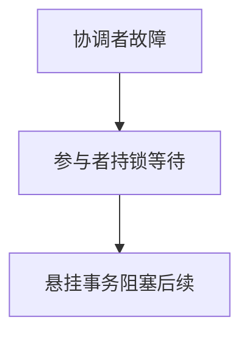
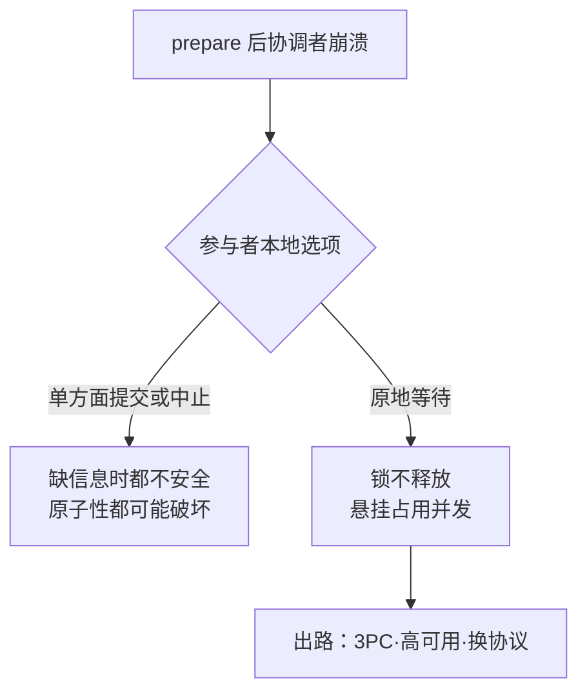

# 两阶段提交的悬挂事务：协调者故障后参与者的两难与出路

> **要点**：2PC（两阶段提交协议）的参与者在"prepare 成功、commit 未决"（prepare 即询问能否提交，commit 即下达提交令）的窗口里被锁住，**协调者故障把窗口变成悬挂**——参与者的两难（单方面提交或中止都可能破坏原子性）**没有本地解**，出路由协议机制（三阶段提交、协调者高可用、事务日志）与环境假设共同决定；**悬挂的处置预案在选型时就要定**。

## 协调者故障后参与者为什么被锁在不确定里？



本文讲协调者故障后的悬挂两难，读完你能判断一个卡住的事务**该等、该提交还是该中止**，也知道协调者挂了要靠什么收尾。


两阶段提交的悬挂问题要解决的是：参与者在"prepare 成功、commit 未决"的窗口里如何自处。协议这样运作：协调者先问所有参与者能否提交，全部同意后再下达提交令。**协议的脆弱点在两个阶段之间**：参与者回了"同意"，就把自己锁进"只能等命令"的状态**——本地**既不能提交（协调者可能决定中止）也不能中止（协调者可能已经决定提交）。**协调者在这时崩溃，参与者面对一个无解的问题：命令永远不会来，锁还在身上**。

这个两难是协议证明的代价面：原子性要求参与者服从协调者，服从意味着**在不确定窗口放弃自主权**。**悬挂事务要解决的问题本质是"不确定窗口 × 协调者故障概率 × 事务时长"的乘积暴露**：窗口越长、协调者故障越频繁、事务持锁越久，三者相乘，**出现悬挂的机会就越多**——单库事务的窗口是毫秒级，跨服务事务能拉长到秒级，协调者偶发故障时，悬挂就从论文里的极端情况**变成实际运维中会真实遇到的故障**。本库后端域"分布式事务的分类与各自失败形态"给过 2PC 的失败分类；本篇深挖悬挂这一种：**它的形成、它的两难结构、三类出路各自的交换**。

## 两难的结构是什么、三类出路各用哪种代价换掉悬挂？

打个比方：两阶段提交像民政局办离婚——先问双方"材料齐了吗"（prepare），两边都说齐了才盖章（commit）。如果工作人员在问完之后、盖章之前晕倒了，两个人就被晾在"材料已交、还没离成"的状态，谁也不敢擅自走人。这个比喻到"为什么会有悬挂"为止：日志怎么写、参与者怎么问别人来恢复、为什么需要三阶段或超时回滚（把系统状态退回到改动之前的版本），要看正文，比喻只解释卡在哪一步。


**两难的根源是参与者握着锁却拿不到决定**。这类"等待一个可能永不到达的指令"的状态，在可观测性（通过系统对外输出判断内部状态的能力）上有对应的呈现方式——off-CPU 火焰图（火焰图是把时间消耗按函数层层调用的路径画成条带的图，off-CPU 版专门展示不在 CPU 上运行的等待时间）把不在处理器上的时间也摊开，等待点会集中成很宽的一段：


*图示：Off-CPU 分析中线程的阻塞时间分布。图源：[Brendan Gregg · Off-CPU Analysis](https://www.brendangregg.com/offcpuanalysis.html)。*

这张图对应悬挂事务的可观测面：参与者卡在等待协调者指令，CPU 是闲的，**只有把等待时间也画出来才看得见**。

**两难的结构**：参与者已投"同意"票后的本地选项只有两个——**单方面提交**：若协调者最终决定中止，原子性破坏（部分提交）；**单方面中止**：若协调者最终已决定提交，同样破坏原子性。**两个选项在缺信息时都不安全**——这就是为什么协议要求参与者原地等待。等待的资源代价是锁（prepare 阶段加的锁不释放），**锁的持有时间 = 不确定窗口长度**，下游的并发能力被悬挂事务逐步占用。

prepare 之后的本地选项与各自结局：



**出路一：三阶段提交（3PC）**：在 prepare 与 commit 之间插入 pre-commit（全票通过后先同步这个事实），参与者在协调者故障时可以根据**"是否见过 pre-commit"**决策（见过 → 安全提交，没见过 → 安全中止）。**代价是多一轮通信 + 对网络分区的脆弱**（分区恢复后可能出现两个协调者视角）——3PC 在实践中的地位是教学价值大于生产价值：它用复杂度换掉悬挂，代价是对网络分区更脆弱——分区恢复后可能同时出现两个协调者视角，各自下命令。

**出路二：协调者高可用**：悬挂的前提"协调者故障不恢复"被高可用消灭（主备切换、事务日志持久化）——参与者等的命令在协调者恢复后必然到达。**交换是协调者层的可用性成本**，以及一个残留风险：切换期间参与者的锁还在持有（窗口 = 切换时长），**切换时长要进事务超时预算**。

**出路三：换协议**。TCC（Try-Confirm-Cancel，把提交拆成预留、确认、取消三步的业务层两阶段）、Saga（补偿链，本库已有专篇）与基于共识的协调者复制事务状态，Raft（一种以易于理解著称的共识算法：靠领导者与日志复制达成多数派一致） 是一种把多份日志复制保持一致的共识算法；上游 BookKeeper 类系统用日志复制保证协调者状态不丢，BookKeeper 是提供日志复制与持久化的存储服务。**各自的交换在隔离性、侵入性与复杂度之间移动**：这些协议让协调者状态可持久化，或让参与者在缺信息时也有本地可决策路径，协调者故障不再导致无限等待，悬挂概率随之降到可运维的水平。

悬挂的两难先看协议的全貌。正常路径上协调者与参与者各有一条时间线，prepare 与 commit 两阶段之间参与者持有锁（图中的灰色条），这把「不确定窗口」直接画在了锁的长度上：


来源：《Designing Data-Intensive Applications》Figure 9-9（腾讯云开发者社区转载，https://cloud.tencent.com/developer/article/2365924）。灰条的两端就是窗口的两端：prepare 之后锁已在手，commit 到达之前谁也不能替它做决定。

协调者在窗口中间崩溃，参与者就被晾在图上这个位置——Database 1 已投 yes 票却等不到指令，单方面提交与中止都可能与协调者的最终决定冲突：


来源：《Designing Data-Intensive Applications》Figure 9-10（腾讯云开发者社区转载，https://cloud.tencent.com/developer/article/2365924）。正文说的「无解的本地问题」在图上就是 Database 1 的时间线断在 prepared：它握着锁、缺着信息，这正是三类出路要消灭的窗口。


## 读完这一段你能判断什么：悬挂的处置与选型核对

**处置预案的三要素**（选型时定，不是出事后补）：一是**超时语义**——参与者的锁等待有上限，超时后的动作（默认中止、默认提交、告警人工介入）要有明确选择，**默认中止在"可能已提交"场景下会造成不一致，默认提交在"可能已中止"场景下同样**——**按业务对一致性的要求在两害之间取其轻**：宁可少卖不能错发的业务选默认中止，宁可多发不能卡单的业务选默认提交；二是**悬挂监控**——不确定窗口内的事务单独计数与告警（正常事务在毫秒级完成，窗口内滞留秒级即异常）；三是**协调者恢复后的对账**——悬挂期间人工放行的决策要与协调者最终命令核对，冲突时按业务语义修复。

**选型的核对清单**：协调者状态是否持久化（事务日志）且高可用？参与者的超时语义是否可配置且与业务匹配？不确定窗口的监控是否内置？跨服务的边界（参与者是外部系统时，2PC 不可用）——**四个问题过不了两个，这个 2PC 部署的悬挂事务就是定时炸弹**。

**与锁的关系要显式**：悬挂持有的是 prepare 加的锁，**锁的粒度（行、页、表）决定受影响的并发范围**——行级锁悬挂只锁几行，**表级锁悬挂会阻塞整表访问**；高冲突表的 2PC 要谨慎评估锁粒度（锁保护的范围大小、直接影响并发度）。

## 这套说法在哪儿会失效

以下三条说明这套判断在哪些情况下不适用。

**2PC 不是分布式事务的全部**：跨服务的业务事务多数场景用 Saga 或最终一致更合适（放弃隔离性换可用性）——**2PC 适用的前提是参与者都在协议内且可用性可牺牲**，把它当万能方案会在服务边界上碰壁。

**悬挂时间不等于锁等待超时**：参与者本地超时只是本地动作，协调者侧事务还在——**两侧的超时语义要联动设计**（参与者超时后协调者的命令到达时如何处置），单侧配超时制造出新的不一致窗口。

**恢复后的对账不能省**：任何悬挂处置（人工放行、默认动作）都要与最终真相对账——**对账 skipped 等于接受静默不一致**，它在下次读取时以数据矛盾的形式重新出现。

## 怎么自己动手验证

可复现的验证路径：

1. 悬挂复现：测试环境在 prepare 后 kill 协调者，预期参与者锁保持、超时语义按配置触发、协调者恢复后命令到达并与本地动作按预案对账；
2. 切换演练：协调者主备切换期间提交事务，预期切换时长内的窗口行为与预案一致、无永久悬挂；
3. 锁占用验证：构造悬挂事务持有行锁，预期相关行的并发访问按锁语义阻塞，悬挂清除后恢复；
4. 断言锚点：**协调者状态有持久化日志、悬挂监控与告警在管、超时语义在选型文档里写明、对账流程演练过**——四件齐备，悬挂从事故变成预案内场景。

```text
悬挂断言 = 协调者故障可恢复且对账闭环
窗口断言 = 窗口内滞留有监控告警
锁断言 = 锁范围与恢复动作可预期
```

2PC 的悬挂两难没有免费的出路**——每条出路都是用另一种成本（复杂度、可用性、隔离性）换掉"无限等待"。选型时把出路与代价写清楚，**悬挂才从理论上无解变成运维上可控。

## 接着读哪几篇：出路三的补偿路线
[[工程知识/后端系统：在并发、失败与变化中维持服务/分布式可靠性/最终一致性的工程边界——什么时候可以接受不一致.md]]
[[工程知识/后端系统：在并发、失败与变化中维持服务/分布式可靠性/分布式系统中的脑裂与仲裁——从故障检测到一致性恢复.md]]

- [[工程知识/后端系统：在并发、失败与变化中维持服务/分布式可靠性/分布式事务的分类与各自失败形态]] —— 失败分类的全景，本篇深挖悬挂一种
- [[工程知识/后端系统：在并发、失败与变化中维持服务/分布式可靠性/Saga把长事务变成补偿链，代价是失去隔离性]] —— 出路三的补偿路线
- [[工程知识/后端系统：在并发、失败与变化中维持服务/分布式可靠性/Raft选举与日志复制把共识变成工程实现]] —— 协调者状态持久化与高可用的机制来源
- [[工程知识/数据系统：在并发与故障中保存事实/事务与存储/事务隔离决定并发读写能观察到什么]] —— 本地锁协议与分布式悬挂锁的关系