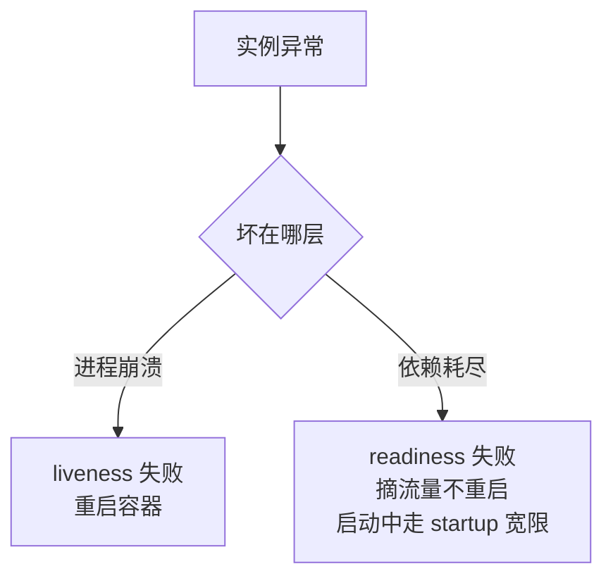

# 健康检查只能提供有时效的失败证据

**三者都在观察运行状态：轮询获取业务结果，心跳检测连接或成员是否仍在，健康检查决定实例是否接收流量**。观察对象与目的各不相同。**读完你能把轮询、心跳、健康检查分成三个接口各自实现，分清各自能证明什么，不再用一个接口同时承担三种语义**。

例如**一个实例可能仍能返回 `/healthz`，但模型尚未加载、数据库连接池（预先建好连接反复取用、省去反复握手建连的开销）已耗尽或租户配额已满**；反过来，**短暂的下游抖动也不应让所有实例同时被摘除**。**检查结果必须带上观察时间、作用范围和过期语义，调用方不能把一次成功当成未来一段时间的保证**。

## 要解决的问题：三种探测分别回答哪些问题

同一个接口被用来查询业务结果、检测连接存活与决定实例是否接收流量，三种语义混在一起之后，**健康检查通过但业务不可用、或者实例被摘除的原因无法判断**。本篇回答：三种探测各自回答什么问题、时效性差异在哪里、判定失败之后各自触发什么动作，以及它们为什么需要分开实现。

## 三种探测在语义上差在哪儿？

打个比方：健康检查像护士每隔一小时来量一次体温——量到正常只代表"刚才那一分钟还正常"，不代表"现在还正常"，两次测量之间发生了什么它不知道。这个比喻到"证据有时效"为止。探测间隔怎么定？连续几次失败才摘除？摘除后怎么恢复？答案在下面各节。


| 机制 | 发起方 | 问题 | 设计重点 |
| --- | --- | --- | --- |
| 轮询 | 客户端/消费者 | 任务是否完成、资源是否更新 | 间隔、退避、截止时间、游标和重复读取 |
| 心跳 | 连接两端/集群成员 | 对端是否仍可通信、租约（带过期时间的临时授权，过期即失效）是否续期 | TTL（Time To Live，存活时间：到期后自动失效或删除）、丢包容忍、时钟偏差、脑裂（集群分裂成两半各自为政的故障）和误判 |
| 健康检查 | 入口/编排系统 | 实例现在能否安全接流量 | 存活与就绪分离、依赖范围、摘除与恢复 |

心跳检测的对象是连接是否仍在。**心跳在传输层依赖 TCP（传输控制协议，负责把数据完整、有序地送达）连接的存活状态，因此先看 TCP 状态机如何描述连接的断开过程**。下面的状态机按事件驱动迁移，每个状态标注了触发它的接收报文与发出的响应，包含同时关闭（双方同时发起断开的罕见情形）与 CLOSING（TCP 正在关闭但尚未完全断开的中间状态）分支：


来源：[腾讯云《【图解】三次握手，四次挥手 —— 用心看这一篇就够了》](https://cloud.tencent.com/developer/article/2015692)


## 轮询怎么设计

- 有事件推送、Webhook（服务方主动把事件回调到指定 URL，不用轮询方反复来问）、消息队列（生产者写入、消费者读取的缓冲中间层）或长连接（建立后保持不断开、多次通信复用同一条连接）时优先使用它们；没有可靠事件通道时才轮询。
- 使用指数退避（每次失败后按倍数拉长等待时间）和抖动（在等待时间上加随机量，错开各客户端的重试时刻），避免所有客户端在同一时刻打满服务；服务端返回 `Retry-After`（告知客户端过多久再来重试的响应头）时遵守它。
- 每次轮询都带总截止时间、取消信号和最大次数；超时后返回「未知/待处理」。这表示任务可能已完成但本次未读到结果，调用方需另行确认，不能当作业务失败，也不要无限等待。
- 用任务 ID、版本号或 cursor（游标，标记已读取到哪一条的指针）增量读取，保证重复响应不会重复执行副作用（操作对外部状态产生的额外影响）。
- 监控轮询 QPS（每秒查询数：一秒钟处理了多少个请求）、空响应率、任务完成延迟和取消率；任务状态接口应限流（控制单位时间放进来的请求数量，超过配额就拒绝）并可缓存。

探针（向系统注入的检测点或检测请求）结果的语义在 Kubernetes（容器编排平台，负责容器的部署、调度与自愈）里被形式化成显式状态机：**startup、liveness、readiness 三种探测各自独立循环，HTTP 返回 200-399 视为通过，400+ 或连续失败达到 failureThreshold 就触发对应动作**——**liveness 失败重启容器，readiness 失败只摘流量不重启，startup 失败直接终止**。**探测「当时那一刻」的语义与失败后果绑定在一起**：


*图源：GOV.UK《Control App healthchecks and Kubernetes probes》中的 Pod（Kubernetes 调度的最小部署单元，可含一个或多个共享网络的容器） 生命周期状态机，https://docs.publishing.service.gov.uk/kubernetes/manage-app/control-healthchecks （OGL v3.0 许可，Open Government Licence）。三种探测同一套 HTTP 判据、三种失败后果——重启、摘流、终止，探测结果从来接了具体动作的状态迁移，而不是单纯的「健康/不健康」标签。*

## 心跳与租约各管什么

租约到期后判断节点是否可用，本质是**分区下的多数派问题：只有超过半数节点同意的决定才能生效，被隔离的一侧凑不齐多数派，它对租约的判断不算数——但它不知道集群已经选了新主，仍会认为自己持有租约**。etcd（分布式键值存储，Kubernetes 用它存集群状态）文档把新旧 leader 并存的形态画了出来：


*图源：[etcd 官方文档 · Learner 设计](https://etcd.io/docs/v3.5/learning/design-learner/)。*

心跳只能证明「最近一次通信仍成功」，不能证明业务依赖健康。实现时明确：

服务器机架上有这样的实物：机架式 KVM 切换器（Keyboard Video Mouse，把多台服务器的键盘、显示器、鼠标集中到一套的机架设备）旁边，每台服务器面板上都有一盏健康指示灯，绿灯亮代表上一次自检通过，就像汽车仪表盘上的检查灯，亮起只代表检查那一刻没有问题。这个比喻只到「亮灯代表检查通过」为止。

灯与灯之间隔着探测周期，周期内电源、风扇、内存 ECC（error checking and correcting，内存的纠错机制，出错时上报可纠正/不可纠正错误）报错都可能已经发生，绿灯帮不了任何人；真要全时健康，要靠周期轮询（每 30 秒一次的 IPMI 轮询，IPMI 是服务器主板上的带外管理接口）加带外直报（BMC——主板上的管理芯片）主动发送 SNMP（Simple Network Management Protocol，网络设备监控协议）trap（设备主动上报的告警消息）：


*图源：Wikimedia Commons，David Lippincott for Chassis Plans，CC BY-SA 3.0，https://commons.wikimedia.org/wiki/File:Rackmount-Trifold-KVM-Layflat.jpg。*

**健康检查的时效语义与这盏灯一样：`/healthz` 返回 200 是"此刻平安"，下一次探测之前发生的依赖故障（两次亮灯之间的故障）不在这份证据的覆盖里**。**过期的「健康」证据会让已出故障的实例继续接收流量**——调用方若不知道证据已经过期，就会按旧结论继续把请求转发给这台实例——所以**摘流量的判定必须带观察时间与过期时刻，到期重新探测，不能把一次成功当成一段时间的保证**。

- 发送周期、失效 TTL、允许丢失次数和重连策略，并考虑网络抖动和暂停造成的误判。
- **租约续期必须幂等（同一个续期请求执行多次与执行一次效果相同，重试不会造成副作用）**；**过期后的旧持有者不能继续写入，必要时使用 fencing token（防止过期持有者误写入的单调递增令牌，持旧令牌的写入会被拒绝）**。
- **成员发现和领导选举要处理网络分区，不能把「收不到心跳」直接等同于「节点已宕机」**。
- TCP keepalive（操作系统层面的空闲连接保活探测）、WebSocket Ping/Pong（浏览器与服务端之间的双向长连接协议自带的心跳帧）和应用层心跳（应用自己定义的心跳消息）的检测范围、配置和故障语义不同，按协议文档验证。

## 健康检查查的是什么

- **liveness**（存活探针）：**进程是否需要重启容器；不应依赖易抖动的下游服务**。
- **readiness**（就绪探针）：**实例是否具备接收业务流量的条件，可检查关键本地状态和必要依赖**。
- **startup**（启动探针）：**启动慢的服务先通过启动检查，再进入存活/就绪判断**。

坏在哪一层，决定触发什么动作：


- **检查接口应轻量、鉴权、限频且不产生业务副作用；返回状态要能区分「不可用」「降级（主动牺牲部分功能或精度，保住核心链路）」和「未知」**。
- **摘除、恢复、滚动发布和依赖故障都要在压测或故障演练中验证，防止检查风暴和级联摘除**。

## 轮询的伪代码怎么写？

```python
deadline = monotonic() + timeout
delay = initial_delay
while monotonic() < deadline and attempts < max_attempts:
    result = get_status(task_id, timeout=request_timeout)
    if result.done:
        return result
    sleep(with_jitter(delay))
    delay = min(delay * 2, max_delay)
    attempts += 1
raise TimeoutError("task status unknown")
```

伪代码只示意轮询的截止与退避逻辑，不对应任何具体 SDK（软件开发工具包）的默认参数。生产实现还要处理取消、服务端限流、时钟单调性、认证和错误分类。

## 和哪些主题有关联

- 入口层健康检查：[[工程知识/后端系统：在并发、失败与变化中维持服务/服务设计/流量入口只负责路由与连接，不负责业务正确性]]
- 超时、重试与幂等：[[工程知识/后端系统：在并发、失败与变化中维持服务/分布式可靠性/部分失败决定分布式系统的设计]]
- 性能与连接诊断：[[工程知识/性能工程：从用户等待到资源瓶颈/存储与网络/端到端网络延迟来自排队、协议、传输与处理]]
- [[工程知识/后端系统：在并发、失败与变化中维持服务/基础设施/TCP连接建立与断开的状态机：握手挥手与异常路径.md]] —— 连接活与业务活的区分

相关（同为连接存活的判定）：[[工程知识/后端系统：在并发、失败与变化中维持服务/服务设计/一路会话只能有一个回复归属：多客户端接入时的所有者绑定]] —— 会话应答者的清理应当绑定关闭事件，不依赖定期探测

相关（探测动作的副作用）：[[工程知识/缺陷分析：从个案到体系/并发/只读旁观者不能改变被观察对象的状态]] —— 探测在对象关闭之后仍继续读统计接口，一次只读调用会把服务带下来

## 怎么自己动手验证

1. 语义分离核验：**让实例保持进程存活但耗尽数据库连接池，预期 liveness 通过、readiness 失败，且该实例被摘出流量**；若两者同时失败，说明存活检查依赖了易抖动的下游。
2. 摘除与恢复：**对上游依赖注入短时抖动，观察摘除动作是否同时波及全部实例；恢复后统计重新接流量的时间与检查风暴强度**。

3. 时效性核验：**记录一次检查成功的时间戳与作用范围，在一次成功之后立刻制造依赖故障，确认调用方依据过期语义重新探测，没有把一次成功当成后续一段时间的保证**。
4. 轮询边界：对状态接口施加限流或返回 `Retry-After`，**预期客户端按退避与抖动重试并在总截止时间到达后返回未知，而不是无限等待或把超时当成业务失败**。

5. 断言锚点：**存活与就绪分离且依赖范围明确，摘除与恢复经过故障演练，轮询带截止时间与重试上限，心跳误判在分区场景下被验证过**。

## 效果从哪儿来，要付什么代价

**把轮询、心跳与健康检查按语义分开，换来的是实例摘除与恢复的判定有明确依据，抖动不会同时把全部实例摘掉，业务不可用与进程不健康能被区分**。代价是**检查接口需要单独设计与维护**，就绪条件要随依赖范围调整，摘除与恢复的动作需要在故障演练中验证，**否则检查本身会成为新的故障源**。

关系：[[工程知识/软件构建：让变化可以理解、验证与交付/测试与交付/故障演练把预案、工具与人串成可执行的响应链.md]] · [[工程知识/软件构建：让变化可以理解、验证与交付/测试与交付/混沌工程验证系统是否真的能处理故障]]

