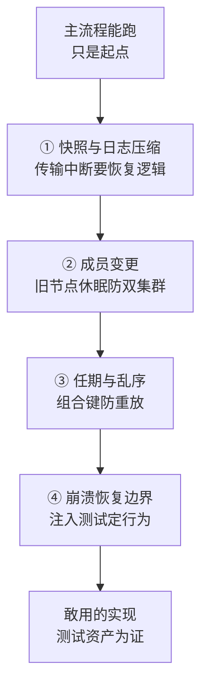

# 共识的实现深度：日志复制协议要处理平衡括号之外的事

> **要点**：实现共识的门槛**不在能跑通主流程，而在成员变更、快照安装、日志压缩、乱序消息四个"平衡括号之外"的环节**——每一环都有**与主流程独立的失败形态**；选库看的是**这些环节的实现完成度**，自建看的是**每一环的测试是否可达**。读完你可用四问清单判断**一个共识库够不够格**，用风险清单给自建项目排期。

## 背景与本质：论文主流程与工程完成度为什么差一截

平衡括号指像检查括号配对那样的形式正确性——语法对，却覆盖不到真实失败。共识实现要回答的问题是：为什么论文主流程一个周末可以写出能跑的原型，工程团队却要再花一个季度——**主流程在"消息不丢、节点不崩、成员不变"的理想环境里是完备的**，工程环境三条全不成立：消息重排（布局或尺寸变化触发重新计算排版）与重复、节点随时崩溃重启、成员动态增减。

**从"能跑"到"敢用"的距离，全部在主流程之外的环节里**：快照（某一时刻的完整只读副本）与日志压缩（日志无限增长怎么收）、成员变更（配置切换期间两套配置并存怎么仲裁）、乱序与重放的防护（旧任期的消息迟到怎么识别）、恢复时的边界（崩溃发生在切换的哪一步）。

本库后端域"Raft（一种以可理解性为设计目标的共识算法）选举与日志复制把共识推进到实现"讲过主流程的机制；本篇回答实现完成度的清单要解决的问题——**它同时是选库的检查单与自建的风险清单**，Jepsen 类黑盒（不接触代码内部、只看输入输出的测试或分析方式）测试反复证明：共识实现的问题几乎全部出在这些环节，而不是主流程。

主流程能跑只是起点，四个环节各自藏着独立的失败形态：



成员变更这一环之所以难，正因为旧节点不会主动退场：它被网络隔离后仍自认是主节点，新主选出时两侧并存。etcd（分布式键值存储，Kubernetes 用它存集群状态）文档把这种并存状态直接画了出来：


## 它是怎么做到的：四个环节的独立失败形态

打个比方：日志复制像几个人合抄一本账——光保证抄的字一样不够，还得处理"抄到一半换人"（leader 切换）、"中间撕了几页"（日志冲突）、"这一页到底算抄完没有"（提交判定）这些麻烦事。这个比喻到"实现比原理麻烦"为止：具体的任期、匹配索引、提交规则怎么设计，要看正文。


**日志被截断后，落后节点怎么靠快照安装追上？**日志无限增长不可运维，压缩（快照 + 截断日志）引入新问题——**落后节点追赶时日志已被截断，走快照安装路径（传整个状态机的快照）**；安装过程中 leader 变更、快照传输中断、快照比接收者日志还旧（接收者已经分区恢复）——**每一步都有独立的恢复逻辑**。压缩的收益是**日志存储有界、追赶走快照路径更快**，代价是**快照传输窗口内的中断恢复逻辑成为新的故障面**；上游 BookKeeper 的一个复现改进是 RocksDB 数据强制声明 formatVersion——存储格式的版本管理属于这一环的工程配套：**快照的格式版本不声明，跨版本恢复的兼容性无从判定**。

**被移除的旧节点不主动退场，怎么防止出现两个集群？**单步变更（每次只增减一个节点）是主流做法，两套配置并存的窗口被压缩到单次切换——但重启恢复时要回答"崩溃时的成员配置生效到哪一步"：**配置本身要进日志**，恢复时按日志里的配置续作，内存里的配置只是缓存**。旧节点仍在运行（被移除但没收到通知）会形成**"两个集群"**——**休眠机制（旧节点发现新 leader 后退位休眠）是必须项。

集群成员之间怎么互相知道谁活着，靠的是周期性的消息交换。Redis 集群的 gossip 协议是这套机制的现成实例：每个节点随机挑几个节点发 PING（探活消息），附带自己已知的部分集群视图，收到 PONG（对探活消息的应答）回来后双方对齐——视图里有异常的节点会被标记疑似下线，再经多数节点确认转为客观下线：


来源：小林coding《Redis 集群模式是怎么保证高可用的？》，https://www.xiaolincoding.com/redis/cluster/cluster_problem.html。共识实现里的"成员变更 + 故障检测（通过心跳与超时判定节点是否存活）"两环，在这张图上是同一套消息基础设施：MEET 承担成员加入，PING/PONG 承担存活探测。

疑似下线要变成多数派认可的客观下线，中间有一道表决流程——某个节点判断对方 PING 不通后标记 PFAIL（可能下线：集群内其他节点的初步判断），把判断随 gossip 扩散出去，半数以上主节点都标记后升级为 FAIL（确定下线：多数节点确认后的状态）：


来源：同上。单点判断升级为多数派表决，正是共识里"个体观察不可信、多数派判定才生效"的最小实现形态。

日志复制这套机制，在 RAID（冗余磁盘阵列，把多块盘组合成逻辑盘提升可靠性）阵列上有直接的实物对应：多块磁盘互为副本，任何一块掉线，阵列降级运行、数据不丢——前提是每块盘上的校验与数据块严格同步，重建盘插进来时，阵列按条带号（stripe index，磁盘按固定大小分块、轮流写入，每块即一个条带，条带号是块的编号）逐段补齐，从哪个条带续作有精确记录。崩溃恢复要的「从哪个位置续作」，正是这套条带账本回答的问题；但 RAID 没有任期与多数派投票仲裁（冲突发生时裁决谁胜出的机制），成员变更的表决仍要回到共识协议本身，比喻只到「位点（消费进度的记账标记，记录处理到哪一条）续作」为止；成员变更（加盘减盘、换大容量盘）对应 RAID 的在线扩容与重构——配置切换期间的同步窗口处理不当，两套条带布局并存就是数据丢失的开始——并存期间新旧布局都在接收写入，读取时按不同布局拼回数据，结果错位即为损坏。共识实现的恢复边界与此同构：日志条目对应条带，位点对应条带号，休眠机制对应重建期间旧盘的下线纪律。


*图源：Wikimedia Commons，en:User:Cburnett，CC BY-SA 3.0，https://commons.wikimedia.org/wiki/File:Degraded-RAID_5.png。*

**旧任期消息迟到、重复消息重放，怎么防住？**网络分区恢复后，旧任期的消息迟到——**每个消息带任期号，接收方拒绝过期货**是主流程规则；工程细节在"拒绝后怎么办"：旧 leader 收到更高任期的响应要**立即退位**，否则它在旧任期里继续服务会分裂脑（两个主节点同时对外服务、写入互相冲突，数据出现分叉）。**重放防护**（重复消息幂等：同一条消息处理多次，结果与处理一次相同）靠任期 + 索引的组合键，实现里丢掉组合键的任一半，**重复消息就破坏状态机**。

**崩溃落在两步之间时，恢复逻辑怎么定？**崩溃可以发生在任何两步之间——日志条目已追加未确认、已确认未应用、快照已写未提交，恢复逻辑对每个边界都要有**确定行为**。**测试这些边界的方法是崩溃注入**：在每两个日志操作之间随机 kill，恢复后集群一致性不变——**这个测试过不了，前面的正确性都是纸面正确**。


来源：[博客园《解密 Raft 算法》](https://www.cnblogs.com/traditional/p/12588733.html)（CC 4.0 BY-SA，下图同）


## 读完这一段你能判断什么：选库与自建的完成度检查

**选库检查单**（按四环节问问题）：快照安装的中断恢复有没有测试覆盖？成员变更支持单步还是整批？旧节点休眠有没有实现？崩溃注入测试是常规项还是没跑过？——**开源共识库在这四问上的答案差异，比主流程的性能数字重要一个量级**。

**自建的风险清单**：主流程一个月，四个环节各一个月，崩溃注入与 Jepsen 类验证再一个月——**时间预算按这个比例给**；只给主流程预算的自建项目，交付的是**能跑的原型**，敢用的实现还差四分之三。结论与前两批一致：**共识的造与买里，买是默认项**（本库软构域"购买与自建的决策框架"）。

**验证工具的优先级**：确定性模拟（Jepsen 的 porcupine 类线性一致性检查器）> 崩溃注入 > 长稳压测——**模拟器能用几百个调度序列覆盖物理环境跑不到的交错**，它是一致性验证的主力，物理压测只是补充。

## 这套说法在哪儿会失效

三条边界防止防线走形。

**一致性检查器验证的是模型不是实现**：porcupine 验证"历史线性一致"，前提是**记录的历史完整**——记录不完整的历史验证会误判，历史采集的完备性要先于检查器可信。

**性能调优不能破坏安全边界**：批量提交、流水线化、读本地副本（ReadIndex/Lease）都有安全前提（ReadIndex 的确认、Lease 的时钟假设）——**每一项优化都是一次安全前提的重新论证**，不是开关。

**成员变更的操作顺序要演练**：增减节点的命令序列、失败时的回退序列，在测试环境演练过才算具备运维能力——共识集群的运维事故多数是"顺序错了"，不是"命令错了"。

## 怎么自己动手验证

可复现的验证路径：

1. 崩溃注入：在日志操作间随机 kill 节点（自动化，每轮千次），恢复后全量对账——一致性保持为通过判据；
2. 分区演练：leader 分区、旧 leader 孤岛、多数派切换三种分区形态，预期旧 leader 退位休眠、新 leader 选举完成、不会出现双主并行写入；
3. 快照恢复验证：kill 快照安装中的传输，预期接收者回退或续作、集群一致；
4. 断言锚点：**四环节的测试覆盖在仓库里可查（崩溃注入常态跑）、成员变更演练记录在案**——共识实现的完成度**以测试资产为证，不以文档声明为证**。

```text
注入断言 = 随机崩溃后一致
分区断言 = 三形态无脑裂
快照断言 = 中断可恢复
```

共识实现的深度按四个环节丈量——选库按检查单问，自建按风险清单排期，验证以崩溃注入与模拟器为主力：**主流程之外的距离，才是工程与论文的距离**。

## 接着读哪几篇：无主复制与共识的关系

- [[工程知识/后端系统：在并发、失败与变化中维持服务/分布式可靠性/Raft选举与日志复制把共识变成工程实现]] —— 主流程机制层，本篇补实现完成度清单
- [[工程知识/数据系统：在并发与故障中保存事实/可靠性与运维/复制的三种模式：主从、多主与无主的失败形态]] —— 无主复制与共识的关系
- [[工程知识/软件构建：让变化可以理解、验证与交付/架构与代码/购买与自建的决策框架：每条约束都摆上桌面]] —— 共识组件造与买的决策框架
- [[工程知识/缺陷分析：从个案到体系/并发/并发缺陷的复现策略：压力放大与确定性调度]] —— 确定性调度与模拟验证的方法来源
