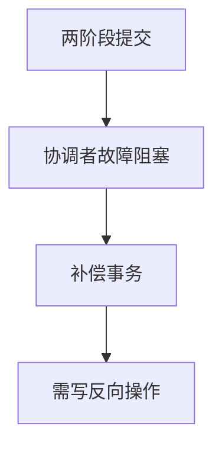
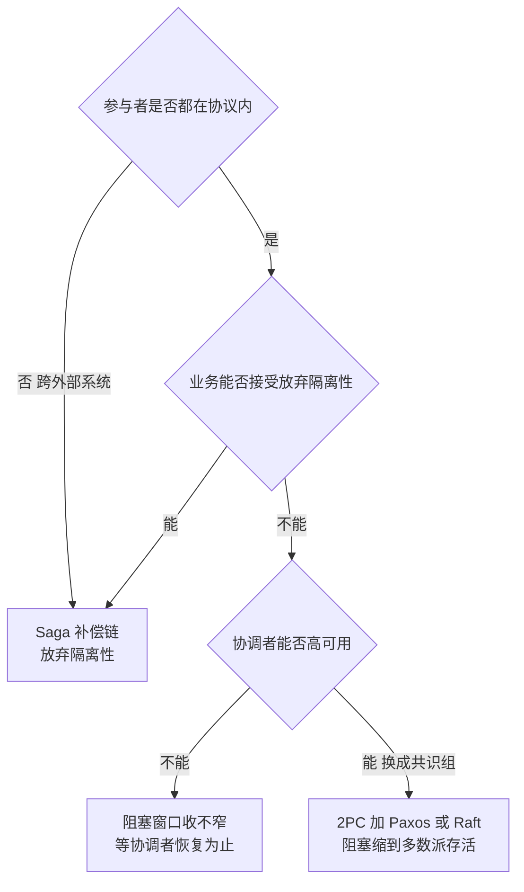

# 分布式事务的分类与各自失败形态

**单机事务失败就回滚（把系统状态退回到改动之前的版本），机器原子性由存储引擎保证**。**分布式事务把一次业务写入分散到多台机器，失败形态立刻多出几种：提交到一半网络断了、协调者（统一决定各参与者提交或回滚的中心节点）宕在决定前后、参与者准备好但永远等不到裁决**。**本篇要解决的问题，是把"分布式事务会怎么坏"按类列清楚；只有把每类失败对应到具体组件的具体状态，修复路径才有的放矢**。读完你能照**四类失败形态表定位故障在哪个组件**，并依据**三个选型问题决定用哪类事务**。

## 分布式事务有哪四类，各自怎么失败
补偿型事务里最典型的 Saga，**把长事务拆成一串本地事务，每个本地事务配一个补偿动作，失败时反向执行**。**它的失败形态集中在补偿环节——补偿自身失败时，链就停在中间态**。

**拆开之后真正决定失败形态的是编排方式**：**编排式由中央协调器依次调用各服务，失败归属清晰但协调器成了新的单点；协同式由各服务监听事件自行推进，没有中心节点但全局状态散在各处**。**两者在失败时的可见性差异，比它们在成功时的差异大得多**——**失败时编排式的协调器立刻知道卡在哪一环，协同式只能从各服务零散的事件里拼出全局状态，所以差异在失败时更明显**。

把四类事务与各自的失败形态列成表：



三类方案把失败转移到了不同位置，各自的协调结构、独有失败形态与恢复路径见下表：


| 事务类 | 协调结构 | 独有失败形态 | 恢复路径 |
| --- | --- | --- | --- |
| 2PC（两阶段提交） | 单协调者 | 协调者宕在 prepare 后：参与者锁资源无限等待（阻塞） | 协调者恢复后重放日志 |
| 3PC（三阶段提交，在准备与提交之间增加预提交阶段并靠超时推进，试图缓解阻塞） | 协调者 + 超时推进 | 网络分区下仍可能不一致（非解决阻塞的银弹） | 不一致需人工仲裁（由第三方投票打破平局、决定归属的机制） |
| Saga | 无协调者，补偿链 | 补偿自身失败：链停在中间态 | 补偿的重试与死信队列 |
| Percolator 风格（用主锁标记事务、冲突队列排队等待的跨行事务模型） | 主锁 + 冲突队列 | 锁未释放拖住后续事务（长尾延迟） | lockGC 定时清理僵尸锁 |

**2PC的阻塞失败是经典考点：单协调者宕机后没有人下达裁决，参与者只能等它恢复**。工程上的实际答案是**共识：把协调者换成 Paxos/Raft（一种共识算法，让多台机器对同一份日志的顺序达成一致）组（CockroachDB、Spanner 的做法），只要多数派存活就能继续裁决，协调者自身高可用，阻塞窗口从"协调者恢复为止"缩到"共识组多数派存活"**。Jepsen（分布式系统一致性验证工具套件，靠故障注入检验数据库声称的一致性等级）对 CockroachDB 1.1 的分析报告**展示了真实实现里因果一致性（读到的数据反映已提交操作的先后因果）与事务异常（事务被中断或发生冲突时的行为）的边界，是验证断言时的一手对照**。收益是**跨机原子性与高可用协调**；代价是**每类方案各自的失败窗口与复杂度**。

两阶段提交的报文往返与各自的等待点，用一张时序图看完整路径：

来源：Wikimedia Commons「Two-phase commit」系列时序图。这张图上是成功路径，**阻塞失败的窗口就在两个阶段之间：Prepare() 发出后、Commit() 发出前，参与者已经持有资源却还没有裁决——协调者在这段宕机，参与者只能锁着资源等**，图上「Commit 未发出的那段空白」正是「参与者锁资源无限等待」的所在。**把协调者换成共识组要缩掉的，就是这段空白的持续时间**。


来源：[CSDN @bjmayor《图解分布式事务模式》](https://bjmayor.blog.csdn.net/article/details/154004146)（CC 4.0 BY-SA，下张 Saga 正向图同）


## 读完这一段，你能判断故障落在哪个组件吗

该选哪类事务？看下面三个问题的判定顺序。
打个比方：**分布式事务像跨行转账——有的做法是先两边都冻结再一起动（2PC），有的是先扣钱再慢慢通知对方（Saga/补偿），有的是"只要你努力去做，最后总能对上"（尽力+对账）。三种各有各的坏法**——这个比喻到"坏法不同"为止：**悬挂（提交到一半却长期不结束的事务）、空补偿（原事务没实际执行，补偿却照跑了）、幂等（同一操作重复执行，结果与执行一次相同）各自怎么防，要看正文**。

**三个选型问题的判定顺序决定落到哪一类事务，也决定阻塞窗口最终能收窄到什么程度**。**其中隔离性指并发事务互不干扰、看不到彼此未完成中间状态的程度，Saga 类方案要放弃它**。



三条分支都指向 2PC 时才轮到协调者的高可用方案——最右边那条边就是共识组要缩掉的等待窗口。

**选型按三个问题走：参与者是否都在协议内（跨外部系统时 2PC 不可用）、业务能否接受放弃隔离性（能接受则 Saga 类补偿方案更合适）、协调者能否高可用（不能则阻塞窗口无法收窄）**。**三个问题都指向 2PC 时，协调者应由共识组承担，让阻塞窗口从"协调者恢复为止"缩到"多数派存活"**。

**排查失败时按失败形态表定位：参与者锁等待说明故障在协调者或共识组；链停在中间态说明故障在补偿环节，查补偿的重试与死信（多次消费失败的消息转入的兜底队列）；锁未释放拖住后续事务说明故障在锁清理，查僵尸锁回收任务**。**定位到组件之后再查该组件的状态记录——先按失败形态锁定故障组件，排查范围从全链路缩到单个组件，比从表象症状逐层猜测省去大量无效检查，快一档**。


来源：[CSDN @bjmayor《图解分布式事务模式》](https://bjmayor.blog.csdn.net/article/details/154004146)（CC 4.0 BY-SA，下张补偿图同）


## 怎么自己动手验证
```bash
# 用 Jepsen 的开源套件对支持分布式事务的数据库做故障注入
# （jepsen: https://github.com/jepsen-io/jepsen）
# 典型 nemesis：partition、kill、clock-skew
docker run -it jepsen/jepsen
# 对照检查：事务历史是否有内部一致性（奇怪读、丢失更新）
```
预期：**正常网络下 2PC 事务全部提交或全部回滚；注入分区后，正确实现表现为事务卡住或拒绝（而非既提交又回滚）**。Azure Storage 的论文给出了生产级分布式强一致事务的实现细节，包含故障注入（主动向系统注入故障来验证容错能力的测试方法）下的不变量设计。**数字对不上（出现脏读或丢失更新）说明实现存在正确性缺陷，这是 Jepsen 报告反复证实过的问题类别**。
## 这套说法在哪儿会失效
**本篇讲分布式事务的故障形态分类**。单机事务的隔离与原子性机制见 [[工程知识/数据系统：在并发与故障中保存事实/事务与存储/事务隔离决定并发读写能观察到什么|事务隔离决定并发读写能观察到什么]]。共识怎么给协调者提供高可用见 [[工程知识/后端系统：在并发、失败与变化中维持服务/分布式可靠性/Raft选举与日志复制把共识变成工程实现|Raft选举与日志复制把共识变成工程实现]]。Saga 补偿链的隔离性代价见 [[工程知识/后端系统：在并发、失败与变化中维持服务/分布式可靠性/Saga把长事务变成补偿链，代价是**失去隔离性|Saga把长事务变成补偿链]]**。部分失败的总纲见 [[工程知识/后端系统：在并发、失败与变化中维持服务/分布式可靠性/部分失败决定分布式系统的设计|部分失败决定分布式系统的设计]]。
## 接着读哪几篇
- [[工程知识/后端系统：在并发、失败与变化中维持服务/分布式可靠性/Raft选举与日志复制把共识变成工程实现]]——阻塞失败的现代答案
- [[工程知识/后端系统：在并发、失败与变化中维持服务/分布式可靠性/Saga把长事务变成补偿链，代价是**失去隔离性]]——**补偿链的失败形态**
- [[工程知识/后端系统：在并发、失败与变化中维持服务/分布式可靠性/两阶段提交的悬挂事务：协调者故障后参与者的两难与出路]]——**悬挂这一种失败形态的深挖与出路**
