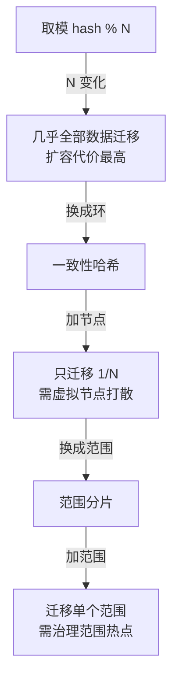
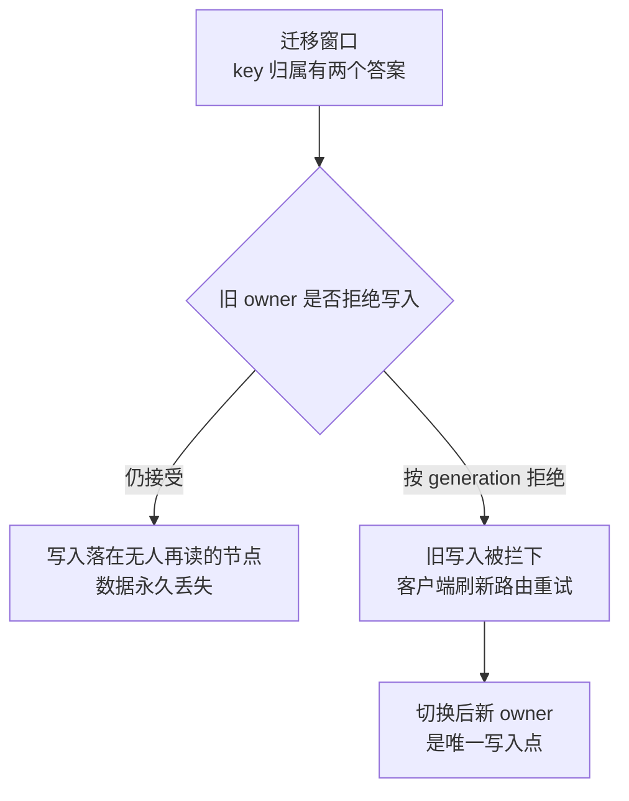
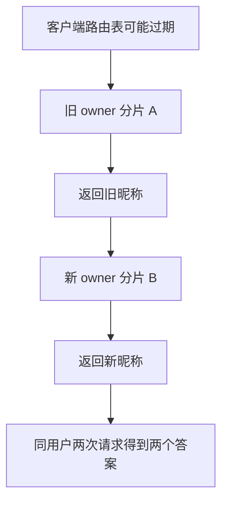

# 复制分片与再平衡改变数据归属

复制（replication）和分片（sharding）都解决"单节点不够用"，但方式相反：**复制把同一份数据放多个节点，分片把不同数据放不同节点。**读完你能判断**该加副本还是该分片**，并知道分片键选错会带来哪些不可逆的麻烦。

它们共同改变了两件事：**同一条数据"在哪"，以及"能不能看到最新版"。** 这两件事变成动态的之后，**分布式系统里大部分一致性问题都从这里长出来**——读到旧值、写了丢失、扩容期间时有时无，都出自这里。

这一页讲清楚：复制的同步/异步权衡与 Quorum（N 个副本中超过半数确认才通过）读写、分片的三种路由策略、以及**再平衡为什么是最容易出事的时刻**（数据归属在迁移期间有两个答案），并给出迁移状态机和上线前必须做的破坏性测试。再平衡会在迁移期间让同一份数据的归属出现两个答案，读完你也能判断一次扩容会不会丢数据。

| | 做法 | 解决 |
| --- | --- | --- |
| **复制** | 同一份数据放多个节点 | 读吞吐、可用性、容错 |
| **分片** | 不同数据放不同节点 | 容量、写吞吐 |

## 背景（要解决的问题）：扩容后，用户看到的数据为什么"时有时无"

一个用户服务，从 2 个分片扩到 4 个。扩容后收到投诉：

- 有的用户**刷新几次，资料时有时无**
- 有的用户**改了昵称，一半请求读到旧的**
- 日志里出现`stale routing`（路由已过期）警告，但没人当回事

排查这三个现象，发现三个问题同时存在：

| 现象 | 真因 |
| --- | --- |
| 资料时有时无 | **旧路由**：客户端缓存的分片表没更新，还在查旧节点 |
| 一半请求读到旧值 | **迁移未完成就切换了路由**，部分数据还在源节点 |
| 改了昵称没生效 | **请求被发到了旧 owner**，而旧 owner 已经不持有这份数据了 |

**根因：扩容期间，"这条数据在哪个节点"这个问题有两个答案。** 两个答案意味着**同一份写入可能同时落在新旧两个节点**——若旧节点仍接受写入，切换后它不再被任何人读取，那次写入就永久丢失；两次读也可能分别落到两个节点，**结果一新一旧**。处理不好就会出现**丢失、重复、读到旧值**。

## 复制到底解决了什么问题

打个比方：分片像把一座图书馆的书分到几个分馆——读者问哪本，先查目录知道在哪个分馆（路由）；某个分馆太挤了就要往别的馆搬书（再平衡），搬的过程中读者可能查到**"书在路上"**。这个比喻到"归属会变"为止：一致性哈希（节点增减时只迁移少量数据的分片路由）怎么算、搬迁期间怎么保证不丢读，要看正文。


### 为什么需要复制

```text
单节点：
  - 挂了就全不可用
  - 读吞吐有上限
  - 数据丢了就没了

三个副本：
  - 挂一个还有两个
  - 读可以分散
  - 数据有多份
```

### 同步还是异步：核心权衡在哪

同步复制要求主节点等所有（或多数）副本确认后才返回成功，写入路径是这样的：

```text
写请求 → 主节点 → 等所有（或多数）副本确认 → 返回成功
```

异步复制则是主节点写入后立即返回，副本靠后台追赶，写入路径是这样的：

```text
写请求 → 主节点写入 → 立即返回成功 → 后台同步给副本
```

| | 同步 | 异步 |
| --- | --- | --- |
| 数据安全性 | 高（确认了才返回） | 低（主节点挂了可能丢） |
| 写入延迟 | 高（要等副本） | 低 |
| 可用性 | 副本挂了就写不了 | 副本挂了照样写 |

生产上常见的复制配置折中方案有下面这几类：

- **MySQL（开源关系型数据库）半同步（主库等至少一个从库确认收到日志才返回）**：至少一个从库确认才返回（折中）
- **Kafka（分布式消息队列，靠日志追加支撑高吞吐订阅） `acks=all`**：所有 ISR（In-Sync Replicas，与主副本保持同步的副本集合） 副本确认
- **多数派（Quorum）**：N 个副本中 W 个确认（如 3 副本中 2 个）。像借书要找多数人核对：**读和写两边核对过的人数加起来超过总人数，两份名单必有重叠**，一定能对上最新记录

Raft（一种共识算法，让多台机器对同一份日志的顺序达成一致）论文把多数派机制的规则压缩成一张规范卡：持久状态、两个 RPC（远程过程调用，让程序像调用本地函数一样调用另一台机器上的函数）的参数与返回，以及每台服务器要遵守的五条规则，实现时逐条对照即可。


Quorum 读写的写法是这样的：

```text
N = 副本数，W = 写需要确认数，R = 读需要查询数

保证读到最新：W + R > N
例：N=3, W=2, R=2  → 2+2 > 3 ✓（读写副本必有交集）
```

### 复制会带来哪些问题

| 问题 | 说明 |
| --- | --- |
| **复制延迟** | 异步复制下从库落后（几毫秒到几秒）→ 读到旧值 |
| **主节点故障** | 要选新主，期间不可写；且可能丢未同步的数据 |
| **脑裂（集群分裂成两半各自为政的故障）** | 网络分区导致两个节点都认为自己是主 → **数据冲突** |
| **冲突解决** | 多主写入时同一条数据被改两次 → 需要版本/时间戳/业务规则解决 |

**脑裂是最危险的**：两个主都接受写入，恢复后发现数据冲突。防护手段是 **fencing token**（见 [[工程知识/后端系统：在并发、失败与变化中维持服务/分布式可靠性/租约必须配合FencingToken阻止过期持有者]]）。


来源：[CSDN @bjmayor《图解分布式事务模式》](https://bjmayor.blog.csdn.net/article/details/154004146)（CC 4.0 BY-SA）


再一处图源：[博客园《解密 Raft 算法》](https://www.cnblogs.com/traditional/p/12588733.html)（CC 4.0 BY-SA）


## 分片为什么能消掉单节点不够用的问题

### 为什么说分片键决定一切

```text
分片路由：shard_id = hash(shard_key) % shard_count
```

分片键的选择决定了下面三件事：

- 数据是否分布均匀（避免热点）
- 查询是否能路由到单个分片（避免跨片）
- 后续扩容的难度

邮政编码的分片逻辑同款：按邮编分拣，同一片区信件归同一网点（均匀、可路由）；但按"某某大厦"这种热点（访问集中在少数键或节点上的现象）收件人分，全城信件都堆到一个网点（热点），其他网点闲着。选键先问"以后按什么维度找它"——按查询维度分，跨片查询才少。

详见 [[工程知识/数据系统：在并发与故障中保存事实/事务与存储/分库分表只在单库成为瓶颈后使用]]。

### 有哪三种分片策略

哈希分片按键取模，数据分布均匀，代价是扩缩容时大量键要重新映射——再平衡的风险正来自这里。


| 策略 | 做法 | 扩容时 |
| --- | --- | --- |
| **取模** | `hash(key) % N` | N 变了几乎全部数据要迁移 |
| **一致性哈希** | 哈希环，节点负责一段范围 | 只迁移 1/N 的数据 |
| **范围分片** | 按 key 范围划分（如 A-M, N-Z） | 中等，但要处理范围热点 |

三种策略在扩容时的迁移量按阶梯排开，越往下一档迁移越少，代价移到了别处：



一致性哈希的原理是这样的：

- 把节点和数据都映射到一个哈希环上
- 数据顺时针找到的第一个节点就是它的归属
- 新增节点时，只影响环上它和前一个节点之间的数据，迁移量 = 总数据 / 节点数


*图源：DeCandia 等《Dynamo: Amazon's Highly Available Key-value Store》（SOSP 2007）Figure 2，https://web.stanford.edu/class/cs345d-01/rl/dynamo.pdf（Amazon 论文，供学习引用）。*

**实践改进**：**虚拟节点**（每个物理节点对应环上多个点），让分布更均匀。

## 再平衡为什么最容易出事

### 再平衡为什么危险

再平衡（resharding / rebalance）像搬家：旧家新家都还能进门的一段时间里，同一个人可能两个地址都收到快递，必须明确哪个地址作废。这期间会出现三类问题：

- 数据正在从 A 搬到 B
- 有的 key 已经在 B
- 有的还在 A
- 客户端的路由表（决定数据包下一跳去向的转发表）可能是旧的
- 网络可能有延迟

此时"这个 key 在哪"有两个答案**。同一个 key 的读写请求可能被路由到不同节点，**导致读到旧值或写入丢失。

旧 owner 与新 owner 同时可写的窗口里，两种收场分岔见下面这张图：



用户看到的"刷新几次资料时有时无"，根源是读路径在迁移窗口里来回落在两个节点上，且旧节点上的副本尚未失效：



时序图里的三次读取都没有报错，服务端全部返回 200——这正是这类故障难以发现的原因：它不产生错误日志，只在用户侧表现为数据不稳定**。收敛办法是在迁移窗口内让旧 owner 对已迁出的 key 明确返回重定向或按 generation 拒绝，**使读路径只有一个答案，等路由表最终一致解决不了。

### 正确的迁移状态机长什么样

```text
1. 准备：目标节点 B 就绪，但还不接收流量
2. 复制：B 开始从 A 同步数据（A 继续服务）
3. 追赶：B 追上 A 的增量（此时 A 的写入持续同步给 B）
4. 校验：比对 A 和 B 的数据（checksum，即校验和 / 行数）
5. 切换：路由切到 B，A 对这批 key **拒绝写入**
6. 清理：确认无流量后，A 删除这批数据
```

  **关键是第 5 步**：切换后旧 owner 必须**拒绝**这批 key 的写入。如果旧 owner 还接受写入，那些写入会**永久丢失**（因为没人再从它读）。搬家的手续是同一个次序：新家先备好（就绪）、东西分批搬（复制）、补搬零碎（追赶）、清点两处数量（校验）、然后地址簿改新址、旧门牌作废（切换），最后旧屋清空（清理）——地址没改完前旧屋还收快递（旧 owner 还接受写入），**收下的件永远没人取**。

**实现手段：fencing token / generation 号**

```go
func (n *Node) Write(key string, val []byte, gen int64) error {
    if gen < n.currentGen(key) {
        return ErrStaleRouter    // 路由版本过旧，拒绝
    }
    ...
}
```

### 路由怎么版本化

客户端与代理缓存的路由表必须有版本号，机制如下：

- 请求带上：routing_version = 42
- 节点发现：当前是 43
- 返回 ErrStaleRouting（路由已过期错误，客户端据此重新拉取路由表）+ 新路由表
- 客户端刷新后重试

**没有版本化的后果**：旧路由把请求发到错误的节点，而那个节点可能已经不持有数据了（数据丢失）。车载导航的地图更新是同一机制：路口封了，旧地图还往那儿指（旧路由），车到了才发现路没了（请求打到已无数据的节点）——导航提示"地图版本过旧，请更新"（ErrStaleRouting + 新路由表）再重算路线（刷新后重试），是唯一靠得住的走法。

### 迁移期的读写策略怎么定

地理分片是另一种切法：按地域划分，数据与访问来源就近，跨区访问变慢。迁移期旧分片和新分片同时在线时，客户端该查哪个，取决于它拿到的路由版本号。


*图源：Microsoft Learn 中文文档，CC BY 4.0，https://learn.microsoft.com/zh-cn/azure/architecture/patterns/sharding。*


| 阶段 | 读 | 写 |
| --- | --- | --- |
| 复制中 | 从 A 读 | 写 A（同步给 B） |
| 校验完成 | 从 A 读 | 写 A（同步给 B） |
| 切换瞬间 | **短暂不可用**或双读 | **短暂拒绝** |
| 切换后 | 从 B 读 | 写 B（A 拒绝） |

切换瞬间有两种处理路径，按从简单到平滑排列：

- 最简单：**短暂拒绝**（毫秒到秒级），客户端重试
- 更平滑：**双写（迁移期间同一份数据同时写入新旧两个存储） + 双读**，确认一致后停掉一边

## 生产怎么用

### 容量怎么规划

```text
需要容量 = 数据总量 × (1 + 增长预期) × 副本数
分片数 = 需要容量 / 单分片建议容量

单分片建议：
  - 关系型数据库：2-5 TB 以内
  - Kafka 分区：考虑吞吐，通常每分区 < 10 MB/s
```

**留余量**：容量按 1-2 年后的数据量算，当前数据量只作参考。仓库按明年进货量扩建是同一笔账：按今年库存量建的库，明年货一多就得二次搬迁——**搬迁的工夫比当初多建一排货架贵得多**（扩容再平衡的风险正来自"当时算小了"）。

### 有哪些避免热点的手段

| 手段 | 做法 |
| --- | --- |
| **加盐** | 在 key 前加随机前缀打散（但查询时要查所有分片） |
| **复合键** | `shard_key = hash(user_id) + 时间戳` |
| **单独处理大客户** | 超大租户单独一个分片 |
| **读热点用副本** | 加副本分散读（**不能解决写热点**） |

**写热点只能靠分开 key**，读热点可以靠加副本——副本复制的是同一份数据，写入仍全部打到持有该 key 的那个分片，加副本分散不了写。商场洗手间是现成的对照：女厕排长队（读热点），把保洁间改成第二间女厕（加副本）就能分流；收银台前排长队（写热点），多开几个收银口（分开 key）才有用——在每个收银口旁边摆更多购物篮（副本）一分摊不了收银这个动作。

### 监控要盯住哪些量

| 指标 | 异常含义 |
| --- | --- |
| 各分片数据量 | 倾斜（某个分片明显大） |
| 各分片 QPS | 热点 |
| 复制延迟 | 从库落后（影响读到新值） |
| 迁移进度 | 卡住了 |
| 路由版本分布 | 有客户端还在用旧路由 |
| 跨片查询比例 | 分片键选得不好 |

## 验证：怎么测

再平衡的破坏性测试（上线前必做）按下面的场景做：

```text
1. 造一个热点分片，数据量 100GB
2. 开始迁移到新节点
3. 在以下时刻分别杀进程 / 断网：
   a. 复制进行中（50%）
   b. 校验刚完成
   c. 切换瞬间
   d. 清理阶段
4. 每次检查：
   - 有没有数据丢失？
   - 有没有重复？
   - 读到的版本对不对？
   - 旧 owner 是否拒绝了写入？
   - 回滚要多久？
```

**没有做过这些测试，"支持在线扩容"这句话是不可信的。**

## 有哪些常见错误

**错误 1：迁移未完成就切路由**

读到空/旧值。**必须有校验阶段 + 校验通过才切换。**

**错误 2：切换后旧 owner 仍接受写入**

**这些写入会永久丢失。** 必须用 generation/fencing 拒绝。

**错误 3：路由表没有版本**

客户端用旧路由 → 请求发到错误节点。**必须版本化 + 主动失效。**

**错误 4：以为加副本能解决写热点**

副本只能分散读。**写热点必须分开 key。**

**错误 5：取模分片**

扩容时几乎全部数据要迁移。**用一致性哈希或预分片。**

**错误 6：不看复制延迟（从库同步速度落后于主库、读到旧数据的时间差）就做读写分离（写入走主库、查询走从库的架构）**

延迟 5 秒时读从库 → **用户刚提交的数据看不到**。**要监控延迟并做写后读一致性**（写入后，该用户的读请求强制走主库或等从库追上，保证读到刚写的版本）。

**错误 7：不测故障就上再平衡**

出问题时不知道会不会丢数据。**必须做破坏性测试。**

关系：[[工程知识/后端系统：在并发、失败与变化中维持服务/分布式可靠性/一致性模型与共识解决不同问题]] · [[工程知识/后端系统：在并发、失败与变化中维持服务/分布式可靠性/租约必须配合FencingToken阻止过期持有者]] · [[工程知识/数据系统：在并发与故障中保存事实/事务与存储/分库分表只在单库成为瓶颈后使用]]

## 这套说法在哪些地方会失效

再平衡不改变键到值的业务语义：迁移只搬归属。迁移窗口内，业务读写的键路由可能出现新旧视图短暂不一致**，此时要按快照（某一时刻的完整只读副本）与租约纪律处理——快照指在某一个确定时刻抓取的数据状态，租约纪律指节点只在持有租约（一份带过期的所有权凭证）期间才对外提供服务。再平衡是容量操作，**不承担正确性修复，正确性问题走数据修复路径。

