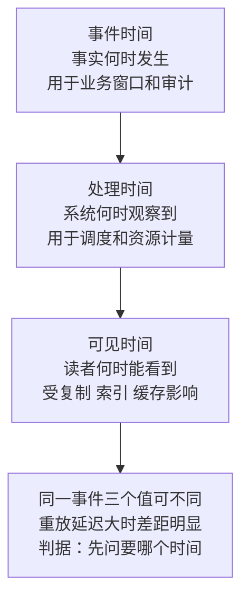
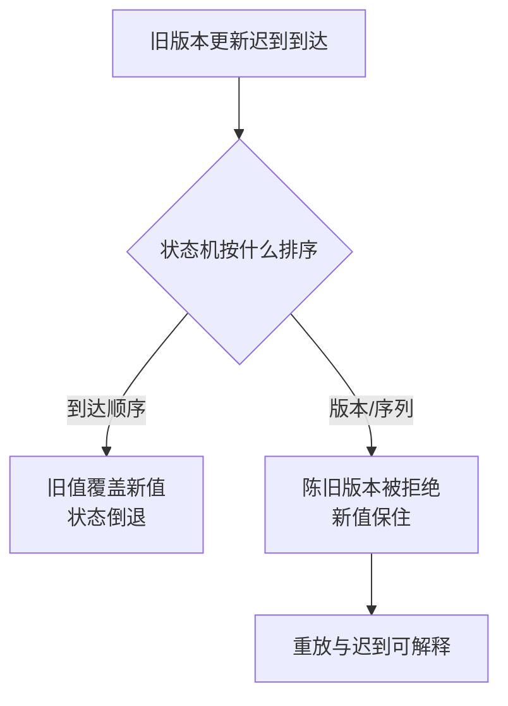
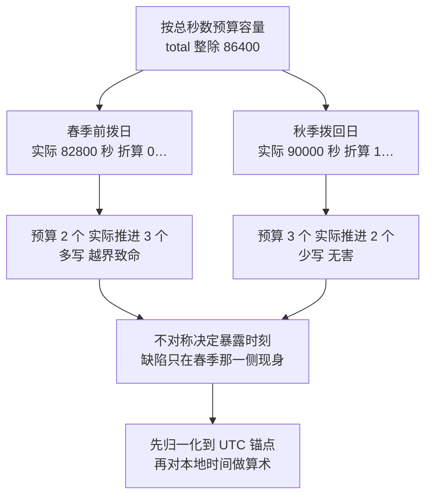

# 时间顺序与因果必须显式建模

**本文讲时间顺序与因果为什么必须显式建模：把到达顺序误当发生顺序，会导致新状态被旧状态覆盖、聚合结果出错、同一条消息被重复执行**。**做法是为业务事实携带事件时间（事实发生的时刻）、版本、序列或逻辑时钟（用计数表达先后顺序的机制），并让状态机（按规则校验并拒绝非法状态变更的程序）拒绝陈旧更新**；**效果是重放、迟到和跨节点比较可解释，代价是元数据、存储和冲突处理增加**。**通过时钟回拨、乱序、重复和重放测试验证不变量**。读完你能**给业务事实带上事件时间与版本，让状态机挡住迟到与乱序的更新**。

**分布式节点的墙上时钟会漂移、跳变和不同步；消息到达顺序不等于事件发生顺序，也不等于因果顺序**。**业务若依赖「最新」「先发生」「只处理一次」，必须携带版本、序列、逻辑时钟或状态条件**。**因为漂移让不同机器的「现在」不再可比，单靠时间戳无法判定谁先发生，所以要把可比较的顺序信息随数据一起带过去**。

## 要解决的问题：业务事实需要携带哪些时间与顺序信息

**把消息到达的顺序当成事件发生的顺序，导致新状态被旧状态覆盖、聚合结果错误、同一条消息被重复执行**。**本篇回答：业务事实需要携带哪些时间与顺序信息、逻辑时钟与序列号各自解决什么、状态机怎样拒绝过期更新，以及重放与迟到消息怎样处理。**

## 为什么到达顺序不能当发生顺序：机制与本质

先用一个比喻建立顺序直觉——比喻只帮到建立直觉这一步：**分布式系统里的事件像网购包裹——下单（发生）、揽收、到站、派送、签收（到达）是五件事，快递延误时后买的可能先到**。**系统只看见"签收"这一刻，如果拿签收顺序当购买顺序，账就会记反**。

**墙上时钟会漂移、跳变、互相不同步，消息的到达顺序由网络路径决定，两者都无法表达事实发生的先后**。**业务状态依赖"最新"或"先发生"时，判定要建立在一个单调、可比较的顺序标记上**；事件时间、版本号与逻辑时钟各自覆盖不同范围的顺序，**选定哪一种决定了重放、迟到与跨节点比较能不能被解释清楚**。

这个比喻只用来建立顺序直觉，到"顺序标记"为止——**包裹场景里翻购物记录就能还原真相，分布式系统里每个节点只看见自己收到的部分，还原先后要靠随消息携带的版本或时钟元数据，这正是"显式建模"四个字的含义**。


## 三种时间分别回答哪些问题

三种时间像一份外卖的三个时刻：做菜时间对应事件时间，骑手取餐扫码的时间对应处理时间，你看到送达的时间对应可见时间——同一个订单，三个时刻各不相同。

- **事件时间**：事实发生的时间，适合业务窗口和审计。
- **处理时间**：系统观察到的时间，适合调度和资源计量。
- **可见时间**：数据对某个读者可见的时间，受复制、索引和缓存影响。

**三种时间回答的是三个不同的问题，混用会让顺序判断失去依据**。**比较「谁先发生」时最常被拿来当裁判的是墙上时钟，而墙上时钟的可比性是被分发出来的**：UTC（协调世界时，全球统一的时间基准）从权威钟源出发，经 Stratum 1/2/3 层层同步（Stratum 是时钟层级，数字越小越接近权威源，越大误差越大），越往下误差越大，层内服务器还互相对拍纠偏：


*图源：[华为《什么是NTP?NTP如何实现时钟同步?》官方百科](https://info.support.huawei.com/info-finder/encyclopedia/zh/NTP.html)。层级数字越小越接近权威源，Stratum 16 表示未同步不可用——两台机器的「现在」是否可比，取决于它们挂在这棵树的多深。*



**Lamport 时钟（一种用计数表达先后顺序的逻辑时钟）与向量时钟（为每个节点维护一个计数向量以判定因果与并发的逻辑时钟）表达的是部分因果，能说清"谁可能影响了谁"，推不出全局先后**，**因为不同进程没有共同时间基准，两个不相关的事件无法比较先后**。**窗口统计需要全局统一的时间刻度，"最后写入者胜"需要一个所有人都认的全局排序，部分因果只提供局部先后，两者都满足不了，所以不能拿它做窗口统计，也不能拿它做"最后写入者胜"**。**数据库自增 ID、Kafka offset（分布式消息队列 Kafka 中、消息在分区里的序号）、UUID（通用唯一标识符，随机生成的 ID）和时间戳各自覆盖不同范围的顺序，同样不能混用**。

下图是逻辑时钟的工作方式：三个进程各自维护计数器，事件发生时计数加一，消息携带发送方的计数，接收方取「本地计数与消息计数较大者加一」，于是「先发生」在计数上永远成立：


*Lamport 逻辑时钟：消息携带发送时刻的计数，接收方按取较大者加一的规则更新本地计数，因果先后在计数上保持（图源：Yang Blog「计算机的时钟」）*

**计数只保证「先发生的事件不会得到更大的数」这一方向性，不保证两个计数相近的事件有因果联系——这正是部分因果的边界**。

向量时钟用来判定哪些事件是并发的：**每个进程维护一个覆盖全部进程的计数向量，本地事件给自己的分量加一，收到的消息携带发送方的整个向量，接收方逐分量取最大值再自增**。这张三进程示例里，P1 的 [2,0,0] 随消息到达 P2 合并成 [2,1,0]，再经 P2 传到 P3 与本地 [0,0,1] 合并成 [2,2,2]——**两个事件的向量互相不可比较时就是并发，因果与并发从此都能判定**：

![向量时钟示例：三个进程各自维护计数向量，本地事件自增自身分量，消息携带发送方向量，接收方逐分量取最大值再自增，P1 的 [2,0,0] 经 P2 传到 P3 合并为 [2,2,2]](/static/figures/vector-clock.jpg)

*图源：普林斯顿大学 COS418 分布式系统课程讲义（Vector Clocks，CC BY-NC-SA 3.0），https://www.cs.princeton.edu/courses/archive/fall19/cos418/docs/L5-vc.pptx。*

## 状态机怎样拒绝陈旧更新？

**先定义哪些事件可以并发合并，哪些必须拒绝陈旧版本，再选择时间戳、单调序列、CAS（Compare-And-Swap，比较并交换，一种原子更新操作）或逻辑时钟**。**墙上时钟适合展示和窗口统计，却不能单独决定「最后写入者」；offset 只能表达某个分区的消费位置，也不能证明跨分区因果**。

同一条迟到旧更新，排序规则不同结局相反，对照见下图：



**最小实验：让两台时钟相差数秒，交错发送同一实体的更新，并重复/延迟其中一条；分别用到达时间、事件版本和因果标记排序**。**检查最终状态、重放结果和审计解释是否一致，确认排序规则确实覆盖业务不变量**（任何时候都必须成立的条件）。

## 为什么一天不总是 24 小时

墙上时钟的非线性不是理论风险，它每年在启用夏令时的时区里发生两次。以柏林为例（2024 年，UTC 锚点计算）：

| 日期 | 实际秒数 | 小时 | 按 86400 折算 |
| --- | --- | --- | --- |
| 2024-03-30（普通日） | 86400 | 24 | 1.0000 天 |
| 2024-03-31（春季前拨） | 82800 | 23 | 0.9583 天 |
| 2024-10-27（秋季拨回） | 90000 | 25 | 1.0417 天 |

**任何按"总秒数 ÷ 86400"预算容量、再按步长逐个填充的代码，都会在前拨日撞上这个缺口**。下面这段能直接复现越界：

```python
import datetime, zoneinfo

tz = zoneinfo.ZoneInfo("Europe/Berlin")

def utc(dt):
    return dt.astimezone(datetime.timezone.utc)

start = datetime.datetime(2024, 3, 30, 0, 0, tzinfo=tz)
end = datetime.datetime(2024, 4, 2, 0, 0, tzinfo=tz)

total = (utc(end) - utc(start)).total_seconds()   # 255600.0
budget = int(total // 86400)                       # 预算 2 个元素

n, cur = 0, start
while cur < end:                                   # 逐日推进
    n += 1
    cur = datetime.datetime.combine(
        (cur + datetime.timedelta(days=1)).date(),
        datetime.time(0, 0), tzinfo=tz)

print(budget, n)   # 2 3 —— 预算 2 个，实际 3 个，越界
```

预算 2 个，实际推进 3 个。**秋季拨回方向相反（实际少于预算），少写无害、多写致命**。**秋季少写只是容量算多、不会越界；春季多写才触发数组越界，所以只有春季一侧会让缺陷现身**。


同一段代码在两个切换日上结果相反，而只有一侧会致命——两侧并排才看得出这个不对称：



**不对称解释了这类缺陷的潜伏期：秋季那侧不报错，问题于是被留到下一个春季；归一化到 UTC 锚点是对两侧都成立的唯一入口**。

直接对两个带 `tzinfo` 的本地时间做减法会得到 86400 秒的"正确"答案：**`(b - a)` 在同一 tzinfo 下抵消了偏移，转换到 UTC 锚点后才显现真实的 82800 秒**。**对本地时间做算术之前先归一化**，这句话的具体含义就在这里。

## 失效时长什么样

[[工程知识/缺陷分析：从个案到体系/稳定性/案例二十二：时间也是输入——夏令时让序列生成越界]] 是这套规则被违反的直接现场：Spark（分布式计算引擎，靠内存计算加速大规模数据处理）的 `sequence()` 按总秒数预算数组容量、按步长逐个填充，**在春季前拨日多写出一个元素，数组越界、查询失败**。**缺陷不在时间字段的解析上，而在把时间当算术常数——"一天 24 小时"这个前提在切换日失效**。

**同类断裂出现在按天聚合的窗口边界、定时任务的"每天 2 点"、证书（CA 签发的公钥凭证、证明持有者身份）与租期的到期计算上**。**它们的共同点是：时间出现在计算的输入位置，却没被当作需要边界检查的输入**。

[[工程知识/缺陷分析：从个案到体系/正确性/案例十：类型说谎时——静默删数据的 TTL 与算错的比较]] 从另一个方向说明同一件事：TTL（生存时间，到期自动删除的机制）与比较运算在类型与语义不匹配时静默删数据，**被破坏的对象是"谁算旧"的判定规则**。**排序规则一旦选错，删除与保留会整体反转**。

## 这套说法在哪儿会失效

这套做法的前提是**事件可以携带可信的事件时间或版本**。**在以下情况需要换手段**：**写入方时钟不可信且无法校时**（**改用服务端单调序列而非客户端时间戳**）；**只有单副本且无重放需求**（**墙上时钟足够，不必引入向量时钟**）；以及**因果关系本身无法由数据表达**（**此时应由业务规则显式声明冲突处理**，见 [[工程知识/后端系统：在并发、失败与变化中维持服务/分布式可靠性/一致性模型与共识解决不同问题]]）。

**逻辑时钟表达部分因果，不能推出全局先后。它不能替代真实时间做窗口统计，也不能替代全局排序做"最后写入者胜"**。

## 怎么自己动手验证

**因果结论要与时钟注入对账——预写时钟回拨后状态机应拒绝旧版本、窗口修正正确，实测旧值覆盖了新值，与预期对不上**。

**测试时钟回拨、时区/DST（夏令时）、NTP（网络时间协议，用来校准机器时钟）不可用、消息乱序/重复、跨分区事件和重放；检查状态机拒绝旧版本、窗口正确修正、缓存不过期覆盖新值、RAG（检索增强生成，先检索资料再让模型作答）检索内容的鲜度（数据的新鲜程度）和审计时间可解释**。

关系：[[工程知识/缺陷分析：从个案到体系/稳定性/案例二十二：时间也是输入——夏令时让序列生成越界]] · [[工程知识/缺陷分析：从个案到体系/正确性/案例十：类型说谎时——静默删数据的 TTL 与算错的比较]]

- [[工程知识/后端系统：在并发、失败与变化中维持服务/分布式可靠性/一致性模型与共识解决不同问题]] —— 顺序之上的一致性归属
- [[工程知识/后端系统：在并发、失败与变化中维持服务/分布式可靠性/消息投递与业务提交需要显式的一致性边界]] —— 顺序标记与提交时点的关系
- [[工程知识/后端系统：在并发、失败与变化中维持服务/分布式可靠性/租约必须配合FencingToken阻止过期持有者]] —— 时间驱动的持有权失效
- [[工程知识/数据系统：在并发与故障中保存事实/数据管道与流处理/CDC把数据库变化传播为可重放事实]] —— 事件时间在生产中的体现
- [[工程知识/软件构建：让变化可以理解、验证与交付/算法与数据结构/算法复杂度连接规模与资源成本]] —— 预算与实际用量失配的通用形态
- [[工程知识/后端系统：在并发、失败与变化中维持服务/分布式可靠性/电源与时钟：UTC与单调钟的工程含义.md]] —— 时间戳不等于因果的完整论证

