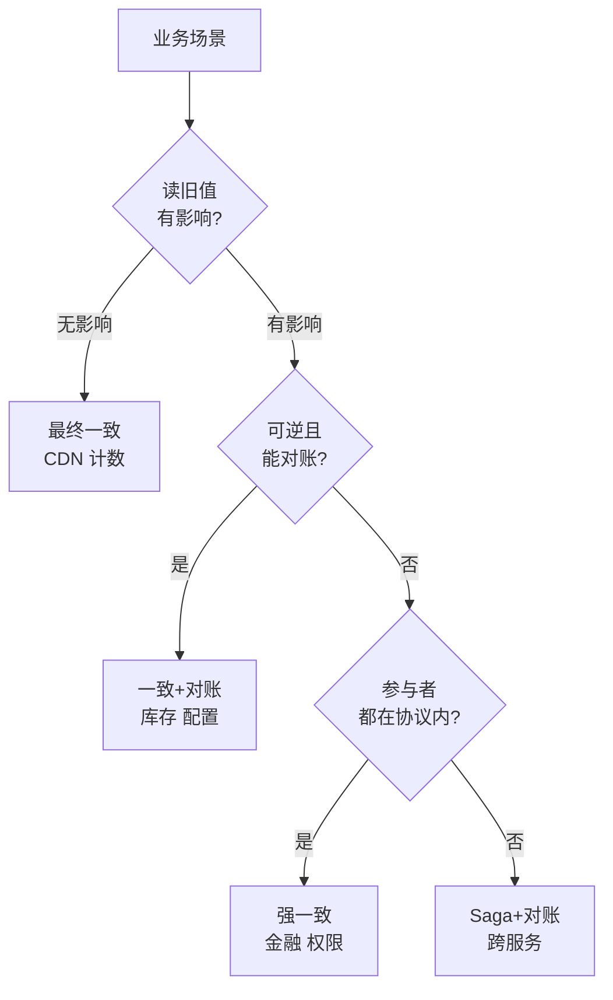

# 最终一致性的工程边界——什么时候可以接受不一致

最终一致性在实践中被广泛使用，但"最终"到底有多久、不一致窗口内会发生什么、哪些场景可以接受哪些不能，**很少有清晰的工程边界**。本文给出一个判定框架，读完你能判断自己的场景**是否适合最终一致性**，并知道如何量化不一致窗口带来的风险。

## 最终一致性承诺了什么、没承诺什么

最终一致性承诺：**如果没有新写入，所有副本最终会收敛到相同的值**。但它**没有承诺**：

- **多久收敛**：可能是毫秒，也可能是分钟
- **收敛顺序**：不同副本可能以不同顺序到达最终状态
- **中间状态**：收敛过程中可能读到任何值（旧值、新值、甚至不存在的值）
- **单调性**：同一个客户端连续读可能先看到新值再看到旧值，出现回滚（把系统恢复到上一个可用版本）现象

这些"没承诺"的边界，就是工程上需要评估的风险。

## 判定框架：四个问题决定是否适合最终一致性

### 问题1：不一致窗口内，读到的旧值会造成什么后果？

这是最关键的判定。按后果严重程度分级：

| 级别 | 后果 | 例子 | 适合最终一致？ |
| --- | --- | --- | --- |
| L0 | 无影响 | 用户头像CDN（Content Delivery Network，内容分发网络：把内容提前放到离用户近的节点）缓存 | 适合 |
| L1 | 体验降级（压力过大时关闭次要功能，保住主流程）但可恢复 | 文章点赞数短暂不准 | 适合 |
| L2 | 业务错误但可对账修复 | 库存短暂超卖 | 谨慎（需兜底） |
| L3 | 不可逆的损失 | 扣款重复、权限越权 | 不适合 |

**判定规则**：如果L2及以上场景出现频率高且无法兜底，放弃最终一致性。

### 问题2：不一致窗口能控制在什么范围？

最终一致性的"最终"**不是无限期**。工程上可以控制窗口大小：

| 控制手段 | 典型窗口 | 代价 |
| --- | --- | --- |
| 同步复制 | 0（强一致） | 延迟高、可用性降 |
| 半同步复制 | 1-10ms | 延迟中 |
| 异步复制（同机房） | 10-100ms | 延迟低 |
| 异步复制（跨机房） | 100ms-数秒 | 延迟低 |
| 异步复制（跨洲） | 数秒-分钟 | 延迟低 |

**判定规则**：如果业务能接受的最大不一致窗口小于实际窗口，**需要改用更强的一致性模型**。

### 问题3：不一致窗口内，系统行为是否可预测？

即使接受最终一致，也需要知道不一致窗口内系统会怎么表现：

- **读旧值**：从库延迟导致读到旧数据
- **读不到新值**：写入主库后立即读从库，返回旧值
- **单调读违反**：先读从库（新值），再读另一个从库（旧值）
- **因果违反**：先看到回复，后看到原帖

**判定规则**：如果不可预测的行为会导致业务逻辑错误，如基于旧值做决策，**就需要增加约束，例如写后读一致性**。

### 问题4：有没有兜底机制？

**最终一致性的安全网是对账**。如果对账能在可接受时间内发现并修复不一致，**就可以接受更大的不一致窗口**。

| 兜底机制 | 发现时间 | 修复能力 |
| --- | --- | --- |
| 实时对账（秒级） | 秒级 | 自动修复 |
| 定期对账（小时级） | 小时级 | 自动修复 |
| 每日对账 | 天级 | 人工介入 |
| 无对账 | 永远 | 无 |

**判定规则**：**没有对账兜底的最终一致性，只适用于L0级别场景**。

## 典型场景的判定结果

八个典型场景按上面四问逐一过堂，结果汇总如下（问题 1-4 依次对应影响等级、窗口可控性、可预测性、兜底机制）：

| 场景 | 冲击（问题1） | 窗口（问题2） | 可预测（问题3） | 兜底（问题4） | 判定 |
| --- | --- | --- | --- | --- | --- |
| 内容分发（CDN） | 头像/静态资源旧值无影响（L0） | CDN 缓存 TTL（Time To Live，存活时间：到期后自动失效或删除） 可控 | 可预测（TTL 内不变） | 可以无对账 | 适合 |
| 非关键计数器（点赞、阅读量） | 短暂不准不影响业务（L1） | 秒级收敛 | 可预测（最终收敛） | 可加对账 | 适合 |
| 搜索引擎索引 | 新内容延迟几秒可见可接受（L1） | 分钟级收敛 | 可预测（最终一致） | 全量重建兜底 | 适合 |
| 库存扣减 | 超卖导致订单取消（L2） | 窗口不可控（取决于复制延迟） | 不可预测（读从库可能见旧库存） | 可对账修复 | 条件更新+对账兜底 |
| 用户配置更新 | 改配置后立即见旧值（L1-L2） | 窗口不可控 | 可预测（写后读一致性可解决） | 可加对账 | 需要写后读一致性 |
| 金融交易（扣款、转账） | 重复扣款不可逆（L3） | 任何窗口都不可接受 | 不可预测 | 对账发现时已造成损失 | 强一致 |
| 权限控制 | 越权访问（L3） | 任何窗口都不可接受 | 不可预测 | 对账发现时已发生越权 | 强一致 |
| 分布式锁 | 锁冲突导致数据损坏（L3） | 任何窗口都不可接受 | 不可预测 | 无有效兜底 | 共识 |

这张表的用法是**核对而非背记**：拿业务的真实场景逐列对照，预期（该场景判在哪一格）与验证实测（对账与监控测出的真实不一致窗口）对不上时，**升级一致性等级或补对账**，两个方向的偏差都要处理。

## 工程实践：如何在不一致窗口内保护业务

### 写后读一致性（Read-your-writes）

最常见的折中方案：允许最终一致，**但保证客户端能读到自己的写入**。实现走三步：
```text
1. 客户端写入时记录写入时间戳或版本号
2. 读请求携带该版本号
3. 如果从库版本落后，等待或读主库
```

代价：客户端需要维护版本状态，读延迟可能增加。

### 单调读一致性（Monotonic Read）

保证同一个客户端不会读到"倒退"的值。实现走三步：
```text
1. 客户端记录上次读到的最小版本号
2. 后续读请求只访问版本不低于该值的副本
3. 如果当前副本版本落后，重试或切换副本
```

代价：客户端需要维护读状态，副本切换逻辑变复杂。

### 条件更新（Compare-and-Swap）

用原子操作（不可分割、要么全做要么不做的操作）替代"先查后写"，避免不一致窗口内的并发问题：

```text
-- 错误：先查后写
SELECT qty FROM stock WHERE id=1;  -- 读到旧值
UPDATE stock SET qty=qty-1 WHERE id=1;

-- 正确：条件更新
UPDATE stock SET qty=qty-1 WHERE id=1 AND qty>=1;
```

### 对账兜底

**对账是最终一致性的最后防线**。设计原则：

1. **对账频率**：根据不一致窗口和业务风险确定
2. **对账范围**：覆盖所有关键数据
3. **修复策略**：自动修复优先，人工介入兜底
4. **告警机制**：对账发现不一致时及时告警

## 最终一致性与强一致的选型决策树



## 案例回流：不一致窗口里的两个实录

[[工程知识/缺陷分析：从个案到体系/正确性/案例三十：中间缺了一块——跨地域复制的 ack 空洞]] 是最终一致的反面教材：复制链路出现 ack 空洞且没有对账机制发现它，**「最终」一致永远没有到达**——**不一致窗口无限延长的系统不能再叫最终一致**。它印证本篇边界一节：选最终一致的前提是**收敛确实会发生且可被验证**，对账（定期比对两侧数据找差异的机制）是**验证收敛的最低配置**。语义混淆的形态见 [[工程知识/缺陷分析：从个案到体系/正确性/案例二十九：离开的人还占着座位——机架信息的陈旧映射.md]]：节点下线后映射表没更新，调度继续按陈旧拓扑决策——陈旧数据被当成新鲜数据使用，正是本篇**「读旧数据做错误决策」**失效模式的实例。两案共同判据：接受最终一致的业务，**必须回答「不一致窗口内哪些读会发生、错了怎么办」**，答不出这两问的场景要回到强一致。

## 与相邻概念的关系

- [[工程知识/后端系统：在并发、失败与变化中维持服务/分布式可靠性/一致性模型与共识解决不同问题]]：一致性模型的完整分类，本文是其中最终一致性的专项展开
- [[工程知识/后端系统：在并发、失败与变化中维持服务/分布式可靠性/分布式事务的分类与各自失败形态]]：跨服务一致性的实现方案
- [[工程知识/后端系统：在并发、失败与变化中维持服务/分布式可靠性/消息投递与业务提交需要显式的一致性边界]]：消息系统的一致性边界
- [[工程知识/后端系统：在并发、失败与变化中维持服务/分布式可靠性/部分失败决定分布式系统的设计]]：分布式系统设计的总纲
- [[工程知识/后端系统：在并发、失败与变化中维持服务/分布式可靠性/超时、重试与幂等共同定义调用语义]]：重试与幂等（同一操作执行多次与执行一次效果相同）对一致性的影响
