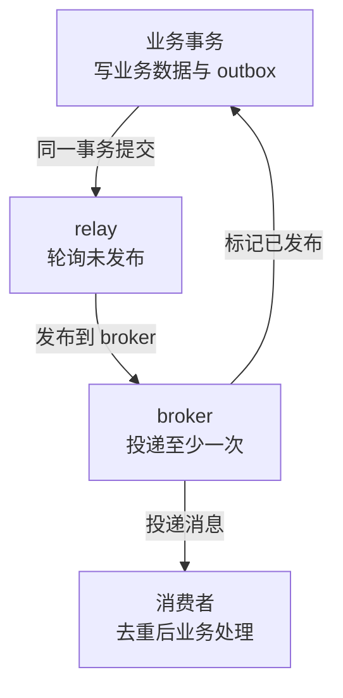
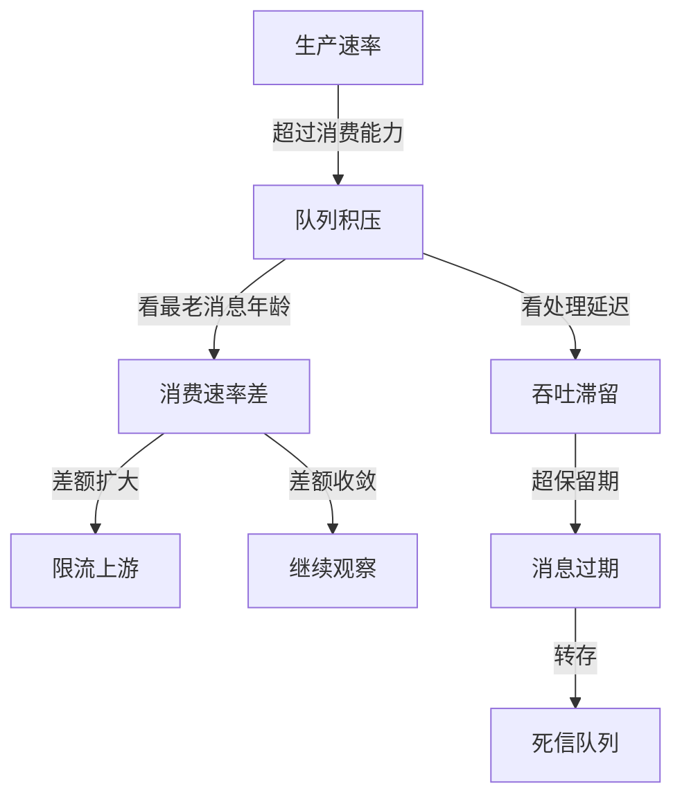

# 消息投递与业务提交需要显式的一致性边界

**写数据库**和**发消息**是两个独立的系统，**无法放在同一个事务里**。但这个"缝隙"会导致：库里有了、消息没发（下游永远不知道），或者消息发了、库里回滚（把系统状态退回到改动之前的版本）了（下游看到了不存在的事实）。

这一页讲怎么处理这个缝隙：Transactional Outbox（把待发消息和业务数据写进同一个数据库事务）模式、投递语义的真实边界、以及为什么"恰好一次"在跨系统时是个伪承诺。读完你能判断自己的双写（迁移期间同一份数据同时写入新旧两个存储）代码**会在哪一步丢消息或产生幽灵订单**，并照着实现 Transactional Outbox 与消费端幂等（同一操作执行多次与执行一次效果相同）。

## 要解决的问题：这类不一致以哪些形态出现

写数据库与发消息分属两个系统，无法放进同一个事务，于是出现库里已有而消息未发出，或者消息已发出而数据库回滚，两侧就此长期不一致。本篇回答：这类不一致以哪些形态出现、可用哪些手段让两侧的提交结果一致、每一种手段留下了什么中间状态，以及出现重复投递时业务侧怎样处理。


*图源：Apache Pulsar 官方文档架构概览页。*

## 这件事发生在什么场景：那个"已付款但没发货"的订单

打个比方：把消息投递和业务提交想成"寄快递"和"银行扣款"——快递公司保证送到，银行保证扣对，但"送到了没扣钱"或"扣了钱没送到"这两件事，任何一方都不替另一方负责，得你自己设计一个对账的办法把它们绑在一起。这个比喻到"为什么需要显式边界"为止：至少一次与恰好一次怎么实现、幂等键怎么设、对账表怎么建，要看正文，比喻只说明"两家不互相担保"。

一个电商系统，支付成功后发消息通知仓库发货。

直觉的写法是把两步直接串在一个函数里：

```go
func Pay(orderID string) error {
    if err := db.Exec("UPDATE orders SET status='paid' WHERE id=?", orderID); err != nil {
        return err
    }
    return mq.Publish("order.paid", orderID)     // ← 这里
}
```

看起来没问题。**但每个月都会出现几笔"已付款、未发货"的订单**，用户投诉后人工补发。

排查这三种失败按下面的表对照：

| 顺序 | 失败点 | 结果 |
| --- | --- | --- |
| 先写库，再发消息 | 消息发送失败/超时 | **库里有，消息没发** → 永远不发货 |
| 先发消息，再写库 | 写库失败回滚 | **消息发了，库里没有** → 仓库发了不存在的订单 |
| 两个都"成功" | 进程在中间崩溃 | 状态不确定 |

**根本原因**：数据库事务和消息队列（生产者写入、消费者读取的缓冲中间层）是**两个独立的系统**，**没有跨系统的事务能保证它们原子**。

把场景铺开看，这正是消息队列官方文档里描述的经典困境：订单支付这一步牵动物流、积分、购物车等多个下游，普通消息与本地事务各管一段，谁也保证不了对方：


*图源：RocketMQ 官方中文文档《事务消息》，Apache-2.0，https://rocketmq.apache.org/zh/docs/4.x/producer/06message5/。*

**分布式系统的基本事实是：跨系统的两个动作之间必然存在中间态。** 两个动作分属不同系统、无法放进同一事务，进程或网络可能在两者之间崩溃，必然留下一侧成功一侧失败的窗口；重试只能补救已知失败，**消除不了这个窗口本身**，所以要在应用侧引入模式来解决。

## 从零开始该怎么理解：为什么不能直接发

```
数据库提交：本地事务，原子
消息发送：  网络调用，可能超时（不知道成功没有）

两个动作之间：进程可能崩、网络可能断、消息系统可能不可用
```

**"先写库再发消息"和"先发消息再写库"都会出问题**，只是出的问题不同：

| 顺序 | 失败后果 | 严重性 |
| --- | --- | --- |
| 先库后消息 | 消息丢失 → 下游不知道 | 高（业务没触发） |
| 先消息后库 | 幽灵消息 → 下游处理了不存在的数据 | **更高**（可能造成资损） |

  **结论：都不能用。** 正确做法是 **Transactional Outbox**——它把"要发的消息"和业务数据写进同一个事务，**两者要么一起成功要么一起失败，中间态因此消失**。转账的单据流程是同一个道理：记账（写库）和通知对方银行（发消息）是两个动作，中间任何时候断掉，要么钱记了对方不知道（消息丢），要么对方先收到了账还没记（幽灵消息）——**单据联写完才算数（同事务），通知凭单据补发，中间态就不存在了**。

## 方案是什么：Transactional Outbox

### 整体思路是什么

**把"要发的消息"先写进数据库的 outbox 表，和业务数据在同一个事务里。**

```
BEGIN;
  UPDATE orders SET status='paid' WHERE id=?;     -- 业务数据
  INSERT INTO outbox (event_id, topic, payload)
VALUES (?, 'order.paid', ?);                   -- 消息先写入数据库
COMMIT;
```

  这样：**业务数据提交成功 ⟺ outbox 记录存在**。原子性由数据库保证。出纳的两本账并作一本是同一个动作：收款进现金账时，同一行顺带写上"需通知开票组"——**账页要么整行写成、要么整行没写**，不存在"钱记了、通知栏空着"的半行；然后由独立的 relay 进程读取 outbox 并发布：

```
relay: SELECT * FROM outbox WHERE published_at IS NULL
         → 发到 broker（消息中间件里负责暂存并转发消息的服务节点）
         → UPDATE outbox SET published_at = now()
```

### 完整链路长什么样

消息侧的成熟方案是事务消息：先把消息存成「暂不能投递」的半事务消息（已写入队列但标记为不可见、等待确认的消息），等本地事务执行完再做二次确认，确认丢了还有回查（超时后反向询问本地事务是否成功）兜底。RocketMQ 官方中文文档里的这张交互图，把两阶段提交与本地事务的绑定关系画得很完整：


*图源：与上图同出 RocketMQ 官方中文文档《事务消息》，Apache-2.0。*

对照上图，Transactional Outbox 把「半事务消息 + 回查」换成了「outbox 表 + relay 轮询」：**一致性锚点从消息队列移到业务数据库**，两侧解决的是同一个问题——**本地事务与消息投递这两个动作必须有一个明确的先后与确认边界**。



### 关键实现细节有哪些

**1. event_id（事件编号，生产者给每条消息生成的稳定身份）必须由生产者生成并稳定**

```sql
CREATE TABLE outbox (
    id           BIGSERIAL PRIMARY KEY,
    event_id     UUID NOT NULL UNIQUE,      -- 幂等键，消费者用它去重
    aggregate_id VARCHAR(64) NOT NULL,      -- 订单 ID，用于分区
    topic        VARCHAR(128) NOT NULL,
    payload      JSONB NOT NULL,
    schema_ver   INT NOT NULL,
    created_at   TIMESTAMP NOT NULL DEFAULT now(),
    published_at TIMESTAMP                  -- NULL = 未发布
);
CREATE INDEX idx_outbox_unpublished ON outbox (id) WHERE published_at IS NULL;
```

**2. relay 的两种实现**

| 方式 | 做法 | 优点 | 缺点 |
| --- | --- | --- | --- |
| **轮询** | 定时 `SELECT ... WHERE published_at IS NULL` | 简单、可靠 | 有延迟（轮询间隔）；给数据库压力 |
| **CDC（Change Data Capture，变更数据捕获，推荐）** | 读 binlog（数据库的变更日志，如 Debezium 工具） | 延迟低、不查表 | 需要额外组件 |

**小项目用轮询**（每秒一次足够），**大流量用 CDC**。

**3. 不要直接序列化数据库行当事件**

```go
// 差：泄漏内部结构，schema 一改就崩
payload, _ := json.Marshal(orderRow)

// 好：显式的事件约定
type OrderPaid struct {
    EventID    string    `json:"event_id"`
    OrderID    string    `json:"order_id"`
    Amount     int64     `json:"amount_cents"`
    PaidAt     time.Time `json:"paid_at"`
    SchemaVer  int       `json:"schema_ver"`
}
```

**原因**：数据库行会随重构变化，事件约定发布之后要长期兼容。**两者要解耦。**

## 投递语义的真实边界：三种语义到底分别保证什么

### 三种语义分别是什么意思

| 语义 | 保证 | 实现 | 消费者要做什么 |
| --- | --- | --- | --- |
| **最多一次** | 可能丢，绝不重复 | 先确认 offset 再处理 | 要能接受丢失 |
| **至少一次** | 可能重复，绝不丢 | 先处理再确认 | **必须幂等** |
| **恰好一次** | 不丢不重 | 事务或幂等+去重 | 只在特定边界内成立 |

### "恰好一次"的真相是什么

**Kafka（分布式消息队列，靠日志追加支撑高吞吐订阅）事务能保证什么**：Kafka 内部的原子性（写多个 topic、提交 offset 原子）。

**保证不了什么**：你的业务数据库。

```text
Kafka 事务：
  处理业务（写 MySQL）+ 提交 Kafka offset  → Kafka 管不到 MySQL

所以跨系统时，"恰好一次"实际是：
  至少一次（传输层）+ 幂等= 效果上的恰好一次
```

**结论**：**不要指望 broker 的"恰好一次"能让你不用写幂等逻辑。** **幂等必须在消费者侧实现**。幂等就像同一笔付款被重复请求两次，银行也只扣一次款：消费同一 event_id 的消息两次，**去重记录让第二次直接跳过，效果等于只处理一次**。这个比方只到「重复请求只生效一次」为止，去重记录怎么和业务写在同一事务里要看正文。

### 消费者侧怎么做幂等

```go
func Handle(msg Message) error {
    return db.Transaction(func(tx *Tx) error {
        // 1. 去重检查（唯一约束兜底）
        if exists, _ := tx.InboxExists(msg.EventID); exists {
            return nil     // 已处理，直接确认
        }
        // 2. 业务处理
        if err := doBusiness(tx, msg); err != nil {
            return err
        }
        // 3. 记录已处理（和业务处理同事务）
        return tx.InboxInsert(msg.EventID)
    })
}
```

  **关键**：业务处理和去重记录**必须在同一个事务**。否则会出现"业务做了但没记录"或反过来。仓库收货是同一动作的两半：验货入库和登记台账必须一次完成——只验货不登记，明天同一批货再送到，收货的人不知道收过，又收一遍（重复处理）；只登记不验货，账上多了实际没有的库存（幽灵处理）。**签收簿（去重记录）和货架（业务状态）必须同一次动作改完**。

## 为什么跨服务的长流程不能靠一个大事务

本地事务的边界只在一个服务内。跨服务的流程**要么接受最终一致，要么显式建模补偿**——Saga（把长流程拆成多个本地事务、每步失败就执行对应补偿步骤来回退的编排模式）给出的就是后者的形态：**把一个长流程拆成若干本地事务，每个本地事务失败时按补偿步骤回退**。


这张图与 Outbox 解决的是同一类问题的两个层面。Outbox 保证**「本地事务提交了，消息一定发出去」**这件原子的事；Saga 处理的是**发出去之后，中途某一步失败时怎么退**。两者都不承诺跨服务的瞬时一致。

## 事件与命令为什么不能混淆


| | 事件（Event） | 命令（Command） |
| --- | --- | --- |
| 语义 | **已经发生的事实** | **请求对方做某事** |
| 命名 | 过去式：`OrderPaid` | 祈使句：`ShipOrder` |
| 可被拒绝 | 不能（已经发生了） | 可以 |
| 消费者数量 | 任意多个 | 通常一个 |

**最常见的错误就是把命令伪装成事件：**

```text
❌ 把命令伪装成事件："订单已创建，请发货"
   → 模糊了所有权：谁负责发货？如果仓库服务拒绝了怎么办？

❌ 把数据库快照当事件发：每次变更后发整个订单对象
   → 无法审计历史：不知道到底变了什么
```

**正确做法**是区分事件与命令两种消息。区别像小区公告栏与工单系统的差别：公告栏贴"3 号楼已停水检修"（事件，已经发生的事，谁来看到都算数，物业不需要谁批准）；工单系统派"请更换 3 号楼水阀"（命令，请求对方做事，对方可以接可以驳回，且只该派给负责的维修班）——把命令写成公告贴出去，全小区都能"看到发货请求"，**却没人有义务响应，责任就悬空了**。

```text
✅ 事件：OrderPaid { order_id, amount, paid_at }
✅ 命令：ShipOrder { order_id, address, deadline }（发给特定的接收者）
```

## 积压、背压与重放：怎么判断队列快撑不住了，又该怎么处置？

### 积压要盯住哪些量

队列的价值在于把突发流量摊平成平稳的处理速率，生产者不需要等消费者处理完。


*图源：Microsoft Learn 中文文档，CC BY 4.0，https://learn.microsoft.com/zh-cn/azure/architecture/patterns/queue-based-load-leveling。*

反过来看，**削峰（用队列把瞬时高峰摊平到更长的时间段）不是无限的**。消费者速率持续跟不上时积压会一直涨，**涨到超出容量之后开始丢消息**——这正是「削峰」与「掩盖问题」的分界线。


*图源：同上（Microsoft Learn 中文文档），CC BY 4.0。*

队列长度是积压的结果，涨不涨才说明生产与消费谁快——长度高但不再涨，说明消费者追得上；长度不高却一直涨，说明已经在失控，所以**积压要看长度变化趋势**，当前队列长度只是瞬时读数。**长度在涨说明消费侧已经跟不上，此时加消费者才有用**；长度稳定在高位只是说明慢，未必需要扩容。


判断积压要看下面几项，队列长度只作参考：

| 指标 | 为什么 |
| --- | --- |
| **最老消息的年龄** | 真正反映延迟（长度可能是正常的） |
| 生产/消费速率差 | 在扩大还是在收敛 |
| 分区倾斜 | 是不是某个分区卡住了 |
| 处理延迟 | 消费者慢了还是 broker 慢了 |
| 失败/重试比例 | 有没有毒丸消息 |
| 剩余保留期 | **会不会因为积压过久导致消息过期被删** |

**最后一条最危险**：积压超过保留期 → 老消息被删除 → **永久丢失**。

积压从产生到永久丢失是一条链，各环节要看的指标不同，见下图：



**看到指标之后要给出处置，不是继续看**：速率差额**扩大**说明消费能力已经跟不上，要去上游限流（限制单位时间内放行的请求数量）或者扩容消费者；差额**收敛**说明积压正在被消化，保持观察即可；处理延迟升高而队列长度不降，是消费者侧吞吐滞留——**先查消费者是不是卡在外部调用或单条处理过慢**，而不是继续加分区。

### 重放要注意哪些事

重放历史消息前必须确认下面三件事：

- 消费者代码版本是否还兼容旧事件
- schema 是否双向兼容
- **去重记录是否还在**（如果清理了，重放会导致重复处理）
- 外部副作用（重放会真的再调一次外部 API）

**不要把死信（多次消费失败的消息转入的兜底队列）批量塞回主队列** —— 可能重复触发已完成的操作，或再次压垮下游。

### 顺序与死信怎么处理

消息系统通常只保证分区或队列内的局部顺序。需要同一订单有序时，把稳定业务键映射到同一分区（分区是把消息按 key 分到不同队列的存储单元），并让消费者显式处理版本；全局顺序要求所有消息走一条线处理，并行度（同时处理消息的能力）**因此牺牲，通常不值得**。扩分区、重平衡（成员增减时把分区重新分配给消费者的过程）和消费者重启**都要验证顺序假设**。

失败消息不能无限重试。超过次数或总时长后进入死信或隔离队列，保留原消息、失败类别、attempt、消费者版本和 trace；修复后通过受控重放恢复。死信队列（存放多次重试仍失败消息的专用队列）是**待处理失败，不是成功终点**，必须有告警、owner 和清理策略。

投递语义要与业务影响对账——至少一次（at-least-once）的重复消息、最多一次（at-most-once）的丢失消息各自跑一遍故障注入（消费中途崩、确认后崩两种时序），让实测的重复率与丢失率和业务容忍度对账；重复率超容忍就补消费端幂等，丢失率超容忍就换事务消息或更强的投递语义。

一致性边界的机制与本质：本地事务的原子性在跨服务时失效——两条腿（库提交与消息发送）任何一条独立失败都产生中间态；
本质问题是**把隐式的应当一起成功改成显式的边界声明**——事务消息、本地消息表、对账补偿这三条路，选哪一条都必须显式写进设计。


## 验证：怎么测

**在每个间隙注入崩溃**（这是必须的），注入点如下：

```text
1. 业务事务提交前崩
2. 业务事务提交后、outbox 发布前崩
3. outbox 发布中崩（消息可能已发但没标记）
4. broker 已确认、消费者处理前崩
5. 消费者处理完、确认前崩
6. 消费者确认后、下游处理前崩
```

**每次检查**：最终状态是否正确？有没有丢失？有没有重复？预期：任意间隙注入崩溃后，**最终状态与只成功执行一次完全一致**——业务不丢、消息不重、下游不处理不存在的事实。

**重复投递这类场景同样必须测到：**

- 重复投递同一事件 → **最终状态不变**
- 乱序投递（旧事件晚到）→ **被版本/状态机拒绝**
- 新旧 schema 双向兼容 → 部署顺序安全
- 制造积压 → **验证告警和恢复时间**

## 有哪些常见错误

**错误 1：先写库再发消息（或反过来）**

双写问题。**必须用 outbox。**

**错误 2：以为 broker 的"恰好一次"能跨系统**

管不到你的数据库。**消费者必须幂等。**

**错误 3：直接序列化数据库行当事件**

内部结构泄漏，schema 演进失控。**定义显式事件约定。**

**错误 4：去重和业务处理不在同一事务**

并发下会重复处理。**必须同事务 + 唯一约束。**

**错误 5：只看队列长度判积压**

**要看最老消息年龄**和剩余保留期。

**错误 6：死信批量塞回主队列**

重复触发副作用或再次压垮下游。**逐个分析后再决定。**

**错误 7：清理去重记录后重放**

会导致重复处理。**重放前确认去重记录还在。**


## 效果从哪儿来，要付什么代价

把消息写入与业务提交放进同一个事务，换来的是业务数据与待发事件在同一个提交点上**同时存在或同时不存在**，投递侧的失败**只会表现为延迟而不会表现为丢失**。代价是多出一张 outbox 表与一个中继进程，事件约定需要显式定义并长期兼容，消费者侧必须实现去重，积压还会带来保留期内的丢失风险。

## 接着读哪几篇：同在后端系统里的相邻问题

- [[工程知识/后端系统：在并发、失败与变化中维持服务/分布式可靠性/消息投递与业务提交需要显式的一致性边界]] · [[工程知识/后端系统：在并发、失败与变化中维持服务/分布式可靠性/一致性模型与共识解决不同问题]] · [[工程知识/数据系统：在并发与故障中保存事实/事务与存储/事务边界应覆盖完整业务用例]]
