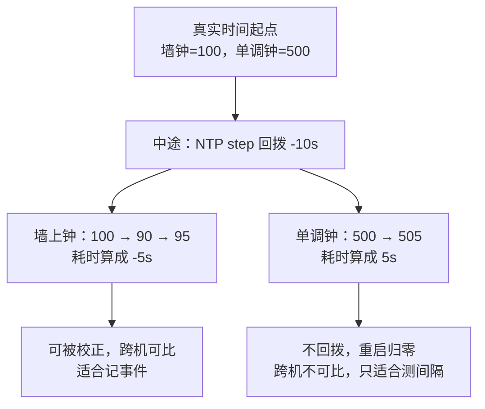
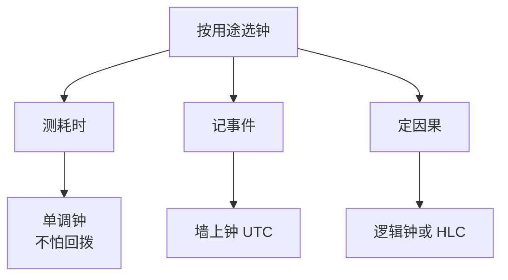

# 电源与时钟：UTC与单调钟的工程含义

## 两台机器的「现在」为什么对不上：要解决的问题

分布式系统里有两种时钟：**墙上时钟管日历时刻，单调钟管经过时长**，选错会算出负耗时。两者从哪来、各守什么约定，是本篇要讲的；读完你能**正确选钟**、避开负耗时与乱序日志这类经典 bug。

先把形状说成一件事：分布式系统里的时钟像一群人各戴一块机械表——每块表走快走慢不一样（晶振漂移）、对表靠互相打电话（网络同步有延迟）、有人睡觉摘表重戴（断电重启）。要让所有人报出同一个"现在"，就得定两条规矩：**墙上时钟是"跟广播对时的表"**（会被人拨快拨慢，好在大家都以广播为准，能对日历）；**单调钟是"秒表"**（只管从按下开始数了几秒，不跟任何人校准，也绝不倒走）。

**测"等了多久"必须用秒表**——用对时表测，广播一次校正就能让"等待时长"变成负数。这个比喻到"负数"为止——现实里两条规矩各有物理来源与工程陷阱（闰秒、时钟跳变），下面逐个展开。

时钟要解决的问题，是让**分散的机器对时间达成共识**。每台机器有本地时钟（晶振计数），**晶振有漂移（快慢不一，ppm 级，ppm 即百万分之一），网络同步有延迟**，所以两台机器的"现在"**永远不严格相等**。

断电重启、休眠恢复这类电源事件进一步打断计数。工程上把时钟分成两种语义：**墙上时钟**（wall clock，即 UTC 日历时间，可被 NTP（Network Time Protocol，网络对时协议）校正回拨）与**单调时钟**（monotonic clock，纯计数，只前进不回拨）。

混淆两者是分布式系统的经典 bug 源：**用墙上时钟测耗时，NTP 一次回拨让耗时变负数**；**用单调钟记业务时间戳，重启后归零、跨机器不可比**。本文写这两种钟的物理来源与工程约定，它们是超时[[工程知识/后端系统：在并发、失败与变化中维持服务/分布式可靠性/超时的层次设计：连接、读写与整链路的预算分配.md]]与时间戳排序[[工程知识/后端系统：在并发、失败与变化中维持服务/分布式可靠性/时间顺序与因果必须显式建模.md]]的地基。

## 墙上钟与单调钟各守哪些约定：机制

**墙上时钟：UTC（Coordinated Universal Time，协调世界时） 的分发链**。UTC 由国家计量局的原子钟产生（TAI 基准，TAI 即国际原子时，UTC 的计数基准），经 NTP 服务器层级（stratum 0/1/2/3）分发到终端机器。NTP 校正本地时钟（slew 缓调即小幅缓慢微调、不产生跳变，或 step 跳变即一次性跳到目标时刻），所以操作系统时间可以被拨快拨慢。**闰秒是 UTC 跟上地球自转的校正机制（不定期插入 23:59:60），对软件是毒药**：POSIX（Unix 系统调用标准）把时间戳假装成每天 86400 秒，闰秒让"同一秒"出现两次或让日志乱序。**Google 的 smear 方案（把闰秒摊到 24 小时慢慢消化）是工程界对物理世界的妥协**。

这条分发链的源头实物是原子钟——全世界机器里走着的同一个「现在」，由它读出：

*图源：Wikimedia Commons《U.S. Naval Observatory Master Clock》，USNO 照片，CC BY 2.0，https://commons.wikimedia.org/wiki/File:U.S._Naval_Observatory_Master_Clock.jpg。*

整条链条最上面那一环的装置长什么样，可以看美国国家标准与技术研究院 NIST（美国国家标准与技术研究院，发布密码与安全标准）的铯喷泉钟：真空腔里用六束激光把铯原子冷却到接近绝对零度，再把原子云整体向上抛起约一米高，原子在重力作用下自由下落穿过微波腔两次，往返约半秒。微波频率扫描到使多数原子发生跃迁的那一点，就是铯原子 9,192,631,770 Hz 的共振频率——国际单位制里「一秒」的定义出自这里。上一张图的机柜与这张图的喷泉钟是同一件事的两个尺度：一个负责维持并分发秒长，一个负责生成秒长。

*图示：NIST-F3 铯喷泉原子钟装置，用于生成美国的首要频率标准。图源：美国国家标准与技术研究院（NIST）《NIST's Cesium Fountain Atomic Clocks》，https://www.nist.gov/pml/time-and-frequency-division/time-realization/cesium-fountain-atomic-clocks，美国政府公开出版物，公有领域。*

图上这排机柜读出的那一秒经 NTP 层级层层背书，最终拨进每台机器的墙上时钟；单调钟不在这条链上——它是每台机器自己数出来的心跳（通信双方定期互发小报文、确认连接还活着），**起点不定义、外部校正不接受**，这正是下文两种钟语义分野的物理来源。

拨进本地钟之前，NTP 在机器内部还走完一套校正流水线。ntp.org 官方文档的架构图把它画全了：多个上游服务器的应答先经 Peer/Poll 进程成对采样（轮询取样本），Selection and Clustering 算法剔除异常源（false ticker，虚假时钟源），Mitigation 算法加权合成最终偏移，Clock Discipline 的环路滤波器（驱动时钟调整的最后一环）把校正量交给时钟调整进程—— slew 缓调与 step 跳变都出自这最后一环：

*图源：[Network Time Foundation《How NTP Works》（NTP 4.2.8 文档 Figure 2）](https://www.ntp.org/documentation/4.2.8-series/warp)。*

**单调时钟：只保证前进**。clock_gettime(CLOCK_MONOTONIC) 是内核维护的计数器，从某个不定义的起点开始只增不减。NTP 不校正它（快就快慢就慢，不回拨），**断电重启后归零**（起点重置）。语义约定：**单机内可比，跨机不可比，跨重启不可比**。**测耗时（interval）必须用它**：两次采样相减，不受任何校正干扰。

**电源的痕迹：启动时间与电源事件**。机器重启后，**墙上时钟靠 RTC（实时时钟芯片，断电后靠纽扣电池继续走时）维持，单调钟归零**。挂起恢复（suspend/resume）后，部分单调钟继续（含挂起时间）、部分暂停（CLOCK_MONOTONIC 在挂起期间停止计数，CLOCK_BOOTTIME 在挂起期间继续计数）——语义选择要按场景：**超时预算是否把挂起时间算进去**。电源故障的不可预测性是存储一致性的源头之一，掉电瞬间的写入是否写入磁盘见 [[工程知识/性能工程：从用户等待到资源瓶颈/操作系统与运行时/脏页回写在性能与崩溃丢失窗口间权衡.md]]，时钟只是它的一个投影——掉电瞬间 CPU 与晶振供电同时中断，时钟能否连续正走，反映的正是电源是否可靠。

**混合时钟与逻辑时钟的分工**。**分布式系统不信任单机时钟**，把时间语义分层：物理时钟（UTC/单调钟）给人看与给日志排序（尽力而为）、逻辑时钟（Lamport 时钟、向量时钟）给事件定因果（严格保证）。混合时钟（HLC，Hybrid Logical Clock，混合逻辑时钟）折中：物理时间打底 + 逻辑计数补分辨，CockroachDB 等用它在事务里近似物理时间又保因果。**选型判据：要因果正确性用逻辑钟，要人可读用物理钟，两者都要用 HLC**。

同一次 NTP 回拨打进来，墙上钟与单调钟的读数各自怎么变，为什么只有一个会算出负的耗时。

同一次回拨只改变墙上钟的读数、对单调钟毫无影响，说明**测耗时与记事件根本不是同一个量**。

按用途选钟，三条纪律各自归到各自主管的钟：

## 这两种约定从哪来、付什么价：背景与代价

时钟偏差带来的问题，和分片（数据按规则切到不同机器）落在哪一片一样，是位置决定视野：你看到的顺序，取决于**你站在哪个时钟上**。这个类比只到「不同位置看到不同顺序」为止，不再外推。

时间同步的历史比计算机老——铁路时代 1880s 的标准时就为跨地域排班而立。NTP把时间分发做成互联网基础设施，30 年没被替代（更精确的 PTP——Precision Time Protocol，精密时钟同步协议——只在特定域用）。Lamport 时钟（1978）是分布式领域的分水岭：论文承认物理时钟不可靠，转而在事件序上定义" Happens-before "，**因果从此不依赖时间**。这两条线（物理同步 vs 逻辑因果）至今并行。

**单调钟"不定义起点"的克制**。如果规定了起点（如 1970-01-01），跨重启跨机器就必须维持这个约定，维护成本回来了；不定义起点，**约定缩到最小（单机内可比），可靠性最大化**。这是 API 设计里"承诺越少越稳"的典范——对比 POSIX 的 gettimeofday 一度承诺微秒精度（实际硬件给不了），后来分成 clock_gettime 一族按用途分语义。代价：两种钟的分工把"时间"这个直觉概念分解了——开发者要记住**"测间隔用单调、记事件用墙上、定因果用逻辑"**三条纪律，**违反其一的 bug（负耗时、乱序日志、误判因果）在生产环境极难排查**，因为故障是偶发的（NTP 回拨不是每台机每天发生）。

## 这些约定在哪儿会失效：边界

- **墙上时钟的回拨在虚拟化环境更频繁**。虚机迁移、宿主机时间校正会 step 客户机时钟，云上机器的时间跳变比物理机常见。**用墙上时钟做耗时统计（start=now; work; end=now; end-start）在云上是已知反模式**，负值或巨大值会污染监控数据。**全部换 monotonic，是多数语言标准库一行的事**（Go 的 time.Since、Java 的 System.nanoTime）。
- **闰秒生产事故是重复发生的**。**2012 年闰秒让一批系统瘫痪**（闰秒插入使内核计时循环在 23:59:60 处反复重试形成活锁，依赖计时循环的 Java 应用 CPU 随之飙高），2015/2016 再来。NTP 的 step 校正在 23:59:60 附近的行为因实现而异。**对策**：确认系统 smear（云厂商多数已默认）、监控 23:59:5x 的异常、关键服务在闰秒时段降载。
- **时间戳不能当唯一排序键**。同一毫秒内的事件（高并发下必然）墙上时钟分辨不开，单调钟跨机不可比。**数据库的写序靠版本号或 LSN，不是时间戳**；日志聚合（把分散在多台机器的日志集中到一处检索）的时间排序只是"近似时间线"，**因果真相要 trace id**。见时间顺序与因果（上文链接）的完整论证。
- **时钟漂移影响租约（带过期时间的临时授权，过期即失效）与超时的有效性**。机器快 100ppm 即每秒快 0.1ms，**租约到期判断——本地时钟 vs 租约时间戳——误差累积**。租约必须配合FencingToken[[工程知识/后端系统：在并发、失败与变化中维持服务/分布式可靠性/租约必须配合FencingToken阻止过期持有者.md]]就是对这个不可靠性的结构性防御：**不信任时间，信任单调递增的令牌号**。

## 想自己验一遍怎么动手：验证

- **两种钟的语义实测**：故意把系统时间回拨 10 秒（date -s），然后测一段 sleep 的耗时。预期：**墙上时钟算出的耗时为负（-10s 附近），单调钟（time.monotonic/ CLOCK_MONOTONIC）的耗时正确（约 sleep 时长）**。这个实验 2 分钟可做，**是两种钟约定差异的最硬证据**。
- **NTP 校正观测**：chronyc tracking（或 ntpq -p）看偏移量与同步状态，预期：**offset 在毫秒级、频率校正（slew）为主**；**发现 step 跳变（offset 突变）说明发生过跳变校正**，日志与监控里该时段的时间戳要打问号。
- **跨机时钟差实测**：两台机互相 date +%s.%N 对拍（SSH——加密的远程登录协议，用于在另一台机器上执行命令——往返取中点），预期：差值在几毫秒内（同 NTP 源）；**差值大到秒级说明其中一台失同步（NTP 断连、时区配置错误）**，依赖跨机时间戳的业务（日志对账、按时间过滤）在该机上的数据不可信。

## 接着读哪几篇：超时预算的地基是单调钟

- [[工程知识/后端系统：在并发、失败与变化中维持服务/分布式可靠性/超时的层次设计：连接、读写与整链路的预算分配.md]] —— 超时预算的地基是单调钟
- [[工程知识/后端系统：在并发、失败与变化中维持服务/分布式可靠性/时间顺序与因果必须显式建模.md]] —— 时间戳不等于因果的完整论证
- [[工程知识/性能工程：从用户等待到资源瓶颈/操作系统与运行时/脏页回写在性能与崩溃丢失窗口间权衡.md]] —— 电源故障与存储一致性的另一投影
- [[工程知识/数据系统：在并发与故障中保存事实/事务与存储/复制滞后的一致性补救：读己之写与会话保证.md]] —— 令牌与位点（消费进度的记账标记，记录处理到哪一条）为何不用时间戳
