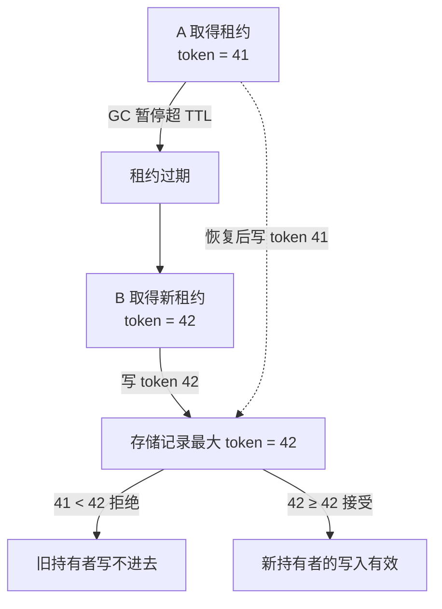

# 租约必须配合 Fencing Token 阻止过期持有者

**租约（lease，带过期时间的持有权凭证）过期后，旧持有者会因网络暂停继续写入——本篇解决的就是这个陈旧执行问题**（陈旧执行即旧持有者以为自己还在任、继续往存储写）。核心做法是协调器（发放租约的一方）**为每次取得租约发放单调 token**（fencing token，它给每次租约贴的单调递增编号），并让**下游只认最大编号、拒绝更小 token**；收益是**把「谁现在持有」变成下游可验证的事实——好处是存储自己能判真假，不用回头问协调器**；代价是**所有写入点都必须传递并检查 token**，**每个写入接口都要多带一个编号并在写入前比对**。

要证明旧 owner 永远覆盖不了新 owner，设计者需分别用**暂停、时钟漂移、续租失败和主备切换四种场景**去验证。**读完你能给自己的任务系统加上单调令牌检查，并在四种异常下确认旧持有者写不进去**。

**锁只解决「此刻谁可以进入临界区」，不自动解决资源归属、进程终止、跨主机一致性和陈旧持有者问题**。

## 要解决的问题：单调递增的令牌怎样让下游识别陈旧持有者

**持有租约的一方因进程暂停或网络延迟暂时失去联系，重启之后旧持有者仍在向存储写入，新持有者的状态被覆盖**。本篇回答：**单调递增的令牌怎样让下游识别陈旧持有者、令牌在哪些位置必须传递与检查、续租失败之后旧持有者要做什么，以及主备切换期间哪些写入会被拒绝**。

## 分布式锁的几种机制各自管什么边界？

每种机制能管的范围不同，选错范围再严的锁也护不住，逐行看适用与边界：

| 机制 | 作用域/语义 | 适用 | 边界 |
| --- | --- | --- | --- |
| `flock` | 通常绑定打开文件描述与文件；共享/排他、阻塞/非阻塞 | 单机进程协调、脚本互斥 | 网络文件系统语义可能不同；advisory lock 要求参与者合作 |
| POSIX（Portable Operating System Interface，Unix 系统调用与工具的接口标准） record lock (`fcntl`) | 可对字节范围加锁，语义与进程/文件关闭有关 | 需要区间锁的单机程序 | 继承与关闭语义容易误用；不等同于分布式锁 |
| 原子创建/rename | 依赖文件系统原子操作 | 发布文件、简单 leader 标记 | 无 TTL；崩溃后需清理策略 |
| 数据库条件更新 | 用事务和版本号竞争状态 | 业务任务、跨进程协调 | 依赖数据库可用性和隔离级别（并发事务互相可见程度的分级） |
| 分布式租约 | owner + TTL（租约存活时间，超时未续约就过期） + renew（续租） + fencing token | 跨主机长期任务 | 需处理时钟、网络分区和陈旧持有者 |

## 什么情况下其实不需要分布式锁？

**先判断业务是否真的需要分布式锁**。**创建唯一业务对象优先用数据库唯一约束，状态更新优先用版本号/CAS**（比较并交换：只有**当值还是我看到的那个时**才写入，是多并发更新的原子操作），**任务分片**（把数据按规则切开存到不同节点）**优先用稳定 owner；这些机制直接保护业务不变量，通常比「先拿锁再写」更容易验证**——**唯一约束和版本号由数据库在写入时就地判定成功或失败，证据就在这次请求里；锁的释放与状态更新分两步，中间任何失败都会留下可被旧持有者钻入的窗口**。**多个进程必须独占一个无法原子更新的外部资源时，才进入租约设计**。

**最常见的错误是把「锁还在」当作「旧持有者已经停止」**。实例 A 暂停超过 TTL 后，实例 B 会取得新租约；A 恢复时仍可能继续写。因此**续租只能让持有者在过期前及时获知状态、缩短不自知的窗口，无法阻止一个已经失联又恢复的旧 owner，最终必须由资源侧检查单调递增的 fencing token**。**资源侧那份单调递增的号，就是检票机自己维护的那份号段记录——这个比喻到「检票机拦下旧号」为止**，**过期持有者的牌子再怎么举着也刷不开门**。

```python
with open(lock_path, "a+") as handle:
    fcntl.flock(handle.fileno(), fcntl.LOCK_EX)
    # 临界区：短、可恢复，不调用不受控的长网络操作
```

- **锁对象的生命周期必须覆盖临界区；关闭 fd 通常会释放相应锁**。
- **非阻塞获取失败是正常状态，调用者需选择跳过、排队、退避或返回冲突**。
- **把 owner、task generation（标识本代任务）、revision（状态版本号）写入受保护元数据，便于诊断谁在哪一代写过；不要把文件存在本身当成锁仍有效**。
- **锁内操作尽量短；长任务使用租约，并让外部协调者续租和检测过期**。

## 为什么任务系统需要 fencing token

**过期持有者之所以能继续写，是因为它自认持有锁、而下游又不检查 token，两次写入直达存储**。**分区把旧持有者隔开，它收不到集群消息、不知道自己已被换下，仍按本地判断继续写；而集群另一侧早已选出新主——这种新旧并存在分区场景下是常态而非异常**。etcd（分布式键值存储，Kubernetes 用它存集群状态）文档把这种新旧并存的形态画了出来：


*图源：[etcd 官方文档 · Learner 设计](https://etcd.io/docs/v3.5/learning/design-learner/)。*

**token 单调递增、下游拒绝旧号——Martin Kleppmann 在这篇分析里给出了这套规则的时序图**：client 1 拿到 token 33 后经历 stop-the-world GC 暂停（垃圾回收导致的整段挂起，程序在这段时间完全停顿），租约过期、client 2 取得 token 34 并写入成功；client 1 苏醒后仍带着 token 33 去写，**存储比对见过的最大 token 直接拒绝**。同一篇分析里还有一张没有 token 的对照图：锁服务、GC 暂停、新旧两个 client 的时序完全相同，**存储没有 token 可查，client 1 苏醒后的写入直达存储，爆炸符号标出数据被覆盖的事故点**：


*图源：[Martin Kleppmann · How to do distributed locking](https://martin.kleppmann.com/2016/02/08/how-to-do-distributed-locking.html)（2016，CC BY）。同一作者、同一场景的两张图并排看：差别只有一处——存储侧有没有一个单调递增的号可查，事故与防护的分界就在这一处。*


*图源：同上（[Martin Kleppmann · How to do distributed locking]）。*

为什么过期印信盖出的文书不作数？实物原型是官印的换防：**衙门换任时旧官的印信即行作废、新官领新印（token 单调递增），库里所有文书收发只认最新一期印**——旧官回衙后拿废印签的批文，吏房比对新印字号（下游检查 token），**一律退回**；**谁也不能凭"我昨天还是官"把文书递进去**：


*图源：Wikimedia Commons，作者 BabelStone，CC BY-SA 3.0，https://commons.wikimedia.org/wiki/File:Bronze_personal_seals_at_the_Liao_Shangjing_site.jpg。*

沿用上面的官印比方：**fencing token 就是印信的期数，租约是任期，续租是延长期任，token 是印上的字号——存储记录见过的最大字号，小号一律退回**。**旧持有者"复活"后的写入被挡在字号比对这一关，与印信作废是同一条防伪逻辑**。


回到机制本身：**仅有 TTL 的租约可能在网络暂停后出现旧持有者「复活」——新任务已经取得租约，旧任务仍向下游写入**；**每次成功取得租约生成单调递增的 fencing token、下游拒绝小于当前 token 的写入，才能阻止陈旧执行者**。同一次过期里新旧双方的写入命运，见下面这张图：



图的关键在存储那一格：**它记下见过的最大 token，之后每次写入都拿 token 跟它比——41 小于 42，A 恢复后的写入被拒之门外**。**租约本身只能让「B 大概率拿到新租约」，拦不住「A 复活后接着写」；把「谁新谁旧」变成下游可验证的事实，靠的是单调 token 在每个写入点的检查**。**这也是为什么所有写入点都必须传递并检查 token：token 检查是存储侧唯一的判据，任何一个写入点不查，那条路径上的旧写入就直接落盘，与别的点查过没有无关——漏掉一个点，陈旧执行就从那里钻进去**。

```text
lease owner=A token=41  --暂停/过期-->
lease owner=B token=42  -> 下游接受 token=42
A 恢复并写 token=41    -> 下游拒绝
```

## 拿到锁就等于可以删除资源了吗

**拿到锁不等于可以删除**。**删除 worktree、缓存或运行目录前检查资源 owner、generation、活跃租约、进程树和引用计数**。**锁只能保护检查与状态更新的原子区间，锁一旦过期路径又变回可读写**，所以**真正删除必须绑定不会过期的明确资源标识，不能使用宽泛路径或未解析的 glob**。

## 怎么自己动手验证

1. **暂停旧持有者：持租约的实例 A 用 `SIGSTOP` 暂停超过 TTL，让 B 取得新租约并写入，再恢复 A 让它继续写。预期下游拒绝 A 携带的较小 token，事实源只保留 B 的写入**。
2. **时钟漂移：调整协调器与被测节点的时钟偏差，观察租约过期判定与续租是否仍按单调时间推进，避免出现两个实例同时认为自己持有租约**。
3. **续租失败：切断 A 与协调器之间的连接但保持 A 与下游可通信，预期续租失败后 A 主动停止写入，而不是凭本地判断继续**。
4. **主备切换：执行一次协调器故障转移，核对新协调器发放的 token 严格大于旧值，切换窗口内的写入被统一按 token 大小裁决**。
5. **断言锚点：每个写入点都传递并检查 token，token 生成单调，续租失败有停止写入路径，暂停与分区场景下旧持有者从未覆盖新持有者**。

## 接着读哪几篇

还有哪些维度在防同一种陈旧写入？脑裂（集群分裂成两半各自为政的故障）指分区后两侧各自都认为自己是主、各写各的；下面的相关篇目从分布式冗余的脑裂防护等角度展开：

- [[工程知识/AI 系统工程：从模型能力到生产能力/安全与治理/执行证据必须独立于AI结论]]、[[工程知识/后端系统：在并发、失败与变化中维持服务/任务与并发/任务生命周期必须覆盖进程、日志、超时与清理]]、[[工程知识/后端系统：在并发、失败与变化中维持服务/分布式可靠性/部分失败决定分布式系统的设计]]。


- [[工程知识/数据系统：在并发与故障中保存事实/可靠性与运维/RAID等级与数据可靠性：镜像与纠删的数学.md]] —— 分布式冗余的脑裂防护是另一维度的可靠性
- [[工程知识/数据系统：在并发与故障中保存事实/可靠性与运维/复制的三种模式：主从、多主与无主的失败形态.md]] —— 切换窗口的脑裂防御
- [[工程知识/数据系统：在并发与故障中保存事实/可靠性与运维/分区再平衡的三种策略：固定取模与一致性哈希.md]] —— 归属切换瞬间的脑裂防御
