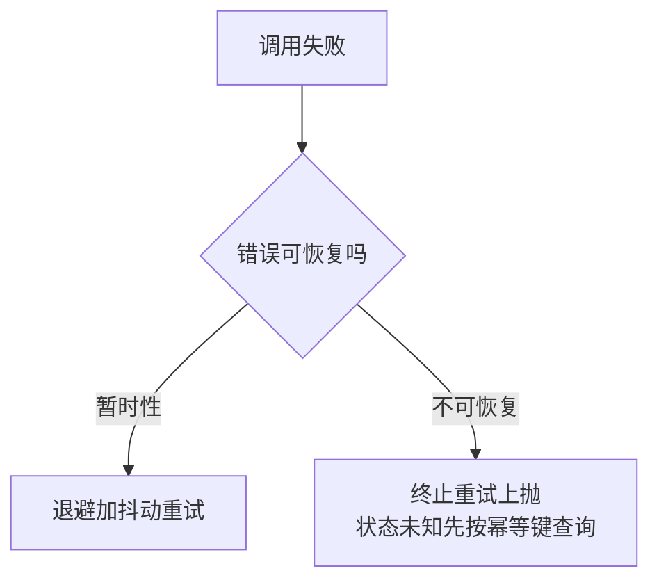

# 超时、重试与幂等共同定义调用语义

**读完你能说清超时、重试、幂等（同一操作执行多次与执行一次效果相同）各管什么：超时负责「等多久就放弃」；重试负责「放弃后要不要再来」；幂等负责「再来一次不会变成两次扣款」，幂等键（给每次操作分配的唯一编号，服务端凭它识别重复请求）是实现幂等的工具**。**读完你还能根据自己的调用场景，写出这三种要素的搭配方式**。

**难点在开头就要说清：任何自动重试都会遇到一个根本不确定性——前一次操作可能失败、可能仍在执行，也可能已经成功但响应丢失——网络超时只表示调用者在期限内没有得到确定响应，不告诉你前一次操作属于这三种情况中的哪一种**。

**为什么「超时就重试」不够？因为重试不会消除「前一次到底执行了没有」的不确定性，只会把不确定的调用再叠加一次，所以「超时就重试」只是一次新的业务调用，本身不构成可靠性策略**。

**只有当调用边界能识别暂时性错误（网络抖动等会自行恢复的错误）、剩余 deadline（本请求还剩多少时间预算）、幂等身份（能识别重复请求的唯一标识）和副作用（操作对外部状态产生的额外影响）状态（操作是否已产生外部效果）时，重试才有可能提高成功率而不制造重复**；**服务端状态未知时，要么按幂等键查询原结果，要么进入对账（事后比对双方记录以确认真实结果），要么交给人工处理**。**重试的前提是能判断「前一次执行了没有」**，做不到就先确认再动。

## 要解决的问题：超时到底表达了哪些信息

**调用方在超时之后无法判断服务端是否已经执行：前一次可能失败、可能仍在处理、也可能已经成功而响应丢失，自动重试在这三种情况下产生的后果各不相同**。**本篇回答：超时表达了什么、重试次数与退避怎样确定、幂等键由谁生成并在哪一步校验，以及怎样把三者的约定写成一条可执行的调用语义**。

## 三者在机制上怎样互相定义调用语义？

**先打个比方：远程调用像托人捎一件要签收的东西——超时是约定"十分钟没回音就算这一次没结果"；重试是再托一次；幂等的意思是重复做同一件事结果不变——给东西贴一个独一无二的签收单号，收件人见过的单号直接说"这个我签过了"，不会再签一遍**。**难处在中间：十分钟到了，不等于东西没送到——可能正在路上、可能已签收而回话的人走散了**。

**三件套合在一起才构成完整的约定：超时说"什么时候放弃等待"，重试说"放弃之后怎么办"，幂等说"再来一次也不会变成两件"**。这个比喻到此为止。**现实里快递单号由快递公司统一生成，分布式系统里幂等键由谁生成、在哪一步校验，是设计决策**，后面幂等的实现一节展开。

这个比喻背后的机制是什么？下面从通信层说清三者的本质。

**网络超时只说明调用者没有在期限内收到确定响应，服务端是否执行完全不可知。这一不确定性来自通信本身，重试则是把不确定的调用再复制一份**；**只有当调用边界同时给出幂等身份、剩余 deadline 与错误分类时，多次调用才能收敛到同一个业务效果**。

**改动幂等键的作用范围或 deadline 的分配方式，决定的是重复执行会不会产生额外的业务后果**。


来源：[CSDN @bjmayor《图解分布式事务模式》支付回调幂等一图](https://bjmayor.blog.csdn.net/article/details/154004146)（CC 4.0 BY-SA）


来源：[CSDN @bjmayor《图解分布式事务模式》本地消息表重试一图](https://bjmayor.blog.csdn.net/article/details/154004146)（CC 4.0 BY-SA）


## 失败窗口在哪里？

**同一条提交链路上，协调者等参与者回执时超时，是另一种更麻烦的处境——参与者可能已经写好日志、也可能还没，协调者只能按"不知道"处理**：


*图示：两阶段提交里协调者等待回执超时的时序。图源：Wikimedia Commons《Two phase commit seq diagram - msg delay and timeout 01》，作者 Jayaprabhakar，CC0，https://commons.wikimedia.org/wiki/File:Two_phase_commit_seq_diagram_-_msg_delay_and_timeout_01.png。与上面成功那条时序对比：多了一个"消息延迟/超时"分支，而这个分支上没有终态（流程结束后不再变化的状态）——这正是超时必须和幂等一起定义的原因。*

**超时之后服务端到底执行了没有，只有时序能说清：这条时间线上服务端已经把订单提交完，丢的是回程那一个响应；调用方超时后带着同一个幂等键第二次到达，服务端这次什么都不做，只把该键对应的原结果交回去**：

~~~mermaid
flowchart TD
    C["调用者带幂等键 K 发起"] --> S["服务端提交订单"]
    S --> L["响应在网络中丢失"]
    L --> R["超时后重发同样的 K"]
    R --> K["返回 K 已保存的原结果"]
~~~

**两次到达只产生一个业务效果，靠的是第二次到达时服务端认出这个键并回吐原结果——所以这条时间线上真正起作用的是幂等键，不是“重试”这个动作本身**。

**没有幂等键时，第二次调用可能创建重复订单。仅靠把 HTTP 方法命名为 PUT（HTTP 里表示「按同一个地址重复写入也只留一份」的方法），或在客户端「只重试一次」，都不能建立业务幂等——方法名只是约定，服务端认不出重复就照样重复执行**。

## 期限怎么层层分配：Deadline、超时和取消

**Deadline**（整条请求的总期限：从用户发起到拿到最终结果的全部时间预算）**是这条请求还能等待到何时**。**它像整段旅程的总时长预算，每一跳再从中切出自己的一段连接、读取、执行超时**。这个比喻到「切出一段」为止——**现实中每一跳的超时按该跳的延迟分布独立设定，总期限决定的是整条链路的上限**。**若每一层独立使用固定 30 秒，调用链会在上游已放弃后继续消耗资源**。

- **连接、TLS（Transport Layer Security，传输层加密协议，HTTPS 里的 S）、读取、写入和业务执行可能需要不同超时**。
- **取消要传播到排队、数据库、子进程和下游请求，并释放资源**。
- **超时值来自延迟分布和业务预算，不应随意复制默认值**。
- **客户端断开不一定意味着业务应取消**；**支付、发布等操作要由业务状态机决定**。

## 重试可以放多少次：重试预算

**重试只适用于明确的暂时性错误，并使用指数退避（重试等待时间逐次翻倍的策略，避免密集重试压垮对方）、抖动（性能指标不稳定的起伏）和最大次数/总时长**。**多层同时重试会相乘：三层各重试三次，最坏可形成 27 次下游尝试**。**通常选择一个最了解业务语义的边界负责重试，其他层返回分类错误**。

**以下错误通常不应原样重试：schema/权限错误、资源不存在、确定性的业务冲突、超过 deadline、不可逆副作用状态未知**。**状态未知时先按幂等键查询或进入对账，不要盲目再执行**。

## 「再来一次不变两件」怎么实现：幂等的实现

**重试解决不了「做了一半」的问题。跨服务的多步操作，任何一步失败都需要显式的回退动作——Saga（一种把长事务改成「每步本地提交 + 失败时逐步反向补偿」的模式）的补偿步骤就是这个结构**。

**补偿与幂等要配套。补偿动作本身也会失败，所以补偿必须能重试；重试意味着同一步可能被执行多次，如果补偿不幂等，重试就会造成二次破坏——因此补偿既要可重试又必须幂等，两者缺一不可，只做其中一个都会在中途卡住**。


| 方式 | 适用 | 注意 |
| --- | --- | --- |
| 自然业务键/唯一约束 | 创建唯一实体 | 冲突后返回原语义，不是裸 500 |
| 幂等键记录结果 | API 写操作 | 调用方身份、参数摘要、过期与原响应 |
| 版本号/CAS（比较并交换：只有当前值和预期一致才写入） | 更新已有状态 | 冲突需要重新读取和决策 |
| inbox（收件箱式）去重：消息先落本地表，同一消息只处理一次 | 消息消费者 | 去重记录与业务写入在同一事务边界 |
| fencing token（单调递增的令牌，持有者拿旧令牌写入时下游直接拒绝） | 租约持有者写入 | 下游必须拒绝旧 token |

**幂等不等于所有调用永远返回相同内容；它要求重复执行不会产生额外业务效果，并能让调用者识别已确认结果**。

**最容易理解的实现是一张「幂等键到原结果」的表：客户端第一次调用生成 key，所有重试复用同一个 key；服务端在同一事务内完成业务写入并保存 key、参数摘要和完整响应**。**两个相同 key 并发到达时由唯一约束裁决，冲突方读取并返回第一次的结果**。**若相同 key 携带不同参数，必须拒绝，不能误当重试**。

| 失败 | 默认处理 | 原因 |
| --- | --- | --- |
| 连接重置、明确 503/429 | 在总 deadline 内退避并加抖动 | 通常是暂时性失败 |
| 400/422、权限拒绝、业务冲突 | 不原样重试 | 输入或权限不变，重试不会修复 |
| 提交后响应丢失 | 按幂等键查询原结果 | 服务端可能已经成功 |
| 副作用状态未知 | 对账、查询或人工处理 | 盲重试可能重复扣款或发货 |

**错误按「重试会不会改变结果」分三路，各走各的结局——先看下面这张分流图，再对照每种错误的处理方式**：



**幂等记录要定义主体、业务范围和过期时间；过期意味着保证窗口结束，重复同一操作仍可能再次执行**。**优先使用订单号、流水号等自然业务键；没有天然身份时再引入额外幂等键表**。

## 重试的风暴由谁来拦？

**重试像雪天又派人出门打探：路越堵，出门的人越多**。这个比喻到「出门的人越多」为止。**现实里，出门的人对应自动重试发出的请求，路越堵重试越多，所以重试会在依赖最脆弱时增加流量**。**调用方必须有并发上限、重试配额（限定总次数与总时长）；服务端要在资源耗尽前做准入控制（资源快耗尽时拒绝新请求）**。**背压（下游处理能力不足时向上游传递减速信号，让上游降低发送速率）像限流（控制单位时间放进来的请求数量，超过配额就拒绝）闸；熔断（快速拒绝已知不可用的依赖，不再白发请求）像拉闸断电**。**两者都只在资源耗尽前生效：资源一旦耗尽，限流和断电都来不及挽回已经发生的雪崩（一处故障沿依赖链放大成级联失效）**。**熔断能快速拒绝已知不可用依赖，但半开探测、恢复抖动和多实例同步都需要验证**。

## 三要素四种组合各会产生什么结果？

```text
同一笔扣款请求，三要素四种组合的语义账（通用推演）：

组合 A：超时 500ms + 不重试 + 非幂等
  语义：至多一次（at-most-once）→ 可能丢（超时即放弃）
  适用：埋点上报（丢一条无所谓）

组合 B：超时 500ms + 重试 3 次 + 非幂等
  语义：至少一次但会重复执行 → 扣款可能扣三次
  事故形态：网络抖动触发重试，用户账户三连扣

组合 C：超时 500ms + 重试 3 次 + 幂等键
  语义：精确一次的效果（底层至少一次，幂等去重）
  适用：支付、库存、任何写操作

组合 D：无超时 + 重试 + 幂等
  语义：看起来安全，实际依赖 hang 住时调用方线程池被拖垮
  → 重试与幂等救不了无超时，超时是三要素的地基
```

**组合 B 上生产扣款的实录——支付回调超时后框架自动重试（团队不知道框架默认重试），用户重复扣款，客诉与退款处理一周；排查发现配置里 retry_on_timeout（超时后是否自动重试的配置项） 默认 true，改组合 C（加幂等键）后重试变成安全动作**。**组合 D 的实录——监控大盘看服务"很健康"（无超时报错），依赖 hang 住时线程池（预先建好一组线程反复取用、避免频繁创建销毁）悄悄耗尽，可用性断崖；无超时等于把超时设为无穷大**。

三要素各自的展开账见 [[工程知识/后端系统：在并发、失败与变化中维持服务/分布式可靠性/超时的层次设计：连接、读写与整链路的预算分配.md]]（超时分层）、[[工程知识/后端系统：在并发、失败与变化中维持服务/分布式可靠性/重试的正确姿势：退避、抖动与重试预算.md]]（重试预算）、[[工程知识/后端系统：在并发、失败与变化中维持服务/任务与并发/幂等性的完整谱系：从操作语义到删除接口的天然陷阱.md]]（幂等实现）。

## 怎么自己动手验证

**验证方法是在服务端提交后、响应前主动断开连接，然后重试，看是否只产生一个业务效果：若实测出现两笔扣款，与预期对不上，说明幂等实现有缺口**。

- **在服务端提交后、响应前注入断连，确认重试只产生一个业务效果**。
- **同一幂等键并发发送不同参数，确认系统拒绝冲突**。
- **让下游持续超时，检查总 deadline、尝试次数和并发是否有界**。
- **取消上游请求，确认队列位置、连接、进程和租约（带过期时间的临时授权，过期即失效）被正确释放**。
- **检查 trace（分布式追踪，跨服务记录同一次请求的完整调用路径）能将逻辑调用与每个 attempt 分开**。


## 接着读哪几篇：每一步都要幂等的场景

- [[工程知识/后端系统：在并发、失败与变化中维持服务/分布式可靠性/租约必须配合FencingToken阻止过期持有者]] · [[工程知识/AI 系统工程：从模型能力到生产能力/Agent与工作流/模型负责判断，运行时负责执行语义]]


- [[工程知识/后端系统：在并发、失败与变化中维持服务/分布式可靠性/Saga把长事务变成补偿链，代价是失去隔离性]] —— 每一步都要幂等的场景
- [[工程知识/后端系统：在并发、失败与变化中维持服务/任务与并发/幂等性的完整谱系：从操作语义到删除接口的天然陷阱.md]] —— 谱系展开：幂等角的完整分类与键的工程实现
- [[工程知识/后端系统：在并发、失败与变化中维持服务/分布式可靠性/重试的正确姿势：退避、抖动与重试预算.md]] —— 重试角的展开：退避抖动预算三件武器的完整纪律
- [[工程知识/后端系统：在并发、失败与变化中维持服务/分布式可靠性/超时的层次设计：连接、读写与整链路的预算分配.md]] —— 超时角的展开：三层超时与整链路预算分配
