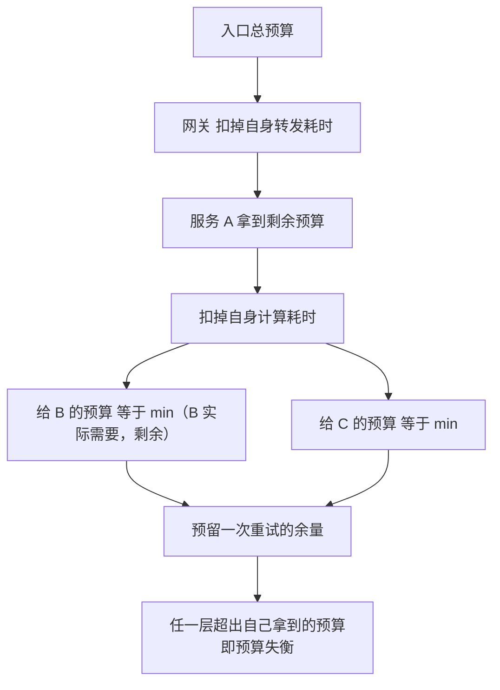
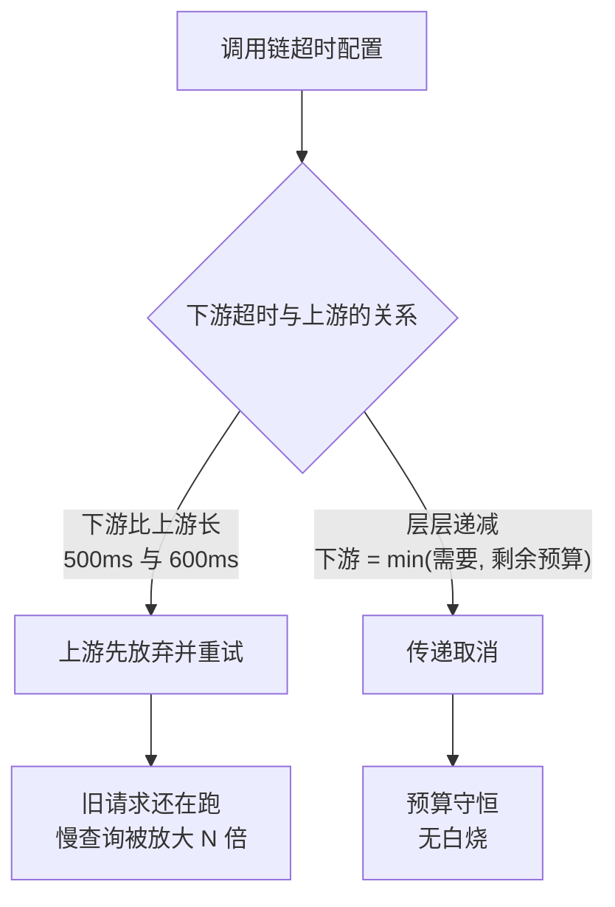

# 超时的层次设计：连接、读写与整链路的预算分配

## 超时到底管住哪些事：要解决的问题

超时要解决的问题，是**给每个远程调用一个明确的时限**。没有超时（或超时设成默认的 30 秒、60 秒），**一个慢依赖就能拖住整条请求链：线程被占着、连接被占着、上游也在等**。读完本文你能**按连接、读写、整链路三层，给远程调用配出一份不会互相打架的超时预算**。**超时、重试与幂等（幂等即同一请求重复发也不会出错的特性）共同定义调用语义**[[工程知识/后端系统：在并发、失败与变化中维持服务/分布式可靠性/超时、重试与幂等共同定义调用语义.md]]，本文把"超时"一角展开成分层的预算分配。

## 三层各管哪一段：连接、请求、链路

先把形状说成一件事：一次远程调用像一次跨城出差——"约得到车"是连接建立超时（约不到 3 分钟就取消订单另打一辆，别傻等）；"对方回话快不快"是读写超时（按对方平时的回话速度留余量，不能按你最能忍的时间等）；"整个行程几点必须回来"是链路预算（总共 1 小时，路上每段都得从总账里扣，不能每段都按 1 小时等）。出差最容易超支的就是最后这笔总账：只顾每段顺利，回程时间早过了。这个比喻到"总账"为止——现实里预算还要沿调用链显式传下去（`min(需要, 剩余)`），每层拿的是扣完上游耗时后的余额，这正是下图时间线的意义。

HTTP 客户端里的各层超时在请求生命周期里的先后位置，Dan Lebrero 的汇总图画成了一条时间线：连接池（预先建好连接反复取用、省去反复握手建连的开销）取连接的超时最先触发，其次 DNS（Domain Name System，域名系统：把域名解析成 IP 地址），然后连接超时管 TCP（传输控制协议，负责把数据完整、有序地送达）握手，连接建立之后剩下的全是读超时（连接建好后等待响应字节的期限）的管辖范围——读超时可以在一次连接里反复触发：

*图源：[Dan Lebrero《Apache Http Client and Asynchronous HTTP client timeouts explained in pictures》](https://www.codementor.io/@daniellebrero/apache-http-client-and-asynchronous-http-client-timeouts-explained-in-pictures-12gi8mcb3v)，2020。*

**连接建立超时**（connect timeout）：TCP 握手（客户端与服务端建立连接的三次确认过程）完成的期限。**典型 1-3 秒——握手是轻操作，超过 3 秒说明对端或网络已异常，等下去没有意义**。

**读写超时**（read/write timeout）：连接建立后，等待响应字节的期限。这是最容易设错的一层：它应该按该接口的**正常响应时间的分布**设（以实测 P99 分位即 99% 请求的耗时上限为锚点向上留余量，按各接口延迟分布折算），**不是按"能容忍多久"设**。**设短了误杀慢请求，设长了失去保护意义**。**读超时与写超时可以分开（流式响应的读超时要显著放宽）**。

**整链路超时预算**（deadline propagation / budget）：**入口请求的总期限（如 1 秒），沿调用链逐层往下分配**。A 调 B 调 C，A 的预算 1s，给 B 800ms，B 给 C 500ms。**每一层的超时不能超过它拿到的预算**。**没有预算传递时，底层超时比顶层还长，顶层超时了底层还在跑——底层调用仍占着分配给它的线程与连接，顶层已放弃却无法释放这些资源，于是白白消耗，这是分布式系统里最常见的隐性浪费**。

三层的本质：**连接超时守门（异常快速发现），读写超时定速（按分布设，不按耐受设），链路预算定量（总量守恒）**。

预算逐层显式传递，铁路工程里有对应的实物：齿轨铁路在陡坡段铺设齿轨，列车的齿轮与轨道逐齿咬合——每一段坡度变化都要换成与它咬合的传动方式，没有哪一段能「沿用」上一段的牵引力：

*图源：Wikimedia Commons，作者 King of Hearts，CC BY-SA 4.0，https://commons.wikimedia.org/wiki/File:Mount_Washington_Cog_Railway_October_2021_019.jpg。*

**预算传递的纪律与逐齿咬合同构：每一层拿到的是扣除自身耗时后的剩余预算，下一层的超时必须与这份剩余显式咬合（`min(需要, 剩余)`）；哪一层省掉这道咬合、沿用上游的原始预算，超时倒挂就在那一层出现——上游已放弃重试，下游还在全速运转**。

来源：[小林coding《TCP 三次握手与四次挥手面试题》](https://www.xiaolincoding.com/os/1_hardware/tcp_interview.html)（CC 4.0 BY-NC-SA）

## 这套预算制怎么来的、付什么价：背景与代价

分层超时的思想背景，是**把"慢"当成一种可用性威胁而不是性能小节的认知转变**。**替代的是两种旧做法：一是不设超时（或超长默认），全靠客户端自己放弃；二是所有调用一个全局超时值（忽略接口响应分布差异，慢接口被误杀、快接口失去保护）**。

预算为什么要显式传递？gRPC（Google 开源的高性能接口调用框架）的 deadline propagation（截止时间沿调用链自动往下传，每个下游读到的是剩余时间）是代表实现：**每个请求带自己的剩余时间，下游服务读到"还剩多少预算"再决定自己的动作（够就做，不够就快速拒绝）**。**这把超时从"每层各自设防"变成"整条链共享一份预算"，避免了层间不协调导致的资源白烧**。代价：**预算传递要求整条链路上的框架都支持（老框架链里传递会断），且每层要显式做预算分配决策——这是一个持续的纪律成本，不是一次性配置**。

## 超时预算的账怎么算：可运行示例与案例回流

**预算从上往下扣，各层不自定数字：每经过一层先扣掉自身耗时，剩下的才交给下游，并且要在扣完之后留出一次重试的余量**。

这道减法只要有一层不成立，加总就会超出入口预算——下面这张分配表就是它在具体接口上的落法。

整链路预算分配（总预算 800ms 的接口，通用推演）：

| 环节 | 预算 | 说明 |
| --- | --- | --- |
| 网关转发 | 10ms | |
| 认证服务（远程） | 50ms | |
| 业务服务 A 内部计算 | 20ms | |
| 业务服务 A 调 B 服务（读） | 300ms | B 的超时 = min(B 实际需要, 剩余预算) |
| 业务服务 A 调 C 服务（写） | 200ms | |
| 数据库 | 150ms | |
| 余量 | 70ms | 预留一次重试的机会 |

**层层收紧的规则：下游超时 < 上游超时 − 上游自身耗时**。

**违反的后果：上游超时 500ms、下游超时 600ms，下游还没放弃，上游已经放弃并重试，重试打在新请求上，旧请求还在跑。每次重试都多复制一份慢查询在下游执行，N 次重试就是 N 份叠加：下游负载被放大 N 倍成重试风暴（同一请求被反复重发、瞬间打满下游），单次响应时间被拉长成时延毛刺（响应时间突然冒尖）——超时倒挂是两者的共同根源**。

超时配置的两种层次关系，结局分岔见下面这张图：

**超时倒挂的实录——网关（站在客户端与后端服务之间的入口层，集中处理路由、鉴权与协议转换）超时 30s、下游服务超时 60s，下游慢查询期间网关早已放弃并重试，同一条慢查询被复制 N 份在库里跑（超时倒挂把慢查询放大 N 倍），改齐层次（每层预算递减）后消失**。**零超时的实录——依赖调用不设超时（默认无限），一次依赖 hang 住把线程池（预先建好一组线程反复取用、避免频繁创建销毁）占满，整个服务雪崩（一处故障沿依赖链放大成级联失效）——这些调用共用一个线程池，所有线程都阻塞在同一个卡住的依赖上，池被占满后新请求无处可去，故障连锁放大**。

（与 [[工程知识/后端系统：在并发、失败与变化中维持服务/任务与并发/限流熔断与隔离控制故障半径.md]] 的隔离手段衔接）；每层超时都要显式设置，"用默认值"就是把预算决策交给不知道你链路的人。与 [[工程知识/后端系统：在并发、失败与变化中维持服务/分布式可靠性/重试的正确姿势：退避、抖动与重试预算.md]] 的衔接：超时是重试的前提（重试预算要扣除已消耗的超时），两篇合起来是失败路径的时间治理。

## 预算制管不到什么：边界

- **超时是重试的前置**。**没有明确超时的重试等于盲发**。重试的完整纪律见 [[工程知识/后端系统：在并发、失败与变化中维持服务/分布式可靠性/重试的正确姿势：退避、抖动与重试预算.md]]。
- **超时后要主动取消下游**。**客户端超时放弃后，服务端若不知情会继续算完**。HTTP/2（HTTP 第二版，多条流复用一条连接）的 RST_STREAM（一种通知对方立即关闭这条数据通道的信号帧）、gRPC 的 cancellation（主动告知下游这条调用作废、别再往下执行）是传递取消（告知下游立即停止当前请求）的标准机制；**没有取消机制时，超时只救了客户端，没救服务端**。
- **流式与长任务要换模型**。**读超时对流式响应SSE（Server-Sent Events，服务器单向推送协议，比 WebSocket 简单）、日志拉取不适用，要改成心跳（节点定期互发的存活信号，超时收不到就判定故障） + 活性检测（定期确认对端还活着、没有卡住）**。**批处理（把多个请求合并成一批同时计算、提高硬件利用率）任务的长超时（小时级）要配合进度回报与检查点（定期保存任务已完成的中间状态，失败后可从该点续跑而非从头开始），不能简单放大读超时值**。
- **重试会吃掉预算**。A 给 B 800ms 预算，B 重试两次意味着**每次只有 ~400ms**。**预算分配要预先扣除重试放大系数**。

## 分层配得对不对怎么验证：验证

- **预算守恒验证**：整链注入底层慢 500ms 的故障，预期：**底层在预算耗尽处被取消（trace 里能看到 cancellation 传播），顶层总耗时不超过入口预算**。对不上就停下查：**预算是否真的传到最底层、取消是否传播**。
- **超时分布验证**：任选一个线上接口，拉它的 P50/P99（99% 的请求耗时不超过这个值） 响应时间，预期**读超时设置落在实测 P99 分位之上并留有余量**（经验做法，按接口延迟分布折算）。**对不上说明超时是拍出来的，要按分布重设**。
- **白烧检测**：对比客户端超时率与服务端完成率，预期**服务端完成率 ≥ 客户端超时率（服务端不该在客户端放弃后大量跑完）**。
- **整链预算对不上时**：把每层的实际超时配置拉出来加总，与入口预算对比，**层和超出即预算失衡的直接证据**。

## 接着读哪几篇：超时之后的动作纪律

- [[工程知识/后端系统：在并发、失败与变化中维持服务/分布式可靠性/超时、重试与幂等共同定义调用语义.md]] —— 超时角的总纲
- [[工程知识/后端系统：在并发、失败与变化中维持服务/分布式可靠性/重试的正确姿势：退避、抖动与重试预算.md]] —— 超时之后的动作纪律
- [[工程知识/后端系统：在并发、失败与变化中维持服务/服务设计/RPC框架的通用骨架：序列化连接管理与超时传递.md]] —— 超时传递的完整纪律
- [[工程知识/后端系统：在并发、失败与变化中维持服务/分布式可靠性/电源与时钟：UTC与单调钟的工程含义.md]] —— 超时预算的地基是单调钟
- 相关（等待没有上界时的形态）：[[工程知识/缺陷分析：从个案到体系/稳定性/订阅者断线之后路由指向谁：请求被静默丢弃的识别]] —— 请求被静默丢弃之后，调用方在没有超时的情况下会无限等待
