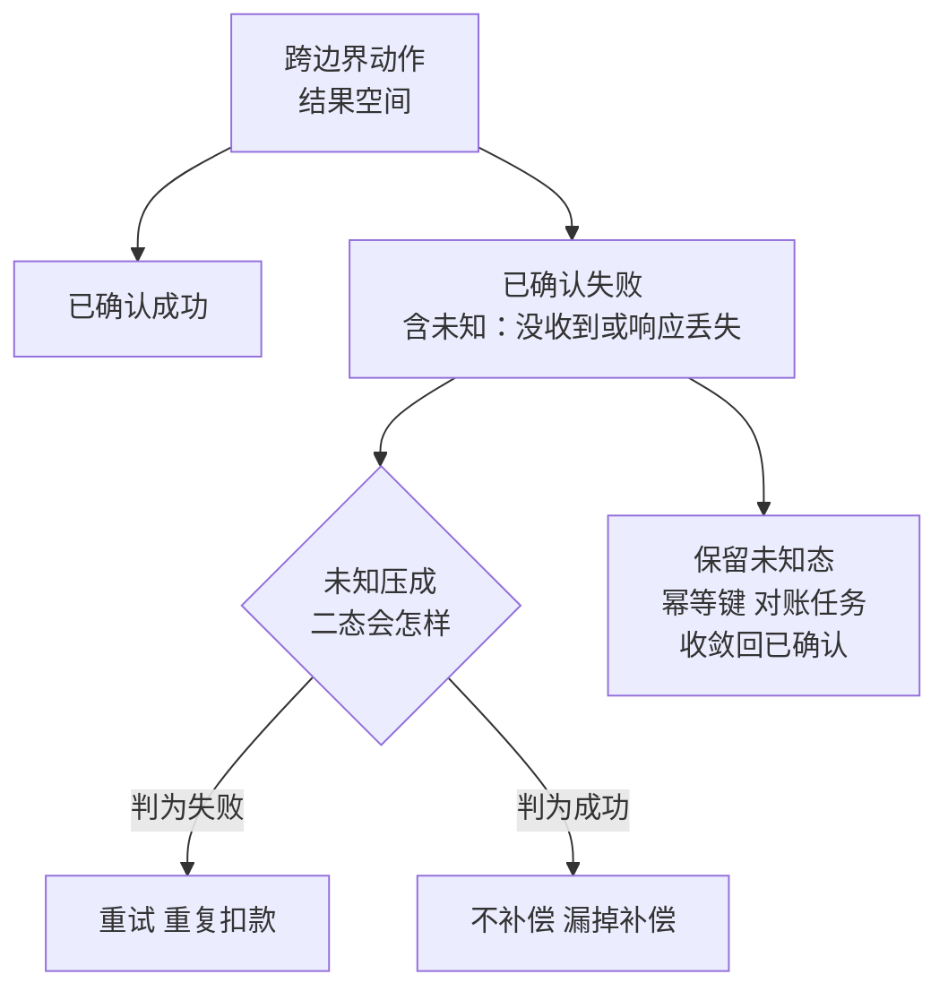
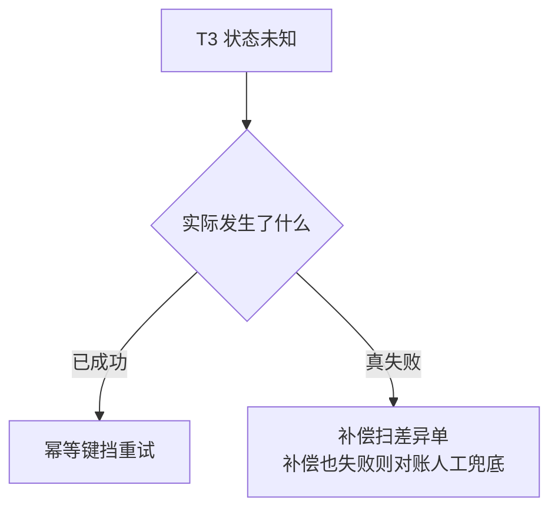

# 部分失败决定分布式系统的设计

本文讲部分失败如何决定分布式系统的设计；读完你能先定目标再选组件，并知道模糊结果会出现在哪几处。**部分失败指节点、网络、时钟、存储和依赖可能只失败一部分。**设计时**先声明一致性、可用性、延迟和恢复目标，再选择协议和组件。**可以把它想成打电话：对方没接，你不知道他是没听见、正在赶来，还是接了之后话没传到你这边。本地函数调用没有这种含糊，返回值要么到要么不到；**跨网络的调用有第三种状态——你不知道结果是什么。**这个比方到「可能没收到回音」为止，打电话你可以再拨一次问问，而重试一个已经扣过款的接口会把钱扣两遍。

**一次请求可能已经写入事实源（系统里唯一可信的数据出处），却在返回客户端前遇到网络故障；一个副本可能健康但没有最新日志；控制面可能认为实例就绪而业务依赖已不可用。**把这些状态都压成「成功/失败」会让重试、补偿和告警做出错误动作，所以**系统必须保留未知状态和真实证据**。

## 部分失败为什么比整体失败更难处理

节点、网络、时钟与存储可能只有一部分失效，**按全部正常或全部失效两种状态设计时，系统在半数组件不可用的区间内行为无法解释。**城市供水是同一个处境：全城有水或全城停水都好办，麻烦的是「有的楼有水、有的楼没有」——报修工单没法按「全停」模板派，只能逐片排查（部分失败区间内行为要逐分支定义）。

比喻到「半好半坏最难办」为止：供水坏了好歹看得见水龙头，分布式系统里哪个节点半失效要靠监控与探针（向系统注入的检测点或检测请求）才能发现。本篇回答：**一致性、可用性、延迟与恢复目标要在设计之前怎样声明、这四项之间怎样取舍、协议与组件的选择由哪一项约束决定，以及部分失败在监控上以什么形式表现。**

## 设计前必须回答哪四个不变问题？

| 问题 | 必须回答 |
| --- | --- |
| 状态放在哪里 | 所有权、持久化、复制、缓存、版本和恢复 |
| 消息如何到达 | 超时、重试、顺序、重复、背压（接收方处理不过来时反向抑制发送速度的机制）和投递语义 |
| 失败如何收敛 | 幂等、补偿、隔离、降级、人工接管和回放 |
| 变更如何兼容 | schema、协议、数据迁移、灰度和回滚 |


来源：[博客园《解密 Raft算法》](https://www.cnblogs.com/traditional/p/12588733.html)（CC 4.0 BY-SA）

**「多数确认才返回」把部分失败挡在返回值之外**：领导者把日志复制给两个跟随者，只要多数确认就提交并向客户端返回结果——**某个跟随者掉线时，结果仍是确定的「已提交」，掉线节点事后由日志复制补齐。**三态问题被协议收窄成二态答案：


*图源：[博客园《解密 Raft 算法》](https://www.cnblogs.com/traditional/p/12588733.html)，CC BY-NC-SA 4.0，文档引用。*


## 为什么结果是二态要变成三态

分布式系统的成员关系**不是"在或不在"两种状态。learner 是介于两者之间的第三态：它在接收日志，但还不参与投票、不算多数派。**这个中间态让成员变更可以在不中断服务的前提下进行。


*图示：learner 的中间态（来源：etcd 官方 design-learner 文档）。第三态的存在让变更不必停服。*

单机函数常被简化成「成功或失败」，跨网络调用却还有第三种结果：**未知**。**超时只说明调用方没在期限内拿到响应，服务端可能没收到、仍在执行，或已经提交但响应丢失。把未知误判为失败会重复扣款，把未知误判为成功会漏掉补偿。**

跨网络调用的结果空间有三个值，**把未知压成成功或失败都会做出错误动作：判成失败会重复扣款，判成成功会漏掉补偿，保留未知态才有收敛回已确认的路。**



未知态能靠对账（把两边记录按动作身份逐笔比对、补齐差异的处理）收敛回已确认，前提正是这两件东西。

**未知态只有靠对账才能收敛成已确认，而对账要能定位到具体那一次动作，因此每个跨边界动作都要有稳定身份和可查询状态：请求用幂等（同一操作执行多次与执行一次效果相同）键（同一请求重复发送也只产生一次效果的键），任务用 task/attempt，消息用 event id，写入用版本。状态不能只存在调用进程内存里；进程退出后要能从事实源、事件日志或检查点（定期保存进度、故障后从最近一次保存处恢复）重建，并清楚区分已确认成功、已确认失败和待对账。**

## 一致性与复制要怎么一起考虑

- **线性一致性**要求操作表现得像在单一副本上按实时顺序执行，**代价通常是更高的协调和故障敏感性。**
- **最终一致性（不承诺实时一致、但保证停止写入后副本终将一致）**允许副本暂时不同，但**必须定义收敛条件、冲突解决、读己之写和过期行为。**
- **增量同步（只把新增的变更同步给从库）**依赖可定位的版本、日志位点（消费进度的记账标记，记录处理到哪一条）或变更时间；**断线后要检测日志是否仍可用，必要时回退到全量重建。**
- **缓存和索引是派生状态**：写入顺序、失效、重建和删除必须有明确策略，**不能把「缓存命中」当成一致性证明。**

## 消息、重试与幂等怎么配合

一次网络调用可能已经在服务端成功，但客户端没有收到响应，因此**「只重试失败请求」并不等于不重复。**挂号信回执是同一笔账：寄信人没收到回执时，重寄一封（重试）可能对方收两封——解决的办法是每封信编号（幂等键），收发室按编号去重（事实源记录处理结果），重寄照常。比喻到「编号去重」为止：挂号信重寄一封的成本可以忽略，线上重试是乘在每次请求上的放大动作，**还要配次数上限与退避节奏。**

- **为业务操作生成幂等键（请求自带唯一标识，重复提交只生效一次），并在事实源或去重存储中记录处理结果。**
- **重试只针对可恢复错误，设置次数、退避、抖动（性能指标不稳定的起伏）和总截止时间；不要让多层重试相乘。**
- **明确投递语义的适用范围**：at-most-once（最多一次）、at-least-once或更强语义；**exactly-once 通常是受限边界内的处理效果，全链路层面不存在免费的精确一次。**
- **队列要有容量上限、背压、积压告警、死信（多次消费失败的消息转入的兜底队列）和重放流程；消费者必须能安全处理重复和乱序。**

## 跨服务事务该怎么处理

- **本地事务 + 可靠事件**：**先提交事实源，再发布可重试事件**，适合多数异步流程；需要 outbox（在本地事务里先记录一条待发事件，再由独立流程发出的模式）、幂等消费者和失败补偿。
- **Saga（把长事务拆成一串本地事务、每步配一个补偿动作的模式）**：**把长事务分成可独立提交的步骤，为每一步定义补偿动作；补偿不是数据库回滚（把系统状态退回到改动之前的版本），必须考虑外部副作用（操作对外部状态产生的额外影响）和人工处理**（见 [[工程知识/后端系统：在并发、失败与变化中维持服务/分布式可靠性/Saga把长事务变成补偿链，代价是**失去隔离性]]**）。
- **TCC（Try-Confirm-Cancel，三段式柔性事务：预留、确认、取消三步）**（Try-Confirm-Cancel，取三个阶段首字母的缩写）：Try 预留、Confirm 提交、Cancel 释放，**业务侵入较强；三阶段都必须幂等，并处理空回滚、悬挂和超时。**
- **两阶段提交/共识提交**：**适用边界窄**，协调者和参与者故障会增加阻塞与运维复杂度，**不能因为「强一致」就默认采用。**

## 共识与成员发现的边界在哪

成员变更是共识里最容易出错的一段：**新副本加入时如果先参与投票再追数据，会在追平之前把多数派算错**——它还没拿到全部日志，却按自己不完整的日志参与表决，等于把未追平的状态当成了多数意见。**learner 的设计就是让新成员先只收日志、不参与投票，追平后才转正——成员发现与投票权是两件事。**


*图示：learner 的引入与转正（来源：etcd 官方 design-learner 文档）。成员发现与共识投票分离，避免变更期的多数派误算。*

| 机制 | 解决的问题 | 不解决的问题 |
| --- | --- | --- |
| Raft/Paxos（最早的分布式共识算法：通过两阶段投票对一个值达成一致） 类共识 | 在故障模型内让副本对日志/状态顺序达成一致 | 业务事务、跨系统副作用和网络永不分区 |
| Gossip/成员传播 | 传播成员、健康和部分元数据，最终收敛 | 线性一致的写入顺序和唯一提交者 |
| 负载均衡/服务发现 | 找到可接收流量的实例 | 业务幂等、数据一致性和故障后补偿 |

**不要用「集群节点数建议」「收敛秒数」或「吞吐倍数」作为脱离实现的通用结论；这些取决于网络、存储、故障模型、负载和实现版本。**

## 设计时该逐项回答什么

- [ ] **写出数据所有权、读写路径和一致性承诺。**
- [ ] **为每个外部调用写超时、取消、重试、幂等和降级（主动牺牲部分功能或精度，保住核心链路）路径。**
- [ ] **为消息写重复、乱序、积压、死信、回放和 schema 兼容策略。**
- [ ] **为跨服务流程写补偿动作、人工接管和不可逆副作用。**
- [ ] **为发布和迁移准备向前/向后兼容、灰度（新版本先放一小部分流量验证，逐步放大到全量）、观测门禁和回滚方案。**
- [ ] **通过故障注入（主动向系统注入故障来验证容错能力的测试方法）验证节点、网络、依赖、存储和控制面的部分失败。**

最小实验：**在「提交前、提交后响应前、事件发布后」三个位置分别断开网络或强制终止进程**；重复客户端请求并观察事实源、事件、缓存和报告。**验收标准是业务效果只发生一次、未知状态可查询、失败不会覆盖已确认成功**，而不是**所有步骤都返回 200**。

## 动手跑一遍会看到什么：部分失败的推演账

```text
一次下单调用链的部分失败推演（通用形态）：

订单服务 T1: 创建订单（本地事务）✓
  库存服务 T2: 扣减库存 ✓
  积分服务 T3: 加积分 ✗（超时，实际已成功——响应丢失）

三态现实：T3 的状态外部未知（失败/成功/未执行都可能）
  设计必须回答的三个问题：
    1. T3 已成功但调用方认为失败 → 重试会重复加积分 → 幂等键挡住
    2. T3 真失败 → 订单已创建积分没加 → 补偿任务扫描差异单重放
    3. 补偿也失败 → 对账任务每天对"订单-积分"差异表，悬挂单人工兜底

推演的产出：每条跨服务链路写出"成功/失败/未知"三分支的处理归宿
  写不出的链路就是线上事故的预约单（指跨服务调用链；能写出成功、失败、未知三态归宿的链路，事故才有兜底）
```

T3 状态未知时，三个分支各有归宿，下面这张图：



**未推演未知态的实录——积分服务超时被调用方判失败并重试，积分加了两次（接口无幂等键），用户提现时发现积分异常**；修复链路是幂等键 + 补偿对账两件套，同链路的另一种时序（真失败）由差异扫描兜住。三态处理的工程化展开见 [[工程知识/后端系统：在并发、失败与变化中维持服务/分布式可靠性/消息投递与业务提交需要显式的一致性边界.md]]（消息域的三态边界）、[[工程知识/后端系统：在并发、失败与变化中维持服务/分布式可靠性/超时、重试与幂等共同定义调用语义.md]]（三态下的调用语义组合）、[[工程知识/后端系统：在并发、失败与变化中维持服务/分布式可靠性/Saga把长事务变成补偿链，代价是**失去隔离性.md]]**（补偿链的编排形态）。

## 这些问题之间怎么关联

桥梁设计里荷载、风阻、地基是同一张网上的变量：桥面加宽（负载变大）风阻跟着变，风阻变了地基配重要重算（**一项改动牵动其余三项**），没人能只改一样不动别的——比喻到「牵一发动全身」为止：桥梁参数一次定死，**分布式系统的一致性、可用性、延迟、恢复四项目标还会随负载与故障模式漂移，所以要按演练周期复核。**

- 总览：[[工程知识/后端系统：在并发、失败与变化中维持服务/后端系统：在并发、失败与变化中维持服务]]
- 入口和服务发现：[[工程知识/后端系统：在并发、失败与变化中维持服务/服务设计/流量入口只负责路由与连接，不负责业务正确性]]、[[工程知识/后端系统：在并发、失败与变化中维持服务/基础设施/基础设施选型先比较责任边界与故障模型]]
- 数据与索引：[[工程知识/数据系统：在并发与故障中保存事实/数据系统：在并发与故障中保存事实]]
- 发布与测试：[[工程知识/软件构建：让变化可以理解、验证与交付/测试与交付/测试策略从风险选择证据]]

**部分失败的处理要与演练对账——跨服务的每条调用链注入中途失败（A 成功 B 失败、A 失败 B 成功两种时序各来一次），实测的补偿行为与设计对账，对不上的链路补补偿逻辑或改幂等设计。**

