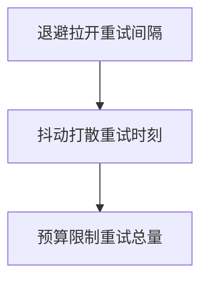
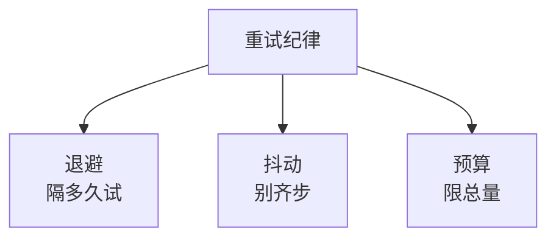
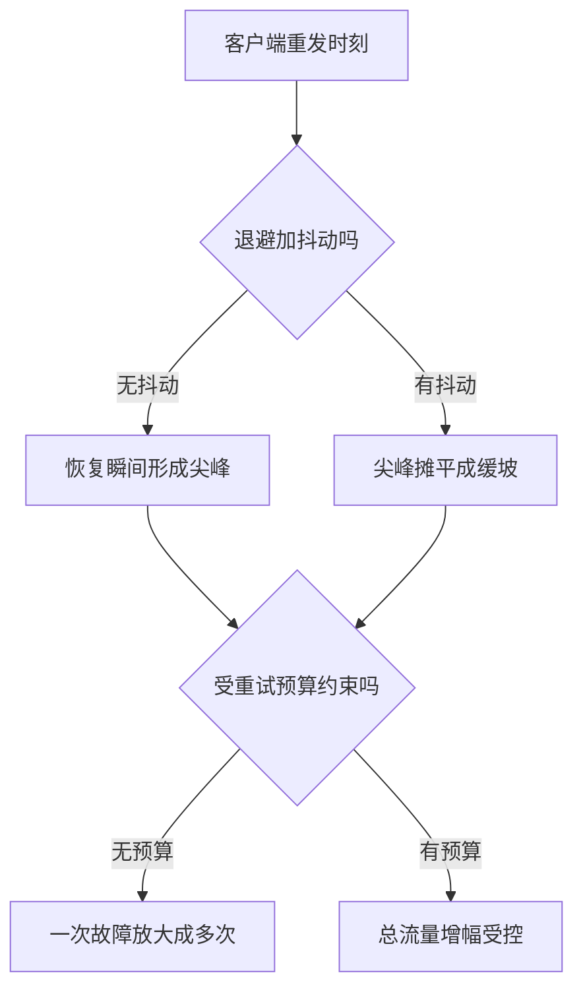

# 重试的正确姿势：退避、抖动与重试预算

## 重试到底要解决什么问题？

这篇讲重试怎么用退避、抖动、预算挡住瞬时故障；**读完你能给自己的重试定规则，也知道哪些失败不该重试。**


来源：[JavaGuide](https://javaguide.cn/high-availability/timeout-and-retry.html)（CC 4.0 BY-SA）



**重试要解决的问题是对抗瞬时故障：网络抖一下、依赖闪断一下、GC（垃圾回收）停顿半秒，这些故障不值得让请求失败，重发一次就能过。但重试是双刃剑：系统性故障（依赖过载）时，重试等于给正在崩溃的系统加倍施压。**超时、重试与幂等（同一个操作执行一次和执行多次的结果相同，重复执行不会产生额外副作用）共同定义调用语义[[工程知识/后端系统：在并发、失败与变化中维持服务/分布式可靠性/超时、重试与幂等共同定义调用语义.md]]，本文把"重试"一角展开成可执行的纪律。

## 三件武器各管什么：退避、抖动、预算

先把形状说成一件事：重试像在售票窗口前反复排队——退避是"每次被拒后多等一会儿再来"（1 秒、2 秒、4 秒，给窗口喘息）；抖动是"等的时间带点随机"（不然所有人都在整点排到窗口，恢复瞬间又被挤爆）；预算是"今天最多再排三次，超过就换别的办法"（防止自己把窗口挤爆还搭上全部时间）。这个比喻到"换别的办法"为止——售票窗口看得见排队的人，分布式系统里互相看不见对方在重试，所以抖动与预算必须是约定好的机制而非自觉。


来源：[JavaGuide](https://javaguide.cn/high-availability/timeout-and-retry.html)（CC 4.0 BY-SA）

**退避（backoff）**：连续失败后等待时间指数增长（1s、2s、4s），给依赖喘息窗口。固定间隔重试的问题：N 个客户端在整秒点齐步重发，故障恢复的瞬间又被打回去。

**抖动（jitter）**：退避时长加随机量（退避 × 0.5 ~ 1.5 之间取随机），打散客户端的重发时刻。AWS（Amazon Web Services，亚马逊云服务）构建者手册的经典结论：全同步重试会在恢复瞬间形成尖峰，加抖动后尖峰摊平成缓坡。没有抖动的退避只是把齐步走改成了慢速齐步走。

**重试预算（retry budget）**：限制重试流量占比（如重试不超过总请求的 10%）。实现方式有两种：客户端侧计数（每发 100 个请求最多 10 个是重试），或用令牌桶（按固定速率发放许可、超限即丢弃的限流器）容器统一分配。重试是特权流量——它比首次请求更有可能命中故障中的依赖，所以必须限量。

**三件的关系：退避管"隔多久试"，抖动管"大家别一起试"，预算管"总共还能试几次"。**只做退避不做抖动，齐步问题没解；只做退避抖动不做预算，**系统性故障时重试风暴（重试流量层层放大、让故障雪上加霜）照样发生。**

三件武器各管一件，缺一件的后果各不相同，对照见下表：



## 重试怎么把故障放大：重试风暴


来源：[JavaGuide](https://javaguide.cn/high-availability/timeout-and-retry.html)（CC 4.0 BY-SA）

**上图的重试风暴就是"缺预算"那一支的完整链条：下游变慢，上游超时重试，重试流量叠在已经不健康的下游上，把"慢"推成"挂"，再沿调用链向上传染。**

## 这套纪律怎么来的、付什么价：背景与代价


来源：[JavaGuide](https://javaguide.cn/high-availability/timeout-and-retry.html)（CC 4.0 BY-SA）

这套纪律的思想背景，是**对"重试加剧故障"的承认。早期实践把重试当成免费的可靠性工具（失败就重发，多试几次总没错），直到若干大规模事故证明：雪崩（一处故障沿依赖链放大成级联失效）的放大器往往就是客户端的重试逻辑**——这里借雪崩形容故障沿调用链层层加码，但真实系统不会像积雪那样物理滑动，只是调用量被成倍放大。它替代的是"固定重试三次、不区分错误类型"的默认配置——**那个配置在依赖正常时无害，在依赖过载时是凶器。**

依赖恢复的那一刻是重试压力最大的时刻——抖动与预算从同一个时刻分岔，一条管形状，一条管总量：



预算那一支正是**把重试从个体决策变成系统决策**的那一笔：每个客户端只看见自己的失败，觉得"我多试一次没什么"；**预算让重试总量在系统层面可见、可限。**代价是**预算的实现复杂度：跨客户端的预算需要公共的计数载体—**—因为每个客户端只看见自己的失败，谁都无法掌握全局重试量，所以需要各方都能读写的统一计数处；服务网格（统一管理服务间通信的基础设施层）里的 sidecar（与每个服务部署在同一处的轻量代理）是现成位置，**应用内自行实现时预算只能约束自己进程内的重试。**

## 重试预算的账怎么算：可运行示例与案例回流


来源：[JavaGuide](https://javaguide.cn/high-availability/timeout-and-retry.html)（CC 4.0 BY-SA）

```python
def call_with_retry(req):
    budget = RetryBudget(per_window=0.1)   # 全局：重试流量 ≤ 总请求 10%
    for attempt in range(3):
        try:
            resp = call(req, timeout=budget.remain() / (3 - attempt))
            return resp
        except RetryableError:
            if not budget.allow():        # 预算耗尽 → 直接失败，不再加重
                raise CircuitOpen
            backoff = min(2 ** attempt * 0.1, 2.0)   # 指数退避 0.1/0.2/0.4s
            sleep(backoff * random.uniform(0.8, 1.2))  # 抖动 ±20%
    raise FinalFailure
```

三要素的分工：退避管"间隔多久"，抖动管"大家一起退吗"，预算管"总共试多少"。**缺预算的后果是下游过载时所有调用方同时重试，下游收到的调用量含重试可达原始请求的三倍，过载被重试放大成雪崩，重试从止损手段变成故障放大器。**

**无预算重试的实录——下游抖动 30 秒期间，上游三层各自重试 3 次（每次故障被放大成二十七次下游调用），下游刚恢复就被重试洪峰再次压垮（重试风暴的二次过载），加了全局预算（重试流量超一成就触发熔断：依赖持续报错时暂时不再调用它，直接走失败路径，防止拖垮自己）后同场景恢复时间从 40 分钟缩到 3 分钟。无抖动的实录——定时任务整点批量失败后整点重试（退避基数相同，同步洪峰每分钟一次；加 ±20% 抖动后洪峰摊平）。**

只重试幂等操作的纪律见 [[工程知识/后端系统：在并发、失败与变化中维持服务/任务与并发/幂等性的完整谱系：从操作语义到删除接口的天然陷阱.md]]——**重试与幂等是一对约束，缺一个另一个就是事故。**

## 这套姿势的适用线在哪：边界


来源：[JavaGuide](https://javaguide.cn/high-availability/timeout-and-retry.html)（CC 4.0 BY-SA）

- **不是所有失败都该重试**。可重试的：超时、连接拒绝、503（服务暂不可用）。**不可重试的：400（请求参数错误）、401（未通过鉴权）、业务规则拒绝——重试一万次结果不变，还浪费时间与配额。**
- **重试必须配幂等**。**非幂等操作重试会双扣款**，幂等键（请求自带唯一标识，重复提交只生效一次）的工程实现见 [[工程知识/后端系统：在并发、失败与变化中维持服务/任务与并发/幂等性的完整谱系：从操作语义到删除接口的天然陷阱.md]]。
- **重试风暴的极限情况要交给熔断（错误率过高时暂时断开调用快速失败）**。预算管常态，连续失败率高到阈值时熔断直接止血，见 [[工程知识/后端系统：在并发、失败与变化中维持服务/任务与并发/限流熔断与隔离控制故障半径.md]]。**重试与熔断的分工：重试对抗瞬时故障，熔断对抗持续性故障。**
- **重试加深层级放大**。**A 调 B 调 C，每层重试 3 次，C 的一次故障在 A 层放大成 27 次调用。多层链路要只有最外层或最关键层持有重试权，内层把失败快速上抛。**
- **排队中的请求重试要谨慎**。**下游排队论视角下，重试等于往队列再塞一个任务**，见 [[工程知识/性能工程：从用户等待到资源瓶颈/观测与诊断/排队论给容量一个可推导的模型.md]]。

## 怎么验证三件都配齐了：验证

- **故障注入（主动向系统注入故障来验证容错能力的测试方法）验证**：对依赖注入 500ms 闪断，**预期：带退避抖动的客户端在恢复后 5 秒内成功率回到基线（正常状态下的指标水平、用来对比异常），重试流量占比不超过预算。**对不上就停下查：抖动区间是否生效、预算计数是否把重试都记进去了。
- **风暴演练**：注入持续性 5xx（非瞬时），**预期：重试预算触顶后请求快速失败（不再消耗下游），熔断在连续失败阈值处打开。预期总流量增幅不超过预算上限的 1.x 倍，若观察到流量翻倍，说明预算没兜住。**
- **多层放大验证**：三层调用链每层配 3 次重试，底层注入一次超时，**数底层实际收到的调用量，预期 27 次以内**（若各层还有超时叠加，实际数与推导数对不上就查超时预算传递）。

## 接着读哪几篇：重试在调用语义三元组里的位置

- [[工程知识/后端系统：在并发、失败与变化中维持服务/分布式可靠性/超时、重试与幂等共同定义调用语义.md]] —— 重试在调用语义三元组里的位置
- [[工程知识/后端系统：在并发、失败与变化中维持服务/任务与并发/限流熔断与隔离控制故障半径.md]] —— 持续性故障的止血机制
- [[工程知识/后端系统：在并发、失败与变化中维持服务/任务与并发/幂等性的完整谱系：从操作语义到删除接口的天然陷阱.md]] —— 重试安全性的前置条件
- [[工程知识/后端系统：在并发、失败与变化中维持服务/分布式可靠性/超时的层次设计：连接、读写与整链路的预算分配.md]] —— 超时定下时限之后的重试纪律
- [[工程知识/后端系统：在并发、失败与变化中维持服务/基础设施/长连接网关的工程要点：心跳推送与连接迁移.md]] —— 重连风暴的退避纪律
