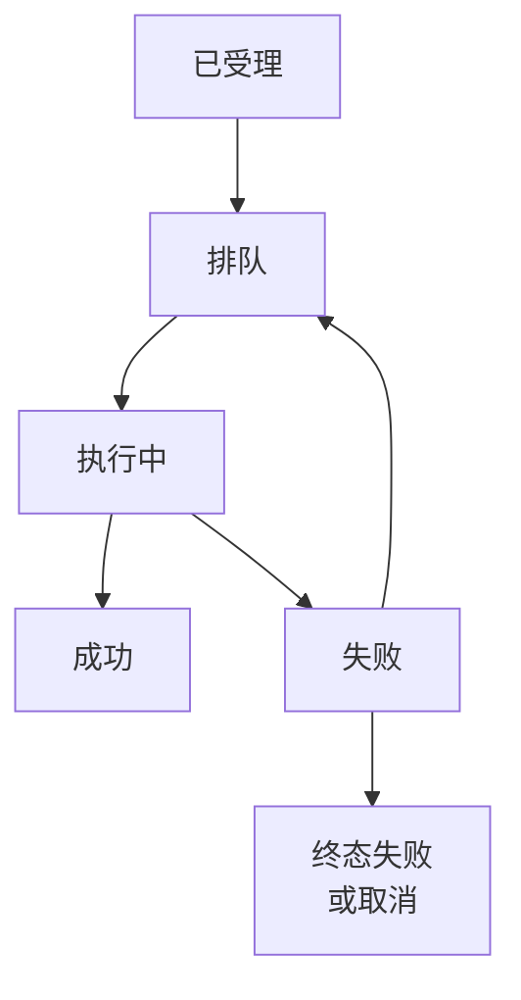

# 后端系统：在并发、失败与变化中维持服务

**后端工程的核心，是让一个请求或任务在并发、超时、重复（同一条请求被投递多次）、依赖故障和版本变化中仍有明确结果**；HTTP 服务、异步任务、数据管道和 AI（人工智能模型）推理平台外形不同，但**共享同一组问题**。读完这篇你能**把不同外形的后端系统归到同一组问题上**，也知道**换形态时哪几件事要重新回答**。

## 后端系统到底在解决什么问题

一个请求在并发写入、调用超时、重复投递与依赖故障同时出现时，系统给出的结果无法解释，也无法判断业务事实被写入了几次。本篇回答：HTTP 服务、异步任务、数据管道与推理平台共享哪一组问题、每一项在这组问题里对应什么设计动作，以及后端能力的判断依据是什么。

## 一次请求完整走哪些层

~~~mermaid
flowchart TD
    C["客户端"] --> E["入口与鉴权"]
    E --> A["应用服务"]
    A --> D[("事实数据")]
    A --> Q["队列/任务"]
    A --> X["外部依赖"]
    Q --> W["Worker"]
    W --> D
    E -.->|"request id"| O["日志·指标·Trace"]
    A -.->|"状态与错误"| O
    W -.->|"attempt 与产物"| O
~~~

**每一条边都要说明：请求身份如何传播（谁发起、带什么凭证），deadline（每层允许耗尽的最晚时间）是多少，是否可重试，重复如何识别，容量如何限制，失败如何记录，调用者最终看到什么**。

一层把请求变形并向下传，同时吸收本层的失败——这个分工在机房里有逐层对位的实物：负载均衡器把入口流量按健康度与容量分给后端节点（分水），后端过载时队列缓冲、降级开关把非核心请求泄走（排洪），洪峰沿设计好的路径走，各层自吸收本层的抖动（性能指标不稳定的起伏）：

*图源：Wikimedia Commons，Damakamis，CC BY-SA 4.0，https://commons.wikimedia.org/wiki/File:Antwerp_Mons_Waterloo_Warehouses_datacenter_06.jpg。*

都江堰的鱼嘴把这个道理说得更古老：**一条岷江分成内江灌溉、外江排洪，分水比例由地形自动调节——后端系统的每一层，都该有自己的鱼嘴：入口分流开关就是它，负载均衡（把请求分摊到多台服务器、避免单点过载）分流量、队列与降级开关泄走非核心请求，与分水排洪同构**。

分层之后，两个基础问题先于一切设计动作：状态改动怎么保证原子——要么全部生效要么全不生效，这个要么全要么无的范围就是事务边界；并发执行怎么划清共享与私有（线程边界）。当一个业务操作要写多个节点的数据时，如何保持一致就是分布式事务，其五种主流模式在一致性、性能与复杂度上各有取舍，按场景选型的对照如下：

来源：[CSDN @bjmayor《图解分布式事务模式》](https://bjmayor.blog.csdn.net/article/details/154004146)（CC 4.0 BY-SA，即知识共享署名-相同方式共享许可，允许自由使用但需署名并以相同方式共享）

并发控制落到执行单元上，起点是线程的共享与私有边界：**同一进程的多个线程共享代码、数据与打开的文件，各自私有寄存器与栈——共享的部分需要锁与同步来管理，私有的部分天然安全**。**线程比进程轻，因为同一进程的线程共享同一块内存地址空间，切换时不必像进程那样换页表（虚拟地址到物理地址的映射表）与内存映射，创建和切换更省**：

来源：[小林coding《进程、线程基础知识》](https://www.xiaolincoding.com/os/4_process/process_base.html)

## 有哪六个设计对象

| 对象 | 需要定义的不变量 |
| --- | --- |
| API/命令 | 输入输出 schema、错误语义、版本兼容、授权 |
| 状态 | 唯一事实源、事务边界、派生数据、所有者 |
| 调用 | deadline、取消、重试、幂等（同一请求重复提交也只生效一次）、并发上限 |
| 任务 | 状态机、attempt、lease（带时限的持有权，持有者须定期续期，过期则任务可被别人接管）、检查点、产物、清理 |
| 容量 | admission（准入：系统决定接收还是拒绝新请求）、队列上限、背压、租户配额、降级 |
| 变更 | additive 兼容（只新增字段或接口、不改已有语义，旧客户端仍能工作）、迁移、灰度、观测门禁、回滚 |

## 地基与扩展分别是什么

后端基础不止 HTTP。请求要先经过 API 约定、认证授权、服务发现和缓存，再进入并发控制、队列或事务；多节点扩展后还要处理复制（把数据存多份）、分片（把数据拆到不同节点）、一致性、共识（让多个节点对一件事达成一致）、容器和网络拓扑。

- API 与兼容：[[工程知识/后端系统：在并发、失败与变化中维持服务/服务设计/API接口约定定义输入输出和演进边界]]
- 身份与权限：[[工程知识/后端系统：在并发、失败与变化中维持服务/服务设计/认证授权决定请求能看什么和做什么]]、[[工程知识/后端系统：在并发、失败与变化中维持服务/后端系统：在并发、失败与变化中维持服务]]
- 缓存与读取：[[工程知识/后端系统：在并发、失败与变化中维持服务/服务设计/缓存改变读写路径、一致性与故障模式]]
- 路由与发现：[[工程知识/后端系统：在并发、失败与变化中维持服务/服务设计/服务发现与负载均衡决定请求发往哪里]]
- 并发、队列与过载：[[工程知识/后端系统：在并发、失败与变化中维持服务/任务与并发/并发控制先定义共享状态和完成条件]]、[[工程知识/后端系统：在并发、失败与变化中维持服务/任务与并发/队列和流系统用时间与容量换取解耦]]、[[工程知识/后端系统：在并发、失败与变化中维持服务/任务与并发/限流熔断与隔离控制故障半径]]
- 多节点一致性与因果：[[工程知识/后端系统：在并发、失败与变化中维持服务/分布式可靠性/一致性模型与共识解决不同问题]]、[[工程知识/后端系统：在并发、失败与变化中维持服务/分布式可靠性/复制分片与再平衡改变数据归属]]、[[工程知识/后端系统：在并发、失败与变化中维持服务/分布式可靠性/时间顺序与因果必须显式建模]]
- 运行边界：[[工程知识/后端系统：在并发、失败与变化中维持服务/基础设施/容器隔离资源边界与镜像身份]]
- 通信治理：[[工程知识/后端系统：在并发、失败与变化中维持服务/基础设施/服务网格统一通信治理但不负责业务正确性]]

## 同步请求与异步任务该怎么分

同步调用适合**能在连接和 deadline 内完成、调用者需要即时结果**的操作。异步任务适合**执行时间长、需要削峰（用队列缓冲瞬时洪峰、让下游按能力匀速消费）、可暂停恢复或需要独立扩缩**的工作。**把同步改成队列不会消除失败，只会把失败从调用栈变成状态机**：

**「消息已投递」只证明队列接受了消息，不证明业务完成；「worker 返回 0」也不必然证明目标状态正确。任务完成应绑定事实状态和产物验证**。

## 可靠性为什么来自有界行为

- **所有等待有 deadline，取消沿调用链传播**。
- **重试只用于被分类为暂时性的错误**（网络抖动、连接被重置这类会自行消失的失败），**并受总预算约束（重试次数或总耗时的上限）**。
- **写操作有幂等键（调用方生成的唯一请求标识，服务端据此识别重复请求）或并发版本，无法判断是否提交时进入 reconciliation（对账补偿，把实际状态与期望状态核对并补齐）**。
- **队列、线程池（预先建好一组线程反复取用、避免频繁创建销毁）、连接池（预先建好连接反复取用、省去反复握手建连的开销）、内存和下游并发都有上限**。
- **超载时尽早拒绝、排队或降级（主动关掉或简化非核心功能，把资源让给关键请求），不能用无限队列掩盖容量不足**。
- **依赖故障有隔离范围**；熔断（连续失败到一定次数就断开调用，避免持续打到已故障的依赖）只省去无效等待，**真正的恢复仍要靠重试或降级设计**。

## 为什么分布式不是默认答案

**模块化单体通常提供更简单的本地事务、调用链和部署**。独立服务抵得过网络、数据一致性、兼容和值班成本的条件是：**边界需要独立扩缩、故障隔离、技术约束或团队所有权**。消息队列（生产者写入、消费者读取的缓冲中间层）的引入条件是**异步、削峰、广播或重放成为实际需求**。

## 接着该读哪几篇

- 调用语义：[[工程知识/后端系统：在并发、失败与变化中维持服务/分布式可靠性/超时、重试与幂等共同定义调用语义]]
- 部分失败：[[工程知识/后端系统：在并发、失败与变化中维持服务/分布式可靠性/部分失败决定分布式系统的设计]]
- 长任务：[[工程知识/后端系统：在并发、失败与变化中维持服务/任务与并发/任务生命周期必须覆盖进程、日志、超时与清理]]
- 公平与背压（下游处理不过来时把压力传回上游减速）：[[工程知识/后端系统：在并发、失败与变化中维持服务/任务与并发/调度必须同时处理优先级、公平与背压]]
- 流量入口：[[工程知识/后端系统：在并发、失败与变化中维持服务/服务设计/流量入口只负责路由与连接，不负责业务正确性]]
- 数据正确性：[[工程知识/数据系统：在并发与故障中保存事实/数据系统：在并发与故障中保存事实]]

**后端系统的验收要与负载对账——每一类变更（扩容、限流、缓存、降级）上线前写预期指标，压测或灰度（新版本先放一小部分流量验证，逐步放大到全量）后拿实测对账，对不上的变更回滚（把系统状态退回到改动之前的版本）并回到容量假设重新算**。

**后端系统的机制与本质是什么？把后端系统看成分层的失败处理机器——每一层（接入、服务、缓存、存储、基础设施）把上一层的请求变形并向下传递，同时吸收本层固有的失败模式**；
**本质问题是变化（流量、数据、代码、拓扑）持续到来时，每层用多少冗余与多少协调去维持服务承诺**。

## 怎么自己动手验证

最小验证：对同一份服务代码，逐项构造**并发写入、调用超时、重复请求、依赖不可用与版本不一致**五类场景，断言**每一种场景下系统给出的结果是明确的（成功、失败或明确的中间状态），而不是未定义的中间态**。再对每一次重复请求，断言**业务事实只被写入一次**。

配置核对：逐项核对**超时、重试次数、并发上限与队列长度**在目标环境中的生效值，与实际配置不一致时**按环境漂移处理**。

## 效果从哪儿来，要付什么代价

让请求与任务在并发、超时、重复与依赖故障下仍有明确结果，收益是**故障可定位、恢复路径清楚**，代价是**需要在状态、超时、幂等与观测上做额外设计**，且**这些设计在业务迭代中需要同步维护**。

