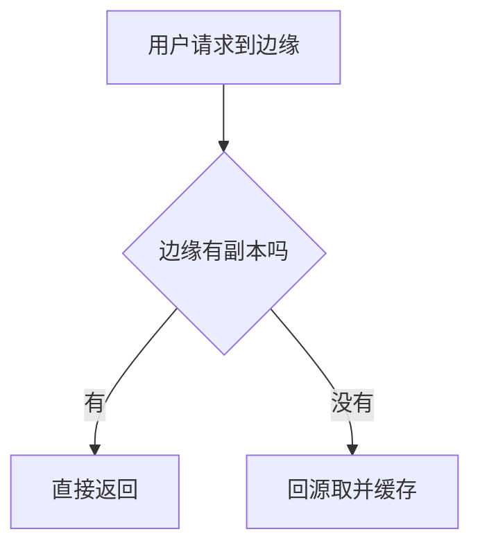
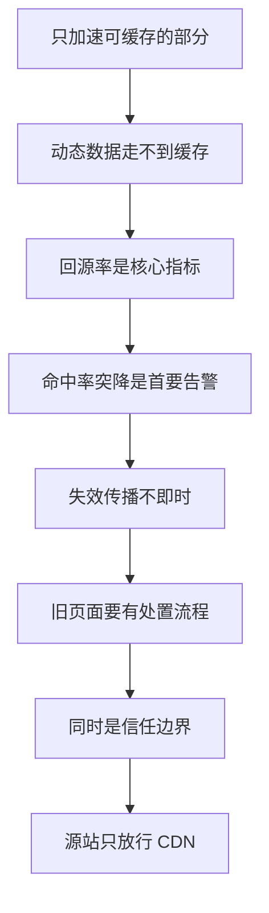
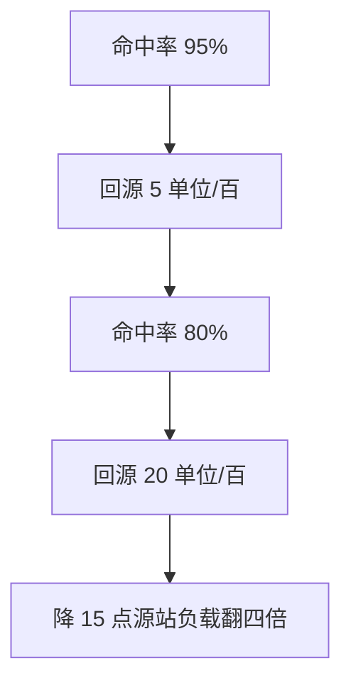

# CDN的回源与边缘缓存：静态加速背后的机制

## CDN 要解决什么问题



这篇讲 CDN（Content Delivery Network，内容分发网络） 的回源与边缘缓存：内容怎么被放到离用户近的地方、没命中时怎么回源站取。读完你能判断一次慢请求是回源还是边缘没命中，也会定缓存规则。正文用连锁便利店体系作比喻——源站是中央仓库，边缘节点是门店。


CDN 要解决的问题，是把内容搬到离用户近的地方。**用户请求先落到边缘节点，边缘没有副本时才回到源站取，这一步叫回源**。源站在单点（一个机房），全球用户都从这点拉内容：**距离远的用户吃跨洋 RTT（round-trip time，往返时间：请求发出去到应答回来一整趟，100-300ms 起步）**，热点（访问集中在少数键或节点上的现象）内容反复回源打爆源站带宽。CDN 的答案是在全球部署边缘节点（POP，point of presence），GSLB（Global Server Load Balancing，全局负载均衡：按地域调度流量） 按用户 IP 的地理位置返回最近 POP 的地址，请求因此被调度到就近的 POP，**内容缓存在边缘，命中就地返回，未命中才回源拉一次**。本质是**"读多写少的内容**，按地理位置复制一份"。它是缓存改变读写路径[[工程知识/后端系统：在并发、失败与变化中维持服务/服务设计/缓存改变读写路径、一致性与故障模式.md]]在"以地理距离为轴"上的实例。

## 命中、回源与新鲜度怎么配合：机制

先把形状说成一件事：CDN 像连锁便利店体系——源站是中央大仓库，POP（边缘节点）是开在你家附近的门店。**多数商品（内容）门店有货（缓存命中）当场拿走**；门店没货时店员才去仓库调（回源），调来的货还会摆上货架（缓存），下一个买同样商品的人就不用等。门店货架多久换一次货（新鲜度）由总部规定（源站的 Cache-Control 头）。这个比喻到"按声明执行"为止——门店补货可以趁夜里，CDN 的回源却发生在用户请求里（几十毫秒内完成），**热点商品同时过期时百万顾客同时等调货（回源风暴），这是便利店不会遇到的形态**。

CDN 的拓扑一句话：一个源站，多个边缘节点，用户就近取：


*图源：Wikimedia Commons「Content Distribution Network diagram」，作者 Avelludo，许可 [CC BY-SA 4.0](https://commons.wikimedia.org/wiki/File:Content_Distribution_Network_diagram.svg)*

**请求路由：DNS 与调度系统**。用户查 cdn.example.com，CDN 的权威 DNS（即前述的 GSLB）**按用户 IP 地理位置、节点负载、节点健康返回最近的 POP 地址**。这层调度就是 DNS 解析全链路[[工程知识/后端系统：在并发、失败与变化中维持服务/基础设施/DNS解析的全链路：递归缓存与失效传播.md]]的 TTL（Time To Live，存活时间：到期后自动失效或删除）机制在运营层的使用：**调度决策的生效速度受 DNS TTL 拖累**（改调度要等 TTL 过期），故障摘除节点也慢半拍。

**命中路径：边缘就地返回**。POP 的缓存服务器收到请求，**内容在缓存且新鲜，直接返回**（不发 x-cache: MISS 的回源流量）。命中路径的延迟构成：**用户到 POP 的 RTT+ POP 处理时间，跨洋 RTT 从链路里消失**。**这是 CDN 加速的主体收益**。

**回源路径：miss 时的拉取链**。内容不在缓存或已过期，POP 向源站（或上层 CDN 节点，多级回源）拉取。**回源是 CDN 的昂贵的路径**：一次跨洋 RTT + 源站处理 + 回传。**回源风暴（热点内容过期，百万用户同时 miss，同时回源）是 CDN 的经典故障模式**，防护靠请求合并（同一内容的并发回源合并成一次，其余请求等结果，术语 request coalescing）。

多级回源的分层结构在 Cloudflare 官方参考架构里画得很直白：最左边是互联网用户，进来先落到低层节点（DC1 到 DC3，离用户最近），低层未命中时向区域层（DC4、DC5）要内容，区域层也没有才由上层（DC6）向源站取。每一层的缓存都替下一层挡住请求，源站只跟上层打交道：


*图示：用户请求先进入低层节点，低层未命中时逐级向上要内容，只有上层节点连接源站，源站承受的请求数取决于**上层的数量而非全部节点数量**。图源：Cloudflare 官方文档《Content Delivery Network (CDN) Reference Architecture》，https://developers.cloudflare.com/reference-architecture/architectures/cdn/。*

这张图解释了回源风暴为什么会被分层削弱：如果每个低层节点都直连源站，**同一个 URL 在每次缓存过期后会被几十上百个节点各回源一次**；分层之后，**只有少数上层节点能连源站，同一个 URL 的回源次数收敛到上层的数量级**。代价是**低层到上层多了一跳**，命中不了时延迟比直连源站多一次转发。

天翼云官方文档的中文业务流程图把这条链画全了：DNS 调度（步骤 1-6）、边缘节点命中直接返回（步骤 7、10）、未命中时经中间节点逐级回源到客户源站（步骤 8、9）：


*图源：[天翼云 CDN 加速简介](https://www.ctyun.cn/document/10015932/10015967)官方文档。图中虚线为信令流（DNS 调度），实线为数据内容流，多级缓存节点（边缘 → 中间 → 源站）正是「回源路径」的逐级拉取链。*

**新鲜度：HTTP 缓存语义的执行**。RFC 9111（HTTP 缓存语义标准）定义了浏览器与代理共享的缓存语义，CDN 是其中的代理缓存角色：源站用 Cache-Control（max-age、s-maxage）声明内容能缓存多久，**CDN 按声明执行**。**静态资源（带指纹的 JS/CSS，文件名含 hash）可以 max-age 一年**（内容变了 URL 变，旧 URL 永不失效）；**动态内容（API 响应）要么短 max-age 要么 no-store**。HTTP 语义的分层[[工程知识/后端系统：在并发、失败与变化中维持服务/服务设计/HTTP语义的分层：方法、状态码与头部的约定角色.md]]里 Cache-Control 是其中最容易被忽视、又最影响 CDN 行为的头。

## 这套加速怎么来的、付什么价：背景与代价

CDN 的原型来自 1998 年 Akamai 创立时的一个观察（MIT 的分布式系统研究）：互联网的拓扑决定了**距离即延迟，内容不动用户动，不如内容主动搬到用户旁边**。第一代 CDN 服务静态文件下载；流媒体时代（2000s）推了大带宽节点；动态内容时代（2010s）扩展到动态加速（TCP 即传输控制协议的优化、路由优化、只缓存可缓存的边缘部分）；现在边缘计算（Cloudflare Workers、边缘函数）把"算"也搬过去。

**"缓存键 + 新鲜度声明"把失效责任交还给内容作者**。**CDN 不猜内容多久过期，源站的 Cache-Control 说多久就多久**；内容作者用**"文件名带 hash"的构建产物把失效变成"永不失效的新 URL"**。这个组合让 CDN **可以大规模缓存而不用担心失效协议**（没有主动失效推送，靠 TTL 自然过期 + URL 换代）。代价：这套机制只对**"URL 可变"**的内容友好，不可变的 URL（首页 HTML、API 响应）的缓存失效（缓存里的数据过期或不一致、需要回源加载）**仍是难题**——短 TTL 意味着**频繁回源**，主动失效（CDN API 清缓存）又引入新的运维接口与故障面。CDN 加速的越彻底，**"内容改了但边缘还是旧的"这类不一致事故的排查越困难**（多级缓存、多 POP、各自 TTL）。

## 这套说法在哪儿会失效

- **CDN 只加速可缓存的部分**。HTML 里嵌的动态数据、个性化内容（登录态、地域价）每次请求的答案都不同，**同一份边缘副本对下一个用户不成立，不能边缘缓存，回源仍是延迟主体**。动态加速（链路优化）收益有限（省的是握手与拥塞窗口爬坡，跨洋 RTT 本身省不掉）。
- **回源率是 CDN 的核心健康指标**。命中率（请求直接从缓存拿到结果的比例） 99% 意味着** 1% 的请求吃全价回源**，这 1% 的延迟分布——P99——与回源带宽要单独监控。**内容改版、缓存键设计错误、query string 进缓存键造成的命中率突降是最常见的事故信号**。
- **多级缓存的失效传播不保证即时**。CDN 上层节点、POP、浏览器各自缓存，**清边缘缓存不等于清浏览器缓存**，Cache-Control 与 purge API 管不到浏览器层。发布后"我这里还是旧页面"的工单，逐层清缓存是标准处置。
- **CDN 是信任边界也是攻击面**。边缘节点替源站挡 DDoS（吸收带宽攻击是 CDN 的增值能力），但源站若不限制"只有 CDN 能回源"（防火墙白名单或 CDN 回源鉴权头），**攻击者绕过 CDN 直打源站 IP，防护归零**。**源站 IP 保密是这条防线的一部分**：IP 一旦泄露，攻击者不需要经过任何域名解析，直接向源站地址发请求，白名单挡不住这种直连。

四条边界各自指向一个 CDN 覆盖不到或自身失效的面：



第二条最容易被平均值骗过去：命中率 99% 听起来很好，**剩下的 1% 却吃全价回源**，这 1% 的延迟分布与回源带宽要单独监控，命中率突降是最常见的事故信号。[CDN缓存命中率较低可能的原因](https://www.ctyun.cn/document/10015932/10138007) 把排查顺序排得很清楚：先看是否刚接入——**首次访问必然回源，要两三天到一周才把文件逐步缓存到节点**；再看请求量是否过低——**5 分钟内仅 100 个请求时，20 个请求打在同一个不缓存的 URL 上就能把命中率压到 80% 以下**，最后才查缓存规则与资源热度。

第三条与第四条说的是覆盖边界：清边缘缓存不等于**清浏览器缓存**，`Cache-Control` 与 purge API 都管不到浏览器层，所以"我这里还是旧页面"的工单要逐层清；而源站若不限制只有 CDN 能回源，攻击者绕过 CDN 直打源站 IP，CDN 吸收带宽攻击的能力就归零了。

## 怎么自己动手验证

- **命中路径验证**：同一 URL 连续两次 curl（命令行 HTTP 客户端），看响应头 x-cache（或 age 头），预期：**首次 MISS（回源）、二次 HIT**。**HIT 的 age 头随时间增长**（缓存了多久）。如果二次仍 MISS，**查缓存键是否被 query string 或 cookie 撕裂**（cache key 把不需要的变量算进去了）。
- **调度就近验证**：从不同地域的机器（或代理出口）dig CDN 域名，预期解析到的 POP IP 不同且就近（用 IP 归属地查）。**全部解析到同一 IP 说明 GSLB 没按地理调度**，查 DNS 配置。
- **回源合并验证**：对同一 URL 并发发起 100 个请求（缓存过期后），源站访问日志**预期只有 1-2 次回源（合并生效）**，其余在边缘等待后拿到结果。**源站日志 100 条说明合并没开，回源风暴直冲源站**。

## 缓存的账怎么算：可运行示例与案例回流

```text
一次发布与一次事故的推演账（通用形态）：

  命中的经济学：边缘命中 5ms 且不走源站；回源 80ms 且源站承压
    命中率 95% vs 80%：源站负载差 4 倍（回源率 5% vs 20%）
  回源风暴的账：缓存同时过期（同一秒 10 万 URL 回源）→
    源站瞬时 QPS（每秒请求数）= 平时回源的 50 倍，直接压垮源站
    解法：过期前异步续期 + 回源合并（同一 URL 并发回源只放行 1 个）
  发布的账：静态资源带内容哈希文件名（app.a3f9.js）→
    新版本 = 新 URL，旧缓存自然淘汰，TTL 可以设一年
    不带哈希的 URL 靠刷新接口主动失效（有配额与延迟）
  源站透传的账：源站返回 500 → 部分边缘把错误短暂缓存 → 故障放大
    错误响应不缓存（或短 TTL）是默认守约
```

回源风暴的实录——大促预热（上线前提前加载数据或建立连接，避免初期变慢）时批量刷新缓存，同秒数十万 URL 回源，源站被压垮——**刷新要限速分批**、回源合并配置缺失；**开启回源合并 + 预热接口分时段后平稳**。哈希（把任意长度数据压成固定长度指纹、不可逆）缺失的实录——JS 文件固定文件名上线，用户端命中旧缓存加载新接口报错——**新旧不匹配的窗口按 TTL 长度存在**；**改内容哈希命名后该类故障归零**。错误缓存的实录——源站瞬断期间边缘缓存了 502 页面 60 秒，故障从 10 秒放大到 1 分钟；**错误响应 TTL 归零后故障窗口恢复真实长度**。缓存语义的源头见 [[工程知识/后端系统：在并发、失败与变化中维持服务/服务设计/HTTP语义的分层：方法、状态码与头部的约定角色.md]]（Cache-Control 是约定的组成部分）、动态内容的边界见 [[工程知识/后端系统：在并发、失败与变化中维持服务/基础设施/DNS解析的全链路：递归缓存与失效传播.md]]（入口解析与失效传播）。

两个命中率下源站承受的回源负载各走一条链，对位看差距：



## 接着读哪几篇：CDN 是缓存一致性命题的地理轴实例

- [[工程知识/后端系统：在并发、失败与变化中维持服务/服务设计/缓存改变读写路径、一致性与故障模式.md]] —— CDN 是缓存一致性命题的地理轴实例
- [[工程知识/后端系统：在并发、失败与变化中维持服务/基础设施/DNS解析的全链路：递归缓存与失效传播.md]] —— CDN 调度依赖的 DNS 层及其 TTL 拖累
- [[工程知识/后端系统：在并发、失败与变化中维持服务/基础设施/代理与网关的谱系：正向反向与sidecar各自解决什么.md]] —— CDN 节点本质是**反向代理集群**
