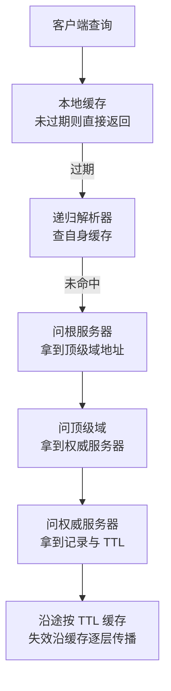

# DNS解析的全链路：递归缓存与失效传播

## DNS 要解决什么问题

DNS 要解决的问题，是**把人类记得住的名字（example.com）翻译成机器路由需要的地址（93.184.216.34）。**名字到地址的映射本身不复杂，难的是这个翻译系统要在全球范围内、无中心协调地保持：**可用（全球任何角落随时能查）、一致（所有查询者看到同一答案）、可演进（域名换地址时全世界能在可控时间内换过来）。**这是一个分布式缓存系统，**它的所有设计都围绕"缓存的 TTL（Time To Live，记录在缓存中的存活时长）是一致性与可用性之间的谈判筹码"展开。**读完你能给域名定 TTL、估算一次切换要多久生效、看懂切换演练为什么要提前降 TTL。

## 一次查询要经过哪些站：解析链的完整路径

一次查询从本地缓存到权威服务器共四站，逐站未命中才往上问。先把形状说成一件事：DNS 解析像问路的层层指路——路人问小区门卫（本地缓存）某家单位怎么走，门卫不知道就替他打电话问片区派出所（递归解析器），派出所也不存全城地图，它问市局（根服务器）"高新区归谁管"，市局说"问高新分局"TLD（Top-Level Domain，顶级域名：如 .com .cn）权威，分局说"这家单位在 xx 大厦"（域权威）。

每一层问完都把答案记在自己的小本上（缓存），下一个人问同样的问题就不用再打一遍电话。这个比喻到"层层指路"为止——**现实里每层小本记多久由被问一方声明（TTL），谁都无权撕掉别人小本上的旧记录，这正是域名换地址后全球收敛要等 TTL 的原因。**

`dig example.com` 背后的完整链路：

1. **本地缓存层**。浏览器缓存 → 操作系统缓存（按 nsswitch 配置决定先查哪些来源，如先 hosts 后 DNS）→ hosts 文件。

命中即返回，绝大多数查询在这里终止。
2. **stub resolver（本机里只负责把查询转给递归解析器、自己不递归的小转发器）→ 递归解析器**。

本机配置的 DNS（公网 8.8.8.8、内网 CoreDNS）是递归解析器，它替你跑完整个递归过程。
3. **递归过程**。

解析器问根服务器（.com 在哪）→ 根返回 .com 的 NS 记录（Name Server，指明该域由谁负责解析）→ 解析器问 .com 权威（example.com 在哪）→ TLD 返回 example.com 的 NS → 解析器问 example.com 的权威服务器 → 拿到 A 记录（Address 记录，域名最终对应的 IP 地址）。逐级问、逐级缓存。

把这条递归链跑成完整时序，Cloudflare 的编号图一图看全——8 步解析加 2 步建页，谁发起递归查询（蓝线）、解析器代谁发迭代查询（黑线）分色标注：


来源：Cloudflare Learning Center，[What is DNS?](https://www.cloudflare.com/learning/dns/what-is-dns/)。图里解析器是唯一跑完全程的角色：用户的递归查询只有一跳（步骤 1），剩下的 2-7 是解析器替用户跑的迭代查询——"递归"与"迭代"的分工在这张图上是两种箭头。步骤 8 之后的解析结果按 TTL 进解析器缓存，下一次查询从步骤 1 直接命中返回，2-7 全部省掉。

三步迭代在 Wikimedia 的这张示意图上各占一行：解析器自己没有记录，先问 root-servers.net 的权威「example.com 归谁管」，被指到 gtld-servers.net（.com 的 TLD 权威），再被指到 example.com 自己的 NS1-NS3，最后由权威给出 `example.com is at 203.0.113.15`——每一行就是「逐级问」的一跳，指路的一方只回答下一站叫什么，不代跑腿：


*图源：Wikimedia Commons《DNS Recursion.jpg》，作者 Jan Bellon，CC BY-SA 4.0，https://commons.wikimedia.org/wiki/File:DNS_Recursion.jpg。*
4. **答案回填缓存**。每一级答案带 TTL，解析器按 TTL 缓存，后续查询直接命中。

这条链的关键性质：**每一级都可以缓存，缓存让解析从秒级变成毫秒级，也让失效变成了一场赌博——旧值散在多少层缓存、每层留多久，记录作者一个都控制不了**。

缓存分布在解析链的每一级，越靠近用户命中越快、失效也越难统一。把这条链画开：跑在链条中段的递归解析器是一排实打实的机器：全球用户的查询先汇聚到它们身上，命中缓存就地返回，未命中才往上问：


*图源：Wikimedia Commons，David Monniaux，CC BY-SA 3.0，https://commons.wikimedia.org/wiki/File:Paris_servers_DSC00190.jpg。*

## TTL 定多久合适：一致性与新鲜度怎么谈判



TTL 越高可用性越好、一致性越差，定多久是在两者之间取一个可接受的收敛窗口——它决定记录在各级缓存里的存活时长，改记录后旧值要等各级缓存分别过期。这条传播链上的每一级缓存各守各的 TTL，谁也命令不了谁提前失效——上面 mermaid 图里权威服务器返回记录与 TTL 之后，路径就在沿途缓存里分岔了：

域名改地址的操作流程是：**权威侧改记录 → 全球所有缓存里的旧记录按 TTL 逐步过期 → 新查询拿到新地址。**问题就在这：**改记录的瞬间，全球已缓存的旧值要等满 TTL 才失效。**TTL 300 意味着**改地址后最长 5 分钟内**，部分用户还打到旧机器。

工程对策是**提前降 TTL**。**计划内的迁移（机房搬迁、容灾切换）流程：提前一天把 TTL 降到 60 秒 → 切换当天改记录 → 全世界在 1 分钟内跟上 → 切稳后把 TTL 恢复到高值（减轻权威服务器压力）。**计划外的切换（故障应急）没这个优待，**只能吃满旧 TTL 的不一致窗口——这是 DNS 故障切换慢的根本原因**，也是多活架构用 GSLB（全局负载均衡，按地理位置与节点健康把用户引到最近可用节点）/健康检查驱逐（按策略移除条目或实例）坏节点的原因。

TTL 的本质：**它是记录作者对"这个世界多久内可能变卦"的声明**。TTL 0 意味着每次都问权威（**一致但权威压力大**），TTL 86400 意味着一天内变了没人知道（**可用性满分、一致性冒险**）。缓存改变读写路径、一致性与故障模式[[工程知识/后端系统：在并发、失败与变化中维持服务/服务设计/缓存改变读写路径、一致性与故障模式.md]]，DNS 是这个命题在命名系统上的实例。

## 这套体系从哪来、付什么价：背景与代价

1983 年的 RFC 882/883（现 1034/1035）设计 DNS 时，替代的是 ARPANET（互联网的前身网络）集中维护的 HOSTS（系统的静态域名解析文件）.TXT（DNS 的文本记录类型）——单文件全局分发的名字表，斯坦福研究所每晚把最新版本 ftp 给所有主机。集中文件的扩展性上限撞到顶之后，Paul Mockapetris（DNS 协议的设计者）设计了分层授权加缓存的分布式方案，根只管顶级域，逐级下放。

**分层授权与缓存是同一个设计的两面**。像总店只给分店发区域牌照、各分店自己张贴当日菜单：发牌是授权（**每层只对自己的子树负责，扩展性**），贴菜单是缓存（**热点答案就近复制，性能**）；分店越多覆盖越广，各自过期的菜单也越多。比喻到"贴菜单"为止——现实里每层留多久由被授权一方自定 TTL，总店管不着。代价：**这套体系把"全局一致"放松成"最终一致"。改记录后全球收敛时间 = TTL 上限，不能更快。对一致性要求高于 TTL 的场景（登录态、支付路由），DNS 不能当路由依据，要用服务发现与实时健康检查**[[工程知识/后端系统：在并发、失败与变化中维持服务/服务设计/服务发现与负载均衡决定请求发往哪里.md]]。

## 这套说法在哪儿会失效

- **DNS 缓存无视你的业务 TTL 预期**。**部分 ISP（互联网服务提供商，即宽带或移动网络的运营商）解析器强制最低 TTL，你的 60 秒降 TTL 策略对它们无效。**切换演练要实测第三方解析器的真实行为，不能只信权威侧配置。
- **负缓存也是缓存**。**域名不存在（NXDOMAIN：DNS 返回的否定应答）的答案也带 TTL，误配导致的"域名不存在"会按 TTL 固化在递归层。删错记录后马上恢复，部分用户仍要等负缓存过期。**
- **HTTPDNS（用 HTTP 协议直接向解析服务查询域名，不走传统递归链路）/私有解析绕过递归层**。**客户端直连 HTTP 接口查解析**（由运营商 LocalDNS 即运营商网络里替用户跑递归的解析器误判域名、跨网调度不准的问题驱动），**链路变短但失去缓存生态，解析端并发压力自行承担。**移动端 App（应用程序的调度普遍走这条路）。
- **DNSSEC（给 DNS 记录加数字签名的安全扩展）验证的是完整性不是可用性**。签名（用私钥对数据生成可验证的防篡改标记）让"答案被篡改"可检测，**但验证失败的处置策略（拒绝服务 vs 降级放行）因实现而异。**且 DNSSEC 增大响应（签名链），又反过来影响 UDP（用户数据报协议，只管发、不保证到达与顺序）分片（把超过单包上限的数据切成多个包传送）与 EDNS0（DNS 的扩展机制，允许更大的应答报文）兼容——**响应超过 UDP 单包上限就要分片，不少中间网络设备对分片处理不稳，安全与可用性在这套体系里处处互搏。**

## 怎么自己动手验证

- **解析链观测**：`dig +trace example.com` 看完整递归路径，**预期：根 → TLD → 权威逐级返回 NS 与 A 记录。**+trace 失败时查本地解析器是否限制了递归。**逐级实测的形态——每一级的第一行答案连起来就是完整委托链，TTL 从根的 35 秒到 TLD 的 3569 秒逐级变长，最末级 A 记录只剩 17 秒**：


*图源：本机 dig 实测渲染（2026-09-27，每级取第一行答案，数据为真实查询结果）。TTL 的落差就是上文的失效传播模型：顶层记录可以缓存得久（TLD 一小时），最底层的 A 记录随时准备变（十几秒）——切换演练要盯的就是最后一行。*
- **TTL 传播实测**：权威侧改一条测试记录，多网络位置（不同运营商出口）dig 查询，**预期各位置在 TTL 内逐步拿到新值；若某位置超过 TTL 仍返回旧值，是强制最低 TTL 的解析器，记入该域名的切换档案。**
- **切换演练**：按"降 TTL → 改记录 → 观察 → 恢复 TTL"流程做一次真实切换，**预期不一致窗口不超过 TTL 加上中间层的强制缓存时长（该上限按演练实测确定），超出即说明有中间层在缓存更久，逐层排查。**

## 解析的账怎么算：可运行示例与案例回流

```text
一次解析与一次故障切换的推演账（通用形态）：

解析链的耗时账：本地缓存命中 0ms → 运营商递归缓存 1-5ms →
    权威服务器 10-50ms（跨网再翻倍）→ 全链路首次可到数百 ms
  TTL 的两难账：TTL 300 秒 → 切换后最多 5 分钟新旧并存；
    TTL 86400 秒 → 解析压力小 288 倍，但故障切换要等一天
  失效传播的现实：客户端/App 内嵌解析（自己缓存，无视 TTL）、
    运营商递归不守约（大 TTL 之下仍缓存）、libc 解析器行为差异

故障切换的真实时间线（TTL 300s 的"快"切换）：
    T+0    权威记录改指向备用 IP
    T+5min 缓存过期，新解析开始生效
    T+5~30min 长尾客户端逐步切换（内嵌解析、守约差异）
    → "切 DNS 就恢复"的实际窗口是分钟到半小时级
```

**TTL 拍大的实录——生产域名 TTL 设 24 小时，故障时改解析无法止血，被迫在负载均衡层切流量（DNS 只当入口指路牌，不当切换开关）；重大切换前 48 小时降 TTL 是标准前置动作。内嵌解析的实录——App 内嵌 HTTPDNS 与系统解析并存，切流量后三成用户仍打旧机房（内嵌缓存无 TTL 约束）；服务端按 IP 段灰度（新版本先放一小部分流量验证，逐步放大到全量）放量 + 旧机房保活一周才清干净。**

解析链的传输层成本见 [[工程知识/性能工程：从用户等待到资源瓶颈/存储与网络/TLS握手与证书链决定连接建立成本.md]]（解析后的握手是第二段等待）、全局入口的形态见 [[工程知识/后端系统：在并发、失败与变化中维持服务/服务设计/服务发现与负载均衡决定请求发往哪里.md]]。

## 接着读哪几篇：DNS 是缓存一致性命题的命名系统实例
[[工程知识/后端系统：在并发、失败与变化中维持服务/基础设施/队头阻塞是共享队列的排队税：一卡全等的传递链与解法.md]]
[[工程知识/后端系统：在并发、失败与变化中维持服务/基础设施/凭据的生命周期决定泄露半径：签发、注入、轮换、吊销的闭环.md]]
[[工程知识/后端系统：在并发、失败与变化中维持服务/基础设施/代理后的真实IP要靠协议传递：X-Forwarded-For的信任边界与PROXY protocol.md]]
[[工程知识/后端系统：在并发、失败与变化中维持服务/基础设施/requests与limits各管一段：调度装箱、QoS判定与节点压力驱逐顺序.md]]

- [[工程知识/后端系统：在并发、失败与变化中维持服务/服务设计/缓存改变读写路径、一致性与故障模式.md]] —— DNS 是缓存一致性命题的命名系统实例
- [[工程知识/后端系统：在并发、失败与变化中维持服务/服务设计/服务发现与负载均衡决定请求发往哪里.md]] —— DNS 的最终一致不满足实时路由需求时的替代
- [[工程知识/后端系统：在并发、失败与变化中维持服务/服务设计/HTTP语义的分层：方法、状态码与头部的约定角色.md]] —— 名字解析之后的请求约定
- [[工程知识/后端系统：在并发、失败与变化中维持服务/基础设施/CDN的回源与边缘缓存：静态加速背后的机制]] —— CDN（Content Delivery Network，内容分发网络：把静态内容缓存到离用户更近的节点） 调度依赖的 DNS 层及其 TTL 拖累
- [[工程知识/性能工程：从用户等待到资源瓶颈/存储与网络/DNS故障的放大效应：一条解析记录拖垮一个调用链.md]] —— 本篇讲解析正常机制，故障形态与取证顺序见放大效应篇
- [[工程知识/后端系统：在并发、失败与变化中维持服务/基础设施/异步DNS解析的坑：解析在别的线程，连接在当前线程，回调要过桥.md]] —— 同步阻塞的替代路径及其线程归属纪律
