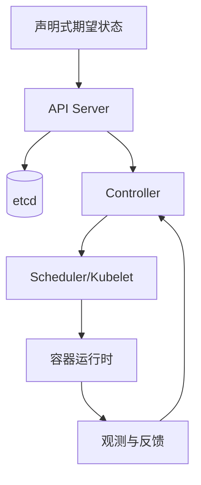

# Kubernetes 管理资源状态，不管理业务正确性

**集群能替你重启容器、调度副本、扩缩实例，这些是资源状态（集群里每个东西的现状：多少副本在跑、每个 Pod 在哪个节点上）；但订单有没有重复扣款、数据有没有写坏，它管不到**。

读完这篇你能分清哪些事交给控制器（持续把集群现状拉回你声明的期望状态的组件）收敛、哪些必须自己建事实源，也能说清 Pod（Kubernetes 调度的最小单元，把一组共享网络与存储的容器捆在一起）自愈为什么不等于**业务正确**。可以把它想成仓库管理员：他负责货架上有多少箱子、箱子在不在位、坏了补一个（资源状态），至于箱子里装的东西对不对、订单有没有发错，他不看（业务正确性）。

这个比方到「管数量不管内容」为止，**管理员补箱子时会按原样补一个空的，而 Kubernetes（容器编排平台，负责容器的部署、调度与自愈）重建的 Pod 会从镜像重新长出来——Pod 的本地存储随容器一起消亡，没有外部持久化的数据在重建时一并没了**，这一处是比方到不了的地方。

## 先记住哪几句

| 维度 | 回答 |
| --- | --- |
| 要解决的问题 | 多个进程和节点需要按期望状态调度、发现、重启和扩缩，但人工维护每个实例会放大部署和故障处理成本。 |
| 本质 | **控制器持续比较声明的期望状态和集群观察状态，并通过 API、调度器（挑选节点跑容器的组件）、kubelet（节点上管容器启停的组件）和运行时（真正运行容器的软件）收敛资源**。 |
| 做法 | 定义资源请求、探针（判断容器是否就绪或存活的健康检查）、拓扑、发布顺序、权限、配置版本、网络策略（控制 Pod 之间谁能访问谁的规则）和业务状态的外部事实源。 |
| 效果与代价 | 降低资源编排和发布操作成本；代价是控制面、网络、调度、可观测性和数据迁移复杂度。 |
| 边界 | **Pod 重启、自愈和 readiness 不等于业务正确、数据一致或容量足够；回滚应用也不能自动回滚数据**。 |
| 验证 | 分别注入 Pod/节点故障、陈旧 Endpoint（Service 后端的实际 pod 地址列表）、资源耗尽、网络/DNS 故障和部分发布（只更新一部分副本到新版本，其余保持旧版本），核对请求、状态、数据与恢复证据。 |

**一个 Pod 被重新调度只能说明资源控制器完成了替换**——**Pod 重启会丢掉内存里的在途请求和本地临时状态，替换完成只保证进程重新起来，处理中订单、消息 offset（消息在队列里读到哪里的位置标记）或数据库迁移要靠应用自己的恢复逻辑接着走**。**把 Kubernetes 事件、容器状态和业务事实分开记录，才能避免「Pod Running」被误读为服务恢复**。

## Kubernetes 到底解决哪些问题

部署方式的演进先把问题推到了平台上：物理机时代一个应用一台机器，虚拟化把机器切成多份，容器再把交付物标准化。每一次变化都让"跑起来"更容易，但都没回答"跑得对不对"。


*图源：Kubernetes 官方文档中文版，CC BY 4.0，https://kubernetes.io/zh-cn/docs/concepts/overview/。*

演进的终点是"容器由平台调度"，而调度的最小单位是 Pod——它把共享网络与存储的一组容器捆成一个交付单元。


*图源：同上（Kubernetes 官方文档中文版），CC BY 4.0。*

**平台把 Pod 调度到节点、保证副本数、维持网络可达，这三件事都属于资源状态**。

**编排平台管理的是"哪些实例在跑、网络怎么连通"这一层，实例内部的业务状态不在它的视野里**。集群网络图能看清这个边界：**平台保证 pod 之间可达、Service 稳定，但不保证写入数据库的数据是正确的**。


*图示：平台职责的边界。资源状态归平台，业务正确性归应用。*

**Kubernetes 通过声明式对象（把期望状态写成配置交给平台，平台自己凑过去）和控制循环（反复比对现状与期望、有差距就修正）提供调度、服务发现、滚动发布（逐批换新版本的发布方式）、自愈和资源隔离**。**它只比对和收敛资源状态，看不见业务语义**，所以**数据库一致性、业务幂等（同一操作执行一次与执行多次结果相同）、容量规划、权限设计、错误处理都要应用自己解决**。

上面那段声明式对象与控制循环落到真实集群里，是控制平面与节点两类组件在分工：控制平面决策并保存状态（API 服务器接收对象、etcd（分布式键值存储，Kubernetes 用它存集群状态）存状态、调度器选节点、控制器做收敛），每个节点上的 kubelet 管容器生命周期、kube-proxy 维护转发规则。官方中文架构图把这条分工一图列清，看图的重点是哪几个组件在比较期望状态与观察状态：


*图源：Kubernetes 官方中文文档《集群架构》，CC BY 4.0，https://kubernetes.io/zh-cn/docs/concepts/architecture/。etcd 是唯一存放期望状态的地方，控制器与 kubelet 轮流把它与现状对齐——「Pod Running」只是这条对齐回路的一次输出，业务正确性不在这条回路上。*



## 它管不到哪些生产边界

- **Pod 只是故障域中的进程；请求仍需超时、取消、重试、幂等和背压（下游扛不住时让上游减速的机制）**。比如一次扣款请求写到一半时 Pod 被重启，**只有应用自己的超时与幂等设计能避免重复扣款**。
- **readiness 决定是否接流量，liveness 只用于重启异常容器**；**探针不能依赖脆弱的下游全链路**。
- **requests/limits、HPA（水平Pod自动伸缩器，按指标增减副本数量）、节点容量和拓扑分布共同约束调度结果**；只设 limit 不等于**容量规划**。
- **ConfigMap（K8s 存放非敏感配置的对象）/Secret（存配置与密钥的对象）有版本和权限边界**；**镜像固定 digest（镜像内容的唯一指纹，固定后依赖可追溯），依赖和供应链可追溯**。
- **发布要有灰度（新版本先放一小部分流量验证，逐步放大到全量）、指标门禁、数据库兼容迁移和回滚（把系统状态退回到改动之前的版本）；回滚应用不一定能回滚已执行的数据变更**。

## 出问题按什么顺序排查

```text
入口/路由 -> Service/Endpoint -> Pod 状态 -> 容器日志
         -> 资源/调度 -> 网络策略/DNS -> 依赖服务和数据层
```

## 选型该问自己哪两个问题

**选型按两个问题走：集群的运维人力归谁、升级窗口能不能自己扛**。**自行承担控制面高可用、etcd 备份恢复、组件版本升级与安全补丁是一条完整运维路线**；**托管服务（云厂商的托管控制面）把这些收走，代价是节点池规格、网络插件与准入控制受厂商约束**。**团队没有专职平台人力时，托管服务是默认选项**；有特殊调度需求（GPU 拓扑、定制调度器）或合规要求数据面私有部署时，再评估完整运维路线。

**看完本篇应能做的判断：给一个具体系统指出它的资源层由谁托管、业务正确性由哪些组件承担（探针设计、幂等与对账、容量规划），验收时逐项核对资源事件与业务事实是否分开记录**——**只有资源层日志而没有业务状态记录的系统，故障排查时会把「Pod Running」当成恢复证据**。

## 还有哪些知识跟这篇关联

- [[工程知识/后端系统：在并发、失败与变化中维持服务/后端系统：在并发、失败与变化中维持服务]]
- [[工程知识/软件构建：让变化可以理解、验证与交付/软件构建：让变化可以理解、验证与交付]]
- [[工程知识/性能工程：从用户等待到资源瓶颈/性能工程：从用户等待到资源瓶颈]]

## 真实案例里发生了什么：K8s 管对了资源、业务仍然错的实录形态

**探针全绿但服务不可用是最典型的形态**——就绪探针（告知实例能否接收流量的健康检查）只检查进程能应答 `/healthz`，不检查依赖的数据库连接池（预先建好连接反复取用、省去反复握手建连的开销）是否耗尽，**Pod 全部 Ready、流量全进来、每个请求都 500**；**K8s（Kubernetes 的常用简称、容器编排系统） 的语义是"进程活着且能应答探测"，业务正确性要靠探测设计自己补（探针端点做依赖轻量检查）**。副本扩容救不了有状态错误的实录见 [[工程知识/缺陷分析：从个案到体系/稳定性/案例三十六：写被自己的回调堵住——挂起的 add 回调.md]]——**回调挂起是应用层问题，加多少副本每个副本都同样挂起，K8s 把副本数维持到位（它承诺的），业务错误原样复制到每个副本**。

资源状态的收敛语义与 [[工程知识/后端系统：在并发、失败与变化中维持服务/基础设施/基础设施选型先比较责任边界与故障模型.md]] 的责任约定直接对应：**控制器保证的是"期望副本数、期望版本、期望调度"，业务语义的保证永远是应用自己的事**，**探测与就绪设计是把业务正确性接回资源层的唯一接口**。

## 怎么自己动手验证

1. 探针语义核对：把探针端点分别指向只检查进程存活与检查关键依赖两种实现，制造依赖不可用，**预期前者保持 Ready 而请求大量报错、后者被摘出流量。两种表现对得上，才说明业务可用性判断确实由探测设计承担**。

2. 故障注入：逐项驱逐（按策略移除条目或实例） Pod、封锁节点、把 Service 后端指向已停止的 Pod、把 requests 调到节点无法满足、切断 DNS（Domain Name System，域名系统：把域名解析成 IP 地址），每项记录 Deployment（Kubernetes 里管理无状态应用副本与滚动更新的控制器）、Endpoint、容器状态与业务侧错误码，**确认资源层收敛完成与业务恢复完成是两个可以分别观察的时刻**。
3. 回滚边界核验：对一次包含数据变更的发布执行应用回滚，**预期旧版本进程恢复，而数据状态停留在新版本写入之后**。

这条核验用于确认回滚应用不改变已执行的数据变更。
4. 断言锚点：**探针端点覆盖关键依赖，每类注入都留下资源状态与业务事实两份记录，发布流程包含数据兼容检查与回滚演练记录**。

