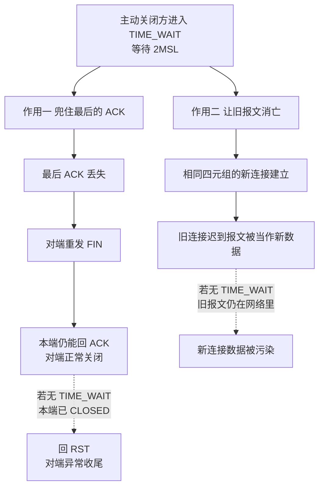
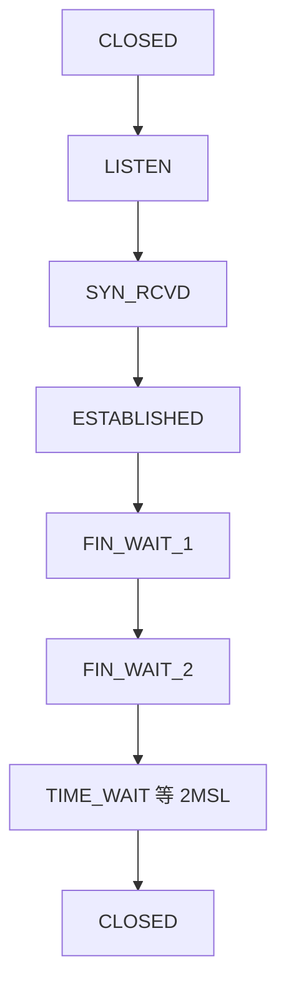

# TCP连接建立与断开的状态机：握手挥手与异常路径

## 要解决的问题是什么

**这一篇讲 TCP 连接怎么建立、断开和异常退出**。**读完你能看懂抓包里的握手挥手（断开连接的四次确认过程）报文各代表什么，也能解释服务端为何出现大量"连上了却没有数据"的连接**。

**连接这件事看起来只是"连上了"和"断开了"两个状态，实际上 TCP（Transmission Control Protocol，传输控制协议：互联网上保证数据按序、不丢地送达的传输层协议）在两端各维护一台"状态机"（一组"当前处于什么状态、收到什么消息就切到哪个状态"的规则），连接的建立、断开和异常退出都是这台机器在走状态**。抓包里那些 SYN（同步位，建连第一步的标志）、ACK（确认位，告诉对方这个序号之前的数据都收到了）、FIN（结束位，发完数据要关连接的标志）和 TIME_WAIT（主动关闭方等待 2 倍最大报文存活时间的终态）各自落在状态机的哪一步，下文逐一走过。

把两台机器的连接想成两个人打电话：双方都要先确认"你听得到我吗"（握手），挂断时要各自说一句"我说完了"（挥手），而一方把话筒放下、另一方还在说话，就出现了"半开连接"。**这个比喻到"状态存在哪里"为止——电话里状态在两个人的记忆里，TCP 里状态在两台机器的内核表项里，一头重启就等于它的记忆清空，对端却毫无察觉**。

**连接建立这一段，正好是 RTT（Round-Trip Time，一个数据包从发出到收到应答的往返时间）的定义现场：RTT就是这段等待的长度**。**三次握手（TCP 建立连接前、双方交换三个报文确认彼此收发能力的流程）里画着两个 RTT，一个在客户端视角，一个在服务端视角**。


*图源：小林 coding（博客园）《30 张图解：TCP 重传、滑动窗口（允许连续发送未确认数据、控制流量的机制）、流量控制、拥塞控制（发送方根据网络状况调整速率、避免压垮网络）》中三次握手与 RTT 标注一节，CC 4.0 BY-SA，https://www.cnblogs.com/xiaolincoding/p/12732052.html。*

**TCP 连接的建立与断开要解决的问题，是在不可靠的 IP 网络上让两端对"连接状态"达成一致**。IP 层不保证任何东西（丢包、乱序、重复都可能），**两台机器凭什么同时认为"我们有一条连接"**？

**答案是状态机加三次握手——三次握手让两端各自发出并确认对方的初始序列号，双方据此都确信对端收发正常、连接成立**。**每一端维护自己的状态（CLOSED（连接已关闭状态）、SYN_SENT、ESTABLISHED、FIN_WAIT 等，SYN 是同步报文，用来发起连接并交换初始序列号），通过交换报文驱动状态迁移**。

**TIME_WAIT 是连接收尾的代价与设计**[[工程知识/性能工程：从用户等待到资源瓶颈/存储与网络/TIME_WAIT是连接收尾的代价与设计.md]]，**本文展开整台状态机，TIME_WAIT 只是它最出名的一个状态**。

## 三次握手：为什么不是两次

打个比方：三次握手像打电话——"喂，听得到吗"（SYN）、"听得到，你呢"（SYN+ACK）、"我也听得到，开始说"（ACK）；挂电话要两边都说"我说完了"（FIN）并且都收到对方的确认，否则有一边还在等。这个比喻到"为什么要来回确认"为止：状态机有哪些状态、TIME_WAIT 为什么存在、半关闭是什么，要看正文，比喻只帮你记住"通路要双方都认"。

**建立连接交换 SYN、SYN+ACK、ACK三个报文**。**前两个交换初始序列号ISN（Initial Sequence Number，TCP 初始序列号），第三个确认**。**看起来第三次 ACK 没带数据"浪费"，但它要解决的问题有两个：一是让服务端确认"客户端能收到我的包"（两次握手下，服务端无法区分"客户端活着"与"客户端的旧包延迟到达"），二是同步双向的接收窗口协商**。**RFC 9293（IETF 发布的 TCP 协议标准文档）定义的 ISN 随机化解决旧连接的幽灵报文问题——序列号空间错开，旧连接的迟到报文无法进入新连接的接收窗口**。

**背景本质**：**三次是"双向都确认收发能力"的数学下限**。零次双方什么都不知道，一次确认一个方向，两次只确认一个方向的双向能力，三次两个方向都确认。**追问"为什么不是四次"——第四次可以捎带在第一个数据包里（ACK 与数据合发），省一次纯往返**。

序列号怎么推进、两端状态怎么随报文迁移，维基百科的脚本图一步一标：


*图示：TCP 三次握手的过程与状态变化。图源：Wikimedia Commons《TCP connection establishment.svg》，作者 Adielbm，CC BY-SA 4.0，https://commons.wikimedia.org/wiki/File:TCP_connection_establishment.svg。*
来源：Wikipedia「Transmission Control Protocol」条目（CC BY-SA）。第二个报文的 ack=x+1 就是"确认了你的 ISN"在协议里的写法——两个方向各报各的 ISN、各确认对方的，这就是"双向都确认"落在报文上的形态。

## 断开为什么比建立多一次报文

**断开比建立多一次报文（FIN、ACK、FIN、ACK），因为 TCP 全双工——把连接想成两条单向车道，数据一个方向一条：建连是各开一条车道，断连得两条都关，所以要各关一次**。**一端发完数据要关（FIN），另一端可能还有数据要发，所以另一端的 ACK 与 FIN 分开发送**。这就出现了 CLOSE_WAIT状态——对端已关，本地应用还在持有连接。**CLOSE_WAIT（对端已关闭、本端应用还没关闭连接的状态） 堆积是应用层忘记 close 的信号，这是线上排查的常见场景**。

**异常路径是状态机的另一半，常被忽略，下面逐条过**：

- **RST（复位报文，一端不协商直接中断连接）的三个触发**：端口未监听（连接请求打到不存在的服务）、进程崩溃（内核替它发 RST）、队列溢出（backlog，内核里已完成握手、等待应用取走的连接队列，打满时 SYN 被 RST 或丢弃）。**它不经过协商直接毁连接，两端状态立即回到 CLOSED**。
- **半开连接**：一端重启后不知道连接存在（内存里的状态没了），另一端还认为连接活着。**下一个包到达重启端会触发 RST，连接被强制收尾**。**keepalive（TCP 保活探测：内核定时发探测包确认对端还在）是主动发现半开连接的手段**。
- **同时打开与同时关闭**：两端同时发 SYN时状态机走对称路径（SYN_SENT → SYN_RCVD），**这是教科书冷门但真实存在（两端互调时偶发）**。

**十一个状态怎么连成一台机器、主动关与被动关在下半场怎么走岔，RFC 793 的经典状态图一张看全**：


*TCP 的十一种状态与转换路径：主动打开、被动打开、主动关闭、被动关闭各走各的边，TIME_WAIT 是主动关闭方的收尾代价（图源：CSDN 博客）*

*图示：TCP 连接的状态机与各状态之间的迁移条件。图源：Wikimedia Commons《Tcp state diagram fixed new.svg》，作者 Sergiodc2, Marty Pauley, Scil100，CC BY-SA 3.0，https://commons.wikimedia.org/wiki/File:Tcp_state_diagram_fixed_new.svg。*
来源：Wikipedia「Transmission Control Protocol」条目，原出 RFC 793（CC BY-SA）。**左下虚线框就是正文说的收尾不对称：主动关的一方要多走 FIN_WAIT 与 TIME_WAIT，被动关的一方 CLOSE_WAIT 之后 LAST_ACK 一路直回——CLOSE_WAIT 堆积之所以是应用忘记 close 的信号，看图即知：被动关路径卡在 CLOSE_WAIT 不动，说明应用一直没发自己的 FIN**。

## 这套设计付出了什么代价

**握手之后的重传，难在超时时间怎么定。定长了空等，定短了白重传——两头都是损失**。


*图源：同上（小林 coding）。*

**这套状态机的思想背景是 1974 年 Cerf-Kahn 的互联网论文：在不可靠网络上构建可靠字节流的协议设计**。**它替代的是更早的电路交换思路——电信网靠物理电路保证连接，TCP 靠两端状态一致"仿真"出连接**。**连接是软件状态，不是物理事实，这是 TCP 最深刻的抽象**。

**状态是有成本的**。**每个 ESTABLISHED 连接占内核内存（套接字缓冲区、控制块，量级几十 KB），每个 TIME_WAIT 连接占表项约 60 秒（2MSL：MSL 即 Maximum Segment Lifetime 报文最大生存时间，通常取 30 秒）**。

**服务器总内存与文件描述符数量有限，能同时维持的连接数因此有上限——状态机的内存占用是 C10K（单台服务器扛一万条并发连接）问题的根源之一**，后来的事件驱动（epoll（Linux 的事件通知机制，一个进程用它同时监视大量连接）——Linux 的多路复用接口，一个线程盯住成千上万个连接）与连接复用（HTTP keep-alive、连接池：一组预先建好、反复复用的连接都在摊薄这份状态成本）。

## 这套说法在哪儿会失效

- **TIME_WAIT 的设计不是缺陷**：**它等 2MSL 是为了 (a) 最后的 ACK 丢了还能重发 ACK 响应对端的 FIN 重传 (b) 旧连接的幽灵报文自然消亡**。要压缩它见 [[工程知识/性能工程：从用户等待到资源瓶颈/存储与网络/TIME_WAIT是连接收尾的代价与设计.md]]。

这两个作用各自对应一个具体的报文场景，都是没有 TIME_WAIT 就会出事的情形：



  **两个作用保护的不是同一端：作用一保护对端能正常收尾，作用二保护后续复用同一四元组的新连接不被旧报文污染**。**这也是为什么 TIME_WAIT 只出现在主动关闭方——只有它发出了最后一个 ACK，也只有它需要为"这个 ACK 可能丢了"负责**。
- **状态机不解释应用层语义**：**连接 ESTABLISHED 不代表服务能处理请求（进程活着但队列满）**。**健康检查（定期探测服务能否真正处理请求的机制）要解决"连接活与业务活"的区分**，见 [[工程知识/后端系统：在并发、失败与变化中维持服务/分布式可靠性/健康检查只能提供有时效的失败证据.md]]。
- **握手耗时可绕过**：**TCP+TLS（Transport Layer Security，传输层安全协议：给通信加密、防窃听与篡改） 的多次往返在弱网下显著拖慢首请求**。**QUIC（基于 UDP、把可靠性与加密都做在用户态的新传输协议）把传输握手与加密握手合流到用户态（普通程序运行的低权限受限状态）**[[工程知识/性能工程：从用户等待到资源瓶颈/存储与网络/QUIC把传输握手与加密合流到用户态.md]]，**0-RTT（零往返：复用上次会话的密钥材料，重建连接的首个报文就带数据）连重传都省了**。

## 怎么自己动手验证



挥手比握手多一次，因为两个方向要分别关闭，过程见下图：


- **抓包验证**：`tcpdump -i any 'tcp port 80'`（命令行抓包工具：把网卡上的数据包按条件过滤打印出来） 抓一次真实连接的完整握手挥手，**预期：SYN、SYN-ACK（TCP 握手第二步：应答同步并回同步）、ACK 的序列号推进、挥手四次报文的 FIN/ACK 交替**。**对不上就停下查：抓包点是否在 NAT（Network Address Translation，网络地址转换：在内外网之间改写地址与端口）/防火墙后（中间盒可能改写）**。
- **状态观测**：`ss -tan` 看线上服务的连接状态分布，**预期：ESTABLISHED 占绝大多数，少量 TIME_WAIT，CLOSE_WAIT 接近零**。**CLOSE_WAIT 持续增长是应用泄漏的硬证据**。
- **异常路径演练**：kill -9 服务进程，从客户端发请求，**预期：收到 RST 且客户端状态直接 CLOSED，不是走挥手**。

## 怎么用一次真实抓包核对状态机的账

**状态机的账，最后是丢包（数据包在网络传输途中丢失）的账**。**数据包丢失与确认应答丢失在发送方看来是一样的，都要靠超时重传兜底**。


*图源：同上（小林 coding）。*


```text
一次连接生命周期与两次经典事故的推演账（通用形态）：

  建立账：SYN → SYN-ACK → ACK，内核两道队列把关
    SYN 队列满（SYN Flood 或 accept 太慢）→ 新握手被丢弃
    accept 队列满（应用 accept 不及时）→ 客户端看"连接超时"，服务端看"队列溢出"
  关闭账：主动关进 TIME_WAIT
    高频短连接服务 TIME_WAIT 数十万 → 端口耗尽、连接表膨胀
  异常路径账：RST、半开连接（对端断电，
    本端还以为在传数据，直到写超时才发现）
```

**accept 慢的实录——服务进程 GC 停顿 2 秒，accept 停止消费，队列打满后全部新连接被丢，恢复后积压瞬间涌入造成二次过载（监控要看 `溢出计数`，客户端报"连不上"时服务端进程可能还活着）**。**半开连接的实录——机房断电，对端连接没机会挥手，本端应用层还在该连接上等响应等了 15 分钟（应用层心跳 + 写超时是发现半开的唯一手段，TCP 自身不会通知你）**。**TIME_WAIT 积压的实录——压测机关闭方式不对，数万 TIME_WAIT 占满端口，改由服务端主动关闭 + 连接复用后归零**。**两道队列的细节账见** [[工程知识/性能工程：从用户等待到资源瓶颈/存储与网络/连接建立失败先看内核队列：SYN 队列与 accept 队列是两个瓶颈.md]]**、收尾代价见** [[工程知识/性能工程：从用户等待到资源瓶颈/存储与网络/TIME_WAIT是连接收尾的代价与设计.md]]**、拥塞窗口的接力见** [[工程知识/性能工程：从用户等待到资源瓶颈/存储与网络/拥塞控制在吞吐与公平之间动态调节.md]]。

## 接着读哪几篇：状态机收尾状态的单点深挖

- [[工程知识/性能工程：从用户等待到资源瓶颈/存储与网络/TIME_WAIT是连接收尾的代价与设计.md]] —— 状态机收尾状态的单点深挖
- [[工程知识/性能工程：从用户等待到资源瓶颈/存储与网络/QUIC把传输握手与加密合流到用户态.md]] —— 握手成本的用户态重构
- [[工程知识/后端系统：在并发、失败与变化中维持服务/分布式可靠性/健康检查只能提供有时效的失败证据.md]] —— 连接活与业务活的区分
- [[工程知识/后端系统：在并发、失败与变化中维持服务/基础设施/拥塞控制的四代演进：从AIMD到BBR的思路转变.md]] —— 同协议的连接建立与断开视角，与本文的网络整体稳定视角互补
- [[工程知识/后端系统：在并发、失败与变化中维持服务/基础设施/长连接网关的工程要点：心跳推送与连接迁移.md]] —— 长连接（建立后保持不断开、多次通信复用同一条连接）赖以存活的传输层状态机
- [[工程知识/后端系统：在并发、失败与变化中维持服务/基础设施/QUIC之后的传输层：HTTP3与连接迁移的工程红利.md]] —— 被 QUIC 绕开的 TCP 状态机及其代价
- [[工程知识/后端系统：在并发、失败与变化中维持服务/基础设施/socket读写缓冲区：拥塞窗口与应用层背压的连接点.md]] —— 连接生命周期与流量控制的分工
- [[工程知识/性能工程：从用户等待到资源瓶颈/存储与网络/连接建立失败先看内核队列：SYN 队列与 accept 队列是两个瓶颈.md]] —— 握手阶段两段队列的溢出取证与缓解
