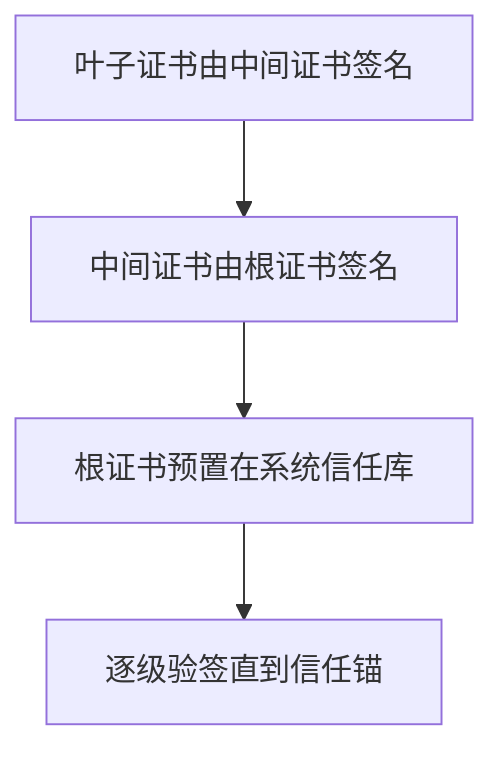

# TLS握手与证书链：信任是怎么一层层背书的

## 这篇文章要帮你搞懂一个什么问题？



信任是逐级背书的：


TLS（Transport Layer Security，传输层加密协议，HTTPS 里的 S）要解决的问题，是**在不安全的网络上安全地交换密钥：双方从未见过面，中间人可以截获、篡改、重放任何报文，凭什么双方能协商出一个只有彼此知道的对称密钥？**答案是两段式设计——**非对称加密（一对公私钥，公钥加密的内容只有对应私钥能解开，双方无需先共享秘密）解决"初次见面如何安全商量密钥"，证书链（从根证书逐级签发到站点证书的信任链条）解决"我怎么知道你是你说的你"。**读完你会知道证书链每一级验什么、握手失败该去链上哪一级找原因。QUIC（基于 UDP 的传输协议，把可靠传输与加密握手合在一起）把传输握手与加密合流到用户态（普通程序运行的低权限受限状态）[[工程知识/性能工程：从用户等待到资源瓶颈/存储与网络/QUIC把传输握手与加密合流到用户态.md]]压缩的是这段流程的耗时，本文展开的是这段流程本身的机制。

## 为什么握手分两段：密钥交换与身份证明

打个比方：证书链像介绍信——你信居委会（根证书），居委会给街道开介绍信，街道再给这个人开介绍信，你顺着这条链一路看下来才信他；中间任何一环不认识，这条链就断了。这个比喻到"信任怎么传递"为止：具体验签怎么做、密钥怎么交换、证书吊销怎么查，要看正文，比喻只帮你记住"信任是顺着链传下来的"。


**密钥交换 ECDHE（椭圆曲线临时 Diffie-Hellman 密钥交换）**。客户端与服务端各自生成临时椭圆曲线密钥对，交换公钥，各自算出相同的预主密钥（临时生成的种子，用来派生后续会话密钥）。好比两人各选一个只有自己知道的数，按同一公开规则算出结果，外人只看得到公开交换的部分，推不出这个数——比喻只到「各自算出相同密钥」为止，具体曲线运算看正文。**临时密钥对每次连接都换（E 的含义），临时私钥用完即丢，攻击者即便日后拿到服务器长期私钥，也只能解密本次，无法还原过去被录下的会话——这解决了 RSA（非对称加密算法）直接交换密钥时代"服务器私钥泄露等于历史全部泄露"的问题。**密钥交换完成后，双方用预主密钥派生出四个会话密钥（两个方向各自的加密密钥与 MAC 密钥，MAC 即消息认证码，用来校验报文没被篡改）。

**身份证明（证书链）**。服务端发证书，**证书内容是"我是 example.com，公钥是这个"，签发者 CA（证书颁发机构）用自己的私钥对这段声明签名。**客户端验证：用 CA 的公钥验签 → 验证通过则信任声明。问题是**客户端凭什么信任 CA？答案是链式背书：中间 CA 被根 CA 签名，根 CA 被自己签名，根证书预装在操作系统/浏览器里。信任从预装的根出发，沿链逐级验证到叶子证书。**RFC 5280 定义了这套 X.509（公钥证书的标准格式）体系，RFC 8446 的 TLS 1.3 把整个握手压缩到一次往返。

两段的分工：密钥交换建立**保密通道**（没人能偷看），证书链建立**身份确认**（对面不是我假扮的）。**只有前者没有后者，中间人可以自签证书冒充任何站点——保密地和一个骗子说话，比公开地和一个骗子说话更危险。**

密钥交换的 1.2 与 1.3 差别，Cloudflare 用两张图画得很清楚——1.2 要两个来回才拿到共享密钥，1.3 客户端直接把密钥材料放进第一个 Hello：


*图示：TLS 1.3 握手的消息流程。图源：Cloudflare 博客《A Detailed Look at RFC 8446 (a.k.a. TLS 1.3)》，[blog.cloudflare.com/rfc-8446-aka-tls-1-3](https://blog.cloudflare.com/rfc-8446-aka-tls-1-3/)*

两个报文飞行图把"两段"放进真实时序里：TCP（传输控制协议，负责把数据完整、有序地送达）三次握手（TCP 建立连接前、双方交换三个报文确认彼此收发能力的流程）占 50ms，之后 ClientHello 出发、服务器一次带回证书、密钥交换再走一个往返，TLS 110ms——证书在哪一步送达、往返花在哪，一眼可见：


来源：Cloudflare Learning Center，[What happens in a TLS handshake?](https://www.cloudflare.com/learning/ssl/what-happens-in-a-tls-handshake/)。图里是 TLS 1.2 的 RSA 形态（四次报文两轮往返）；1.3 把密钥交换并进第一轮往返压成 1-RTT（Round-Trip Time，一个数据包从发出到收到应答的往返时间），证书链每多一级就多一份随 ServerHello 下发的传输量——这就是"证书链多一级多一次传输"在报文层面的样子。

## 它从哪儿来，要付什么代价

这套体系的前身是 1976 年 Diffie-Hellman 的密钥交换（数学上第一次证明不见面也能共享秘密）与 1978 年 RSA 论文（数论构造的非对称加密）。证书链的思想源头是社会学的背书链——你信银行，银行给企业担保，你就信这家企业。PKI（公钥基础设施，负责签发、分发和验证证书的一整套系统）把社会信任结构数学化了。

**信任锚的本地化**。根证书预装在本地系统，**各操作系统/浏览器维护自己的根列表**（Mozilla 的根列表事实标准化了整个行业）。代价：**证书链的运维成本持续存在——证书要续期（Let's Encrypt 用 90 天有效期强制自动化，ACME（自动证书签发协议，Let's Encrypt 用它）协议让申请与续期可程序化完成，把续期变成无人值守的例行任务）、CA 要被审计（DigiNotar 2011 年被入侵后浏览器厂商联合吊销其根，CA 体系有一次整体信任重置的前科）、证书透明度日志（CT log）作为公开审计层补在链后面。信任这套基础设施建好之后维护成本仍不停止，需要持续投入。**

## 动手跑一遍会看到什么：证书链的账

```text
一次握手里证书链的验证账（通用流程）：

客户端收到：服务器证书（api.example.com）+ 中间证书（Example CA）
验证链条：api.example.com 的证书 ← 由 Example CA 签名
          Example CA ← 由根证书签名（根证书在操作系统信任库里）
  每一环验三件事：签名对得上、有效期没过、域名匹配（SAN 字段，证书里列出允许使用该证书的域名清单）
  缺中间证书（服务器没配全链）→ 客户端只收到服务器证书 → 验证失败
  → 浏览器报错，curl 报 "unable to get local issuer certificate"

数字锚点：一次完整 TLS 握手 2-RTT，
  会话复用（session resumption，把上次握手的参数缓存下来，下次直接复用，省去重新协商）后 0-RTT；证书链多一级多一次传输
  OCSP 装订把吊销检查从客户端主动查询改为服务器随身携带（OCSP 即在线证书状态协议，用来查询证书是否被吊销；装订指服务器在握手时把吊销状态证明一起发给客户端）
```

**证书过期的实录——监控盯了服务指标没盯证书有效期，凌晨证书过期，全站握手失败（每台客户端都报证书错误），修复只需续期换证书，损失在发现环节（告警缺位两小时）；修复是证书有效期监控（剩 30 天告警）+ 自动续期（ACME 类工具）+ 续期演练。中间证书缺环的实录——只配了域名证书没带中间链，自家浏览器有缓存能访问、外部用户大量失败（故障只在一部分人身上复现，最迷惑的一种），用 openssl s_client（openssl 的 TLS 客户端调试命令） 看下发链即定位。**

握手成本与连接复用的账见 [[工程知识/性能工程：从用户等待到资源瓶颈/存储与网络/Socket与TCP把连接可靠性分成多层.md]] 的分层模型、与 [[工程知识/性能工程：从用户等待到资源瓶颈/存储与网络/TLS握手与证书链决定连接建立成本.md]] 的成本账衔接。

## 这套说法在哪儿会失效

- **TLS 1.3 删掉了协商降级（主动牺牲部分功能或精度，保住核心链路）的老路**。1.2 时代客户端可以声明只支持弱套件，中间人篡改协商让连接降到弱加密。**1.3 的握手签名覆盖了协商内容，降级攻击在协议层被封闭。但老客户端还在跑 1.2，混合环境的弱套件仍是攻击面。**
- **证书验证的坑在链验证逻辑而不在算法**。**主机名校验遗漏、链不完整（服务端只发叶子不发中间证书）、时间窗校验缺失，是 TLS 集成的三大经典 bug——库给了验证函数，业务代码没正确调用。**
- **mTLS（双向 TLS，要求客户端也出示证书证明身份）是同一套机制的双向使用**。**服务间通信要求客户端也出示证书，把"客户端是谁"也从 IP/Token 升级为密码学证明。**服务网格把 mTLS 下沉到基础设施层统一实施。
- **证书不证明服务可信**。**它只证明"持有者控制这个域名"。钓鱼站可以合法买证书，浏览器锁图标只说明连接加密，不说明对面是好人——把加密当信誉是常见的认知错位。**

## 怎么自己动手验证

- **握手观测**：`openssl s_client -connect host:443 -tls1_3` 看真实握手，**预期：ClientHello/ServerHello 一次往返完成密钥交换（1.3），证书链完整送达（叶子+中间证书）。链不完整时 openssl 报 verify error，这是服务端配置遗漏的硬证据。**
- **链验证演练**：`openssl verify -CAfile ca.pem -untrusted intermediate.pem leaf.pem`，**预期链逐级通过。故意去掉中间证书重跑，预期失败——验证逻辑对不完整链必须拒绝，这是中间人攻击的防线。**


*图源：VulcanSphere 截图，Wikimedia Commons《Amazon certificate example on Firefox 89 screenshot》（Firefox 界面 MPL-2.0，https://commons.wikimedia.org/wiki/File:Amazon_certificate_example_on_Firefox_89_screenshot.png ）。顶部标签页就是链的层级——客户端验签正是从左往右逐级走的：叶子证书的 Issuer Name（Amazon）对应中间证书的 Subject，中间证书的 Issuer 对应根证书的 Subject，任取一页都能对上文中「每环验三件事」的账目（有效期、域名 SAN、公钥签发者）。*
- **到期预警验证**：监控证书剩余有效期，**预期续期流程在到期前 30 天完成轮换。Let's Encrypt + ACME 的自动化预期零人工介入；靠日历提醒的人工续期在人手紧张或流程变化时容易漏掉，遇上线缆变更或值班交接期尤其危险。**

## 想继续往下读，可以看哪几篇？

- [[工程知识/性能工程：从用户等待到资源瓶颈/存储与网络/QUIC把传输握手与加密合流到用户态.md]] —— TLS 握手成本的传输层优化
- [[工程知识/后端系统：在并发、失败与变化中维持服务/服务设计/HTTP语义的分层：方法、状态码与头部的约定角色.md]] —— TLS 之下的 HTTP 语义层
- [[工程知识/软件构建：让变化可以理解、验证与交付/开发工具/依赖供应链需要锁定来源与构建输入.md]] —— 信任链思想在软件供应链的同构应用
- [[工程知识/后端系统：在并发、失败与变化中维持服务/基础设施/服务网格控制面与数据面：mTLS与流量治理.md]] —— mTLS 赖以成立的证书机制
