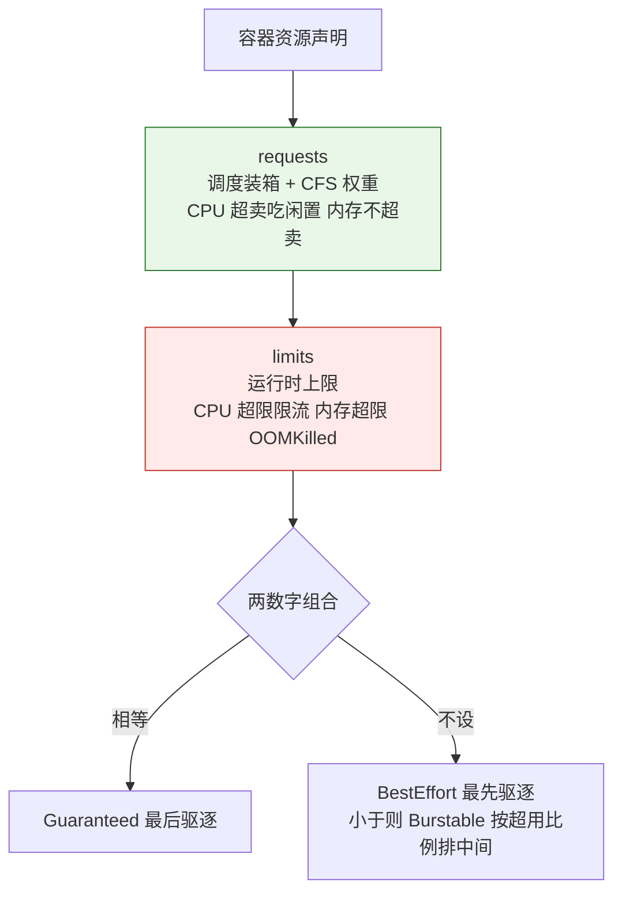

# requests与limits各管一段：调度装箱、QoS判定与节点压力驱逐顺序

**requests 管「调度器以为你要多少」，limits 管「内核最多给你多少」——两个数字各管一段，混为一谈会把资源纠纷变成性能事故。** 读完你能回答：为什么 CPU 超卖常用而内存超卖危险、QoS 等级怎么由两数字的组合算出、节点压力驱逐先赶谁走、装箱率与稳定性的定价关系在哪。

## 要解决的问题

**容器化把「进程要多少资源」拆成了两份声明：requests（调度依据）与 limits（运行时上限）。**两份声明对应两个互相冲突的目标——**调度器要高装箱率（一台机器塞尽量多的容器），运行时要低干扰（谁也别抢谁的资源）。**requests 与 limits 的设计就是给这两个目标各留一个旋钮：**requests 说了算「谁和谁住在一起」，limits 说了算「住下之后能占多少」。** 用错旋钮，**资源纠纷以三种形态出现：调度时装箱过满（OOM 驱逐）、运行时 CPU 被限流（throttling）、节点压力时被优先赶走。**

## 机制：两个数字的四个作用面

### 调度装箱：只看 requests

**调度器把节点的「可分配资源」减去各 Pod 的 requests 之和来装箱。**requests 设小，**装箱率高、单位成本低，但实际用量超过 requests 的部分构成节点的超卖敞口——大家同时超用时节点资源不够分。**requests 设大，装箱率低、成本高，但运行时干扰小。**CPU requests 影响的是调度份额（CFS 权重），内存 requests 影响的是调度位置**——内存无法压缩，超卖敞口最终以 OOM 结算。

### 运行时行为：CPU 可压，内存不可压

**CPU 超过 limits 只会被限流（CPU 时间片配额耗尽，进程变慢），不会崩。内存超过 limits 直接 OOMKilled——容器被杀重启。这条不对称决定了两资源的超卖策略不同：CPU 常用「request 低 + limit 高」吃闲置算力，内存必须 request = limit（Guaranteed）或至少不超卖**——**内存超卖的风险由同节点全体容器分摊，任何一家超用都是全节点的 OOM 风险。**

### QoS 等级：两个数字的组合自动算出

| QoS | 条件 | 节点压力下的待遇 |
| --- | --- | --- |
| Guaranteed | CPU 与内存都 request = limit | 最后被驱逐 |
| Burstable | 至少一项 request < limit | 按「用量超出 requests 的比例」排序驱逐 |
| BestEffort | 都不设 | 最先被驱逐 |

**QoS 不是手动配置，是从两数字组合推导的运行时身份。**基础设施组件（kubelet、CNI、存储插件）配 Guaranteed，在线服务按稳定性要求选档，后台任务 BestEffort 吃余量——**驱逐顺序天然形成一条成本梯度。**

### 节点压力驱逐：kubelet 的排序规则

节点内存不足时，**kubelet 按优先级驱逐：BestEffort 先走；Burstable 内按「实际用量 − requests」排序，超用越多越先走；Guaranteed 且用量未超 requests 的理论上不动。**这解释了一个反直觉现象：**requests 设置得比实际用量小很多的容器，在节点压力时是第一批牺牲品**——超用部分没有「预定」，属于借的。

## 案例：借来的份额在压力时刻结算

[[工程知识/缺陷分析：从个案到体系/资源与容量/案例十七：删除列表里的幽灵——永不收敛的待删账本]] 展示的是「以为在释放实际没释放」的资源账目错误；requests 与 limits 的误配是同构的账目错误——**requests 记的是「预定份额」，实际用量超过预定的部分是「借的」，节点压力时刻就是结算时刻。**链路完整版：**批处理任务 BestEffort 部署吃余量，在线服务 CPU 被抢占变慢（限流），内存压力再上来时批任务先被驱逐又不断重启重跑——每一环都是两个数字的配置后果。**容量的账（本篇）与行为异常的账（缺陷分析）在这里汇合。

## 怎么测

- **用量画像：`kubectl top` 与 VPA 建议（或 Prometheus 的 P95 用量）画一周曲线，requests 按 P95 设、留峰值余量给 limit。**
- **限流观测：`container_cpu_cfs_throttled_periods_total` 非零增长说明 CPU limits 卡了业务；对延迟敏感服务验证限流率 ≈ 0。**
- **驱逐演练：在测试节点制造内存压力，验证驱逐顺序与预期 QoS 排序一致、核心服务幸存。**
- **OOM 事件审计：`OOMKilled` 事件归因到 limits 设低、用量突增或内存泄漏三类，逐类处置。**

## 哪些认识一看就错

- **「limits 设大更安全」——内存 limits 大于 requests 是节点 OOM 风险源；CPU limits 卡性能，延迟敏感服务常不设 CPU limit。**
- **「QoS 是配置项」——它是两数字的推导结果，改 QoS 就是改 requests/limits 组合。**
- **「节点还有空闲内存就没事」——kubelet 驱逐看的是压力信号（可用内存水位），空闲是暂态；超卖敞口在峰值同时出现时结算。**
- **「BestEffort 不能用于生产」——后台任务、可重跑作业用它吃余量是正确用法，错的是把延迟敏感服务放进去。**

## 效果从哪来、要付什么代价

**requests 与 limits 分管调度与运行时，让装箱率与稳定性变成两个可独立调节的量：CPU 超卖吃闲置算力降成本，内存不超卖保住节点稳定，QoS 梯度让压力时刻先牺牲便宜的。**代价是**要持续维护资源画像——用量变了画像就旧**，**旧画像的 requests 等于失真的预订，驱逐与限流会出现在没人改过配置的今天。资源声明是持续对账的账本，一次性配置只是开始。**

关系：[[工程知识/后端系统：在并发、失败与变化中维持服务/基础设施/Kubernetes管理资源状态，不管理业务正确性]] —— 声明式资源模型的位置：状态归 Kubernetes，正确性归业务。[[工程知识/缺陷分析：从个案到体系/资源与容量/案例十七：删除列表里的幽灵——永不收敛的待删账本]] —— 资源账目错误的缺陷形态。[[工程知识/性能工程：从用户等待到资源瓶颈/操作系统与运行时/内存回收与OOM把内存压力变成延迟与终止的分配问题]] —— 节点内存压力的底层机制：回收、watermark 与 OOM 的分层。
