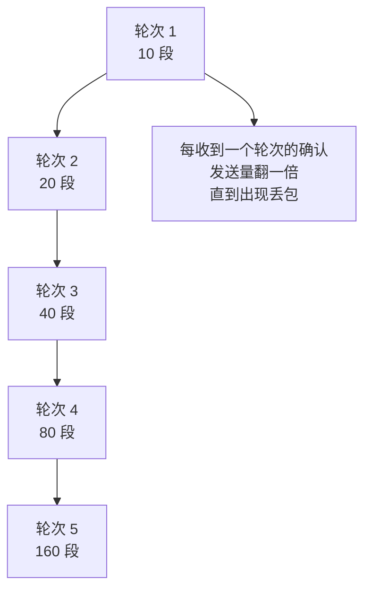
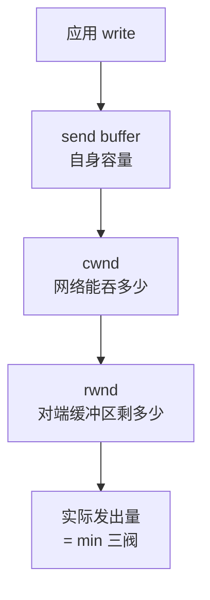
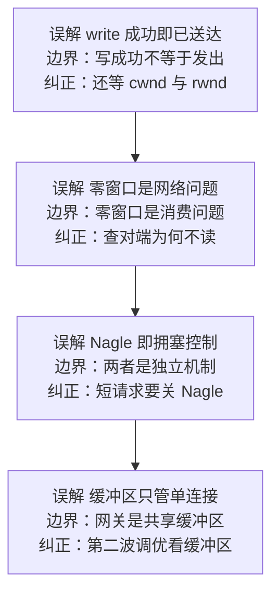
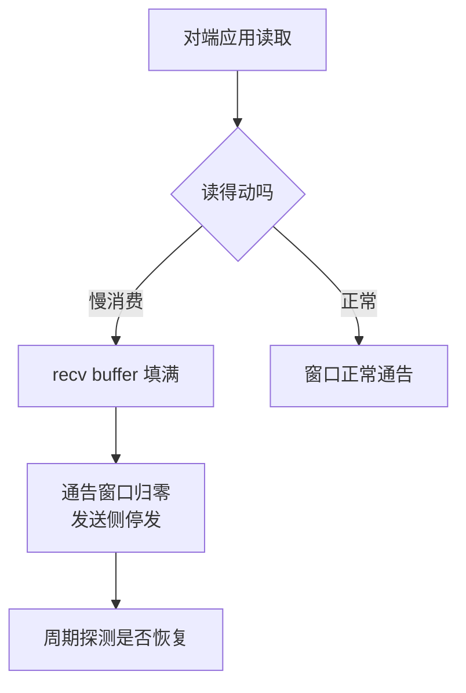

# socket读写缓冲区：拥塞窗口与应用层背压的连接点

## 要解决的问题是什么

socket 缓冲区（内核在连接两端各放的一块临时存放区）要解决的问题，是**让两个速度不一致的组件可以协作**：**应用写数据的速度、网络传输数据的速度、对端应用读数据的速度，三者永远不同步**。内核在 socket 两侧各放一个缓冲区（发送缓冲 send buffer、接收缓冲 recv buffer），**用它们吸收速度差**。读完你能判断 **write 卡住、zero window 这类故障到底卡在连接里的哪一环**。

它像在前后两端速度不同的传送带之间加的一段料仓：**前面供得快、后面取得慢，料仓先把货存住，短时间的快慢差就被吸收掉了**。这个比喻到"料仓存不下会怎样"为止——**料仓只能吸收一时的快慢差，供货持续快于取货，仓库迟早堆满**，这时候必须**回头让供货方慢下来（背压，backpressure，下游满了就向上游传递"慢下来"的信号）**，否则**只能眼看着货堆坏掉**。

但**缓冲区只能吸收抖动，吸收不了持续的差距**——**持续的差距要么填满缓冲区（内存爆）、要么缓冲区永远空（带宽浪费）**。本文写这个连接点：**内核的拥塞窗口（cwnd，网络一次能吞下多少数据，由拥塞控制算法决定）控制"往网络里塞多少"，应用层的背压（下游处理不过来时把压力传回上游减速）控制"往内核里塞多少"，两者在 send buffer 相遇**。

TCP（传输控制协议，负责把数据完整、有序地送达）连接建立与断开的状态机[[工程知识/后端系统：在并发、失败与变化中维持服务/基础设施/TCP连接建立与断开的状态机：握手挥手与异常路径.md]]管连接的建立与断开，本文管连接里的水流量。

## 缓冲区为什么要夹在两个速度之间


**发送量为什么取三个水阀的最小值？**应用 write() 把数据交给 send buffer，内核再从 send buffer 取数据发出去。**一次能发多少，取三个量的最小值**：**拥塞窗口 cwnd——网络能吞多少，由拥塞控制（发送方根据网络状况调整速率、避免压垮网络）算法决定**，见 [[工程知识/后端系统：在并发、失败与变化中维持服务/基础设施/拥塞控制的四代演进：从AIMD到BBR的思路转变|拥塞控制的四代演进]]——**与接收窗口 rwnd——对端缓冲区还有多少空间，由对端通过 ACK（确认包：告诉对方自己已经收到数据） 通告、send buffer 自身大小**。**send buffer 被填满后，write() 返回 EAGAIN 或阻塞**。三个水阀的比喻只到「三者取最小、谁小谁限流（控制单位时间放进来的请求数量，超过配额就拒绝）」为止，**阀门不会完全截断发送，只是把发出量压到最小的那个**。**这是背压的第一现场**：**应用感觉到的"写不动了"，是 send buffer 没有空闲空间**；**cwnd 小时每次往返只能发出少量数据，rwnd 小时对端声明自己收不下更多，两者都让 send buffer 里的数据排不出去，缓冲区就这样被逐渐填满**。

**拥塞窗口不是固定的：连接刚建立时很小，之后每个往返轮次都会增长，直到出现丢包（数据包在网络传输途中丢失）**——**发送量增长过快会挤满中间路由的排队空间，于是出现丢包，拥塞控制据此停止增长并回退**。下面这张时间线展示了一次传输的前几批——先发 10 个分段，确认后发 20 个，**发送量随轮次增长**。



*慢启动的指数增长形态参考 [HPBN · Building Blocks of TCP](https://hpbn.co/building-blocks-of-tcp/)，此处按原文"先发 10 个分段、确认后发 20 个"的描述自绘。*

发送路径上卡着三个水阀，实际发出量取三者最小：



三个水阀串在同一条发送路径上，**任一时刻的发出量受三者共同约束**，所以这条链要读成“**同时取小**”，不能读成“依次放行”：**拥塞窗口、对端通告窗口与 send buffer 自身容量三者谁小谁说话，另两个此刻不起作用**。

**接收侧怎么把「我还有多少空间」告诉发送侧？**对端从 recv buffer 读走数据，**内核在 ACK 里把"剩余空间"作为窗口通告回发送侧**。**这个"剩余空间"就是 TCP 报文头里的 Window Size 字段——每一条 ACK 都带着它重新通告一次，接收缓冲区腾出多少就报多少**：


*图源：Wikimedia Commons，作者 Ere（挪威语维基百科），公有领域，https://commons.wikimedia.org/wiki/File:TCP_header.png。窗口通告走的就是图中 Window Size 这 16 位字段，与 Sequence/Acknowledgment Number 一起构成滑动窗口的全部协议依据。*

**对端应用不读（卡死、慢消费），recv buffer 满，通告窗口归零，发送侧停发（zero window）**。**发送侧会周期性发 window probe 探测窗口是否恢复**。**应用层消费速度直接翻译成 TCP 层的流控**——**慢消费者在协议层被表达为零窗口**。

**缓冲区是怎么被连接数吃光内存的？****每连接的 send+recv buffer 是内核内存，10 万连接 × 256KB 双缓冲 = 50GB，内存被连接数乘法吃掉**。**tcp_mem/tcp_rmem/tcp_wmem（分别是全部连接的内核内存总额、接收缓冲与发送缓冲的上下限）的自动调节（autotuning）按需伸缩缓冲区，但上限要配**。**调大的收益：高 BDP（带宽时延积）链路吞吐上去（缓冲区小于 BDP 时带宽利用率被掐）**；**调大的代价：慢消费者把内存撑爆（buffer 越大，积压越多才触发背压）**。


*图源：Emory University CS455 课程讲义 TCP's (send/receive) buffers，教学用途，https://www.cs.emory.edu/~cheung/Courses/455/Syllabus/7-transport/tcp1c.html。*

这张图把本文的两个主角画在一条链路上：**左侧 send buffer 吸收应用 write 的速度与网络发送速度的差，右侧 receive buffer 吸收网络到达速度与对端应用读取速度的差**——**两个缓冲区各自垫在两种速度之间**，正文说的「三个水阀」「窗口通告」分别作用在这两段的入口与出口。


## 这个设计付出了什么代价

**缓冲区解耦生产者消费者是流水线思想（1970s 的计算机体系结构），TCP 的滑动窗口（1974 年原始规格）是它在网络上的实例化**。**autotuning（Linux 2.4 后引入）来自"手工配置在异构网络里永远配错"的教训**：**卫星链路要大缓冲，局域网要小缓冲，运维拍脑袋的值总有一半场景是错的**。

**流控的反馈回路不经应用手**。**对端消费慢 → recv buffer 满 → 窗口通告变小 → 发送侧自动少发**。**这个回路全自动，应用层不需要写一行流控代码，慢消费者天然被抑制**。代价：**这个回路只保护 TCP 自身（防止内存爆），不保护业务语义——积压的数据在 buffer 里排队，业务的超时可能早就到了（数据还在缓冲区里没发出，客户端已经放弃）**。所以分布式系统的超时纪律[[工程知识/后端系统：在并发、失败与变化中维持服务/分布式可靠性/超时的层次设计：连接、读写与整链路的预算分配.md]]**不能依赖 TCP 流控，要在应用层显式设预算，缓冲区只是垫背的最后防线**。

## 这套说法在哪儿会失效

- **写成功不等于发出**。**write() 返回 n>0 只保证进了 send buffer，数据可能还要等 cwnd/rwnd 打开才发**。**应用把 write 成功当"已送达"，是延迟统计失真的常见来源——应用层 RTT（Round-Trip Time，往返时间）好好的，客户端实测很慢，数据在 buffer 里滞留**。
- **零窗口是消费问题不是网络问题**。**看到 zero window，查对端应用为什么不读（GC 停顿、死锁、慢查询），不是查网络**。**netstat 的 Recv-Q（接收队列里尚未被应用读走的字节数）高水位是对端不消费的本地证据**。
- **Nagle（攒小包算法）与小包**。**Nagle 算法把多个小包攒成一段再发，减少小包开销**，**对延迟敏感的交互协议RPC（Remote Procedure Call，远程过程调用：像调本地函数一样调远端服务）的短请求要关（TCP_NODELAY）**，否则**"攒包等 ACK"的延迟进 P99（百分之一最慢请求的响应时间）**。**拥塞控制四代演进（见上文链接）与 Nagle 是两个独立机制，经常被混谈**。
- **长连接（建立后保持不断开、多次通信复用同一条连接）网关（站在客户端与后端服务之间的入口层，集中处理路由、鉴权与协议转换）是缓冲区事故的多发地**。**推送网关的每连接缓冲、慢客户端的积压、内存乘法**，见 [[工程知识/后端系统：在并发、失败与变化中维持服务/基础设施/长连接网关的工程要点：心跳推送与连接迁移.md]]。**网关的第一波调优通常是文件描述符（fd）与内存，第二波就是缓冲区策略（小 buffer 快背压 vs 大 buffer 高吞吐）**。

四条边界各自纠正一个常见误解：



腾讯云开发者社区的 [TCP 之深入浅出 send&recv](https://cloud.tencent.com/developer/article/1871141) 把第一条边界的机制说透：**应用调用 send 只是把数据拷进 socket 的内核发送缓冲区，返回时数据不一定已发到对端**；**非阻塞模式下缓冲区可用空间为 0 就返回 -1 并置 EAGAIN**。CSDN [背压机制全解析](https://blog.csdn.net/weixin_29587015/article/details/164489836) 补上了第二条边界的排查路径：**接收端应用读得慢，接收缓冲区被填满，内核通告窗口变为 0，发送端内核停止发送，发送端缓冲区随之填满，应用再 write 就被阻塞**——**这一整套连锁反应不需要任何业务代码配合，内核自己完成**。该文还给出了判别方法：**`ss -tnp` 里 Recv-Q 持续积压说明本端 read 不及时，Send-Q 持续积压说明对端窗口为 0、下游背压传导上来了**。

## 怎么自己动手验证



应用层消费速度会翻译成协议层的窗口通告，慢消费最终表现为零窗口：


*图源：本机 2026-09-27 实测 `ss -tnp state established` 与 `ss -tan` 状态计数，Pillow 渲染。Recv-Q 持续积压说明本端 read 不及时，Send-Q 持续积压说明对端窗口为 0、下游背压已传导到本端。*


- **缓冲区积压观测**：`ss -tm` 看 Send-Q/Recv-Q 与 skmem（每 socket 内存），预期：**健康连接的队列水位低（字节积压少）**；**慢消费者场景 Recv-Q 持续高**。**把 ss 的 mem 与 /proc/net/sockstat 的 tcp_mem 对账，预期账目一致**，对不上说明**有隐藏积压在 autotuning 的暗账里**。
- **背压触发验证**：客户端停读（不 recv），服务端持续 write，预期：**send buffer 填满后 write 阻塞或 EAGAIN，netstat 对端窗口归零**。如果 write 一直成功，查 **SO_SNDBUF 是否被设得过大（背压被延迟触发，积压全在内存里）**。
- **吞吐与 BDP 验证**：高 RTT 链路（如 50ms）压测大文件传输，预期：**autotuning 下吞吐接近带宽上限**；**关闭 autotuning 且缓冲区设小（如 64KB），预期吞吐被掐（吞吐 ≤ 缓冲区/RTT）**。**这个实验直接展示"缓冲区小于 BDP 掐带宽"**。

## 拿一个真实场景怎么对账

```text
一条慢消费链路的推演账（通用形态，量级为公开典型值）：

  正常账：应用 write → socket 发送缓冲区 → 拥塞窗口放行 → 对端接收缓冲区 → 对端 read
  慢消费账：对端 read 慢 → 对端接收缓冲区满 → 零窗口通告 → 本端拥塞窗口被压到 0
    → 本端发送缓冲区积压 → 应用 write 开始阻塞（背压终于传到应用层）
  缓冲区参数的账：发送/接收缓冲区调大 → 突发容忍度升，但检测对端故障的延迟也升
    （缓冲区越深，"写成功"离"对方真收到"越远）
  长肥管道账：带宽×延迟积大的链路，小缓冲区跑不满带宽
    （100Mbps×200ms 需要约 2.5MB 在途数据，默认缓冲区常常不够）
```

**背压迟到的实录**——**下游服务卡死但 TCP 连接还在，上游看 write 一直成功（数据全堆在 200KB 发送缓冲区里），故障 10 分钟才被发现**；**改应用层心跳（节点定期互发的存活信号，超时收不到就判定故障） + 写超时后分钟级发现——心跳主动探测出下游已失联，写超时让连接不再空等缓冲区排空，故障从被动等待暴露变成主动分钟级告警**。**缓冲区调大的实录**——为"抗突发"把发送缓冲区调到 8MB，**结果对端宕机后连接挂了 25 分钟才超时（缓冲区深度直接拉长故障暴露时间）**；**缓冲区参数要与故障检测时间一起权衡**。**零窗口的实录**——**导出任务消费慢，零窗口把生产方拖住，生产方线程池（预先建好一组线程反复取用、避免频繁创建销毁）被占满引发雪崩（消费端要有限流和队列上限，让背压在应用层可控地反映）**。拥塞窗口的接力机制见 [[工程知识/性能工程：从用户等待到资源瓶颈/存储与网络/拥塞控制在吞吐与公平之间动态调节.md]]、应用层背压的完整传递链见 [[工程知识/后端系统：在并发、失败与变化中维持服务/服务设计/背压的传递链路：从下游饱和到上游减速.md]]、连接池（预先建好连接反复取用、省去反复握手建连的开销）与缓冲的联动见 [[工程知识/后端系统：在并发、失败与变化中维持服务/服务设计/连接池参数的联动校验：池大小、超时与队列深度是一组约束.md]]。

## 还想深入理解可以接着读哪几篇？

- [[工程知识/后端系统：在并发、失败与变化中维持服务/基础设施/TCP连接建立与断开的状态机：握手挥手与异常路径.md]] —— 连接生命周期与本篇流量控制的分工
- [[工程知识/后端系统：在并发、失败与变化中维持服务/基础设施/拥塞控制的四代演进：从AIMD到BBR的思路转变.md]] —— cwnd 这半个水阀的完整故事
- [[工程知识/后端系统：在并发、失败与变化中维持服务/基础设施/长连接网关的工程要点：心跳推送与连接迁移.md]] —— 缓冲区事故的多发场景
- [[工程知识/后端系统：在并发、失败与变化中维持服务/基础设施/网卡与内核旁路：中断与轮询的取舍.md]] —— 被旁路（绕开主流程的备用路径）掉的内核路径与背压
- [[工程知识/后端系统：在并发、失败与变化中维持服务/服务设计/背压的传递链路：从下游饱和到上游减速.md]] —— 背压的传输层原型