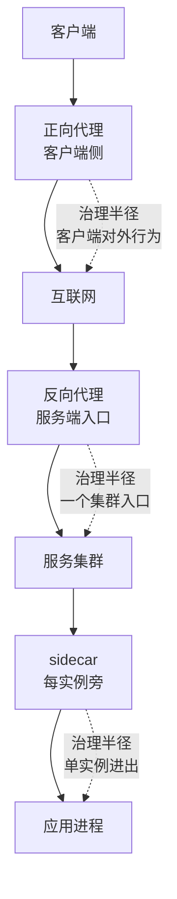
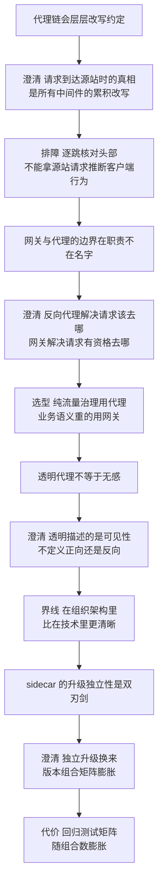

# 代理与网关的谱系：正向反向与sidecar各自解决什么

## 代理到底在替谁干活、解决哪类问题？

本文讲正向代理、反向代理、sidecar（边车：与业务容器同机部署、代理其流量的伴随进程） 三种形态各自解决什么；读完你能按插入位置判断该用哪一种，以及方向配错会出什么事故。代理要解决的问题，是**在通信路径上插入一个可控的中间人**：流量要经过我，我就能观测、改写、路由、熔断（依赖持续报错时暂时不再调用它，直接走失败路径，防止拖垮自己）。

它。这个"**可控中间人**"是**网络治理的最小单元**——所有流量治理（负载均衡、灰度——新版本先放一小部分流量验证，逐步放大到全量、熔断、加密、审计）都建立在**"流量先过我手"这个前提**上。

谱系的存在是因为**中间人插的位置不同，解决的问题不同**：**正向代理替客户端出头，反向代理替服务端挡门，sidecar 替单个应用包一层**。**位置决定职责，这是本谱系的组织原则**。

可以把它想成公司的传达室：**替里面的人往外跑腿的是正向代理**（员工要上网，由它代发），**守在门口给外面的人指路的是反向代理**（访客只知道公司大门，不知道后面哪间办公室），而 **sidecar 像是给每个员工单独配的随身秘书，只服务他一个人**。这个比方到「站在谁的立场上」为止，**传达室的人换班不影响办公室里的活，sidecar 挂掉则是它所服务的那一个实例直接失联**。

## 正向、反向与 sidecar 三种形态分别长在什么位置？

**正向代理（forward proxy）**：**插在客户端侧**。客户端知道代理存在（显式配置或系统代理），代理替客户端访问外部。解决客户端侧问题：**出口管控（企业内网上网审计）、地域突破（跨境加速）、隐私（隐藏客户端 IP）**。正向代理的方向感不难确认——**浏览器只跟代理说话，目标网站收到的是代理发出的请求**，图里的绿色客户端经代理出去，**真实源站对客户端不可见**：


*图源：Wikimedia Commons「Forward proxy h2g2bob」，作者 h2g2bob，许可 [CC0](https://commons.wikimedia.org/wiki/File:Forward_proxy_h2g2bob.svg)，与本节下方反向代理图同作者对照阅读。术语对照：Forward proxy＝正向代理，Internet＝互联网，Web server＝网站服务器。*

HTTP 语义的分层[[工程知识/后端系统：在并发、失败与变化中维持服务/服务设计/HTTP语义的分层：方法、状态码与头部的约定角色.md]]在正向代理处有一次"再解释"——代理改写 Host 头、追加 X-Forwarded-For（记录请求途经的原始客户端 IP 的请求头），约定被中间件重新包装。

**反向代理（reverse proxy）**：**插在服务端侧**。客户端不知道代理存在（域名解析到代理，代理背后是真服务集群）。解决服务端侧问题：**负载均衡（把请求分摊到多台服务器、避免单点过载）、TLS（Transport Layer Security，传输层加密协议，HTTPS 里的 S）终止（后端只管明文）、缓存加速、限流（控制单位时间放进来的请求数量，超过配额就拒绝）熔断**。Nginx（最常用的开源反向代理与 Web 服务器）/HAProxy（以高性能负载均衡著称的开源代理）的主战场。服务发现与负载均衡决定请求发往哪里[[工程知识/后端系统：在并发、失败与变化中维持服务/服务设计/服务发现与负载均衡决定请求发往哪里.md]]的**"决定"动作大多由反向代理执行**。

**sidecar 代理**：**插在每个应用实例旁（同机/同 Pod）**。应用只看到本机地址（localhost，指同一台机器内部使用的地址）的一个代理，**所有进出流量经它**。解决应用级问题：**服务间 mTLS（双向 TLS 认证，两端互验证书，应用零改造）、按实例的精细观测、渐进式流量切分**。业界实现以 Envoy（CNCF——Cloud Native Computing Foundation，托管 Kubernetes 等项目的基金会——的开源数据面代理）为主。容器隔离资源边界与镜像身份[[工程知识/后端系统：在并发、失败与变化中维持服务/基础设施/容器隔离资源边界与镜像身份.md]]给了 sidecar 部署形态——**同 Pod（Kubernetes 里最小的部署单元，一个 Pod 内进程共享网络与存储）共享网络命名空间（操作系统用来隔离网络栈的机制），sidecar 与应用的生命周期一致**。

sidecar 形态的官方全貌来自 Istio 文档：Envoy 代理随应用部署成数据面（真正转发流量的部分），istiod 控制面（负责下发发现、配置与证书的管理部分）把发现、配置与证书（CA 签发的公钥凭证、证明持有者身份）下发给每个代理，应用流量全部从代理之间走：


*图源：Istio 官方文档「Architecture」配图 arch.svg，https://istio.io/latest/docs/ops/deployment/architecture/，Istio by Google，Apache-2.0 项目文档配图（内容 CC BY-NC-SA 4.0，注明出处转载）。*

三形态的统一本质：**都是"流量必经点"的实现，差别只在插的位置与治理半径**。正向代理治理出向流量（半径=**客户端的对外行为**），反向代理治理入向流量（半径=**一个集群的入口**），sidecar 治理服务间流量（半径=**单个实例的所有进出**）。

三形态插在通信路径的三个位置，治理半径各画一段，见下图：



反向代理的形态也不复杂——客户端只认识 example.com，不知道背后被代理挡下的服务器集群：


*图源：Wikimedia Commons「Reverse proxy h2g2bob」，作者 h2g2bob，许可 [CC0](https://commons.wikimedia.org/wiki/File:Reverse_proxy_h2g2bob.svg)*


## 它从哪儿来，要付什么代价

网关（站在客户端与后端服务之间的入口层，集中处理路由、鉴权与协议转换）承担的功能越多，后端就越轻。TLS 这类连接层的活挪到网关之后，因为 TLS 已在网关处终止，网关到后端这段可不再做公网加密，两端能改用更简单的内部协议：


*图源：[Azure 架构中心「Gateway Offloading」模式](https://learn.microsoft.com/zh-cn/azure/architecture/patterns/gateway-offloading)官方配图 gateway-offload-tls.svg，Microsoft，许可 CC BY 4.0。*

再往后是横切功能的整体下沉——认证、限流这些与业务无关的动作统一在网关做，后端只处理业务；下图里的 WAF（Web Application Firewall，Web 应用防火墙）检查就是这类下沉的典型：


*图源：同上（[Azure 架构中心「Gateway Offloading」模式]）。*

sidecar 是同一个思路推到每个服务实例上。大使进程代理出入流量，应用本身只连本地地址；重试、断路、日志等横切网络逻辑都由大使代管，应用代码里不再写这些，复杂度因此挪出应用：


*图源：[Azure 架构中心「Ambassador」模式](https://learn.microsoft.com/zh-cn/azure/architecture/patterns/ambassador)官方配图 ambassador-example.png，Microsoft，许可 CC BY 4.0。*


代理概念的祖先是**电话接线员**——所有通话经过总机，总机可以监听、转接、优先级排序。**HTTP 代理的标准化（1996 年代）最早解决的是企业出口管控**。**反向代理随 Web 规模化兴起**（90 年代末的负载均衡需求）。**sidecar 是微服务时代的发明**（2016 年 Envoy——开源的数据面代理）+ 2017 年 Istio（管理服务网格的控制面平台）**把"每实例一个代理"制度化，它把反向代理的能力下放到实例级**。

**sidecar 用部署形态换治理粒度**——治理粒度指能对多小范围的流量定规则。反向代理是集群共享的，它能做"这个集群的流量规则"；sidecar 是实例私有的，它能做"这个实例的出向流量在目标故障时快速失败"。**治理粒度从集群细到实例，代价是资源与运维的乘法：1000 实例 = 1000 个 sidecar 进程（内存、升级、版本管理都是 ×1000）**。**服务网格的"资源开销是否值得"争议全部源于这个乘法**，这也是近年 sidecar-less（Cilium eBPF 路线、Ambient Mesh）兴起的动机：eBPF 是内核里可编程的数据包处理机制，可在不经 sidecar 进程的情况下完成流量治理。

## 这套说法在哪儿会失效

- **代理链会层层改写约定**。正向代理改 Host、反向代理加 X-Forwarded-For、CDN（内容分发网络：把静态内容缓存到离用户近的节点）注入 Via（HTTP 头里的"途经节点记录"字段）——**请求到达源站时的"真相"是所有中间件的累积改写**。**排障时要逐跳核对头部**，不能拿源站看到的请求推断客户端行为。
- **透明代理不等于无感**。运营商级的透明拦截（TCP 分流）对应用是黑盒（不接触代码内部、只看输入输出的测试或分析方式），**应用无法区分"网络慢"与"中间人在延迟我的包"**。排障方法见 [[工程知识/性能工程：从用户等待到资源瓶颈/存储与网络/端到端网络延迟来自排队、协议、传输与处理.md]]。
- **网关与代理的边界在职责不在名字**。API 网关是反向代理加了业务语义，两者常共用实现（Nginx 做网关、Envoy 做网关）。**选型的分界是"要不要承载业务逻辑"——纯流量治理用代理，业务语义重的用网关**，界线在组织架构里比在技术里更清晰。
- **sidecar 的升级独立性是双刃剑**。应用与 sidecar 可以独立升级（治理能力演进不重启发应用），但**版本组合矩阵膨胀（应用 v1/v2 × sidecar v1/v2 = 4 种组合）**，回归测试（改动后重跑旧用例、确认没有破坏既有功能）**矩阵随之膨胀**。

四条边界各自澄清一个容易被名字带偏的判断，对照见下表：



第二条最容易被名字带偏：透明描述的是对客户端的可见性，并不定义这个代理是正向还是反向。第三条的分界在职责——CSDN [正向代理与反向代理：从原理到 Nginx 配置实战](https://blog.csdn.net/weixin_26805597/article/details/165637069) 给出的概括很直接：反向代理解决"请求该去哪"，网关解决"请求有资格去哪"。

该文还点出一个常被忽略的报文层差异：**走正向代理的 HTTP 请求行里 URL 是完整绝对地址**（`GET http://example.com/foo HTTP/1.1`），**走反向代理的只有路径**（`GET /foo HTTP/1.1`）——**正向代理需要从请求行里解析出目标服务器地址，反向代理只需看路径就能按 location 规则转发**。GeekCoder [正向代理与反向代理：核心概念、差异与实践全解析](https://www.geekcoder.org/blog/zheng-xiang-dai-li-yu-fan-xiang-dai-li-zong-jie/) 补上了配置位置这一维度：**正向代理由客户端显式配置，反向代理由 DNS（Domain Name System，域名系统：把域名解析成 IP 地址） 把域名指向它，客户端无感知**。这正是第一条边界的成因——**每一跳都在改请求，源站看到的"真相"是累积改写的结果**。

## 怎么自己动手验证

- **路径观测**：对一条真实链路（客户端 → 正向代理 → 反向代理 → 源站）tcpdump（命令行抓包工具：把网卡上的数据包按条件过滤打印出来） 逐跳抓包，**预期每跳的头部改写累积可见（X-Forwarded-For 逐级追加）**。对不上就停下查：**哪一跳丢了转发头**。
- **治理生效验证**：在反向代理配置一条限流规则，压测**预期 429 在代理层返回（不到源站）**。若限流"生效"但源站也收到超额流量，说明**有旁路（客户端直连、缓存命中路径绕过代理）**。
- **sidecar 故障演练**：kill sidecar 进程，**预期应用流量快速失败（治理失效但通信不可用）**——**sidecar 是单点，它的可用性就是实例的可用性**。若流量仍通（应用有直连 fallback），**治理规则对该路径失效，这要进设计文档**。

## 动手跑一遍会看到什么：谱系的账

```text
下面用「账」的说法盘一遍三种形态各自容易踩的坑（只列代价与事故，不代表可量化结算）。三类代理的职责推演账（通用形态）：

  正向代理：代表客户端出去（访问控制、缓存、匿名）
    放错了的账：把正向代理当反向代理部署 → 内部服务暴露在公网
  反向代理：代表服务端接客（负载均衡、TLS 终结、静态缓存、限流）
    单点账：反向代理是全站入口，挂了 = 全站挂 → 双活 + 健康检查是底线
  sidecar：代表单个实例收发（mTLS、重试、熔断的进程级外置）
    密度账：每实例一个 sidecar，千实例 = 千份内存税（上批网格篇的账）

  演进账：功能先在应用库（重试熔断 SDK）→ 量大后外置到 sidecar/网关统一治理
    每次外置 = 换一次故障域（SDK 故障变进程故障、网关故障变全站故障）
```

**代理放反的实录**——运维把带公网 IP 的正向代理配进生产网段，**内部服务被扫到直接暴露**（**代理方向是安全边界，配错即开门**）；按方向 + 网段双重校验后杜绝。**网关单点的实录**——反向代理单实例承载全站，**升级重启窗口全站不可用 40 秒**；**双实例 + 探活摘流后发布无感**。**SDK（软件开发工具包）外置过头的实录**——单个请求的重试策略需要在业务层感知上下文（哪些错误可重试依赖业务语义），**外置到 sidecar 后策略僵化，失败率反升**（**重试语义与业务强耦合时留在应用内，通用通信治理才外置**）。sidecar 治理的展开账见 [[工程知识/后端系统：在并发、失败与变化中维持服务/基础设施/服务网格控制面与数据面：mTLS与流量治理.md]]、网格的能力边界见 [[工程知识/后端系统：在并发、失败与变化中维持服务/基础设施/服务网格统一通信治理但不负责业务正确性.md]]、入口分流的层级观见 [[工程知识/后端系统：在并发、失败与变化中维持服务/服务设计/服务发现与负载均衡决定请求发往哪里.md]]。

## 接着读哪几篇：反向代理执行的"决定"动作

- [[工程知识/后端系统：在并发、失败与变化中维持服务/服务设计/服务发现与负载均衡决定请求发往哪里.md]] —— 反向代理执行的"决定"动作
- [[工程知识/后端系统：在并发、失败与变化中维持服务/服务设计/HTTP语义的分层：方法、状态码与头部的约定角色.md]] —— 代理改写的约定层
- [[工程知识/后端系统：在并发、失败与变化中维持服务/基础设施/容器隔离资源边界与镜像身份.md]] —— sidecar 的部署形态基础
- [[工程知识/后端系统：在并发、失败与变化中维持服务/服务设计/RPC框架的通用骨架：序列化连接管理与超时传递]] —— RPC 流量过 sidecar 的治理插入点
- [[工程知识/后端系统：在并发、失败与变化中维持服务/基础设施/网络命名空间与容器网络：vethbridge与overlay.md]] —— sidecar 共享 netns 的部署基础
- [[工程知识/后端系统：在并发、失败与变化中维持服务/基础设施/CDN的回源与边缘缓存：静态加速背后的机制.md]] —— CDN 节点本质是**反向代理集群**
- [[工程知识/后端系统：在并发、失败与变化中维持服务/基础设施/服务网格控制面与数据面：mTLS与流量治理.md]] —— sidecar 形态与治理半径