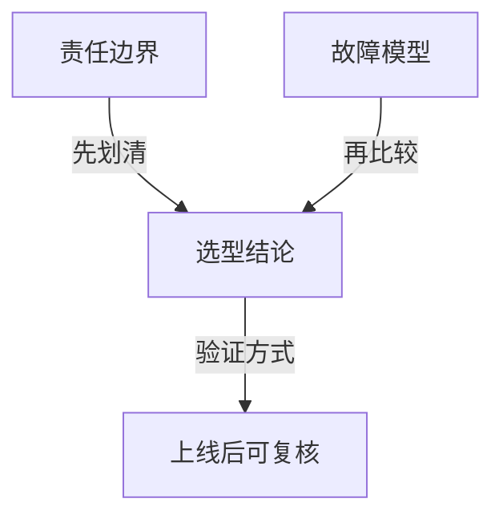

# 基础设施选型先比较责任边界与故障模型

这篇说明基础设施选型如何先把业务约束映射到组件保证；**读完能列出责任矩阵与可验证假设，避免只看吞吐数字选错组件**。**基础设施选型要把业务约束映射到组件提供的保证：数据是否为事实源（系统里唯一可信、可审计的持久化数据，例如订单库）、是否需要事务、能否丢失、是否需要重放、延迟和尾延迟（p99 等高分位下的响应时间）目标、谁负责运维，以及故障时如何恢复；吞吐数字的对比排在这些约束之后**。选型像给不同工种划工位：**谁负责出图、谁负责搬运先定清，再谈工具快慢**。这个比喻到「先划工位再比工具」为止，具体六个问题见下文。

例如「把数据库换成缓存」可能让演示环境延迟下降，却**同时丢失事务约束、审计和恢复语义**；「换成事件流」也**不能自动得到可查询的当前状态**：事件流按时间顺序记录变动，不保存最新汇总，要查询当前状态需另建物化视图（预先算好并存下来的查询结果、读时免重算）。**选型结论应写成责任矩阵和可验证假设，而不是组件排行榜**。

## 要解决的问题：业务约束怎样映射到组件提供的保证

**选型比的是责任边界，而边界是按层划的**。协议栈给出了最直接的例子：**TCP（传输控制协议，负责把数据完整、有序地送达）管可靠有序，IP 只管按地址送到，两者互不替代**。

**在多个组件之间比较吞吐数字之后选定其中一个，上线后发现在事务、重放或恢复责任上缺少任务必需的能力**。本篇回答：**业务约束怎样映射到组件提供的保证、哪些约束必须在选型之前确定、故障恢复的责任归谁，以及脱离环境的吞吐与延迟数字为什么不能作为依据**。

## 选型之前要先问哪六个问题？

打个比方：选型像挑外包——先问清楚"哪部分坏了算你的、哪部分算我的"（责任边界）、"它坏起来是慢慢坏还是一下全坏"（故障模型），这两条比性能参数更能决定你后面睡不睡得着。这个比喻到"先比什么"为止：它只用于理解先比责任与故障，不涉及具体评估方法，具体怎么列出故障模型、怎么验证厂商承诺，要看正文。

1. **事实源是什么？** **订单、账务和配置通常需要可审计的持久化事实源；缓存、索引和派生视图不应反过来成为唯一事实源**。

2. **一致性边界在哪里？** **明确哪些读必须线性一致，哪些读允许最终一致，并写出过期、补偿或人工校正路径**。

3. **消息能否丢失或重复？** **选择投递语义、幂等**（同一操作执行多次与执行一次效果相同）**键**（保证同一请求重复发送只生效一次的去重标识）**、去重记录和重放策略**，而不是**只看「有没有队列」**。

4. **流量形态是什么？** **区分请求响应、持续推送、批处理**（把多个请求合并成一批同时计算、提高硬件利用率）**、事件流和大文件传输；不同形态的连接、背压**（下游处理不过来时把压力传回上游减速）**和成本模型不同**。

5. **故障如何被发现和恢复？** **需要健康检查、超时、限流**（控制单位时间放进来的请求数量，超过配额就拒绝）**、隔离、降级**（主动牺牲部分功能或精度，保住核心链路）**、告警、回滚**（把系统状态退回到改动之前的版本）**和演练证据**。

6. **变更由谁承担？** **托管服务降低底层运维，但会带来供应商边界、配额、网络和迁移约束；自管软件则需要自己承担升级和高可用**。


来源：[腾讯云开发者社区《Redis系列：Redis主从、哨兵、集群介绍》](https://cloud.tencent.com/developer/article/2183910)（CC 4.0 BY-SA）


## 哪些能力域适合用什么组件、边界在哪里？

表里「低流量同步 RPC（Remote Procedure Call，远程过程调用：像调本地函数一样调远端服务）」一行值得展开看：**RPC能替代本地调用的前提，是调用方与被调方之间有一套清晰的责任分工**。JavaGuide 的原理图把这套分工画成 5 个组件 7 个步骤——**客户端 Stub 负责组装与序列化**（把内存对象转成可存储或传输的字节格式的过程）**，网络传输层只管搬运，服务端 Stub 负责反序列化与分发，本地实现只管业务逻辑**；**每一步出错的归属（序列化失败、传输失败、业务异常）正是选型时要逐项问清的责任边界**：


*图源：[JavaGuide《RPC 入门》](https://javaguide.cn/distributed-system/rpc/rpc-intro.html)，CC BY-SA 4.0，文档引用。*

| 能力域 | 典型选择 | 适合解决 | 不应默认承担 |
| --- | --- | --- | --- |
| 事务事实源 | 关系型数据库 | 约束、事务、查询、审计 | 极低延迟的所有读请求 |
| 热点（访问集中在少数键或节点上的现象）和短期状态 | KV（Key-Value，键值对：按键取值的最简数据模型）/缓存 | 缓存、计数、限时状态、分布式协调 | 需要完整审计的唯一事实 |
| 搜索与检索 | 倒排/向量/混合检索系统 | 文本、向量、过滤和相关性排序 | 事务提交和权限最终裁决 |
| 异步解耦 | 队列 | 任务削峰、重试、消费者隔离 | 需要长期查询和复杂事务的主存储 |
| 可重放事件流 | 日志型流平台 | 多消费者、顺序、回放、流式处理 | 低流量同步 RPC 的替代品 |
| 大对象 | 对象存储 | 文件、模型、备份、数据集 | 小事务记录和低延迟随机更新 |
| 流量入口 | CLB（云负载均衡）/反向代理/API 网关 | L4/L7 转发、TLS、健康检查、路由 | 业务幂等和数据一致性 |
| 任务调度 | 容器编排/作业系统 | 调度、扩缩容、滚动发布、资源隔离 | 跨服务业务事务 |

## 为什么用组合而不是单个组件替代？

CDN（Content Delivery Network，内容分发网络：把内容缓存到离用户更近的节点）与源站是典型组合：**CDN 承担就近命中与边缘缓存，源站负责动态内容与回源**（缓存未命中时去后端或源站取数据）。选型时要问**"哪些内容允许在边缘缓存、缓存多久、回源失败怎么办"——这些正是责任边界**，要不要 CDN 反而是下游结论。

「责任边界」在标准机柜的布线规范里有现成的实物教学：**一列机柜里，谁走电力、谁走网络、谁走带外管理线，三种线分槽分色各走各的路径——电力归配电单元，网络归交换机**（在局域网内按地址转发数据帧的设备）**，管理网归 IPMI**（Intelligent Platform Management Interface，带外管理接口）**/BMC**（Baseboard Management Controller，主板上的带外管理控制器）**网络，任何一条线出问题，看线槽颜色就能立刻判定归谁修**。**机柜之所以运维有序，是每个组件都清楚「哪一段归我管、哪一段不归」——线槽的分色条就是选型时要画的那条责任线**。

这个比喻只用来说明**责任要分槽画清**，具体选型仍要回到六个问题逐项确认，不能只画一条线就结束。**基础设施选型的失败案例，多数是没人画这条分色条：缓存回源失败算谁的、队列消息重复算谁的，电力网络管理线混在一个槽里互相指望**。


*图源：Wikimedia Commons，Shixart1985，CC BY 2.0，https://commons.wikimedia.org/wiki/File:Network_equipment_and_cables_organized_in_a_server_rack_at_a_modern_office_environment_during_the_afternoon.jpg。*

CDN 与源站的分工是责任边界的正面案例：**用户请求先打到就近的边缘节点（POP），命中则直接返回，未命中才回源站取——边缘缓存与回源的划分决定了故障时的责任归属**。


图源：[Cloudflare 官方学习中心《What is a CDN?》](https://www.cloudflare.com/learning/cdn/what-is-a-cdn/)。图中「London POP 命中返回 / Paris POP 未命中回源」的两条路径，正是「哪些内容允许在边缘缓存、回源失败怎么办」两个问题在结构上的答案。

```text
客户端 -> 托管负载均衡 -> 网关/反向代理 -> 无状态服务
                                      |-> 关系型数据库（事实源）
                                      |-> 缓存（可重建的派生状态）
                                      |-> 队列/事件流（异步与重放）
                                      |-> 搜索/向量索引（可重建的查询视图）
                                      |-> 对象存储（大对象与归档）
```

同一组合按数据流向画开，每条分支回答「这类数据归哪类组件、是否可重建」：



组合时分别写清：**写入顺序、失败补偿、幂等键**（请求自带唯一标识，重复提交只生效一次）**、数据重建方式和观测指标**。**不要用「WebSocket（浏览器与服务端之间的双向长连接协议） + Redis」或「缓存 + 数据库」这样的产品名组合代替一致性设计**。

## 选型时逐项查什么

- [ ] **为每类数据标注事实源、派生源、保留期限和删除策略**。
- [ ] **为同步调用定义超时、取消、有限重试和幂等行为**。
- [ ] **为队列或事件流定义顺序键、重复处理、积压告警和重放流程**。
- [ ] **为缓存定义失效、穿透、击穿、雪崩**（一处故障沿依赖链放大成级联失效）**和冷启动**（缓存或服务刚启动、还没有数据与连接的状态）**策略**。
- [ ] **为入口层定义健康检查语义、连接耗尽、TLS**（Transport Layer Security，传输层加密协议，HTTPS 里的 S）**终止、路由和灰度**（新版本先放一小部分流量验证，逐步放大到全量）**策略**。
- [ ] **为每个关键组件记录容量模型、配额、备份、恢复目标**（RPO（Recovery Point Objective，恢复点目标：最多丢多少数据）；RTO（Recovery Time Objective，恢复时间目标：出事后多久内必须恢复））**和迁移路径**。
- [ ] **用接近生产的负载验证 p50/p95/p99、错误率、资源成本和故障恢复时间；不要引用脱离环境的固定 QPS**（每秒查询数，系统每秒处理的请求量）**或延迟数字**。

**选型的故障模型要与演练对账——候选组件宣称的故障语义（副本切换时间、脑裂行为——集群中同时出现多个主节点各自写入）、数据丢失窗口逐项注入验证，实测与宣称对不上的候选出局，责任边界以实测为准重画**。

选型的机制与本质：**组件选型比较的其实是一份责任约定——谁负责复制、谁负责故障检测、谁负责数据一致性，宣称的 SLA**（Service Level Agreement，服务等级约定：对可用性、延迟、吞吐等指标做出的承诺）**是这份约定的输出**；
**故障模型是约定的另一半：失效时组件是停、是降级、是静默错，边界内的问题要组件自己扛，边界外的问题要留给上层**。


## 怎么自己动手验证

**最小验证**：对每个待选组件，**逐项写出它是否为事实源、是否提供事务、允许丢失的范围、是否支持重放、延迟目标、运维责任归属与故障恢复方式，缺失项标注为待确认**。**构造一次组件故障，断言恢复动作与预先写下的责任归属一致**。

**容量核对**：**用接近真实流量分布的负载测 p50/p95/p99、错误率与资源成本，核对是否满足预先声明的目标**。

## 效果从哪儿来，要付什么代价

按业务约束对照组件保证的收益是**选项之间的差异可比较、故障时的责任归属明确**，代价是**对每项约束都需要先写清楚**，**约束本身不清楚时选型只能停留在参数对比层面**。

## 维护规则

本页只保留跨产品、跨版本仍成立的决策原则。产品能力、价格、配额和性能数字必须放在带来源和复核日期的专题页，并在外部更新雷达中登记：[[工程知识/AI 系统工程：从模型能力到生产能力/生态与选型/AI技术动态]]。

## 相关

- 入口与托管服务：[[工程知识/后端系统：在并发、失败与变化中维持服务/服务设计/流量入口只负责路由与连接，不负责业务正确性]]
- 通信、重试与幂等：[[工程知识/后端系统：在并发、失败与变化中维持服务/分布式可靠性/部分失败决定分布式系统的设计]]
- 数据事实源与索引：[[工程知识/数据系统：在并发与故障中保存事实/数据系统：在并发与故障中保存事实]]
- 性能验证：[[工程知识/性能工程：从用户等待到资源瓶颈/性能工程：从用户等待到资源瓶颈]]