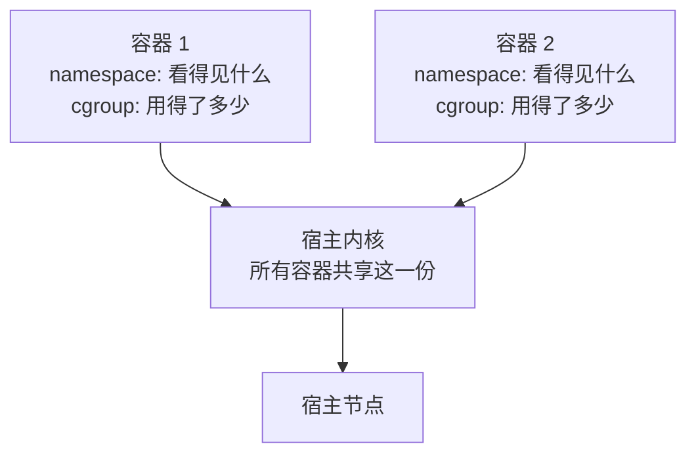
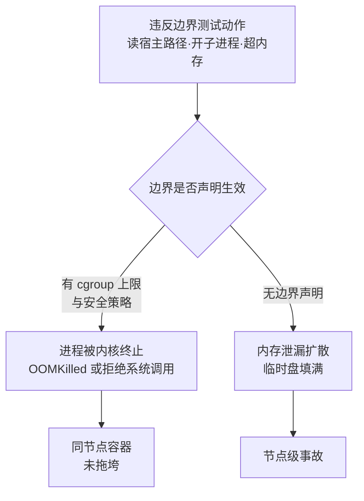

# 容器隔离资源边界与镜像身份

一次内存泄漏拖垮节点，一次重启拉到不同依赖——**容器看着隔离，其实只隔离了进程和资源**。读完这篇你能说清**容器隔离什么、不隔离什么，以及镜像身份该怎么钉住**。可以把它想成公寓楼：每户有独立的水电表（资源边界：既计量用量、也设定用量上限），装修图纸和材料清单决定了**这一户长什么样、能不能原样复制到另一栋楼**（镜像身份）。这个比方到「各户独立、图纸可复制」为止。**公寓的水电从总表分出，容器的 CPU 和内存配额由内核记账；超出配额时进程被直接停掉，不像公寓停水那样只是暂停供应**。

一个内部 Agent 需要执行第三方脚本：脚本会读工作区、发起网络请求并启动子进程。第一版直接用 root 容器、`latest` 镜像和宿主目录挂载。这个设计同时暴露了三条边界：**容器隔离的是进程和资源，不是完整虚拟机；镜像标签不是产物身份；资源上限和安全策略必须在启动前声明**。

这三条边界在节点上由谁执行？containerd（容器运行时）的架构图给出全景：kubelet 的请求经 CRI（Container Runtime Interface，Kubernetes 的容器运行时接口）进来，镜像的存储（Content Store）、文件系统的叠加（Snapshotter）、容器的生命周期（Runtime 与 shim）全部由 containerd 的插件分层管理，资源边界最终由它交给 runc（OCI 容器运行时）用 namespace（隔离进程、网络、挂载点等资源视图） 与 cgroup（Linux 的资源限制机制，把进程分组并限制 CPU/内存上限）执行：


*图源：[containerd 官网](https://containerd.io/docs/)，Apache-2.0。启动前声明的 securityContext 与 resources 最终都由这条链路执行：API 层收到的配置，经 Metadata 与 Runtime 传到 shim/runc，变成 namespace 与 cgroup 的实际边界。*

## 要解决的问题：容器隔离的实际范围是什么

本篇回答：容器隔离的实际范围是什么、镜像标签与产物身份之间差在哪里、资源上限与安全策略在什么时机生效，以及启动前需要声明哪些内容。

## 容器到底隔离了什么


*图源：Kubernetes 官方文档《Pods》，CC BY 4.0，https://kubernetes.io/zh-cn/docs/concepts/workloads/pods/。这张图把"隔离到哪一层"画得很实：同一个 Pod（Kubernetes 调度的最小部署单元，可含一个或多个共享网络的容器） 里的容器共享网络与存储，它们之间不是隔离边界；真正的边界在 Pod 外面。下面这张表逐条说清每种机制隔离了什么、又没保证什么。*

| 机制 | 主要解决 | 不能自动保证 |
| --- | --- | --- |
| **namespace** | PID（Process ID，进程编号）、网络、挂载、用户和 IPC 视图隔离 | 宿主内核仍共享；错误的特权配置仍可扩大权限 |
| **cgroup** | CPU、内存、PID、设备等资源配额 | limit 内的程序一定正确；CPU limit 还可能造成 throttling（被限流：CPU 用量触及上限后被内核强制减速） |
| **capabilities** | 把 root 权限分成可单独撤销的能力 | `CAP_SYS_ADMIN` 等高权限能力安全 |
| **seccomp/LSM（Log-Structured Merge，先把写入攒在内存里、再按批顺序落盘的存储结构）** | 限制系统调用和安全策略 | 应用逻辑越权、供应链恶意代码 |
| **镜像层** | 固定运行时文件和依赖 | 标签永远指向同一内容、镜像本身可信 |

**命名空间与 cgroup隔离的是可见范围与用量，隔离不了共享内核上的提权路径**——**攻击者一旦提权就能越过 namespace 和 cgroup 的边界，影响同内核上的其他容器或宿主**，因此**容器适合资源隔离和部署封装，但不是对抗高权限攻击者的完整沙箱**。**运行不可信代码时，应把它放到更强的 VM（Virtual Machine，虚拟机）、专用节点或明确的沙箱产品里，并缩小网络、凭据和文件系统暴露面**。

这张剖面图说明隔离的两条轴——namespace 切「看得见什么」，cgroup切「用得了多少」——两条轴之下的内核始终只有一份：



namespace 给每个容器一套独立的进程号、网络栈与挂载视图；cgroup 给每个容器划走 CPU、内存与 PID 配额；但系统调用（程序请求内核提供服务的入口）最终都进同一个内核——特权配置、内核漏洞与共享状态都在这条共享通道上。


来源：[腾讯云开发者社区《30 张图揭开「内存管理」的迷雾，瞬间豁然开朗》](https://cloud.tencent.cn/developer/article/2671629)（CC 4.0 BY-SA）


来源：[小林coding《进程、线程基础知识》](https://www.xiaolincoding.com/os/4_process/process_base.html)


## 镜像身份为什么必须先用 digest 钉住？

`my-app:latest` **只是一段可变的名字，不能回答「这次运行的到底是哪一份代码」**。生产发布至少要记录：

- **镜像 digest**（例如 `image@sha256:...`），而不是**只记录 tag**；
- 构建提交、基础镜像 digest、依赖锁文件和 SBOM（Software Bill of Materials，软件物料清单，逐项列出镜像里装了什么）；
- **签名**（用私钥对数据生成可验证的防篡改标记）、**provenance**（构建来源证明：记录这份镜像由谁、在哪台机器、用哪些输入生成）、**漏洞扫描结果和例外审批**；
- 运行用户、开放端口、需要的 capability 和挂载清单。

回滚（把系统状态退回到改动之前的版本）也要回到**已验证的 digest + 配置版本，不能重新拉一次同名 tag**。**镜像扫描只告诉你已知漏洞，不能替代最小权限（只授予完成任务所必需的最小权限）和运行时观测**。

## 生产环境要锁住哪些安全基线？

### 进程和文件系统怎么锁

- **默认非 root，固定 UID/GID**；删除不需要的 Linux capabilities，**通常从 `drop: [ALL]` 开始再按证据加回**。
- 使用 runtime 默认 seccomp，叠加 `no-new-privileges`；**禁止 `privileged`、host PID、host IPC（进程间通信：两个独立进程交换数据的各种办法）和 host network，除非有书面边界和专门节点**。
- **rootfs 只读，把可写目录显式挂到临时盘或专用卷**；不把宿主 `/var/run`、Docker（主流容器运行时） socket 或整个工作区直接挂进去。
- **Secret 以短生命周期、最小权限的方式注入，避免写进镜像、命令行和普通日志**。

### 网络和身份怎么锁

- **服务账号只拥有这个工作负载需要的 API 权限；不同租户或不同风险等级使用不同身份和资源池**。
- 出站网络按域名/IP/端口建立 **allowlist**（白名单：只允许清单内的目标通行）；**工具执行器默认不能访问云元数据（云平台给实例下发的配置信息，含临时凭据）、内网控制面（云平台管理资源的内部接口）和任意公网**。
- 记录 DNS（域名解析系统：把网址里的域名换成机器用的 IP 地址）、连接失败、被策略拒绝的请求和凭据访问，而不是**只记录 HTTP 500**。

### 资源和生命周期怎么锁

- **为 CPU、内存、PID、临时盘和 GPU 显式设置 request/limit；limit 不是容量规划，必须结合 OOM、throttling、队列和 p99 观察**。
- 限制单容器子进程数、文件描述符（进程打开文件的编号句柄）、并发工具调用和请求 token（模型处理文本的最小单位，约等于一个词或字）；**无界 worker 或临时文件会绕过 CPU limit 变成节点级事故——CPU limit 只约束 CPU 时间，子进程数和临时盘不在它管内，失控时会把内存和磁盘吃满**。
- 配置启动、就绪和存活探针（向系统注入的检测点或检测请求），**区分「进程活着」和「可以接收业务」**；**停止时先摘流量、停止接收新任务、等待在途请求，再发送终止信号**。

一个 Kubernetes（容器编排平台，负责容器的部署、调度与自愈）工作负载的基线（正常状态下的指标水平、用来对比异常）可以长这样（数值必须按压测改，不应照抄）：

```yaml
securityContext:
  runAsNonRoot: true
  allowPrivilegeEscalation: false
  readOnlyRootFilesystem: true
  capabilities:
    drop: ["ALL"]
resources:
  requests: {cpu: "250m", memory: "512Mi"}
  limits: {cpu: "1", memory: "1Gi", ephemeral-storage: "2Gi"}
```

这段配置只建立默认边界，不能证明应用在 OOM（Out Of Memory，内存耗尽后被系统强制终止进程）、（内存耗尽，进程申请不到需要的内存）CPU throttling、磁盘满或节点迁移时仍然正确。

## AI 和工具执行为什么要再隔一层

AI 服务的模型权重（训练好的参数文件）可以只读挂载，**推理进程（运行模型处理请求的进程）与工具执行进程分离**；工具容器使用**独立服务账号、短时 token、受限 egress（出站流量）和有界并发**。**GPU device（显卡硬件本身）、驱动（让系统调用显卡的程序）、拓扑（多张卡之间的连接方式）和显存（GPU 上的内存、模型参数与计算中间结果都存这里）不属于普通 CPU 资源，需要单独测量**。

**输入 token、输出 token、Agent 步数、工具调用次数都要纳入预算**；**容器的资源 limit 只覆盖 CPU 和内存，管不到显存和 token 消耗，任务会先因显存耗尽或预算超支而 OOM，成本也控制不住**。

## 怎么用最小实验验证边界是否生效？

在非生产节点运行一个故意违反边界的测试容器，**逐项比较：root 与非 root、可写与只读 rootfs、默认与 drop capabilities、默认网络与 egress allowlist、无 limit 与有界 cgroup**。测试动作包括：读取宿主路径、访问云元数据、创建大量子进程、分配超过内存、填满临时盘、打开大量文件、发送 SIGTERM（请求进程正常退出的终止信号）后继续工作。**记录系统调用拒绝、OOMKilled、CPU throttling、网络拒绝、退出码和残留资源**。

实验要保留镜像 digest、节点内核/runtime 版本和安全策略版本；**它证明的是当前配置的边界，不是「容器永远安全」**。

同一组违反边界的测试动作，边界配置是否生效把结局分成两路：



## 发布、回滚和验证分别要过哪些门禁？

上线前做静态门禁：**拒绝 `latest`、特权容器、hostPath/host namespace、root 用户和未签名镜像**；再做 canary（金丝雀发布：先放一小部分流量观察，无异常再全量推上线），**观察启动失败、就绪耗时、OOM、throttling、重启次数、网络拒绝和业务成功率**。**回滚时使用上一次已验证 digest，确认旧配置、数据库兼容性和消息消费版本仍可用**。

关系：[[工程知识/AI 系统工程：从模型能力到生产能力/安全与治理/沙箱限制能力，策略限制行为]] · [[工程知识/后端系统：在并发、失败与变化中维持服务/基础设施/Kubernetes管理资源状态，不管理业务正确性]] · [[工程知识/后端系统：在并发、失败与变化中维持服务/任务与并发/限流熔断与隔离控制故障半径]]
- [[工程知识/后端系统：在并发、失败与变化中维持服务/基础设施/代理与网关的谱系：正向反向与sidecar各自解决什么.md]] —— sidecar 的部署形态基础
- [[工程知识/后端系统：在并发、失败与变化中维持服务/基础设施/网络命名空间与容器网络：vethbridge与overlay.md]] —— 隔离单元与网络维度的关系

资源边界要与压测对账——limit 设定后压到目标负载，看 throttling 计数与 P99（把所有请求响应时间从小到大排，第 99 百分位的值，99% 的请求比它快），实测与预期对不上的（频繁被限流或长期用不满）按实测重设边界，镜像身份以 digest 校验为准。

## 怎么自己动手验证容器边界是否生效？

最小验证：让容器执行一个刻意申请超出限额内存的脚本，断言进程被内核终止而非拖垮宿主；再让脚本读取宿主目录，断言路径不可见；重复执行多次，断言每次拉取的镜像 digest 相同。

配置核对：逐项核对 CPU 限额、内存上限、用户身份、挂载点与网络策略在容器内的生效值，与声明的配置不一致时按环境漂移处理。

## 容器隔离的收益和代价分别是什么？

用容器隔开进程与资源的收益是**单个任务的异常不扩散到宿主、产物身份可核对**，代价是**需要在启动前声明限额与策略**，且容器提供的隔离范围小于虚拟机，涉及内核的操作仍需额外手段。

GPU 训练作业的显存失效定位要按作业侧形态分，见 [[工程知识/AI 系统工程：从模型能力到生产能力/模型基础与训练/训练作业的显存失效有固定形态：激活峰值、碎片与保存窗口的定位顺序]]：容器视角只能看到进程被 OOM 终止这一层，崩点属于激活峰值、碎片累积还是保存窗口，要回作业内部的显存曲线判断。

