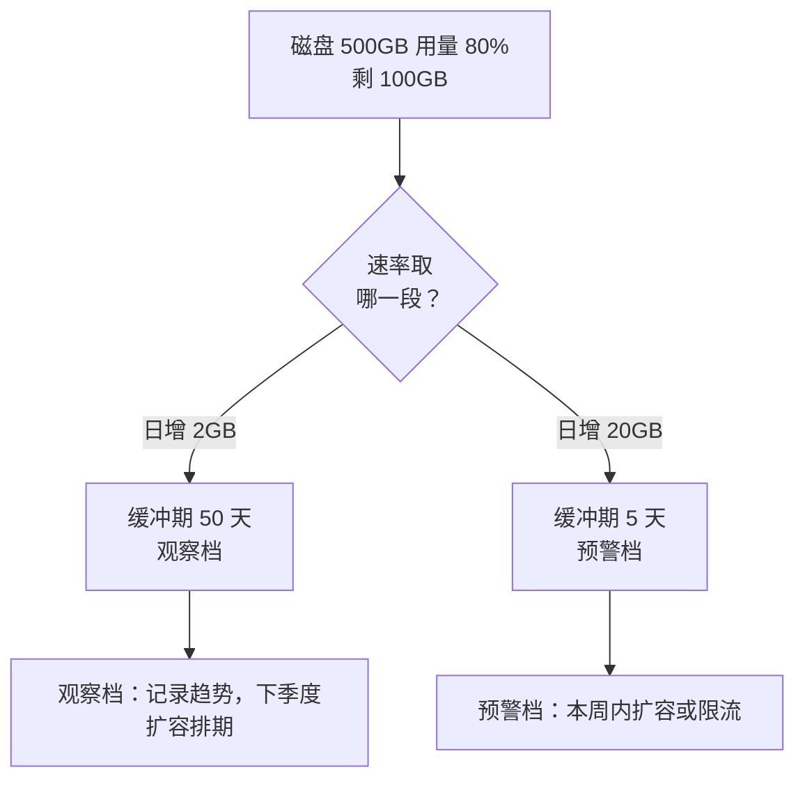
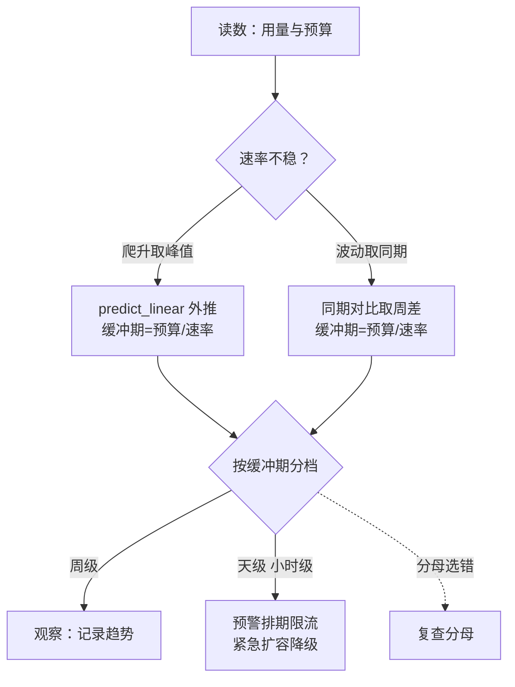

# 容量水位线要换算成缓冲期：从百分比阈值到时间预算的六域通用读法

**水位线是容量管理的核心仪表：它告诉你一块预算（显存、连接、磁盘、迁移速率）还剩多少可用。**但只看百分比会误判险情——**同样的 80%，增长快的资源只剩十分钟，增长慢的资源还剩一个月。**读完这一页你能把任何资源的百分比读数换算成「还能撑多久」的时间预算，**按消耗速率分级响应，并避开均值监控与静态阈值两类盲区。**

> **要点**：**水位线只回答「剩多少」，不回答「还能撑多久」；把百分比除以消耗速率换算成缓冲期后，告警才从「数字超标」变成「时间不够」。**同一套读法适用于显存、连接池、磁盘、迁移速率与延迟六类资源，**分档阈值（观察 / 预警 / 紧急）要按缓冲期而不是百分比来定，且分母要选「引起告警的那一档预算」，不是总量。**

## 水位线为什么必须换算成时间？

水位（watermark，某资源当前占用占预算的百分比）是容量仪表盘的第一读数。本库六域都在用它：[[工程知识/AI 系统工程：从模型能力到生产能力/推理服务与平台/GPU显存管理决定服务容量上限]]盯显存水位满 80% 报警，[[工程知识/性能工程：从用户等待到资源瓶颈/存储与网络/连接池的验证要看池内水位：活跃数、等待数与超时率三个水位计]]看连接池（预先建好连接反复取用、省去反复握手建连的开销）三个水位计，[[工程知识/性能工程：从用户等待到资源瓶颈/存储与网络/磁盘空间管理三原则：配额水位与临时目录纪律]]管磁盘配额水位，数据系统的重平衡（成员增减时把分区重新分配给消费者的过程）要同时盯迁移执行率与前台延迟两个水位。

但各域各讲各的，没有统一回答一个问题：**80% 意味着什么？**

百分比本身不携带时间信息，险情的真实度量是「距离预算耗尽还有多久」：

```
缓冲期 = (预算上限 - 当前用量) / 消耗速率
```

一个磁盘 500GB 用了 80%，剩 100GB。**日志每天涨 2GB，缓冲期 50 天，可以从容安排扩容；同一天上涨 20GB，缓冲期 5 天，本周就必须动。同一个 80%，两种完全不同的紧迫度。**只按百分比设阈值，等于假设所有资源的消耗速率相同，**而这个假设在六域里没有一处成立：显存水位是权重加载后的阶梯（涨一下稳住）、连接水位是流量驱动的波动（白天高夜里低）、磁盘水位是泄漏驱动的爬升（只涨不降）。速率不同，同样的百分比对应的时间预算可以从分钟级到月级。**

把同一个 80% 在两种速率下的结局画出来，分岔就在速率这一步：



两条路径的起点完全相同，分岔只发生在速率取数这一步，而百分比仪表盘恰恰看不到这个分岔。

> **一个比喻**：水位线像水库的标尺——标尺只告诉你水位多高，不告诉你还有几天断水；下游的用水速度（消耗速率）才决定这一刻是「记录在案」还是「开始限水」。标尺与用水速度要一起看，正如百分比与速率要一起算。这个比喻只覆盖「存量读数 + 流速换算」这一层：水库的水不会在夜里自己退回去，而连接池水位随流量昼夜波动，这种周期性要在速率取数时按峰值段单算，标尺讲不到。

这条换算为什么值得做成跨域方法论而不是各域各记一条经验：六域的水位虽然资源不同，**误判形态是同构的——都是「百分比看起来正常、时间预算已经见底」。统一成「换算缓冲期」之后，告警分级、复查节奏、扩容决策可以共用一套判定表，新资源接入时照表填数即可。**

## 换算与分档怎么操作？

### 取速率：按峰值段取，不按全天均值

速率取数的第一错误是**用全天平均：日志白天涨夜里几乎不涨，全天均值是每天 8GB，峰值段（业务高峰的四小时）是每小时 4GB。均值速率算出的缓冲期会高估一倍以上。**取数规则：**用引起告警的那一档峰值段的速率**——要判断「本周会不会打满」，取近一周最陡的连续增长段；要判断「今晚高峰会不会打满」，取近几天高峰时段的速率。[[工程知识/性能工程：从用户等待到资源瓶颈/存储与网络/硬件选型的容量留白：按峰值负载的一半规划，另一半是波动预算]]讲的正是这类盲区的供给侧版本：均值水位监控看不到离峰值的距离。

### 分母：用引起告警的那一档预算

预算上限不总是物理总量。[[工程知识/AI 系统工程：从模型能力到生产能力/推理服务与平台/GPU显存管理决定服务容量上限]]给过实例：**总显存数字正常时 KV cache 预算可能已经紧张，因为 KV 是最灵活的预算、最先吃紧，报警阈值要按 KV 水位单独设置。**换算缓冲期时分母取「告警针对的那块预算」——**报 KV 就用 KV 预算，报连接池就用 max 连接数，报磁盘就用配额上限（配额可以低于物理总量）。分母选错，缓冲期整体失真。**

速率突变与周期波动是 predict_linear（PromQL 的线性外推函数，按趋势预测未来值）的两个软肋。看一张实测曲线就能理解它能提前多久报信：下图中绿色 Actual 是根分区可用空间的真实读数，黄色 Predict 1d 是 predict_linear 按近 24 小时斜率外推的预测线，预测线在 05/23 23:04 拐到负值（-2.46 MiB），这就是「分区将在那之前写满」的读数——提前量就是缓冲期。


这个实验里写入速率是脚本恒定的，预测线才这么准；真实系统速率波动时，预测线会随每个窗口重算而摆动，所以下一节的失效清单里，速率突变排在第一位。

### 分档：按缓冲期定响应，不按百分比

把百分比阈值**换成缓冲期分档**，是这套方法论的核心动作。参照云原生混部安全守则的三级响应（节点水位线 80% / 90% / 95% 分别触发限流、回收、驱逐）与容量水位线 Headroom 70% / 80% / 90% 写入 SLO 与发布门禁的两套公开实践，通用分档表：

| 档位 | 缓冲期量级 | 动作 | 动作性质 |
|------|-----------|------|---------|
| 观察 | 周（≥7 天） | 记录趋势，纳入周期复查 | 只看不动 |
| 预警 | 天（1-7 天） | 扩容排期上会、流量侧准备限流（限制单位时间内放行的请求数量）预案 | 开始准备 |
| 紧急 | 小时（<24 小时） | 立即扩容或限流降级，冻结非核心写入 | 立即执行 |

**分档的依据是「一个扩容动作要走完的时长」：申请机器、扩数据副本、等重平衡收敛，正常路径按天计。缓冲期小于扩容时长，即使百分比只有 75%，也应进入紧急档**——这正是百分比阈值**看不见的信息**。反向同理：**95% 但速率趋零（显存权重加载后的稳态），缓冲期无限长，只需要观察档。**发布门禁（在灰度或发布环节卡一道容量检查的机制）把这一档做成流程：**水位不达标则发布被卡住，容量问题在上线前暴露。**

### 速率不稳时：预测型告警

爬升型资源（磁盘、显存碎片、表膨胀）的速率受业务波动影响，手工取数容易过期。PromQL 的 `predict_linear`（按历史窗口线性外推未来某时刻取值的函数）把换算自动化：**`predict_linear(disk_used[6h], 4*3600) > disk_total * 0.95` 表示按近 6 小时速率外推 4 小时后将超 95%——把「时间不够」直接做成告警条件。**周期波动型资源（连接池、带宽）不要用线性外推（夜间低谷会把速率估低），**改用同期对比：本周高峰对比上周高峰的增量，速率按周差取。**



## 六域各怎么用？

同一张分档表在六个域里各有各的填法：

| 域 | 水位对象 | 分母（预算档） | 速率特征 | 建议取数法 |
|----|---------|---------------|---------|-----------|
| AI 系统 | 显存（KV 分项） | KV cache 预算 | 阶梯 + 流量驱动 | 分项水位 + 高峰段速率 |
| 后端 | 连接池 | max 连接数 | 昼夜波动 | 同期对比 |
| 性能 | 磁盘 | 配额上限 | 泄漏式爬升 | predict_linear |
| 数据 | 迁移执行率 | 重平衡迁移预算 | 突发（触发即快） | 触发后单算一轮 |
| 数据 | 前台延迟水位 | SLO 延迟预算 | 流量驱动 | 高峰段速率 |
| 缺陷 | 回复基线 | 处置时间预算 | 事件驱动 | 现场估算 |

两处需要特别说明。**数据系统重平衡期间的两个水位（迁移限速的执行率、前台延迟）速率是突发的：重平衡一触发速率立即跳到限速值，触发前的历史速率全部作废，要在触发后重新取数单算一轮，不能拿触发前的缓冲期继续用。缺陷分析域的「水位」是复盘概念：案例库里同一类故障的复发频率是一条隐含水位的读数，复查周期（隔多久重新过一遍案例）就是它的缓冲期换算——复发越快，复查越密。**

## 辨析：此水位线不是流处理的水位线

流处理语境里的水位线（watermark）是事件时间进度的标记：**它声明「时间戳小于它的事件都已到齐」，用来触发窗口计算与处理乱序数据。**两个「水位线」共享名字但回答的问题不同——**容量水位线回答「预算还剩多少」，流处理水位线回答「事件时间走到了哪」。**[[工程知识/数据系统：在并发与故障中保存事实/数据管道与流处理/批处理与流处理的取舍：时序语义与一次性投入决定路径]]讲的是后者。**检索与配置告警时先分清语境，避免把流任务的 watermark 延迟告警配到容量监控上。**

## 这套换算在哪儿会失效？

- **速率突变**：**缓冲期按当前速率线性外推，业务活动（大促、批量任务）改变写入速率后，昨天算的 50 天缓冲期可能当场缩到 5 天。**凡有已知的批量活动，**活动前单独重算一轮，外推结果标注「截至何时有效」。**
- **分母本身在动**：**显存预算随 batch 策略调整、连接池 max 随参数变更、配额随租户调整，分母变化与分子变化叠加，速率换算两头失真。预算变更事件要触发缓冲期重算。**
- **多资源联动**：**单资源缓冲期正常，多资源同时逼近上限时扩容动作会互相争抢（扩容要占磁盘与带宽），联动水位要按「最紧的那个」定档。**
- **驱动的清理掩盖速率**：**日志轮转、缓存淘汰（空间不足时按策略移除部分条目）让用量呈锯齿形，每个锯齿点单独算速率会把爬升率估低，要按锯齿顶点的连线取斜率。**

## 怎么自己动手验证

- **挑一块自己负责的预算**（磁盘配额或连接池），取近 7 天的用量序列，**按峰值段算速率，换算缓冲期，与监控里现行的百分比阈值对比：现行阈值在当前速率下对应多大的缓冲期**，是否符合期望的分档。
- **用 `predict_linear` 写一条预测型告警，回放近 30 天数据看它会在哪几天触发、触发时间距离真正打满还有多久，验证提前量是否够一个扩容周期。**预期是**预警档先于紧急档至少一个扩容周期触发；若回放发现紧急档先触发甚至打满当天才触发，说明取数窗口太短把速率低估了，换更长的窗口重算直到预期与回放对得上，对不上就先不启用这条告警。**
- **做一次失效演练**：临时把写入速率调大一倍（压测流量或批量任务），**观察缓冲期读数与分档动作的响应时延，确认预警档能在紧急档之前先触发。**

## 接着读哪几篇：各域水位的单资源展开

- [[工程知识/AI 系统工程：从模型能力到生产能力/推理服务与平台/GPU显存管理决定服务容量上限]] —— 显存预算分项与 KV 水位单独设阈值的实例，本篇分母规则的来源
- [[工程知识/性能工程：从用户等待到资源瓶颈/存储与网络/连接池的验证要看池内水位：活跃数、等待数与超时率三个水位计]] —— 单资源三个水位计的读法与病因对照，与本篇的时间换算互补
- [[工程知识/性能工程：从用户等待到资源瓶颈/存储与网络/磁盘空间管理三原则：配额水位与临时目录纪律]] —— 磁盘配额水位的治理侧展开，本篇是它的读数侧方法
- [[工程知识/后端系统：在并发、失败与变化中维持服务/基础设施/容量规划与压测要用同一个负载模型说话]] —— 缓冲期是排期输入，容量从需求到机器数的推导在那一篇
- [[工程知识/性能工程：从用户等待到资源瓶颈/存储与网络/硬件选型的容量留白：按峰值负载的一半规划，另一半是波动预算]] —— 供给侧留白与均值监控盲区的机制背景
- [[工程知识/数据系统：在并发与故障中保存事实/可靠性与运维/重建只改配置不改数据：放置策略变更要配套重平衡]] —— 重平衡期间双水位（迁移执行率与前台延迟）的实例
