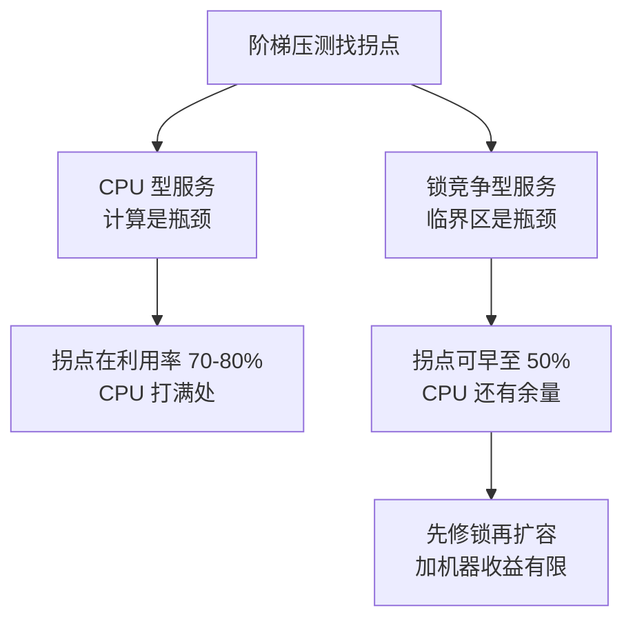
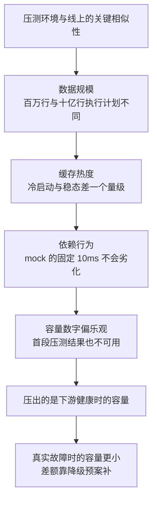

# 容量规划与压测要用同一个负载模型说话

为什么规划和压测总是对不上号？**容量规划（"要多少台机器"）与压测（"现在这套能扛多少"）经常各说各话：规划用峰值 QPS（每秒请求数）估，压测用固定并发压，两边对不上号，结果要么过度采购、要么大促当天崩。**读完本文你能用同一个负载模型统一规划与压测的口径，**判断余量该留多少、拐点出现时该增加机器还是修复瓶颈。**问题的根不在工具，在**两边没有共用同一个负载模型**——负载模型把"用户行为"翻译成请求序列的统计描述（到达率、请求构成、长度分布、突发形态），**规划与压测都应该是这个模型的两个消费者。**

排队论（研究排队等待与资源竞争的学科）给出框架：系统在利用率 ρ 上升时，等待时间按非线性增长（M/M/1 模型——M 表示到达与服务均指数分布、1 表示单服务台）里 W = ρ/(1-ρ) × 服务时间，公式出处 USENIX HotCloud'14 排队论综述，**ρ 越接近 1，延迟对负载增量越敏感**。**按该公式折算：ρ=0.8 时等待时间是服务时间的四倍，ρ=0.9 时达到九倍。把利用率压在 0.7-0.8 即意味着留出 20**-30% 余量——这就是容量规划里常说的「黄金数字」，它指被广泛采用的经验值，依据是排队曲线在尾部的陡峭形态。

## 要解决的问题是什么：负载模型有哪四个要素

| 要素 | 问的问题 | 压测常见错误 |
| --- | --- | --- |
| 到达率 | 单位时间来多少请求 | 只设并发数不设速率，测的是吞吐上限不是延迟形态 |
| 请求构成 | 各类请求占比 | 全用同一接口压，混合负载下的资源竞争看不到 |
| 长度分布 | 请求处理时长的分布 | 用平均时长代替分布，长尾（少数请求耗时远高于其余大部分）请求被藏住 |
| 突发形态 | 峰值/均值的比例与持续时间 | 只压平稳负载，突发排队雪崩（一个服务故障引发连锁反应、成片服务跟着垮掉）测不到——雪崩指突发请求引发排队连锁反应，延迟叠加至系统不可用 |

**到达率与并发数的区别是压测的第一坑：并发 100 的固定压测让系统打满，测出的是饱和吞吐；按到达率（每秒 50 个新请求）压，测出的是目标负载下的延迟形态。容量决策需要后者——大促的正确姿势是按预估到达率检验延迟是否达标，压满系统反而测不出这个答案。**

## 容量是怎么从需求推到机器数的

容量从需求推到机器数：`机器数 = 目标到达率 × 平均服务时间 × (1 + 余量) / 单机有效并发（单机在目标延迟内可并行处理的请求数）`。**链条上每个量都要实测，拍出来的数值撑不住容量决策：服务时间从线上性能分析或日志来，单机有效并发从阶梯压测来（逐级加压，观察延迟拐点），余量按排队曲线与服务等级目标（SLO，对外承诺的延迟与可用性标准）定（P99，即最慢 1% 请求的延迟，要求严的，余量留 30%+）。**

拐点压测的读法：以到达率为横轴、P99（99% 的请求耗时不超过这个值） 延迟为纵轴画曲线，**曲线的弯折点（延迟开始陡升的利用率位置）就是单机的容量点。弯折位置由资源瓶颈决定——CPU 型服务在 70-80%，锁竞争（多个执行流争抢同一把锁造成的等待开销）型可能 50% 就拐**[[工程知识/缺陷分析：从个案到体系/性能/案例三十七：锁自己变成了瓶颈——争用背后的临界区错配]]。

**拐点早于 CPU 打满，说明瓶颈在锁或连接池（预先建好连接反复取用、省去反复握手建连的开销），加机器不如修瓶颈——锁竞争与连接池上限不随机器数增加消失，增加机器只稀释计算瓶颈，修复瓶颈才能提升拐点**——这是压测最值钱的产出。

瓶颈类型决定拐点位置，两类服务的容量点摆开对比：

## 压测数字要满足什么前提才有效

容量规划算出的那条资源占用曲线，实际运行时不会是一条直线。资源占用率是随时间波动的，规划值要落在波动的上沿之内，而不是**贴着均值**。隔舱是同一件事的另一面——把资源按服务切开，单个服务的膨胀不会吃掉别人的份额——超量只消耗自身隔舱的资源额度，不会挤占其他服务的隔离池：

*图源：Microsoft Learn 中文文档，CC BY 4.0，https://learn.microsoft.com/zh-cn/azure/architecture/patterns/bulkhead。*

两张隔舱图说明的是判据：先看单个服务能不能被限制在自己的池子里，再看池子之间是不是真的隔离。只做前者不做后者，隔舱等于没做。

**压测结果可信的前提是环境与线上的关键相似性**：**数据规模（百万行的表与十亿行的表执行计划不同）、缓存热度（冷启动与稳态差一个量级）、依赖行为（下游的真实延迟 vs mock 的固定 10ms）。**数据规模的影响见 [[工程知识/数据系统：在并发与故障中保存事实/可靠性与运维/数据库基准必须描述负载与资源边界]] 的基准边界要求，测量的误差控制见 [[工程知识/性能工程：从用户等待到资源瓶颈/观测与诊断/基准测试必须先定义负载和测量误差]]。

mock 依赖的压测要标注置信边界：**mock 的下游不会像真下游那样在压力下劣化，压出的容量是"下游健康时"的容量。线上真实故障时的容量更小，这一差额要靠降级（主动牺牲部分功能或精度，保住核心链路）预案补**[[工程知识/后端系统：在并发、失败与变化中维持服务/任务与并发/限流熔断与隔离控制故障半径]]。

## 这套说法在哪儿会失效

压测环境哪些地方可以不像线上、哪些不像就不可用——三个失真来源各把容量数字推向哪个方向：

三个前提的失真都指向同一个偏向——压出来的容量偏乐观，所以规划结论必须配一次真实形态的回放压测做校准。

排队模型的前提是**到达接近泊松、服务时间指数分布**，真实流量（整点脉冲、缓存命中突发）偏离假设时，**曲线形态仍可用而精确数值不可用——所以容量规划结论要配一次真实形态的回放压测（录制线上流量回放）做校准。**

**容量是动态的：每次发布改变服务时间，每次缓存策略调整改变到达构成。容量规划要作为持续过程运行——每次大版本后重跑阶梯压测，容量数字与版本一起管理，这与性能回归防护的持续测量原则同构**[[工程知识/性能工程：从用户等待到资源瓶颈/性能工程：从用户等待到资源瓶颈]]。

Kubernetes（容器编排平台，负责容器的部署、调度与自愈）把「容量跟着负载动态走」做成了官方组件 VPA（Vertical Pod Autoscaler，纵向 Pod 自动扩缩），容量随负载自动调整。整条链路分四段：Metrics Server 持续上报资源用量；Recommender 据此算出建议值写入 VerticalPodAutoscaler 资源对象；Updater 按建议驱逐（按策略移除条目或实例）或原地调整 Pod（Kubernetes 调度的最小部署单元，可含一个或多个共享网络的容器）；Admission Controller 在新 Pod 创建时注入建议值。这就是一个自动化运转的「测量 → 建议 → 调整」容量循环：

*图源：Kubernetes 官方文档，CC BY 4.0，https://kubernetes.io/docs/concepts/workloads/autoscaling/vertical-pod-autoscale/。*

## 怎么自己动手验证

**阶梯压测：从目标负载的 50% 逐级加到 150%，每级稳定 10 分钟，记录吞吐、P50/P99、错误率、资源利用率四条曲线。找到延迟拐点与瓶颈资源。验证判据：拐点可复现（两次压测拐点位置一致），瓶颈资源可解释（拐点处某资源达到阈值）。**

**校准验证：用压测预测的容量与下次真实峰值的实际表现对比，偏差超过 30% 回查负载模型哪个要素失真。**

## 接着读哪几篇：排队论的延迟侧展开

- 关系：[[工程知识/性能工程：从用户等待到资源瓶颈/观测与诊断/基准测试必须先定义负载和测量误差]] · [[工程知识/数据系统：在并发与故障中保存事实/可靠性与运维/数据库基准必须描述负载与资源边界]] · [[工程知识/后端系统：在并发、失败与变化中维持服务/任务与并发/限流熔断与隔离控制故障半径]]
- [[工程知识/缺陷分析：从个案到体系/性能/案例三十七：锁自己变成了瓶颈——争用背后的临界区错配]] —— 拐点早于资源打满的机制实例
- [[工程知识/性能工程：从用户等待到资源瓶颈/存储与网络/端到端网络延迟来自排队、协议、传输与处理]] —— 排队论的延迟侧展开
- [[工程知识/后端系统：在并发、失败与变化中维持服务/基础设施/Kubernetes管理资源状态，不管理业务正确性]] —— 容量的调度层实现
- [[工程知识/性能工程：从用户等待到资源瓶颈/性能工程：从用户等待到资源瓶颈]] —— 容量数字的持续复核
- [[工程知识/后端系统：在并发、失败与变化中维持服务/服务设计/容量估算的通用骨架：从峰值QPS到机器数的推导演练.md]] —— 容量数字的推导侧起点：从峰值QPS到机器数的六步估算链
- [[工程知识/后端系统：在并发、失败与变化中维持服务/基础设施/容量水位线要换算成缓冲期：从百分比阈值到时间预算的六域通用读法]] —— 容量数字的运行时复核：水位（队列或资源的当前占用程度）换算成缓冲期决定扩容排期的紧迫度