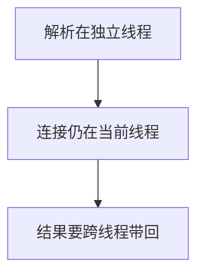
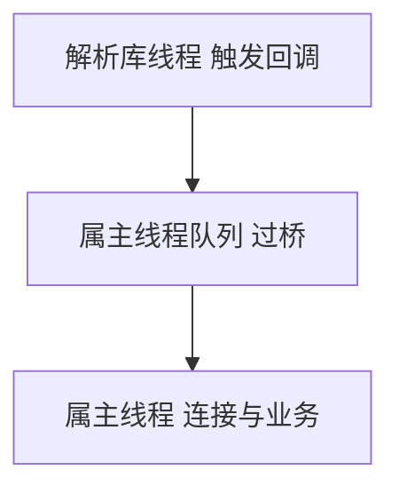
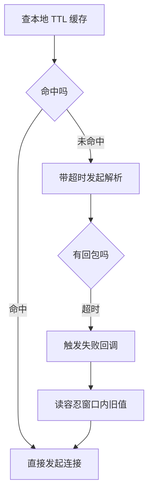

# 异步 DNS 解析的坑：解析在别的线程，连接在当前线程，回调要过桥

把域名解析改成异步能省下等待时间，**代价是解析和连接跑在不同线程上，结果得回到原线程才算数**。读完这一页你能知道**回调里哪些事不能做、超时和重试为什么要自己管**。

> **要点**：异步解析（c-ares，常用的异步 DNS 解析库）把 getaddrinfo（系统提供的同步域名解析函数）的阻塞调用搬进事件循环，代价是三条新纪律——解析线程与连接线程不同属（结果要回原线程）、回调在事件循环里跑（重活与阻塞调用禁入）、超时与重试自管（getaddrinfo 的同步语义护不进来）；绕过这三条，异步解析带来的延迟收益会被偶发的崩溃与卡死吃回去。

## 要解决的问题：异步化省下的延迟，怎么不交回学费



两个阶段分属不同线程，这是坑的来源：


同步解析（getaddrinfo）的代价是阻塞：解析慢（DNS 超时数秒）时整个线程停住——高并发连接场景（网关、爬虫、消息客户端）用独立解析线程池（预先建好一组线程反复取用、避免频繁创建销毁）或异步库（c-ares、getaddrinfo_a（glibc 的异步域名解析函数））把阻塞移走。**异步化改变的不只是延迟，是线程归属**：解析在事件循环（一个线程按序处理事件的机制）的 fd（文件描述符）上跑，结果通过回调交付——**回调的执行线程是事件循环线程**，**拿着解析结果发起连接的代码原来跑在业务线程，现在跑在事件循环里**——**归属变化引出三条纪律，违反任何一条都会以偶发故障的形式偿还**——解析与连接分属不同线程，**同时修改同一份连接状态就会产生数据竞争**，三条纪律正是针对这个风险（本库"回调必须回到属主线程"的通用纪律在 DNS 场景的具体化）。

被移走的这次解析，完整走一遍要经过解析器与多级权威服务器：用户侧只发出一次查询，解析器在背后逐级问根、顶级域与权威服务器，最后把地址交还：


这条链路上任何一级慢了或丢了包，同步解析的线程就跟着停多久——**这正是把它移出业务线程的原因**。

## 三条纪律是怎么管住跨线程归属的？

打个比方：异步解析像让前台去查通讯录、你留在座位上继续干活——**前台查到号码后得回来告诉你（回调），但你们俩不在同一个房间（线程），中间要有个传话的窗口（跨线程队列）**。传话慢了，你就干等着。这个比喻到"为什么中间要过一座桥"为止：超时怎么设、解析结果怎么缓存、回调堆积时为什么连接会挂，要看正文。


**纪律一：结果要回属主线程，跨线程要过桥**。解析结果的消费者（连接发起方）属于某个事件循环或线程，异步解析的回调如果在别的线程执行，**跨线程访问连接状态就是数据竞争**——**过桥的方式**：解析库绑事件循环（c-ares 的 socket_state 回调把 fd 注册进目标 loop），回调在目标 loop 内触发；解析在独立线程池时，结果投递回目标线程的队列（生产者-消费者），**连接代码只在属主线程跑**。上游客户端把异步解析接进 Netty 类框架时的常见错误：**解析回调在 c-ares 自己的线程里直接操作 channel**——**修复就是过桥**（回调里只做投递，channel 操作回 event loop）。

**纪律二：回调里没有重活，没有阻塞**。**回调跑在事件循环里，循环的停顿时间就是全部连接的停顿**——事件循环只有一个线程串行处理所有事件，**回调占住这条线程，别的连接事件只能排队等待**——回调里做同步解析（套娃 getaddrinfo）、做 TLS（Transport Layer Security，传输层加密协议，HTTPS 里的 S）握手、做磁盘 IO，**都是把异步化的延迟收益一次性吐回去**——**回调的动作清单**：拿结果、过桥投递、失败计数，三件以内。**重活的去处**：连接建立、TLS、业务逻辑都在属主线程的正常路径上做，回调只是"结果送达"的信号。

**纪律三：超时与重试自管**。getaddrinfo 的同步语义里有 resolv.conf 的超时与 attempts 配置兜底；**异步库的超时要自己设**（ares_opts 的 timeout 与 tries）——**没有超时的异步解析**是悬挂回调的来源（DNS 服务器不回包，回调永不触发，连接泄漏）。**重试的节奏**：**解析重试与连接重试分开计数**（解析失败换 DNS 服务器，连接失败走连接退避），混在一起的重试会把"DNS 坏"误判成"目标坏"（本库"DNS 故障的放大效应"的判定法）。

**缓存层的配合**：异步解析通常配本地缓存（进程内的 TTL 缓存，Time To Live：到期后自动失效或删除），**缓存命中路径完全绕开解析库**——**缓存的三项纪律**（TTL 到期不提前失效、失败结果只缓存极短时间、到期前主动续期）在异步场景加一件：**回调超时的兜底读**——**解析超时后读缓存旧值过期的容忍窗口**，好比牛奶过期当天先凑合饮用、买到新的再更换。这个比方到「旧值能用一阵」为止：旧值指向的服务器可能已下线。**严格 TTL 在 DNS 故障时把连接全断，容忍窗口（过期值可用 N 秒）给了缓冲**，N 的值按业务的新鲜度需求定（本库"数据新鲜度是一组配额"的同构思路）。

三条纪律里最容易被忽略的是过桥：**解析库的回调线程与连接代码的属主线程不是同一条，直接操作连接状态就是数据竞争**：



回调堆积之外还有一类静默杀手：客户端与服务器之间的中间设备NAT（Network Address Translation，网络地址转换：在内外网之间改写地址与端口）网关、防火墙自己维护连接状态表，**长时间无流量的连接会被它单方面删除，而两端毫无感知**——下一次发数据时中间设备回 RST（Reset，TCP 强制断开连接的信号），连接就断了。这正是长连接（建立后保持不断开、多次通信复用同一条连接）要配应用层心跳（节点定期互发的存活信号，超时收不到就判定故障）的原因，**TCP keepalive（传输控制协议自带的空闲连接保活探测）的默认探测间隔（两小时）远慢于中间设备的状态超时**：


来源：52im《TCP的keepalive和http的keepalive》，腾讯云开发者社区 https://cloud.tencent.com/developer/article/2042599。解析换来的连接如果活得够久就会撞上这张图：中间设备删表项在前，RST 在后，异步解析的回调只是过了桥，救不了这条已经被中间设备单方面终止的连接。


## 读完这一段你能判断什么：异步解析故障的定位路径

**症状一：连接偶发悬挂**——查回调是否触发（解析库的 query 状态）、超时配置是否存在（纪律三）、回调是否过桥失败（结果到了别的线程被丢）。**症状二：事件循环周期性卡顿**——查回调里的动作清单（纪律二），重点抓回调里的同步调用（用 BT 即 backtrace，打印线程当前函数调用链路的排查手段，抓一次事件循环线程的调用栈快照，定位卡顿点的函数）。**症状三：DNS 故障时业务全断**——查缓存容忍窗口是否存在（严格 TTL 的特征），以及失败短缓存是否把失败结果缓存住（失败结果不该进缓存，或进极短的负缓存，负缓存即把「查询失败」这一结果本身缓存一小段时间，避免反复请求已确认失败的域名）。**工具**：ares 的查询日志（每查询的目标与耗时）、事件循环的慢回调监控（回调执行时长直方图，P99 超 10ms 告警——**两个监控点覆盖三条纪律的违规现场**）。

## 这套说法在哪些情况下会失效？

三条边界防止防线走形。

DNS 服务器黑洞时，失败回调、超时配置与缓存容忍窗口三者的时序如何接住这次连接：



图上多出来的超时配置、失败回调与缓存容忍窗口，**正是异步解析额外背上的复杂度**——低频连接不值得为这点延迟收益买单。

**异步化不是默认项**：低频连接（管理面、定时任务）**用同步解析加独立线程足够**，异步解析的复杂度（三条纪律、过桥、缓存配合）只为高并发连接场景的延迟收益买单——**按连接频率选型**，全盘异步化是把复杂度摊到不需要的地方。

**IPv6 与 AAAA（IPv6 地址的 DNS 记录类型）并行查询**：异步库常并行发 A 与 AAAA 查询，解析结果合并逻辑（happy eyeballs 即乐观并行连接：同时尝试多个地址、谁先回应用谁，此处按延迟排序）要显式处理——**只取先回的那个会把同时拥有 IPv4 与 IPv6 地址的主机固定在一种地址家族上**，**合并策略是解析正确性的一部分**，不只是性能细节。

**解析库的线程模型要核文档**：c-ares 的回调默认在处理 fd 事件的线程触发（绑哪个 loop 就在哪触发），自建线程池封装时归属关系变化——**封装层要写明回调线程的归属**，使用者按文档过桥，文档没写明的封装是接口缺陷。

## 怎么自己动手验证

可复现的验证路径：

1. 过桥验证：多线程压力下连接建立的成功率与竞态（多个执行流争抢资源、结果取决于时序）检测（TSAN——ThreadSanitizer，检测多线程数据竞争的动态工具）跑一轮，**无桥版本预期报竞争，过桥版本干净**；
2. 超时验证：DNS 服务器黑洞（iptables（Linux 防火墙规则工具）丢 53 端口包），**预期回调在配置超时内触发失败、连接走退避、无悬挂**；
3. 卡顿验证：回调里注入 100ms 重活，**慢回调监控告警触发；按纪律二清理后告警归零**；
4. 断言锚点：**回调线程归属在封装文档写明、慢回调时长监控在管、解析超时与缓存容忍窗口有配置**——**三件齐备，异步解析从"偶发玄学"变成三条纪律的常规工程**。

```text
归属断言 = 回调过桥回属主线程
轻量断言 = 回调无阻塞无重活
兜底断言 = 超时重试缓存自管
```

异步 DNS 解析的收益（连接不被解析阻塞）**建立在线程归属的重塑上**：解析在哪跑、结果回哪去、回调里能干什么、超时谁负责——四问的答案就是三条纪律，**纪律配齐，解析延迟从连接路径上消失且不再以偶发故障回来讨债**。

## 接着读哪几篇：解析链路的机制层

- [[工程知识/后端系统：在并发、失败与变化中维持服务/基础设施/DNS解析的全链路：递归缓存与失效传播.md]] —— 解析链路的机制层
- [[工程知识/性能工程：从用户等待到资源瓶颈/存储与网络/DNS故障的放大效应：一条解析记录拖垮一个调用链.md]] —— DNS 故障的判定法
- [[工程知识/缺陷分析：从个案到体系/并发/回调必须回到属主线程：完成通知的线程归属纪律.md]] —— 线程归属的通用纪律
- [[工程知识/数据系统：在并发与故障中保存事实/可靠性与运维/数据新鲜度是一组配额：每个消费链路声明自己的时限.md]] —— 新鲜度配额的同构思路
