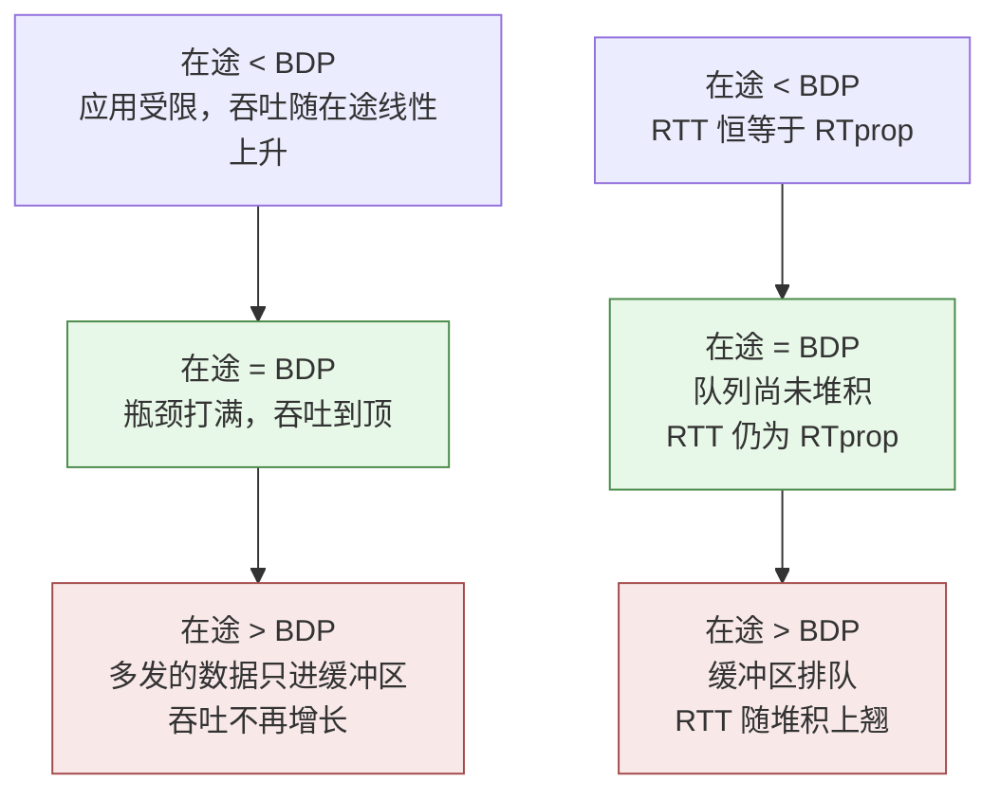
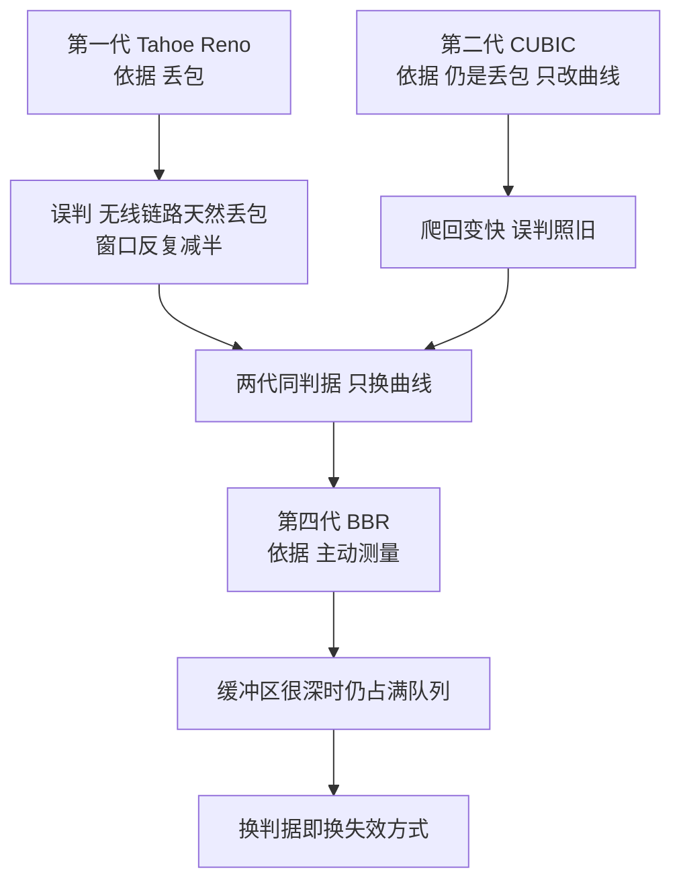

# 拥塞控制的四代演进：从AIMD到BBR的思路转变

## 拥塞控制到底要解决什么问题

**拥塞控制要解决的问题，是防止发送方把网络压垮。**1986 年互联网第一次拥塞崩溃事件（LBL 到 UC Berkeley 的吞吐从 32 Kbps 掉到 40 bps，降了千倍）证明了：**流量控制（接收方能力协商）管不了网络本身，一个共享网络里所有发送方都抢着发，整体一起崩溃。**

**拥塞控制与流量控制是两个机制：流量控制保护接收方（缺了它，接收方缓冲区会被高速发送方灌满溢出），拥塞控制保护网络（缺了它，路由器队列会被所有发送方一起压垮）——保护客体不同，缺一不可。**TCP（传输控制协议，负责把数据完整、有序地送达）连接建立与断开的状态机[[工程知识/后端系统：在并发、失败与变化中维持服务/基础设施/TCP连接建立与断开的状态机：握手挥手与异常路径.md]]管单条连接的建立与断开，**拥塞控制管整条网络的稳定性。**

本文按四代梳理拥塞控制各自拿什么当拥塞信号、思路怎么变。读完本文，你能回答两个问题：如何按链路特征选算法，以及如何动手验证。

## 四代各自把什么当拥塞信号：思路怎么变

先把形状说成一件事：发送方与接收方之间是一条粗细固定的水管（网络管道），发太慢浪费水管，发太快水会从接口溢出（路由器缓冲区堆积后丢包）。四代算法都在回答同一个问题——"水管现在有多粗、我该开多大阀门"，差别只在判断依据：第一代等水溢出来才知道发多了（丢包当信号），第三代看水压涨没涨（排队时延当信号），第四代干脆拿尺子定期量水管（主动测量带宽与时延）。这个比喻到"量管子"为止——真实网络里管子粗细随别人怎么用水而变，测量本身也要周期性重做，这是 BBR（Google 的拥塞控制算法，按带宽与延迟主动调节发送速率） 状态机存在的原因。

**四代算法的差异，全部体现在拥塞窗口（发送方允许同时在途的最大数据量）的轨迹上：指数爬升到阈值后转线性增长，超时与重复 ACK（确认包：告诉对方自己已经收到数据）分别触发窗口的不同收缩。理解这张基准轨迹，才能看清后面几代各自改了哪一段曲线。**


*图示：拥塞窗口随 RTT（往返时延）的变化。第一代 AIMD（加性增、乘性减：每 RTT 加一个 MSS），丢包时窗口减半描述的正是这张图的形态。*

**第一代：Tahoe/Reno 的 AIMD（1988）**。思路是"把丢包（数据包在网络传输途中丢失）当拥塞信号"。**每 RTT 加一个 MSS（加性增），丢包时窗口减半（乘性减），AIMD 向公平共享收敛。慢启动是它的加速机制（指数增长到阈值）。**代价：**网络的轻微丢包（无线网络天然 1% 丢包）会被误判为拥塞，窗口反复减半，高延迟长肥网络（Long Fat Network，LFN）上窗口减半后爬回极慢——带宽时延积大，减半后要重新填满的管道也大，恢复期内吞吐被长期压低。**

**第二代：CUBIC（2008 Linux 默认）**。思路不变（丢包驱动），只改窗口调整曲线（立方函数），**在窗口回退后更快爬回原点，适配高带宽长 RTT 网络。**它解决了"减半后爬回太慢"，**但丢包误判的根本问题原封未动。**

**第三代：基于时延的 Vegas/BBR 前身**。思路转向"把时延当拥塞信号"：**RTT 上升 = 队列在堆积 = 网络接近饱和。**Vegas 用 RTT 与基线（正常状态下的指标水平、用来对比异常）的偏差调整窗口。代价：**与丢包驱动算法混跑时，守规矩的时延算法会被激进算法挤掉带宽**（时延算法一看到排队就降速让路，丢包算法不见丢包不退让，持续占满腾出来的空间，份额就这样被拿走——"收敛性差"的批评源于此）。**Vegas 证明了时延能当拥塞信号，但它仍是被动响应——看到时延才降速；BBR 更进一步，主动建模型、不等信号，所以说它是 BBR 的前身。**

**第四代：BBR（2016 Google）**。思路彻底换：**不再等信号，主动测量。**周期性探测瓶颈带宽（BtlBw）与最小 RTT，**发送速率压在 BDP（带宽时延积：瓶颈带宽乘最小往返时延，即管道容量）上，让数据恰好填满管道、不堆积队列。丢包不再是输入信号（BBR 可以在 1% 丢包链路上跑到满速，实测论文数据：与 CUBIC 相比吞吐提升可达两个数量级）。Google 自己的骨干网与 YouTube（谷歌旗下的视频网站）全量部署是最大规模验证。**

**BBR 靠状态机维持这个模型：启动阶段（STARTUP）指数提速找瓶颈，排空阶段（DRAIN）把启动期多发出去的队列清掉，之后在带宽探测阶段（PROBE_BW）小幅上下试探带宽，并周期性进入时延探测阶段（PROBE_RTT）重测最小 RTT。**


*图源：深入高可用系统原理与设计（isno），CC BY 4.0，https://www.thebyte.com.cn/http/congestion-control.html。*

四代的本质转变：**从"事件驱动"（丢包了才反应）到"模型驱动"（持续测量网络模型，按模型发送）**。BBR 之前的算法都在回答"出现了拥塞信号怎么办"，**BBR 回答"网络现在是什么样子，我该发多快"。**

这个转变最直观的呈现是吞吐与 RTT 各自随在途数据的变化曲线：吞吐在填满瓶颈带宽（BDP）后就不再增长，但丢包驱动的算法还在往缓冲区里塞数据；RTT 在 BDP 之前纹丝不动，之后随缓冲区堆积一路上翘。最优操作点在两条曲线的拐点上——吞吐已到顶、时延尚未起涨。Google 官方培训材料把这两条曲线画在同一张图里，纵轴同时标注了吞吐与 RTT，横轴是在途数据量，BDP 位置用红圈标出：


*图源：Google BBR 官方培训材料（Mobile devices workshop, BBR, Sep. 2020）第 6 页，[github.com/google/bbr](https://github.com/google/bbr/blob/master/Documentation/bbr-trainings/mobile-devices-workshop-bbr-sep-2020.pdf)。红圈即 BDP 操作点：左右两侧分别是「应用受限」与「缓冲区堆积」两个区域。*

这两条曲线合起来看，才能说明为什么「吞吐到顶」和「时延未涨」是同一个操作点：


*图源：同上（深入高可用系统原理与设计），（isno）。*



两条曲线在 BDP 处同时转折（绿色节点）：**吞吐刚到顶、RTT 尚未起涨，这是 Kleinrock 证明的最优操作点——在途数据一旦超过 BDP，吞吐不再涨而时延只升，BDP 是吞吐与时延最后一个双赢点。**丢包驱动算法停在 BDP 加缓冲区容量处（红色节点）——**缓冲区填满才开始丢包，等它反应过来，队列延迟已经产生。**BBR 的做法是分别用滑动窗口（允许连续发送未确认数据、控制流量的机制）最大值估计 BtlBw（瓶颈带宽）、用滑动窗口最小值估计 RTprop（往返传播时延，不含排队的最小 RTT），**把发送量压在 BDP 上，不进红色区域。**

> 原图引自 The Morning Paper《BBR: Congestion-based congestion control》转引 ACM Queue 论文（Cardwell 等 2016，Figure 1），[blog.acolyer.org/2017/03/31](https://blog.acolyer.org/2017/03/31/bbr-congestion-based-congestion-control/)。该站点现已返回 403，两条曲线的关系按论文 Figure 1 原意重绘为上图。

## 每代判断依据错在哪：背景与代价

四代换的是**判断依据**，窗口公式反而次要——每一代都在换"拿什么当作网络堵了的证据"，而各自的代价恰好来自这个依据本身会误判：



第三代与第二代的分界最能说明问题：CUBIC（Linux 默认的拥塞控制算法，用三次函数调节窗口） 改了窗口爬升曲线，高带宽长 RTT 下恢复快得多，**可它判据仍是丢包，缓冲区填满才降速这个毛病原封未动。**Vegas 换成看 RTT，队列一堆积就降速，代价是**在混跑时竞争不过丢包驱动的算法——它先退让**，带宽就被对方拿走了。

BBR 干脆不等信号、直接建模型，**代价变成了缓冲区很深时自己也会占满队列、挤掉同链路的其他流。**飞翔中文网的 [TCP 拥塞控制](https://www.feixiang.net/tcp/congestion-control.html) 与 [TCP Reno/CUBIC 拥塞控制算法对比](http://www.hqwc.cn/a/216498.html) 都按同样的判据线索梳理了这条演进链。

这套设计的思想从哪来？1988 年 Van Jacobson 的论文是整个领域的开山之作，**他证明了拥塞崩溃源于"发送方对网络状态的无知 + 全体同步反应"。**AIMD 的乘性减设计精巧在：**减半是全局可收敛的——所有流同步减半后公平分享带宽**（每次减半都按同比例收缩，占用多的流减掉的绝对量也大，各流差距被等比压缩，最终逼近公平份额）,**加性增让它们各自慢慢扩张。这是没有中央协调的分布式收敛设计，思想源头是控制论里的稳定性分析。**

**BBR 的精巧在于把"管道"隐喻变成了可操作的模型：BDP 是管道容积，测量它需要分别探测（带宽探测会拉高 RTT、RTT 探测要限速），两者不能同时测准，所以 BBR 周期性交替探测。代价：BBR 的公平性争议持续存在（与 CUBIC 混跑时 BBR 有时不让路），单流测量不能完全替代拥塞信号，BBRv2/v3 针对公平性补了约束：检测到与 CUBIC 共存时主动让出一部分带宽。**

## 实际部署的账怎么算：可运行示例与案例回流

这笔账算的是吞吐、时延、公平性各自的收益与代价对比。

怎么判断自己的场景用 BBR 划不划算——**先测链路特征（带宽时延积、丢包率、缓冲深度）再下结论**：**BDP 大、有丢包的跨洋公网收益翻倍**（长肥管道是 BBR 的主场）；**BDP 小、几乎零丢包的内网低延迟环境收益个位数，因为瓶颈本来就不在拥塞控制。**弱网收益有 Google 骨干网 B4 的实测数据支撑：**同样一批跨地域流，BBR 的吞吐分布整体右移，中位吞吐远高于 CUBIC**：


*图源：Google BBR 官方培训材料第 20 页（[github.com/google/bbr](https://github.com/google/bbr)），纵轴为累计流占比，横轴为流吞吐与链路带宽的比值——BBR 曲线在 1.0 附近快速抬升，CUBIC 在低吞吐区拖尾，差距来自 CUBIC 把丢包当信号、在深缓冲长肥管道上窗口反复减半。*

```text
四代算法各值不值——一句话算清通用机制：

AIMD：加性增、乘性减
  每	RTT 窗口 +1，丢包窗口减半 → 把丢包当拥塞信号
  适用：缓冲浅、丢包真拥塞的网络；失效：深缓冲（丢包晚、延迟先爆）

CUBIC：把窗口增长改成立方函数（丢包后快速恢复）
  仍然以丢包为信号 → 高带宽长肥管道上恢复更快，但信号本质没变

Vegas/延迟类：改用排队延迟当信号（RTT 上涨 = 拥塞前兆）
  先于丢包行动 → 与丢包类共存时被挤压（自己让路别人抢跑）

BBR：不再盯丢包也不盯延迟，直接估
  BtlBw（瓶颈带宽）× RTprop= 最优窗口
  主动维持排队最少的状态 → 深缓冲与无线链路上吞吐提升数倍
```

**BBR v1 为什么会抢占：BBR 与丢包类算法混跑时 BBR 拿走超额带宽（它不看丢包信号，丢包类主动让路），v2 加了公平性约束；共享链路的算法选择是全局决策，单方面换要评估对邻居流量的影响——同一瓶颈的缓冲区被多条流共享，一条流的发送策略改变会重新分配缓冲占用，邻居流的时延与丢包跟着变。**四代演进与 [[工程知识/性能工程：从用户等待到资源瓶颈/存储与网络/拥塞控制在吞吐与公平之间动态调节.md]] 的动态调节机制互为表里（那篇讲调节什么，本篇讲信号与算法怎么演进）。

## 这套说法在哪儿会失效

- **四代算法今天都在跑**。**Linux 默认 CUBIC，Google 系与部分 CDN（内容分发网络，把内容复制到离用户近的边缘节点）用 BBR，数据中心内部常用 DCTCP 与 ECN（Explicit Congestion Notification，显式拥塞通知：路由器标记拥塞而非丢包）信号驱动，比四代更早用显式信号。选型是部署位置问题：跨公网长肥管道 BBR 优势大，数据中心内 ECN 更精确。**
- **拥塞控制在应用层的影子**：**HTTP/2 的流控窗口、QUIC（基于 UDP 的新传输协议，把连接建立与加密握手合并，减少往返次数）的独立流控，都是同一问题的应用层重述。**QUIC 把传输握手与加密合流[[工程知识/性能工程：从用户等待到资源瓶颈/存储与网络/QUIC把传输握手与加密合流到用户态.md]]的同时把拥塞控制可插拔化，**同一问题的多代答案在同一个新协议里共存。**
- **慢启动与拥塞避免的切换阈值 ssthresh 没有四代演进**：它是第一代遗产，现在仍是默认行为的一部分。**四代演进的效果是局部替换信号与窗口算法，ssthresh 的切换机制一直保留。**

## 怎么自己动手验证

- **问题场景**：跨地域传输大文件吞吐远低于带宽上限，`ss -ti` 看拥塞窗口与 RTT，**若窗口反复减半（retrans 计数涨），是丢包驱动算法在弱网下的典型表现，换 BBR 是对症药。**
- **验证**：两台云主机间 iperf3 对比 CUBIC 与 BBR（`sysctl net.ipv4.tcp_congestion_control` 切换），**预期弱网（tc netem 注入 1% 丢包，tc 是 Linux 流量控制工具）下 BBR 吞吐显著高于 CUBIC，零丢包时两者接近。**对不上就停下查：netem 是否真的注入了丢包、队列规则是否生效。
- **收益核实**：YouTube 前端 BBR 全量后 Google 报告的平均吞吐提升（BBR 论文数据）可作为量级参考，但**自己场景要自己测：不同 RTT、丢包率、队列深度下四代算法表现不同，拿论文数字直接当预期收益是误用。**

## 接着读哪几篇：单连接建立与断开的协议机制

- [[工程知识/后端系统：在并发、失败与变化中维持服务/基础设施/TCP连接建立与断开的状态机：握手挥手与异常路径.md]] —— 单连接建立与断开的协议机制
- [[工程知识/性能工程：从用户等待到资源瓶颈/存储与网络/QUIC把传输握手与加密合流到用户态.md]] —— 传输层新协议对拥塞控制的重新装载
- [[工程知识/性能工程：从用户等待到资源瓶颈/存储与网络/端到端网络延迟来自排队、协议、传输与处理]] —— RTT 的构成与队列堆积的延迟侧
- [[工程知识/后端系统：在并发、失败与变化中维持服务/基础设施/socket读写缓冲区：拥塞窗口与应用层背压的连接点.md]] —— cwnd（拥塞窗口）水阀的完整故事