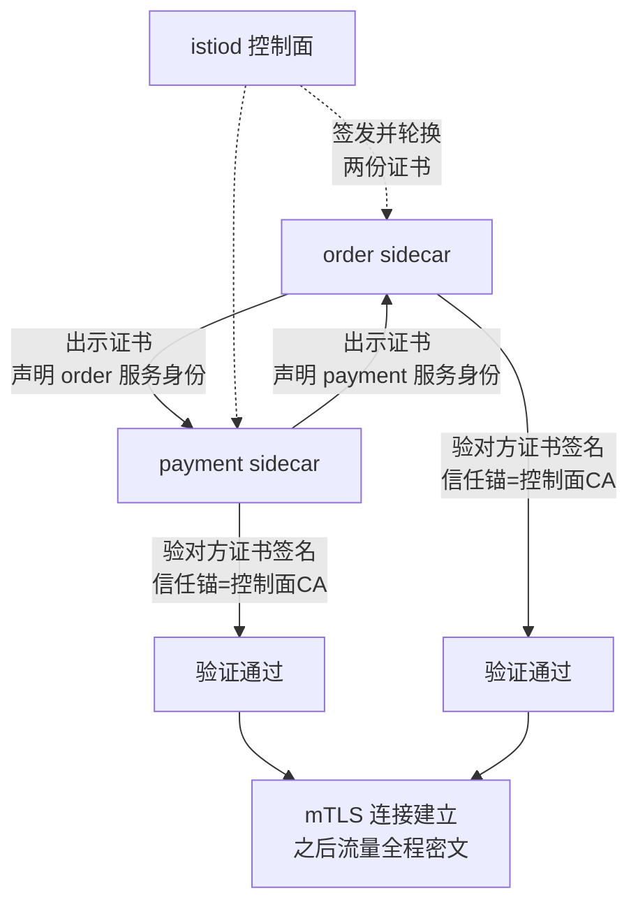
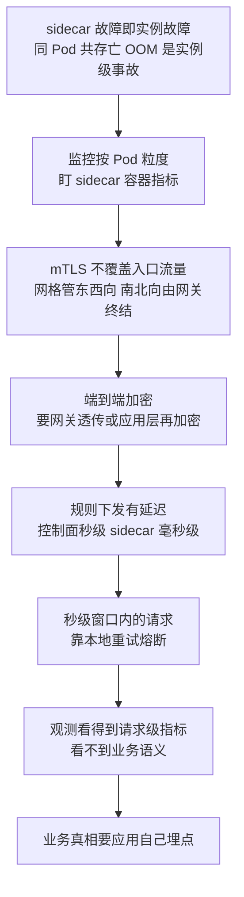

# 服务网格控制面与数据面：mTLS与流量治理

## 要解决的问题是什么

本文讲清控制面与数据面怎么分工、mTLS 怎么给服务间通信加身份，读完你能判断自己的服务要不要接入网格、mesh 出问题时先核查哪一层。

服务网格要解决的问题，是**把服务间通信的治理从应用代码里搬出去**：重试、超时、熔断（依赖持续报错时暂时不再调用它，直接走失败路径，防止拖垮自己）、加密、观测，这些每个服务都要做一遍，各语言实现一遍，**版本漂移、行为不一。**网格的答案是分成两块：**数据面（每实例旁边的 sidecar 代理，拦截进出流量执行规则）+ 控制面（下发规则的中央大脑）。**应用零改造获得治理能力，代价是**链路上多了必经的代理层**。

这套分工像一栋公寓的保安体系：每层楼站着一名保安（数据面，对每个进出的人都查证件、做登记），物业总部统一发通知调规则（控制面，掌握全局秩序，但平时不站在门口）。

这个比喻到"谁在数据路径上"为止——**总部发完命令不参与每一次放行，而每一笔流量的延迟和可靠性都压在那名保安身上，所以控制面出故障时存量流量照走、新规则下不去，这正是网格最需要留意的失效形态。**

代理与网关（站在客户端与后端服务之间的入口层，集中处理路由、鉴权与协议转换）的谱系[[工程知识/后端系统：在并发、失败与变化中维持服务/基础设施/代理与网关的谱系：正向反向与sidecar各自解决什么.md]]给了 sidecar（边车：与业务容器同机部署、代理其流量的伴随进程） 形态，本文写网格在形态之上加的东西：控制面与 mTLS（双向 TLS：通信两端互相出示证书并互相验证身份，TLS 即传输层加密协议）。

## 控制面和数据面分别管什么

mTLS 的「终结位置」是控制面与数据面分工最直观的体现。加密由边上的代理统一终结，服务本身只处理明文：

上面这张图里的「加密由代理统一终结」放到整个网关层，就是 TLS（传输层安全协议，负责加密通信与验证身份）卸载与七层路由两类职责都收到同一处：

两张图共同说明一件事：**证书、握手、轮换这些事从服务代码里挪出去之后，服务只认识 localhost 上的明文连接。**代价是**所有跨服务的可见性与策略**，都集中到了这一层代理上——**它一旦出问题，没有任何旁路（绕开主流程的备用路径）可走。**


**控制面：规则的存储与下发**。控制面（Istio 的 istiod）聚合三样东西：**服务目录（哪些服务、哪些实例，从 Kubernetes 的 API 或注册中心同步）、规则（路由、重试、超时、mTLS 策略，从 CRD（Custom Resource Definition，Kubernetes 的自定义资源类型机制）或配置同步）、证书（为每个服务身份签发证书）。**通过 xDS（Envoy 定义的一组配置发现协议，sidecar 靠它动态获取路由、集群与证书）把最终形态推给所有 sidecar。**控制面是大脑但不在数据路径上——它挂了，已下发的规则继续生效，只是不能改规则。**

「控制面不在数据路径上」这类系统的通用形态，而不是**Istio 的私有设计**。Linkerd 官方架构图把这条分界线画成一条虚线：destination、identity、proxy-injector 三个组件都在 Linkerd（轻量服务网格）命名空间里构成控制面，Pod（Kubernetes 调度的最小部署单元，可含一个或多个共享网络的容器） 里的 Linkerd-proxy 拦截进出流量构成数据面，双向箭头只在「配置与证书下发」这一处穿过虚线，业务流量（绿色箭头）全程不进控制面：


*图源：Linkerd 官方文档架构页，https://linkerd.io/2.16/reference/architecture/。*

**数据面：sidecar 执行规则**。每个 Pod 里的 sidecar（Envoy）拦截该实例的全部进出流量：**出向流量被 iptables（Linux 内核的包过滤规则，可按条件把流量重定向到指定端口）劫持到 sidecar，sidecar 按规则路由到目标 sidecar，再转给目标应用。链路变成 应用→sidecar→sidecar→应用，两跳本地加一跳网络。**治理规则（重试、熔断、鉴权）在 sidecar 里执行，**应用只管业务逻辑。**


这张图把两块摆在一起：istiod（Pilot、Citadel 等的合并形态）经 xDS 把配置与证书推给每个 Pod 里的 sidecar，自己不在请求路径上；进出应用的流量全部经 sidecar 转发。图取自 [Istio 官方文档架构页](https://istio.io/latest/docs/ops/deployment/architecture/)。

「应用→sidecar→sidecar→应用」这条四段链路在 Envoy 官方文档的网格拓扑图里画得更直接：Service A 出向的每一次调用先落到自己身旁的 Envoy（服务网格的边车代理，接管进出服务的网络），再由对端实例的 Envoy 转交给 Service B，应用与 sidecar 之间是 localhost 上的明文，两个 sidecar 之间才是治理真正生效的那一跳：


*图源：Envoy 官方文档《Life of a Request》服务网格拓扑，https://www.envoyproxy.io/docs/envoy/latest/intro/life_of_a_request。*

这张图也解释了「代价」那笔账的来源：每个实例一个 envoy，实例数就是 sidecar 数；四个服务实例两两之间都可能有一条跨实例的那一跳，重试与熔断在被治理的那一跳上执行，而应用侧对此毫无感知。

**mTLS：服务间身份的密码学化**。控制面给每个服务（身份来自 Kubernetes ServiceAccount，即代表一个应用的身份凭证，每个 Pod 默认关联一个）签发证书，**sidecar 之间的连接全部 TLS 加密且双向验证**（我要证明我是 order 服务，你也要证明你是 payment 服务）。像两个初次通话的同事先各自报上带公章的工作证编号、互相核对单位真伪再谈事——这个比喻只到「双方验明身份」为止，证书轮换与信任链细节不在其中。**服务间通信从"IP 可达即可通"升级为"证书身份验证才通"，网络位置不再是信任凭据——验证只认证书不认 IP，攻击者拿到 Pod 的 IP 也拿不到证书，伪装不成别的服务，Pod 被攻破不能横向移动，内网抓包只见密文、看不到明文。**TLS握手与证书链（从根证书逐级签发到站点证书的信任链条） [[工程知识/后端系统：在并发、失败与变化中维持服务/基础设施/TLS握手与证书链：信任是怎么一层层背书的.md]] 的机制在网格里被控制面自动化了：**签发、轮换、验证全部托管，证书有效期短到 24h 级，泄漏窗口小。**

两个 sidecar 建立 mTLS 连接的验证顺序，图里能看清双方各验各的证书、信任锚都指向控制面签发的 CA（Certificate Authority，证书颁发机构）：




来源：[小林coding《TCP 三次握手与四次挥手面试题》](https://www.xiaolincoding.com/os/1_hardware/tcp_interview.html)（CC 4.0 BY-NC-SA）


## 这层网格付出了什么代价

网格的前身是微服务的"胖客户端 SDK（软件开发工具包）"（Netflix Hystrix/Ribbon、Finagle）：治理逻辑进 SDK，每语言一套。**多语言团队维护 N 套 SDK 的成本催生了"SDK 下沉为基础设施"的路线——让一套通用代理替所有语言承载治理**，于是 2016 年 Envoy 开源，2017 年 Istio 把"sidecar + 控制面"组合定型。它继承的是 kernel bypass（把高频处理从内核迁到专门层）与中断吸收（把零散事件攒成一批统一处理）的思想，**继承方式是把网络治理从应用进程搬到独立进程。**

**控制面不碰数据路径**：**规则下发后数据面自治运行，控制面故障不影响在跑的流量。**这个设计让判断故障影响变简单：**先看出问题的是控制面还是数据面——控制面故障只是配置可用性问题（改不了规则），数据面（sidecar）故障才是流量可用性问题（流量真的断）。**每个请求多两跳本地代理（sidecar 进出各一跳），P99（99% 的请求耗时不超过这个值）延迟增加毫秒级到十毫秒级（取决于** sidecar 性能与规则复杂度**）；**每实例一个 sidecar 的资源乘法（内存几 MB 到几十 MB × 实例数）；控制面本身是新组件（istiod 的可用性、版本升级、与 Kubernetes 版本的兼容矩阵）。**"网格值不值"的争论全在代价与收益的换算，**小集群（几十个服务）常常不划算。**

## 这套说法在哪儿会失效

- **sidecar 故障即实例故障**。**应用与 sidecar 同 Pod，sidecar 失效则实例的进出流量全断。**sidecar 的资源 limit（内存不够被 OOM（Out Of Memory，内存耗尽后被系统强制终止进程）的 Killer 终止），**OOM kill 是实例级事故，监控要按 Pod 粒度盯 sidecar 容器的指标。**
- **mTLS 不覆盖入口流量**。**网格管的是东西向（服务间），南北向（外部进来的）流量由网关层处理（Ingress），TLS 在网关终结。**端到端加密要求（外部到 Pod 全程密文）**需要额外的设计（网关透传 TLS 或应用层再加密），不是网格默认给的。**
- **规则下发有延迟，故障切换要靠本地**。**控制面推规则到全网格生效要秒级，实例下线后 sidecar 感知（通过健康检查）也要秒级。秒级故障窗口内的请求会打到坏实例，sidecar 的重试与熔断是第一道防线（本地毫秒级反应）**，见 [[工程知识/后端系统：在并发、失败与变化中维持服务/分布式可靠性/重试的正确姿势：退避、抖动与重试预算.md]]。
- **网格的观测是全链路但不是全真相**。**sidecar 看得到请求级指标（成功率、延迟、目标），看不到业务语义（这笔请求是转账还是查询）。**业务层监控（订单量、支付成功率）**仍要应用自己埋点（在代码里插入统计上报语句、收集用户行为数据），网格指标是流量真相，业务真相要另配。**

四条边界各自守住一个网格自身失效或覆盖不到的面：



第一条说的是耦合：**应用与 sidecar 同 Pod，sidecar 失效则实例的进出流量全断**，所以 **sidecar 的资源 limit 不够被 OOM kill 属于实例级事故，监控要按 Pod 粒度盯 sidecar 容器的指标。**第三条把两层反应的时间尺度分开：**控制面推规则到全网格生效要秒级，实例下线后 sidecar 通过健康检查感知也要秒级，这个窗口内的请求会打到坏实例，落在 sidecar 的重试与熔断上，它们是本地毫秒级反应。**第四条最容易被高估——**网格指标是流量真相，订单量、支付成功率这类业务真相仍需应用自己埋点。**

## 怎么自己动手验证

- **mTLS 生效验证**：网格内两服务通信，在源站 sidecar 抓包，**预期看到 TLS 握手（不是明文 HTTP）**；`istioctl proxy-config listener <pod>` 看监听器配置，**预期 mTLS 模式（STRICT）生效。**直连 Pod IP 绕过 sidecar 的请求，**预期被拒（mTLS STRICT 拒绝明文），这是"网络位置不是信任凭据"的实测。**
- **控制面故障演练**：kill istiod，**预期：已下发规则继续生效，流量正常；但改一条路由规则，预期下发失败（控制面不可用）。**流量与配置的故障域分离，是这个架构的承诺，演练核实。
- **sidecar 注入验证**：`kubectl get pod -o jsonpath='{.spec.containers[*].name}'`，**预期每个 Pod 有应用容器 + istio-proxy 两个容器。漏注入的 Pod 处在网格之外（无 mTLS 无治理），接入率是网格的关键指标**（istioctl proxy-status 看 sidecar 同步状态）。

## 拿一次真实请求，怎么对网格的延迟与资源账

```text
网格接管一次调用的推演账（通用形态，sidecar 模式）：

  数据面：业务容器完全无感，流量被 iptables 劫持进 sidecar
    每次调用多进出两个 sidecar：延迟因此每跳 +0.5-2ms，内存因此每实例 +50-100MB
  控制面：下发配置（路由规则、mTLS 策略、限流）到全部 sidecar
    下发延迟账：万级实例全量生效要分钟级 → 灰度期间新旧规则并存
  mTLS 的账：证书轮换由控制面托管（默认 24h），业务零改造
    但 sidecar 故障 = 业务故障（旁路变拦路）
  流量治理：按 header/权重切流 → 金丝雀发布（先放少量流量到新版本上验证）从负载均衡层挪进网格层
```

**sidecar 单点的实录——业务升级时重启 sidecar 与业务容器同批进行，重启窗口内该实例全部流量被劫持失败（数据面接管后 sidecar 就是网络本体）。改成业务就绪检查通过后再注入流量、sidecar 独立排序升级之后，这个失败窗口就消失了。控制面下发风暴的实录——一次改路由规则误配全量下发，万级 sidecar 同时重载配置打满控制面，健康检查连锁超时（配置变更限速分批 + 按命名空间灰度下发后可控）。资源税的实录——千级实例集群网格内存税 15%（每实例 80MB sidecar），小服务收益低过税；轻量服务改用边界网关统一治理。**网格的通信治理边界见 [[工程知识/后端系统：在并发、失败与变化中维持服务/基础设施/服务网格统一通信治理但不负责业务正确性.md]]、sidecar 在网关谱系中的位置见 [[工程知识/后端系统：在并发、失败与变化中维持服务/基础设施/代理与网关的谱系：正向反向与sidecar各自解决什么.md]]。

## 想补全 sidecar 形态与治理半径，接着读哪几篇

- [[工程知识/后端系统：在并发、失败与变化中维持服务/基础设施/代理与网关的谱系：正向反向与sidecar各自解决什么.md]] —— sidecar 形态与治理半径
- [[工程知识/后端系统：在并发、失败与变化中维持服务/基础设施/TLS握手与证书链：信任是怎么一层层背书的.md]] —— mTLS 赖以成立的证书机制
- [[工程知识/后端系统：在并发、失败与变化中维持服务/服务设计/RPC框架的通用骨架：序列化连接管理与超时传递]] —— 网格接管治理前的 RPC 骨架形态