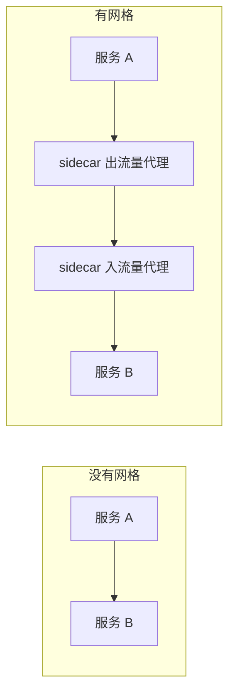
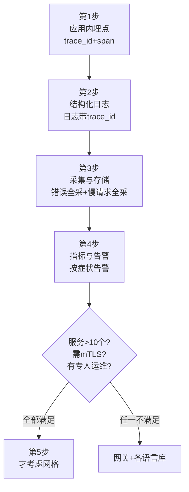

# 服务网格统一通信治理但不负责业务正确性

## 要解决的问题是什么：为什么治理能力会先于业务正确性语义到达

本文讲清**服务网格只治理服务间通信、不负责业务正确性这条边界**；读完你能判断**自己的团队该不该上网格，以及先做什么、后做什么**。

团队引入服务网格的动因通常是可观测性（通过系统对外输出判断内部状态的能力）：**不改业务代码就拿到流量指标、拓扑和重试统计**。实施后的常见落差是，**通信层能力先于业务语义到达**——重试、超时、熔断（依赖持续报错时暂时不再调用它，直接走失败路径，防止拖垮自己）都在，但**哪个策略该作用于哪条业务链路，仍需要人把治理配置和业务语义对上**。

一个团队为了解决"服务之间调用看不见"的问题，引入了 Istio（目前最主流的开源服务网格实现）。三个月后：

- **延迟增加**：每个请求多两跳 sidecar（注入在每个服务旁的代理容器，接管该服务的进出流量），p99（99% 请求的延迟上限，即最慢那 1% 请求的耗时）从 80ms 涨到 110ms
- **排障更难了**：出问题时要同时看应用日志、Envoy 日志、Istio 控制面——**三个地方都对不上**
- **没人敢改配置**：VirtualService（流量路由规则）、DestinationRule（目标服务的负载与连接策略）的规则复杂，改错一次就全站 503
- **原来的问题没解决**："这个请求失败了，是业务逻辑问题还是网络问题"——**还是答不上来**

**服务网格解决的是"服务之间怎么通信"，不是"业务为什么出错"。** 它给的是**通信层的治理能力**（mTLS——服务之间互相认证、加密的传输方式，重试、熔断、流量切分），但**业务可观测性要在应用里做**。

## 服务网格到底是什么：从零开始

### 服务网格一句话怎么定义

**服务网格 = 把"服务间通信的治理"从应用代码里抽出来，放到一个独立的基础设施层。** 写字楼的统一前台是同一分工：访客登记、快递签收、门禁放行都归前台（基础设施层），各家租户不用自己雇人守门（应用代码不感知）——前台管的是"人和物怎么进出"，租户屋里生意做得好不好（业务正确性），前台一概不问。

### 它是怎么做到的：Sidecar 代理

没有网格时，重试、超时、熔断这些治理逻辑写在每个服务自己的代码里，每种语言各实现一遍。有网格之后，流量先经过 sidecar，**治理逻辑挪进代理层，应用代码不再感知**：

sidecar 的形态在刀片服务器机箱上有现成的对应：机箱背部是统一的 midplane（中间背板）与交换模块，每片刀刃自己不装对外网口，进出流量一律经过机箱统一的交换设施——重试、VLAN（Virtual LAN，虚拟局域网：在同一物理网络里划出隔离的广播域）划分、链路冗余这些通信治理由机箱层统一规定，任何一片刀刃不用自己插网卡。**业务代码里不再各写一遍重试与熔断，流量统一从背板走**。

这条对应反过来也提示成本：机箱、背板、交换模块本身要占机柜空间与电力，等于**每个 Pod（Kubernetes 调度的最小部署单元，可含一个或多个共享网络的容器） 多一个 sidecar 容器的资源开销**。这个比喻只到「通信统一收口」为止，别处正好相反：背板是整机一套、刀刃共享，sidecar 是每个 Pod 各一份、互不影响——照搬背板的共享印象会误判网格的故障隔离。


*图源：Wikimedia Commons，Bill McCurdy，CC BY-SA 2.0，https://commons.wikimedia.org/wiki/File:Rack_for_installed_sound_system,_VTC_conference_room_control_booth.jpg。*

差别落在拓扑上：没有网格时 A 直连 B 只有一跳；有网格后请求要先出 A 的 sidecar、再进 B 的 sidecar——**两跳是成对加在两端，不是在中间插一个代理**：


服务网格把代理放在客户端与服务端两侧，一次调用要先后穿过两个 sidecar，因此每个请求多出两跳，延迟按两跳算，资源开销按「每 Pod 多一个 sidecar 容器」乘以 Pod 数来算；**也正是因为两端都经过代理，重试、超时、mTLS 才能在一处配置、对所有语言生效**。两跳合计通常 +1-5ms，而实测里 p99 从 80ms 涨到 110ms 是全链路含排队效应的增幅，**两者不是同一个基准**——高并发下两跳代理各自的队列等待会叠加，p99 这类尾延迟（P99 一类的慢请求耗时指标）被放大，**所以实测增幅远超单跳延迟的叠加值**。

**所有进出服务的流量都经过 sidecar**，由此带来：

- **重试、超时、熔断可以在 sidecar 上统一配置**（不用每个语言实现一遍）
- **mTLS 证书（CA 签发的公钥凭证、证明持有者身份）由控制面自动签发和轮换**
- **流量指标天然可采集**（因为都经过代理）

把这套分工落到具体产品上，Istio 的架构是最常见的参照：**控制面（istiod）负责下发配置、签发与轮换证书，数据面是每个工作负载旁边的 Envoy 代理，业务容器不直接对外发流量**。网格的「治理面与数据路径分离」在 RPC（Remote Procedure Call，远程过程调用：像调本地函数一样调远端服务）框架里早有原型——Dubbo 的经典架构把同一件事画得更直白：Provider 启动时向 Registry 注册地址（init），Consumer 订阅并接收变更推送（notify），日常 invoke 却是 Consumer 与 Provider 的点对点直连，Registry 只在启动与拓扑变化时参与，调用次数统计异步上报 Monitor：


*图源：[Apache Dubbo 官方文档](https://dubbo.apache.org/zh-cn/overview/mannual/java-sdk/reference-manual/architecture/)，注册中心短暂故障不影响存量调用正是这张图的语义：虚线（异步）与实线（同步）把治理面与数据面画在了一张图里。*


来源：[博客园《TCP 三次握手和四次挥手图解（有限状态机）》](https://www.cnblogs.com/huansky/p/13951567.html)（CC 4.0 BY-SA）


## 它擅长哪些、不擅长哪些：方案

### 它真正擅长哪四件事

| 能力 | 说明 | 不用网格的代价 |
| --- | --- | --- |
| **mTLS（服务间加密）** | 自动签发、轮换证书 | 每个服务自己实现，容易出错 |
| **流量管理** | 灰度、金丝雀、流量镜像 | 要在网关或应用里做 |
| **统一的重试/超时/熔断** | 配置一次，所有语言生效 | 每种语言各实现一遍，行为不一致 |
| **通信层指标** | 每个调用的成功率、延迟 | 要自己埋点 |

### 它不解决哪些事

| 误解 | 现实 |
| --- | --- |
| "上了网格就有可观测性" | 只有**通信层**指标（成功率、延迟），没有业务语义 |
| "能看到请求为什么失败" | 只知道"失败了、状态码 500"，不知道**业务原因** |
| "能替代链路追踪" | 网格能传递 trace header，但**span 要在应用里埋** |
| "能替代日志" | 完全不相关 |
| "能提升性能" | **会降低**（多两跳代理，通常 +1-5ms） |

## 可观测性按什么顺序实施

**服务网格是可观测性的一部分，不是全部。** 正确的实施顺序：装修的工序是同一顺序——先在每个房间留好插座和走线（应用内埋点），再定统一的线标（日志格式），然后装配电箱集中走线（采集），最后才考虑全屋智能中控（网格）；**跳过留插座直接上中控，中控再智能也接不上电**。

### 第 1 步：为什么先做应用内的埋点（最重要）

**没有这一步，后面全是空的。**

```text
每个请求生成 trace_id（链路编号，串联一次请求跨服务的调用链）
  → 传给所有下游调用（HTTP header / 消息头）
  → 每个服务记录自己的 span（耗时、状态、关键字段）
  → 日志里带上 trace_id
```

用 **OpenTelemetry（可观测性数据采集的开放标准）**（语言无关的标准），**不要自己造**：

```go
ctx, span := tracer.Start(ctx, "order.create")
defer span.End()

span.SetAttributes(
    attribute.String("order.id", orderID),
    attribute.Int("item.count", len(items)),
)
```

**这一步投入产出比最高，且没有网格也能做**。挂号看病必须先实名登记 trace_id（链路编号，串联一次请求跨服务的调用链）是同一个道理：后面检查、化验、取药每个环节（span）都凭这张登记号串联——没登记号，检查结果出来不知道该贴给谁。

### 第 2 步：日志格式怎么统一

**结构化日志 + trace_id**，等于给每页检查单印上统一的栏目格式（字段名固定）：日期、项目、结果各归各位，任何一本病历翻开都能按栏目对上；每页都带着登记号，几百页单据才串得起一次就诊。

```json
{"ts":"...","level":"info","trace_id":"8f14e45f",
 "span_id":"a3f21b","service":"order-api",
 "msg":"order_created","order_id":"...","amount":1234}
```

**关键**：**trace_id 必须出现在每条日志里，否则无法串联**。

### 第 3 步：链路追踪怎么采集

部署 collector（如 OTel Collector、Jaeger——Uber 开源的分布式追踪后端，负责收集、存储与查询追踪数据），采样（只采集一部分数据以控制记录开销）存储。

**采样策略**：**错误和慢请求全采，正常请求按比例采**（1-10%）。医院的检验科是同一个取舍：急诊标本（出错、超时的请求）全收全验，一份不漏；门诊常规体检（正常请求）按比例抽检——抽检比例再低，急症一个也不会漏。比喻到「采样取舍」为止：检验科漏一份标本可以重新抽血，追踪数据采的时候丢了就永远丢了，**所以出错与变慢的请求必须全采，正常请求才轮到按比例省存储**。

### 第 4 步：指标和告警怎么配

```text
RED 指标（每个服务）：
  Rate     - 每秒请求数
  Errors   - 错误率
  Duration - 延迟分布（p50/p95/p99）
```

**告警要基于症状，不是原因**："错误率 > 1%" 而不是 "CPU > 80%"。体检的报警逻辑同款：胸痛、气短（症状）直接挂急诊，血脂偏高（原因）只是复查提示——**用户感受到的是症状，资源水位（队列或资源的当前占用程度）只是内部原因**；按原因报警，**常常资源还没到线用户已经骂上门了**。

### 第 5 步：为什么这时候才考虑网格

如果满足以下**全部**条件，**就适合接入**：

- 服务数量 > 10 个（否则收益不抵复杂度）
- 需要跨语言的统一治理（否则用各语言的库就行）
- **需要 mTLS 或复杂的流量管理**（这是网格最不可替代的价值）
- 有专职人员运维（网格出问题时需要懂 Envoy 的人）

小区装门禁系统是同一个门槛判断：楼栋超过十栋（服务多于 10 个）、租户来源复杂需要统一发卡（跨语言统一治理）、需要车辆道闸与人脸识别（mTLS 与流量管理）、有物业维修工驻场（专人运维）——四个条件凑齐，门禁才装得值。比喻到「装不装」为止：门禁装坏了刷错卡顶多让访客走侧门，**网格出问题会拦在所有请求的路上**，所以门槛判断比装门禁更严——不满足全部条件就别上。**不满足就别上。** **用各语言的 OTel SDK（软件开发工具包） + 一个网关（站在客户端与后端服务之间的入口层，集中处理路由、鉴权与协议转换）就够了**。

五步顺序画成阶梯，每级回答「这一步做什么、下一步的门槛是什么」：



## 决定上了怎么降低风险：做法

### 为什么不能一次性全量接入

```text
1. 先在非关键服务的 namespace 开启注入
2. 观察 2 周：延迟变化、错误率、sidecar 资源占用
3. 确认没问题后逐步扩大
4. 每个阶段保留快速关闭的能力（改 label 即可）
```

### sidecar 的资源成本怎么算清

接入网格后每个 Pod 多一个 sidecar 容器：

```text
Envoy sidecar：通常 50-100m CPU、128-256MB 内存
1000 个 Pod = 额外 50-100 核、128-256 GB
```

**这是一笔真实的成本，要算进容量规划**。写字楼公摊是同一个账：租一层楼，电梯间、走廊、大堂（sidecar）占掉的不在房租单价里，但实实在在吃掉可使用面积——一千个工位（Pod）的楼，公摊下来要多租半层（额外 50-100 核），**签合同（容量规划）前就要算进去**。

### 为什么只该配置理解的功能

Istio 有几百个配置项。**常用的就这几个**：

| 功能 | 配置 |
| --- | --- |
| 超时 | `VirtualService.timeout` |
| 重试 | `VirtualService.retries` |
| 熔断 | `DestinationRule.trafficPolicy.connectionPool` |
| 灰度（先放开给一小部分用户验证、再逐步加量的发布方式） | `VirtualService.http.route.weight` |
| mTLS | `PeerAuthentication` |

**不要启用你不理解的特性**——比如复杂的故障注入（主动向系统注入故障来验证容错能力的测试方法）、流量镜像，**它们会在你不注意时造成问题**。

### 网格自身该监控什么

```text
控制面：Istiod 是否健康、配置推送是否成功
数据面：sidecar 注入率、Envoy 的 CPU/内存、配置同步状态
```

**网格自己也会挂，而且要能发现**。保安队也是要被查岗的员工（网格自身也会挂）：监控他有没有在岗（Istiod 健康）、传呼对讲通不通（配置推送）、各楼层巡逻到位率（sidecar 注入率）——安保体系本身失灵时，整栋楼的人身安全都悬空，查岗记录（网格监控）不能省。

## 收益从哪来、付什么价：效果与代价

**收益**

- **跨语言统一治理**：重试、超时、熔断配置一次，所有语言生效
- **mTLS 自动化**：证书签发和轮换不用管
- **通信层指标开箱即用**
- **流量管理能力强**：灰度、镜像、故障注入

**代价**

- **延迟增加**：每跳 +1-5ms（两跳 sidecar）
- **资源开销**：每 Pod 多一个容器
- **运维复杂度陡增**：需要懂 Envoy/Istio 的人
- **排障多一层**：应用 → sidecar → 网络 → sidecar → 应用
- **升级风险**：网格升级可能影响所有服务

## 动手时从哪儿开始

**第一步：先问"我要解决什么问题"**

| 问题 | 需要网格吗 |
| --- | --- |
| 看不到调用链 | 用 OTel 埋点，不需要网格 |
| 不知道为什么失败 | 用结构化日志 + trace，不需要网格 |
| 需要 mTLS | 网格最省事 |
| 需要跨语言统一重试/超时 | 网格可以，也可以各语言用库 |
| 需要复杂的灰度发布 | 网格擅长 |
| 服务只有 3 个 | 完全不需要 |

**第二步：先做 OTel 埋点**

**这是最优先的。** **做完这一步，80% 的可观测性问题就解决了**。

**第三步：统一日志 + trace 串联**

**确保 trace_id 在日志、链路、指标里都能对上**。

**第四步：评估是否真的需要网格**

按上面的条件清单。**不满足就用网关 + 各语言库。**

**第五步：如果上，逐步接入 + 监控网格本身**

## 怎么判断哪些做法一看就是错的

判断方法可以借物业接管的查房清单：每一项错误都对应"这栋楼本来不需要、接管后反而添的麻烦"——为景观照明（可观测性）而装整套楼宇自控（网格），灯还是不亮（业务埋点缺失）；三十户的小楼（3 个服务）上中央空调群控（Istio），电费比房租贵。逐项对照，错误一眼可辨。

**错误 1：为了可观测性上网格**

**网格只给通信层指标**。**业务可观测性必须靠应用内埋点。**

**错误 2：一次全量接入**

**出问题影响所有服务**。**逐步接入，每步可回滚（把系统状态退回到改动之前的版本）。**

**错误 3：忽略 sidecar 的资源和延迟成本**

**1000 个 Pod 多出几十核，延迟 +30%**。**要算进容量规划。**

**错误 4：用了复杂的配置却不理解**

**照抄网上的 VirtualService 配置 → 出问题时不知道为什么**。**只配理解的。**

**错误 5：不监控网格本身**

Istiod 挂了 → **配置无法更新，但已有流量还在跑** → **问题被延迟发现**。

**错误 6：把网格转发追踪头部当成已有链路追踪（给请求经过的每一段服务打标、串出完整调用路径）**

网格能传递 header，但**span 要在应用里创建**。**没有 span 就没有链路**。

**错误 7：服务很少也上网格**

**3 个服务上 Istio**：**复杂度远超收益**。

## 这套判断在哪儿会失效：边界

**网格治理通信不治理数据**：**重试、超时、熔断都在调用层生效，业务侧的幂等（同一操作执行多次与执行一次效果相同）与去重仍是服务自己的责任**——**把幂等寄托在网格重试上，会在重试与业务提交之间制造重复订单**，治理边界画在通信层是架构决策，**画到业务层就是事故**。

## 想自己验一遍怎么动手：验证

1. 治理生效验证：注入网络故障（延迟/丢包），预期**网格的重试与熔断行为与配置一致**（错误率与降级——主动牺牲部分功能或精度，保住核心链路）路径可观察。
2. 幂等边界验证：人为触发一次重试，核对业务侧无重复提交（幂等键生效），**预期重复请求被业务层挡住**。
3. 断言锚点：**治理策略有故障注入实测、幂等键进调用约定**。

## 接着读哪几篇：同在后端系统里的相邻问题

- [[工程知识/性能工程：从用户等待到资源瓶颈/观测与诊断/系统指标与观测]] · [[工程知识/后端系统：在并发、失败与变化中维持服务/分布式可靠性/部分失败决定分布式系统的设计]] · [[工程知识/AI 系统工程：从模型能力到生产能力/质量与运营/可观测性必须能重建一次决策]]