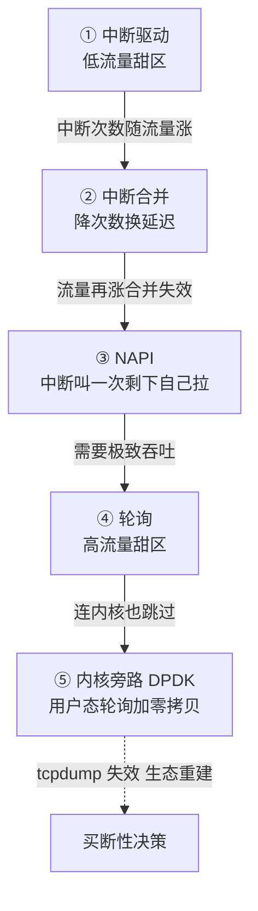
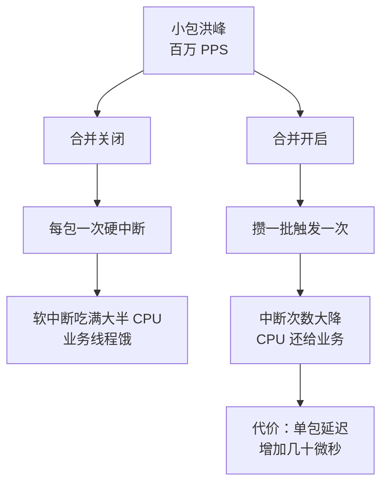

# 网卡与内核旁路：中断与轮询的取舍

## 为什么高流量下中断反而拖垮吞吐

包到达网卡后要进应用，这段路怎么走决定了**网络处理的上限**。传统路径：**网卡收包 → 硬中断通知 CPU → 内核协议栈处理 → socket 缓冲区 → 应用**。

这条路的成本大头不在协议栈本身，在**每次包都打断 CPU**：**硬中断的上下文切换（CPU 从一个任务换到另一个任务、保存并恢复现场的过程）、软中断的处理调度，把 CPU 时间切碎**。低流量时无所谓，高流量（百万 PPS——Packets Per Second 每秒包数，即每秒百万包）时 **CPU 被打断到没法干正事，包处理吞吐反而上不去**。

要解决的问题本质：**事件通知（中断）与持续检查（轮询）之间的成本权衡**，**流量越高，中断的开销越离谱，轮询的浪费越可接受**。读完你能判断自己的服务该用中断、NAPI（Linux 网卡驱动的新式收包接口：高流量时从中断切换到轮询）还是 DPDK（Data Plane Development Kit，用户态网络包处理框架，绕过内核协议）旁路，**并知道各自的调优点与代价**。

## 中断、轮询、NAPI 与旁路各自怎么取舍

中断与轮询的取舍，要放在整个 I/O 模型里看。最经典的那版是 Reactor（事件驱动模型：就绪事件分发给对应的处理器）：一个事件循环（反复取出队列里的回调执行的调度机制）接住多个客户端，再分发给各自的处理链条——读、解码、计算、编码、发送。


*图源：ToolsBook《干翻 nio，王炸 io_uring 来了，史上最详细说明及最全图解》，CC 4.0 BY-SA，https://www.toolsbook.org/2024/05/nio-iouring.html。*


中断开销在性能剖析里是可辨认的：它不走应用调用栈，而是作为内核时间横插进来。同一段负载在火焰图（按调用层级堆叠的耗时分析图、越宽的块越耗时）上对照，中断相关的部分会独立成块，与应用自身耗时区分开。


*图示：CPU 火焰图的形态：宽度是占比、纵向是调用栈深度。图源：[Brendan Gregg · Flame Graphs](https://www.brendangregg.com/FlameGraphs/cpuflamegraphs.html)。*

**中断驱动：包到才通知，低流量最优**。每个包（或每批包）一个硬中断，CPU 立刻响应，**延迟最小**。但吞吐上去后中断风暴（interrupt storm）：CPU 全在响应中断，正经处理排队。经典病：10 Gbps 线速小包（14.88 Mpps，million packets per second，即每秒约 1488 万包）时，**中断开销吃掉全部 CPU**——小包约 64 字节，10 Gbps 带宽除以每包开销就得到这个包速率，也就是每秒近一千五百万次中断。

**轮询驱动：主动拉取，高流量最优**。不要中断，应用（或内核线程）持续查网卡队列有没有包。低流量时轮询是空转（CPU 白烧），**高流量时队列几乎永远非空，轮询没有浪费且免去中断开销**。

**NAPI：自适应的混合模式**。NAPI是 Linux 内核的答案：**低流量用中断（第一口），中断触发后切到轮询模式**（软中断批量收包——软中断是内核自己排队批量处理的下半段任务，不像硬中断那样立刻打断当前程序），**队列空了再切回中断模式**。**自适应切换让两种模式各吃各的甜区**（低于每秒 10 万包算低流量，达到线速小包的百万 PPS 量级算高流量）：低流量的低延迟 + 高流量的高吞吐。NAPI 的批量处理还有二次收益：协议栈处理批量化（每包的处理成本摊薄）、锁竞争（多个执行流争抢同一把锁造成的等待开销）减少——批量收包时一次加锁处理整批，不再每包单独争锁，锁竞争次数随批大小下降。

**内核旁路：干脆绕开内核**。DPDK 的路线：网卡直接映射到用户态（hugepage 收包缓冲、UIO（Userspace I/O，让用户态程序直接驱动设备的简化框架）/VFIO（把硬件设备安全地透传给虚拟机或用户态程序的框架） 这类把网卡设备暴露给用户态程序的驱动框架），应用轮询网卡队列（PMD 即 poll mode driver，轮询模式驱动：不做任何中断处理，只靠循环检查队列），包不进内核协议栈**。协议栈在应用里自己实现，也可以直接用 VPP（vector packet processing，开源的用户态报文处理框架）这类开源框架，不用从零写。收益：**包到应用的路径从"中断+内核+拷贝"缩到"内存读取"，单核百万 PPS**。代价：**CPU 独占（PMD 线程 100% 空转轮询）、协议栈重写（TCP 要自己实现或采用商业实现）、运维复杂（内核的观测工具全失效）。RDMA 绕过内核但要付出可运维性代价（见 [[工程知识/性能工程：从用户等待到资源瓶颈/存储与网络/RDMA绕过内核但要付出可运维性代价.md]]）是同类取舍在存储/消息场景的实例。

## 它从哪儿来，要付什么代价

单循环扛不住的时候，就分成主从（一台主节点负责写入、其他从节点同步数据的部署形态）两拨：主 Reactor 只管接受连接，子 Reactor 管读写，解码、计算、编码这些活交给线程池（预先建好一组线程反复取用、避免频繁创建销毁）。


*主从 Reactor 图示来源：同上 ToolsBook《干翻 nio，王炸 io_uring 来了》，CC 4.0 BY-SA。*


中断 vs 轮询是计算机体系结构的老命题（1960s 起就有），早期设备慢、中断赢得干净。网络提速（1G→10G→100G）把天平推向轮询**：每秒百万级事件时，"每个事件都打断 CPU"**在数学上不成立**。**NAPI与 DPDK是同一判断的两个实现方向：内核内的自适应混合 vs 内核外的彻底旁路。

NAPI 的核心设计可以概括成一句话：**中断只负责叫醒，不负责收包**。第一个包中断唤醒，后续包靠轮询逐一收取，队列空再回中断模式**。**这个状态机把中断频率与流量解耦（高流量时中断频率反而降），单点设计同时拿到两端收益。

代价：旁路方案（DPDK）拿吞吐的代价是**放弃了内核生态——netfilter 防火墙、tcp**dump（抓包工具，按条件截获网卡上经过的报文） 抓包、socket 语义、多进程共享，全部要在用户态重建。旁路是"买断性"决策：一旦走旁路，内核协议栈的演进红利（BBR（Google 的拥塞控制算法，按带宽与延迟主动调节发送速率） 拥塞控制算法、io_uring 新 I/O 接口等内核新能力）与你无关。

socket 读写缓冲区（见 [[工程知识/后端系统：在并发、失败与变化中维持服务/基础设施/socket读写缓冲区：拥塞窗口与应用层背压的连接点.md]]）所在的那段内核路径，就是被旁路掉的——它负责按拥塞窗口与背压（下游处理不过来时把压力传回上游减速）的节奏收发数据，走 DPDK 旁路时整个被跳过。



五种方案排成一条频谱，从纯事件通知到纯持续检查，流量越高越往下走**——实际部署时通常只选其中一个，流量增长后才从上一档移到下一档：低流量时中断最省，线速小包时中断风暴吃光 CPU，**NAPI 用「中断只叫一次」的状态机把两端甜区接起来，DPDK 干脆把整个内核跳过去**。频谱下移的每一步都在用「专用性与运维税」换吞吐**——DPDK 拿到单核百万 PPS 的同时，tcpdump、netfilter、socket 语义全部失效，所以它是买断性决策，上之前先把运维税算进总账。

## 这套说法在哪儿会失效

再往上追一层，是 I/O 多路复用（一条连接上同时承载多个请求、互不阻塞）：由 select（最早的 IO 多路复用，有 1024 上限）这类系统调用（程序请求内核提供服务的入口）同时监视多个连接的文件描述符（进程打开文件的编号句柄），哪个就绪了才交给线程去处理，不用给每个连接配一个线程干等。


*I/O 多路复用图示来源：同上 ToolsBook《干翻 nio，王炸 io_uring 来了》，CC 4.0 BY-SA。*


- **混合模式的切换点是调优点**。NAPI 的轮询预算（budget，每次软中断最多收多少包）与切换阈值**影响延迟与吞吐的平衡：预算大吞吐高但单次软中断占**用久（调度延迟上升）。网卡队列数与 RSS（receive side scaling，网卡把收到的包按哈希分到多个硬件队列、让多核并行处理的特性）的配置在高 PPS场景是基本功。
- **旁路方案不解决所有网络问题**。DPDK 擅长固定路径的高吞吐包处理（防火墙、负载均衡、NFV——把防火墙、负载均衡这类网络功能做成软件跑在通用服务器上），不适合需要完整 TCP（传输控制协议，负责把数据完整、有序地送达）语义的通用服务**。协议栈是几十年工程积累，**重写它的隐性成本（边角 case、安全漏洞、互通性）远超最初的估计。
- **中断亲和性（调度时倾向把相关负载放在同一处）是低成本调优第一站**。把网卡中断绑到特定核（irq affinity，即把中断固定绑定到某个 CPU 核的处理方式），中断固定在一个核上处理、不再跨核迁移**，减少跨 NUMA（Non-Uniform Memory Access，非一致内存访问：CPU 访问本地内存快、远端慢） 的缓存弹跳（NUMA 的代价见 [[工程知识/性能工程：从用户等待到资源瓶颈/处理器与内存/NUMA让跨槽访问付出带宽与延迟代价.md]]），**比直接上 DPDK 便宜两个数量级**——亲和性只改内核参数，半小时就能验证效果；DPDK 要重写收包路径并独占处理核，工作量与资源占用高出约百倍。**调优顺序：先内核参数与亲和性，量不够再旁路。
- **"零拷贝（数据不经用户态中转、由内核直接转发以省去复制）"是营销词，真相是"少拷贝"**。内核路径至少两次拷贝（DMA（Direct Memory Access，设备不经 CPU 直接读写内存） 先到内核缓冲，再从内核缓冲到用户缓冲），优化手段（mmap（把文件直接映射进内存地址空间，读写内存即读写文件） 把文件直接映射进内存、sendfile 让数据在内核内部转发不出内核、splice 在两个数据通道之间搬运）省的是第二次**。旁路方案省的是全部内核环节。**看到"零拷贝"要问具体省了哪一次，见[[工程知识/后端系统：在并发、失败与变化中维持服务/基础设施/网络命名空间与容器网络：vethbridge与overlay.md]]里 veth 的转发路径对照。

## 怎么自己动手验证

NIO（New I/O，Java 的非阻塞 I/O 编程接口）的线程模型把接受连接与处理读写分在不同角色上，每个角色只做一件事，也只在这一件事上被卡住。


*NIO 线程模型图示来源：同上 ToolsBook《干翻 nio，王炸 io_uring 来了》，CC 4.0 BY-SA。*


- **NAPI 行为观测**：`cat /proc/net/softnet_stat`（第2列 packet_budget_exhausted / time_squeeze 高说明轮询预算不够，软中断没收完就到时限）+ ethtool -S 网卡统计。高流量下预期 time_squeeze 随 PPS 增长**；调大 budget 后重测，**预期 squeeze 计数下降、吞吐上升**。**计数不变化则瓶颈不在这层，查应用处理速度。
- **中断亲和性实验**：绑定网卡队列中断到固定核前后对比 p99 延迟（99% 的请求都比这个值快）与 cache-misses（用 perf stat 观测，perf 是 Linux 性能剖析工具，统计 CPU 采样与硬件事件），预期：绑定后跨核迁移的中断处理消失，p99 收窄**。**对照实验是最便宜的调优证据。
- **旁路收益实测**（如有环境）：同一台机 DPDK testpmd 与内核路径（pktgen 打流）对比转发 PPS，预期：DPDK 单核 PPS 数倍于内核路径**。注意公平性：DPDK 用了独占核与 hugepage，**对照组也要给内核路径最优配置（NAPI 调优、RSS 开满），否则对比不诚实。

## 动手跑一遍会看到什么：旁路的账

```text
一次收包路径的推演账（通用形态，量级为公开典型值）：

中断模式：每包一次硬中断 → 10G 线速小包约 14.8Mpps → 中断打满 CPU，
    实际业务只分到 30-40% 处理能力
  中断合并：攒 N 微秒再触发 → 中断次数降 90%**，单包延迟 +几十微秒
    （吞吐换延迟的经典旋钮）
  轮询（NAPI）：包多时切轮询，包少时回中断 → 空载不空转、忙时不风暴**
  内核旁路（DPDK 类）：用户态轮询 + 零拷贝，绕过协议栈
    吞吐再翻倍，代价：独占 CPU 核（业务线程少核可用）、
    失去内核协议栈的全部便利（tcpdump 抓不到、conntrack 失效）
```

中断风暴的实录——百万 QPS（queries per second，每秒请求数）网关（站在客户端与后端服务之间的入口层，集中处理路由、鉴权与协议转换）单机小包洪峰，软中断吃满 8 核里的 6 核，业务线程抢不到 CPU；开中断合并 + RPS（receive packet steering，内核把包跨 CPU 分发的软件手段）多队列分发后软中断占比从 75% 降到 30%**。旁路运维税的实录——**DPDK 化后故障排查失明**（tcpdump 看不到用户态收包路径，协议栈统计全失效），一次丢包（数据包在网络传输途中丢失）问题的排查时间显著拉长；**旁路端要配套自建统计与镜像口，运维税要在选型时算进总账。

轮询空转的实录——低峰期固定轮询线程空转烧 CPU（20% 常驻占用），改 NAPI 式自适应后空载归零。中断与队列的接力细节见 [[工程知识/性能工程：从用户等待到资源瓶颈/存储与网络/网卡丢包先看环形缓冲区溢出：队列、中断与软中断的接力.md]]、整机视角见 [[工程知识/性能工程：从用户等待到资源瓶颈/处理器与内存/CPU性能来自有效执行与数据供给.md]]。

同一波小包洪峰，中断合并关与开各走一条链，结局差在 CPU 去向与单包延迟：



两条链的差别在中断次数：关的一侧每包一次，开的一侧攒一批一次**，代价挂在末端——**单包延迟增加几十微秒。

## 想顺着被旁路掉的内核路径与背压继续读，该看哪几篇

- [[工程知识/后端系统：在并发、失败与变化中维持服务/基础设施/socket读写缓冲区：拥塞窗口与应用层背压的连接点.md]] —— 被旁路掉的内核路径与背压
- [[工程知识/性能工程：从用户等待到资源瓶颈/存储与网络/RDMA绕过内核但要付出可运维性代价.md]] —— 同类旁路取舍的存储场景
- [[工程知识/性能工程：从用户等待到资源瓶颈/处理器与内存/NUMA让跨槽访问付出带宽与延迟代价.md]] —— 中断亲和性与跨槽代价
