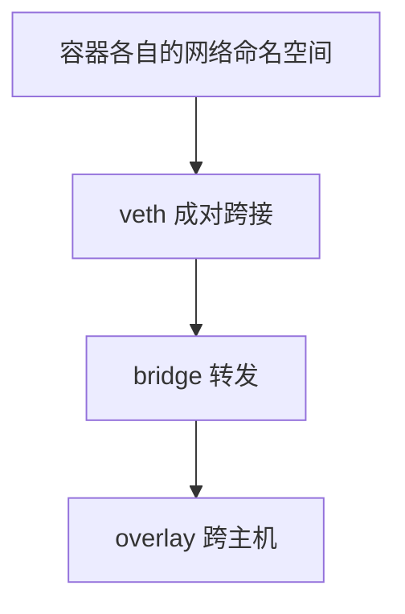
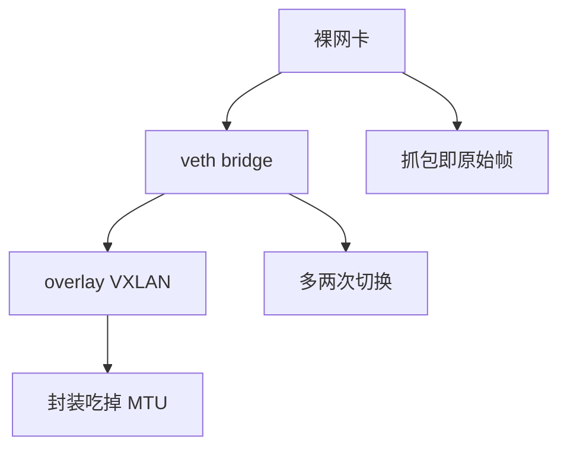

# 网络命名空间与容器网络：vethbridge与overlay

## 容器网络要解决的问题是什么



**容器网络按三级拼起来，每一级各解决一段连通问题**：


本文说明容器网络如何用网络命名空间、veth、bridge、overlay 三级把互相隔离的容器连通起来；**读完你能看懂容器为何能互通、跨宿主怎么通，以及出问题去哪一层排查**。

**容器网络要解决的问题，是让每个容器拥有"自己的一套网络"：独立的网卡、路由表（决定数据包下一跳去向的转发表）、iptables 规则（Linux 的包过滤与改写规则表），互不干扰，又能按需连通**。**Linux 的答案是网络命名空间（netns）：内核把网络协议栈整个复制一份（loopback、路由表、邻接表、套接字列表），进程关进哪个 netns 就用哪套协议栈**。容器隔离资源边界与镜像身份（见 [[工程知识/后端系统：在并发、失败与变化中维持服务/基础设施/容器隔离资源边界与镜像身份.md]]）给了进程的隔离单元，**netns 给了这个单元的网络维度**。剩下的问题是：**两套互相看不见的协议栈，怎么通信？**

## 三级连通方案各自是怎么连通的

**veth 对：点对点管道**。**veth 是一对虚拟以太网设备，数据从一端进入、从另一端流出，两端分别放在两个不同的 netns 里，内核用它做连接两个 netns 的管道**。**容器 netns 里放一端（eth0），宿主 netns 里放另一端（vethxxx）**。这是最底层的连通原语：**有了管道还不够，多个容器互通还得有人转发——bridge 就承担这个角色，在宿主侧把多根 veth 接成交换平面**。

**bridge：把管道接成交换机（在局域网内按地址转发数据帧的设备）**。**单个 veth 只通一个容器**，宿主里放一个 bridge（虚拟交换机，docker0 是默认实例），**把所有容器的 veth 宿主端都插上去，容器间就能二层互通**，再配上 NAT（Network Address Translation，网络地址转换）让容器出网：**iptables 的 MASQUERADE 规则把容器发出的包的源地址改写成宿主 IP，外部回包由宿主转回对应容器**。**单机容器网络的默认形态（Docker bridge 模式）到此成型：netns 隔离 + veth 管道 + bridge 交换 + NAT 出网**。


*图源：dev.to《Understanding Docker's Default Bridge Network (With Diagram)》，https://dev.to/zaheetdev/understanding-dockers-default-bridge-network-with-diagram-4nno。*

**overlay：跨主机的虚拟二层网络**。**多主机时容器 IP 不能靠桥接直接通（宿主之间是三层路由）**，VXLAN（Virtual Extensible LAN，虚拟可扩展局域网）**把容器的二层帧封装进 UDP（用户数据报协议，只管发、不保证到达与顺序）报文，跨宿主传输后解封还原**——容器以为彼此在同个交换机上，实际走的是宿主间的隧道；这层虚拟只到「封装与解封」为止，底层路由该怎么走还怎么走。**每个宿主跑一个 vtep（隧道端点），宿主间组成 overlay 的交换平面**。Kubernetes（容器编排平台，负责容器的部署、调度与自愈）的 CNI（Container Network Interface，容器网络接口标准，各插件按它接入）插件各有取舍：**Flannel VXLAN 是朴素 overlay；Calico 用 BGP（边界网关协议，直接在三层宣告路由）走三层路由，省掉封装开销；Cilium 用 eBPF（在内核里安全运行小程序的技术）直接改写转发路径**。

封装与解封的样子放到图里看，容器帧是这样被装进宿主间隧道的：


*图示：VXLAN 隧道：原始帧被封装后在底层网络上转发。图源：Wikimedia Commons《VXLAN-Tunnel.png》，作者 Carlos.perezrivas，CC BY-SA 4.0，https://commons.wikimedia.org/wiki/File:VXLAN-Tunnel.png。*
两台 VTEP（VXLAN Tunnel Endpoint，overlay 隧道端点） 之间只看得到三层 IP 网络，隧道就架在它上面——**「容器 IP 不能靠桥接直接通」的困境与解法都在这幅形态里：容器帧出宿主前被 VTEP 封进 UDP，到对端解封还原，宿主间抓包看到的是宿主 IP 的报文**。

放进 Kubernetes 集群里，同一套连通问题长这样：


*图源：Kubernetes 官方文档「Cluster Networking」，https://kubernetes.io/docs/concepts/cluster-administration/networking/。*

Kubernetes 官方文档「Cluster Networking」的这张图画出了前面的连通要求：**pod 网络是最下层的一条横线，不管 pod 在哪个 node 上都彼此可达——这条扁平连通性由 CNI 插件用 bridge 或 overlay 在背后搭出来**；**svc 层是连通之上的虚拟 IP 层，与文章的 veth/bridge/overlay 三级方案是同一件事在集群规模的形态**。


## 它从哪儿来，要付什么代价

**netns 进入内核（2007 年 2.6.24）是" namespace（Linux 命名空间：资源隔离的内核机制）家族"的一环（pid/net/mnt/ipc/uts），思想源头是 1998 年的 FreeBSD jail**——FreeBSD 提供的进程隔离机制，让一组进程只能看到自己专属的系统视图：**把系统的全局视图切成进程组的局部视图**。**veth/bridge 复用既有虚拟设备框架（bridge 是 2000 年前后的内核功能，早于容器十年），容器网络把三个旧零件（netns、veth/bridge、VXLAN）拼成新形态**。**overlay 的思想来自数据中心的大二层愿景（VMware VXLAN 2011 年标准化），容器集群把它继承下来**。

容器网络的设计思路是**复用既有内核机制、不新造零件**。**netns、veth、bridge、iptables、VXLAN 全部是既有内核机制，容器网络栈只是编排它们**。**这让整个方案随内核演进免费升级**（内核修一个 bridge bug，所有容器网络受益），**也让排障有据可查**（每个零件都有独立的观测点）。**代价：每加一层抽象丢一分性能与可观测性**（通过系统对外输出判断内部状态的能力）——**veth+bridge 的转发路径比裸网卡多两次上下文切换**（CPU 从一个任务换到另一个任务、保存并恢复现场的过程），**每次切换都要保存并恢复 CPU 现场，转发延迟随之叠加**，**VXLAN 封装吃掉约 50 字节头与 MTU**（1470 变 1420 这类碎片问题），**overlay 的包在宿主间抓包看到的是 UDP 不是原始帧，排障要逐层解封**。**跨主机网络的故障定位成本，是单机的数倍**。

## 这套说法在哪儿会失效

- **overlay 的性能税在封装与解封**。**同东西向流量走 VXLAN，吞吐低于 Calico 的裸 BGP 路由**（少了封装开销）。**大流量服务间通信选 CNI 时，封装方案（Flannel vxlan）与路由方案（Calico）的实测差距要进选型依据，不能只看易用性**。
- **NAT 模式遮蔽了源地址**。**容器出网经 MASQUERADE，外部看到的源 IP 是宿主的**。**服务收到的"客户端地址"失真，日志、限流（控制单位时间放进来的请求数量，超过配额就拒绝）、地域调度都拿不到真实源**。Docker（主流容器运行时）的 userland-proxy、Kubernetes 的 externalTrafficPolicy: Local 都是对这个失真的补救，**各有代价（前者加一跳，后者牺牲节点间负载均衡）**。
- **netns 隔离的是网络协议栈，不隔离带宽**。**两个容器在同一宿主共享物理网卡，netns 没有任何带宽隔离，一个容器打满网卡，邻居全部卡顿**。**带宽控制要靠 tc（traffic control）或 Cilium 的带宽管理，隔离单元与网络单元不是一回事**。
- **容器网络排障的层次纪律**：**先在容器 netns 内看（ip addr、路由表、ping 网关），再切到宿主看 veth 与 bridge（brctl show、tcpdump -i docker0），最后看 overlay 隧道（宿主间 vtep 抓包）**。**跳层排查（直接在宿主抓 overlay 包）会把三层问题搅在一起**。进入任意 netns 的方法：`nsenter -t <pid> -n ip addr`，**这是排障第一命令**。

三层各自丢掉的东西并不一样，排障时对应的观测点也不同，对照如下：



**每一层都有独立观测点，听起来是好事，实际意味着定位一个跨主机问题要在三层之间来回对照**。**跳层排查会把三层的问题搅在一起，反而更难分辨**。**三层各自丢的东西不一样，搅在一起之后就再也分不出是哪一层丢的**，所以**上面那条层次纪律是必要条件**。

## 怎么自己动手验证

- **隔离验证**：**两个容器互 ping**（探测目标主机是否可达的基础命令） 容器 IP，预期通；`nsenter -t <容器pid> -n ip route` **预期看到独立的路由表**（默认网关是 bridge 网段的网关地址）。**若两容器看到了同一张路由表，隔离没生效**，**查运行时是否共享了 netns**（如 --network=container:x）。
- **连通链验证**：宿主 `brctl show docker0`（或 `ip link show master docker0`），**预期所有运行容器的 veth 宿主端都挂在 bridge 上**。容器不通外网时，**逐跳查：容器内 ping 网关**（容器通往外部网络的默认路由地址） → 宿主 `tcpdump -i docker0`（命令行抓包工具）**看包是否到了 bridge** → 看 NAT 规则 `iptables -t nat -L -n` 的 **MASQUERADE 是否命中计数在涨**。
- **overlay 路径验证**：**跨宿主两容器互 ping，宿主间抓 UDP 4789 端口**（VXLAN 默认），**预期看到封装报文在飞**；解封后（tcpdump -e 看内层）**源目 IP 是容器 IP**。**若宿主间没有 VXLAN 报文但容器"通了"，说明走了别的路径（hostNetwork 或路由直通），网络模型与声明不符，要修正文档**。

## 动手跑一遍会看到什么：容器网的账

```text
三级连通方案的推演账（通用形态，量级为公开典型值）：

  veth + bridge：同宿主机容器互通走网桥，跨机走物理网
    延迟最低（近裸金属），跨机要自己管 IP 分配
  overlay（VXLAN 类）：跨机容器互通封在隧道里
    报文多封一层 50 字节 → 有效 MTU 降 1450，吞吐税 10-20%
    大报文被分片/丢弃的坑：应用不知情，表现为"偶发超时"
  host 网络：容器直接用宿主机协议栈，零开销，代价是**端口冲突与隔离弱化**

  排查账：容器里 curl 通、宿主机不通（或反过来）→ 先问自己在哪层命名空间
    MTU 类故障的特征：小包通、大包挂（握手成功、传输卡住）
```

**MTU 黑洞的实录**——**overlay 网络下应用偶发卡死，握手正常传输挂起**（TLS 证书包大于 1450 被静默丢弃，小包探针全绿——TLS 是 HTTPS 里的加密层）；**VXLAN 封装吃掉约 50 字节头，容器内有效 MTU 比物理网小，大包超过上限被静默丢弃**；**把 overlay 的 MTU 调小到与封装后一致，大包不再超界，故障消失**（"小包通大包挂"是 MTU 类故障的指纹）。**conntrack**（Linux 的连接跟踪表：为每条连接在内核里建记录） **打满的实录**——**容器高频短连接，宿主机 conntrack 打满后，新连接无处登记就被丢弃，业务报"随机连不上"**；**调大表容量 + 连接复用后恢复，表水位（队列或资源的当前占用程度）进监控**。**跨命名空间排查绕路的实录**——**网络策略在宿主机 iptables 与容器内各一份，规则冲突时排查花了一天才定位到命名空间层级**；**排查清单固定"逐层收窄"顺序**。隔离的底层边界见 [[工程知识/后端系统：在并发、失败与变化中维持服务/基础设施/容器隔离资源边界与镜像身份.md]]、conntrack 的判定细节见 [[工程知识/性能工程：从用户等待到资源瓶颈/存储与网络/conntrack表满不丢连接的判定：计数、桶与协议差异.md]]、连通性排查的分层纪律见 [[工程知识/性能工程：从用户等待到资源瓶颈/观测与诊断/连通性诊断的分层顺序：从链路到应用逐层收窄，不跳层.md]]。

## 想弄清隔离单元与网络维度的关系，接着读哪几篇

- [[工程知识/后端系统：在并发、失败与变化中维持服务/基础设施/容器隔离资源边界与镜像身份.md]] —— 隔离单元与网络维度的关系
- [[工程知识/后端系统：在并发、失败与变化中维持服务/基础设施/代理与网关的谱系：正向反向与sidecar各自解决什么.md]] —— sidecar 共享 netns 的部署基础
- [[工程知识/软件构建：让变化可以理解、验证与交付/开发工具/词汇即接口：Linux与容器命令的词源与设计.md]] —— ip/netns 命令族的设计语义
