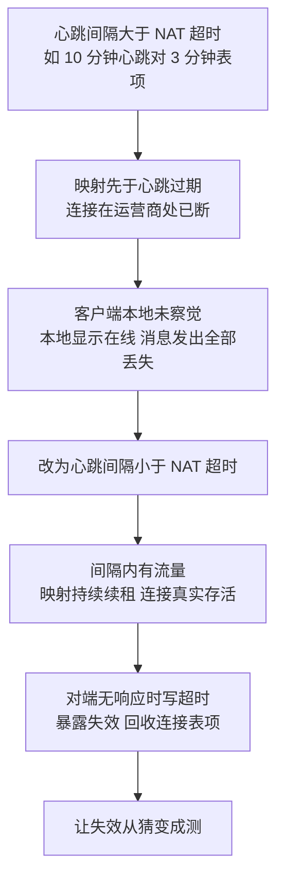
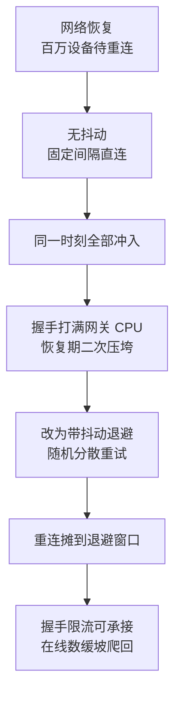

# 长连接网关的工程要点：心跳推送与连接迁移

## 长连接网关到底要解决哪两个核心问题

长连接网关（维持大量客户端长连接、并把服务端消息推给客户端的入口服务）要解决的问题，是**让服务端能把消息推给客户端，且连接本身不能悄无声息地中断**。短连接（HTTP 一问一答）里客户端主动、服务端被动，**推送只能靠轮询（延迟高、空转浪费）**。

长连接（WebSocket；SSE（Server-Sent Events，服务器单向推送协议，比 WebSocket 简单）是服务器单向推送的下行流；QUIC stream——QUIC 是基于 UDP 的新传输协议，把连接建立与加密握手合并、减少往返次数——是一条物理连接上并行多条的逻辑数据流）反转了这一点：**连接保持打开，服务端随时可推**。但**"保持打开"在真实的网络里是个工程谎言**——**NAT（网络地址转换，把内网地址映射成公网地址的中间设备）会超时回收映射、中间设备会掐空闲连接、进程重启会断掉所有在线连接**。这个谎言说的是连接「本地看起来在、实际随时可能被中间设备掐断」，必须靠**心跳（周期性发送用于确认存活的信号）持续续租**才真实存活——它不是不可打破的：**只要心跳频率高过链路上最短的中间设备超时，连接就能真正保持打开**。

**心跳、推送、连接迁移，就是围绕它的三个补救件**。读完你能**定心跳间隔、选推送协议、规划连接迁移**，而不踩 **NAT 超时与重连风暴的坑**。

## 三个补救件各自补的是什么


*图源：Apache APISIX 中文文档《软件架构》（Apache-2.0），https://apisix.apache.org/zh/docs/apisix/architecture-design/apisix/。这张中文架构图里，请求是"路由匹配 → 插件链 → 转发上游"的流水线，而长连接把它换成了"一次匹配、长期持有"：连接不再随请求结束而消失，于是图上不需要操心的事——连接还在不在、迁移时谁来接——都变成了要工程解决的问题。下面三个补救件就是补这三处。*

**心跳：怎么知道连接还通不通？要主动探测**。TCP keepalive（传输控制协议自带的空闲连接保活探测）**默认两小时才起探测，对推送场景形同虚设**，所以应用层自己跳：WebSocket 的 ping（探测目标主机是否可达的基础命令）/pong 帧、SSE 的注释行、自定义业务心跳。心跳解决两个问题：一是**穿透 NAT**（让 NAT 设备上的地址映射不因空闲而超时，外部才能持续连进来），二是**失效连接检测**（对端无响应时，靠写超时或读超时暴露问题：前者是发送缓冲区写满仍发不出去，后者是一段时间无数据到达）。**心跳间隔是权衡：太密浪费电（移动端）与带宽，太疏失效连接滞留占着连接表**。工程常见值在 **30s-60s**，但要**按客户端所处的网络类型分档取值（弱网、移动网络的 NAT 超时更短，取更密的值）**。

TCP keepalive 的探测节奏本身就是一套定时器机制：收到对端确认时重置保活定时器，长时间无数据交互让它超时，超时后发出探测报文，对端的确认回来再重置——探测、等待、重置循环往复。这套机制在内核里静默运转，只是默认的两小时间隔对推送场景太钝：


*图源：即时通讯网《不为人知的网络编程(十二)：彻底搞懂TCP协议层的KeepAlive保活机制》（腾讯云开发者社区转载），https://cloud.tencent.com/developer/article/1814874。*

**心跳间隔的上限不是性能参数，它由链路上最短的那个中间设备超时决定**：**心跳慢于 NAT 超时，映射表项因长期无包被运营商回收，但客户端和网关的本地 TCP 状态仍显示已连**——**本地状态不看运营商的映射表，所以连接实际已断，双方都不知道**。


图上与后面实测段用的是同一组数字（10 分钟心跳对 3 分钟表项），那是具体环境里量到的值，不是推荐值；推荐值按链路最短超时取，工程上常见 30s 到 60s。

两条路径的差别只在「心跳间隔与 NAT 超时的关系」：心跳慢于 NAT 超时，映射被中间设备提前回收，**客户端因为本地没有感知依旧显示在线，消息发出去全部落空——这是「显示在线但收不到」这类问题的根因**。心跳快于 NAT 超时，每个间隔内都有流量经过，**映射持续续租**；同时**读写超时让「对端还在不在」从猜测变成可测**。所以**心跳间隔不是随手填的常数，它的上限由链路上最短的中间设备超时决定**，**移动端要按弱网画像分档取更密的值**。

心跳对抗的是「空闲即断开」的默认行为。这个默认行为在短连接世界是常态：小林 coding 的时序图画的是 HTTP 短连接的标准生命周期——三次握手（TCP 建立连接前、双方交换三个报文确认彼此收发能力的流程）建连、一问一答、60 秒空闲后服务端主动断开四次挥手（TCP 断开连接时、双方交换四个报文释放资源的流程）。长连接的全部意义，就是让连接逃出这条时间线；心跳就是逃出去之后维持「活跃凭证」的最低成本手段：


*图源：[小林 coding《TCP 面试题》](https://www.xiaolincoding.com/network/3_tcp/tcp_interview.html)，原创图注明出处转载。*

**推送：选哪种协议取决于消息往哪个方向走？**三条路各有代价：长轮询（客户端发起、服务端 hold 住直到有消息）**复用 HTTP 基建但每个消息一次往返**；SSE**只能下行**、断线重连靠浏览器内置 EventSource；WebSocket（双向帧协议，RFC 6455）**全双工**但要自己处理**握手升级、帧分片（把数据按规则切开、分散到多个节点存储）、关闭语义**。**选型判据是消息方向与频率：纯下行通知用 SSE 最省，双向高频交互才上 WebSocket**。

WebSocket 从 HTTP 升级而来的那一次握手，小林coding 的中文时序图画得最直接——客户端发 `Upgrade: websocket` 请求，服务端回 `101 Switching Protocols`，此后双方改用 WebSocket 帧格式互推数据，HTTP 阶段就此结束：


*图源：[小林coding《图解网络》WebSocket 章节](https://www.xiaolincoding.com/network/2_http/http_websocket.html)。握手只有一来一回两次 HTTP 报文，升级完成后连接常驻，图下半段的双向箭头正是推送语义的来源。*

**连接迁移：网关重启时怎么不让百万连接同时断掉？**长连接网关是**有状态节点**（连接粘在某台机器上），**重启、发布、宕机都是断连事件**。**百万在线的网关重启，百万客户端同时重连，重连风暴会打垮后端**。对策分两类：**迁移**指把连接状态挪走，即**热升级与连接接管**；**错峰**指**重连退避——在固定重试间隔上叠加随机偏移量 jitter 分散重试**，见 [[工程知识/后端系统：在并发、失败与变化中维持服务/分布式可靠性/重试的正确姿势：退避、抖动与重试预算.md]]。QUIC 是基于 UDP 的传输协议，把可靠传输与加密握手合在一起在协议层给了新选项：**连接迁移靠 connection ID 而非四元组标识连接，IP 变了连接不断**，见 [[工程知识/性能工程：从用户等待到资源瓶颈/存储与网络/QUIC把传输握手与加密合流到用户态.md]]。


## 它从哪儿来，要付什么代价

推送需求的祖先是桌面时代的 IM（ICQ（早期的即时通讯软件）/MSN 的服务器长期挂着连接），那时连接数以千计、单机 select（最早的 IO 多路复用，有 1024 上限）就够。**移动互联网把在线规模推到百万级，每连接一线程的模型撑不住这个量级**——每条连接开一个线程处理，连接多了**线程栈内存与上下文切换（CPU 从一个任务换到另一个任务、保存并恢复现场的过程）开销先爆掉**；于是 **epoll（Linux 的多路复用接口，一个线程盯住成千上万个连接）/kqueue（BSD/macOS 上与 epoll 同类的事件通知机制）的单线程管海量连接的 I/O 多路复用（一条连接上同时承载多个请求、互不阻塞）成了网关的基本功**——C10K（单机一万个并发连接的经典问题）指单机一万并发连接，C1M 指单机百万并发连接。

**WebSocket 标准化（2011 年 RFC 6455）把浏览器纳入长连接生态**，这之前浏览器推送靠 Comet 的 hack（隐藏 iframe 长轮询）。

**心跳把"连接可用"变成显式约定**。TCP 报文里没有"我活着"的声明，keepalive 又太钝，应用层心跳等于双方约定：**N 秒内没有流量就互相判定连接失效**。**这个约定让失效连接的清理从"猜"变成"测"**。代价：**长连接网关的资源模型与请求-响应服务完全不同**——**内存按在线数线性涨（每连接缓冲区）、CPU 由消息推送量驱动而非请求数、发布节奏被连接粘性绑架（滚动发布一轮要等连接自然耗散或主动迁移）**。容量估算的通用骨架[[工程知识/后端系统：在并发、失败与变化中维持服务/服务设计/容量估算的通用骨架：从峰值QPS到机器数的推导演练.md]]里"资源跟着什么涨"这一问，长连接场景的答案**与在线数挂钩，不与 QPS（Queries Per Second，每秒查询数） 挂钩**。

## 这套说法在哪儿会失效

- **心跳检测不到只失效一半的连接**。**写成功（进了内核缓冲区）不代表对端收到**，对端无响应但内核还在收的场景，**业务层往返（req-res 配对）是暴露它的手段**。**关键路径的活跃检测要用业务心跳，链路心跳只够清垃圾连接**。
- **代理链路会吃掉心跳语义**。过 L7 代理（应用层代理，能读懂并改写 WebSocket 报文）的 WebSocket，代理自己也发 ping（透传即原样转发不改动，拦截即代理拆开检查后再转发），**客户端看到的 pong 可能来自代理而非源站**。**排查"连接活着但消息不到"时先查中间层**，代理与网关的谱系[[工程知识/后端系统：在并发、失败与变化中维持服务/基础设施/代理与网关的谱系：正向反向与sidecar各自解决什么.md]]里每层都可能改写行为。
- **连接数上限在文件描述符（进程打开文件的编号句柄）与内存，不在 CPU**。**百万连接的网关先撞 ulimit（进程可打开文件描述符的上限，每条连接占用一个）、再撞每连接缓冲区的内存墙，CPU 反而闲**。调优顺序：**fd 限制 → 内存画像 → 才轮到 CPU**。
- **迁移不是免费午餐**。连接状态接管要求**状态外置（会话表挪到共享存储或对端）**，**每次消息多一跳查表**。**迁移收益（发布不断线）与常态代价（每消息多一跳）要在在线规模大时才合算，小规模错峰重连更简单**。

## 怎么自己动手验证

- **失效连接清理验证**：拔掉客户端网线（不是杀进程），预期：**网关在心跳超时窗口内检测到并回收连接，连接表数量回落**。若连接滞留明显超过心跳超时窗口，**查心跳实现是否真的绑定了读超时**。
- **重连风暴演练**：kill 网关主进程，预期：**客户端按 jitter 退避分散重连，后端 QPS 曲线是缓坡不是尖刺**；新网关节点在线数在退避窗口内爬回基线（正常状态下的指标水平、用来对比异常）。**尖刺出现说明客户端退避没加抖动，全员同一毫秒冲进来**。
- **容量画像验证**：按目标在线数压测（如 50 万连接、每连接 4KB 缓冲），预期：**内存占用 ≈ 在线数 × 每连接开销（缓冲+会话结构）**，实测对不上就**逐项查每连接真实内存（ss -m 看每 socket 的内存分配）**。

## 动手跑一遍会看到什么：连接的账

```text
千万级长连接网关的连接生命周期账（通用推演）：

  心跳：客户端 4.5 分钟一次 ping，网关 5 分钟无心跳判连接无效回收
    移动网络 NAT 表项超时常见 5 分钟 → 心跳间隔必须小于 NAT 超时，
    否则连接在运营商网关处已被回收，应用层还以为在线（发消息全丢）
  推送：在线连接直接写，离线连接转离线消息（拉模式补）
    推送成功 ≠ 对方读到 → 应用层确认（ack）与重试在消息层补
  重连：指数退避 + 随机抖动，避免网络恢复瞬间百万连接同时重连
    重连风暴的账：断网 10 分钟后恢复，1% 设备直连 = 10 万 QPS 的握手洪峰
    → 服务端限流 + 客户端抖动是标配
  连接迁移：WiFi 切 4G，IP 变化但连接要活 → 连接 ID 与设备绑定，
    新地址凭 ID 认领会话，未确认消息自动重放
```

**心跳与 NAT 错配的实录**——心跳间隔 10 分钟，海外运营商 NAT 超时 3 分钟，**用户切后台再回来显示在线（本地 TCP 未察觉），消息发出后对方收不到（连接实际已失效）**；**心跳调到 3 分钟内 + 应用层消息确认后消失**。**重连风暴的实录**——机房网络抖动 2 分钟，**恢复瞬间百万设备同时重连，握手打满网关 CPU，本已恢复的网络被重连洪峰二次压垮**；**客户端退避抖动 + 服务端握手限流（限制单位时间内放行的请求数量）后，恢复期 QPS 曲线从尖峰变缓坡**。长连接的传输层基础见 [[工程知识/后端系统：在并发、失败与变化中维持服务/基础设施/TCP连接建立与断开的状态机：握手挥手与异常路径.md]]，移动场景的传输层红利见 [[工程知识/后端系统：在并发、失败与变化中维持服务/基础设施/QUIC之后的传输层：HTTP3与连接迁移的工程红利.md]]（连接迁移的同源机制）。


断网恢复那一瞬间，百万设备的重连是同一毫秒冲进来还是摊在退避窗口里，决定了**恢复期是尖峰还是缓坡**——也决定了**刚恢复的网络会不会被自己压垮第二次**。


两条链的分叉点在**客户端有没有抖动**，服务端限流只能承接摊开后的那条：**抖动是客户端的责任，限流是服务端的责任，缺任何一半恢复期都会变回尖峰**。

## 想深入长连接赖以存活的传输层状态机，接着读哪几篇

- [[工程知识/后端系统：在并发、失败与变化中维持服务/基础设施/TCP连接建立与断开的状态机：握手挥手与异常路径.md]] —— 长连接赖以存活的传输层状态机
- [[工程知识/性能工程：从用户等待到资源瓶颈/存储与网络/QUIC把传输握手与加密合流到用户态.md]] —— 协议层连接迁移的原生支持
- [[工程知识/后端系统：在并发、失败与变化中维持服务/分布式可靠性/重试的正确姿势：退避、抖动与重试预算.md]] —— 重连风暴的退避纪律
- [[工程知识/后端系统：在并发、失败与变化中维持服务/基础设施/QUIC之后的传输层：HTTP3与连接迁移的工程红利.md]] —— 应用层连接迁移与协议层迁移的对照
- [[工程知识/后端系统：在并发、失败与变化中维持服务/基础设施/socket读写缓冲区：拥塞窗口与应用层背压的连接点.md]] —— 缓冲区事故的多发场景
