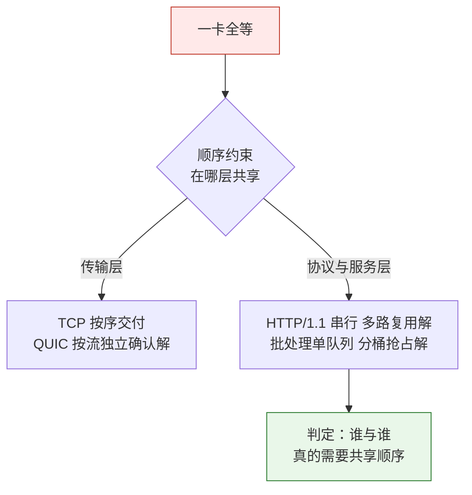

# 队头阻塞是共享队列的排队税：一卡全等的传递链与解法

**队头阻塞（head-of-line blocking，共享队列里队首的慢任务卡住其后全部任务的传递现象）的根源是「共享队列 + 顺序约束」两个条件的叠加；每一层协议与系统的解法都是同一个动作——让单元之间不再共享顺序约束**。 读完你能回答：**TCP 层丢包为什么卡住全部流、HTTP/1.1 与 HTTP/2 的队头阻塞差在哪、推理服务的批处理为什么把首 token 延迟变成了排队税、应用层的单队列怎么改造**。

## 要解决的问题

**队列本身没有问题，问题在「一卡全等」的传递结构：队首单元慢（丢包重传、慢客户端、长请求），后面所有单元不管多急都得等**。**排队论里这是 FIFO 队列在服务时间方差大时的必然形态——方差越大，队首恰好是慢任务的概率越高，平均等待被拉得越长**。**队头阻塞不是缺陷，是共享顺序约束的定价；设计能做的是消除不必要的共享**。

## 机制：同一疾病在四层的形态与解法

### TCP 层：按序交付是承诺也是代价

**TCP 承诺字节流按序到达。一个报文丢失，接收方必须等它重传到达才能把后续已到达的数据交给应用——后续数据全被卡住**。**这是按序交付的内建代价，无法配置关闭**。**解法在 TCP 之上：HTTP/2 的多路复用让多条流共享一条连接，但共享的仍是同一条 TCP 流，一个报文丢失仍卡住全部流的传输——多路复用把应用层的队头阻塞消掉了，TCP 层的还在**。

### HTTP/2 → HTTP/3：把流从共享传输里解放

HTTP/3 换用 QUIC（RFC 9000，基于 UDP 的多流传输协议）：**每条流独立编号、独立确认，流 A 丢包只重传流 A 的数据，流 B 的包照常交付**。**QUIC 的核心改动就是把「共享顺序约束」从连接级降到流级**。**代价是 UDP 在部分网络的中间件兼容性与 CPU 开销——队头阻塞的消除不是免费的**。

### 推理服务：批处理引入的新队头

LLM 推理的 continuous batching 把多个请求合并进一个批次：**一个批次没走完，下一个请求进不来**。**长输出请求把批次拖长，短请求的首 token 时间被拉长——这是应用层主动构造的队头阻塞，换来的吞吐提升是收益**。工程解法是**分桶与抢占**：**按预估输出长度分桶组批，长请求不与短请求同批；调度器支持对批次内请求的抢占与重排**。**队列的解法不是消灭队列，是控制谁与谁共享队列**。

### 应用层：单队列改多队列或改无共享

**共享存储、单工作线程、全局锁串行化——应用层队头阻塞的三个高频来源**。**改造方向按约束强度排：能拆分区就按 key 哈希到多个独立队列（Kafka 的 partition 就是这条思路）；能异步就消息化，长动作旁路处理，主路径只投递；连顺序都不需要时，去掉队列本身**。**判定句：先问这些任务真的需要共享顺序吗，再谈队列参数调优**。

## 案例：共享队列的两端都有账

[[工程知识/缺陷分析：从个案到体系/性能/案例三十七：锁自己变成了瓶颈——争用背后的临界区错配]] 是共享约束的锁形态：**一把全局锁把无冲突的操作串行化，队头从「慢请求」换成「锁持有者」——消共享约束的思路相同：按资源分片、读写分离、缩小临界区**。[[工程知识/后端系统：在并发、失败与变化中维持服务/任务与并发/队列和流系统用时间与容量换取解耦]] 从另一头记账：**队列换来解耦的同时引入了自己的排队与积压问题，容量与时限要显式设计**。**两案与本篇合起来是同一句话的三个角度：共享是效率工具，也是等待的放大器，共享面要按需分配**。

## 怎么测

- **丢包注入：在连接上注入 1-2% 丢包，对比 HTTP/2 与 HTTP/3 的 P99 延迟差异，验证传输层队头阻塞的实际影响**。
- **长尾请求测试：向服务混入少量超长请求，观测其余请求的首 token/P95 变化，量化队头的拖拽半径**。
- **队列深度监控：每个共享队列挂深度与等待时长指标，P99 等待显著高于 P50 时说明方差过大（队首常是慢任务）**。
- **分桶有效性：分桶改造前后对比混布场景的短请求延迟，确认桶间隔离生效**。

## 哪些认识一看就错

- **「HTTP/2 多路复用解决了队头阻塞」——只解决了 HTTP 层的，TCP 层的丢包卡全部流仍在，HTTP/3 才是完整解**。
- **「队列调大参数就能缓解」——加大队列只增加排队长度，等待总量不变甚至更糟；要动的是共享结构，不是队列长度**。
- **「批处理总是好的」——吞吐与延迟是定价关系，混布长短请求时批处理主动制造队头；分桶是必须的配套**。
- **「异步了就没有队头阻塞」——消息队列内部仍是共享队列，消费者的单线程消费、分区的 key 倾斜都会重新引入一卡全等**。

## 效果从哪来、要付什么代价

**按流独立的确认让丢包只影响丢包的流，分桶让长短请求各排各的队，多队列让不同 key 的流量互不等待**。**代价逐项可数：QUIC 的 CPU 开销与中间件兼容风险、分桶增加的调度复杂度、多队列增加的资源隔离成本**。**队头阻塞的治理收益在尾部延迟（P99）不在平均值——平均等待不变、等待方差变小的改造，在 SLA 语境下就是全部收益**。

关系：[[工程知识/后端系统：在并发、失败与变化中维持服务/任务与并发/队列和流系统用时间与容量换取解耦]] —— 队列作为解耦工具的时间与容量定价，本篇是它的排队税专篇。[[工程知识/性能工程：从用户等待到资源瓶颈/存储与网络/MTU黑洞的指纹是小包通大包挂：分片黑洞的诊断路径与封装税核算]] —— 另一种传输层卡顿：分片丢失的指纹与诊断。[[工程知识/AI 系统工程：从模型能力到生产能力/推理服务与平台/推理批处理的两难：吞吐与延迟的调度天平]] —— 推理侧批处理的调度定价，与本篇分桶解法衔接。
