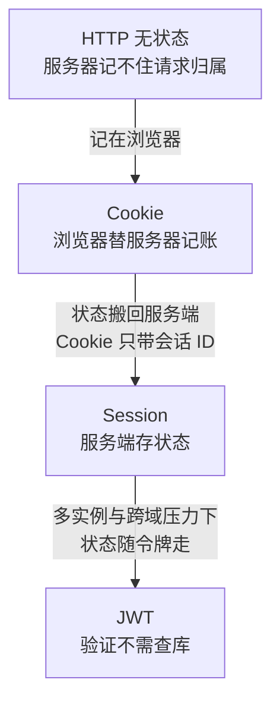

# Cookie到Session到JWT：无状态需求的演进链

**HTTP 每个请求独立，服务器记不住上一个是谁——登录态的三种主流方案（Cookie、Session、JWT）是同一条因果链上的三步演进，每一步都在解决上一步留下的具体约束。** 读完你能回答：Session 为什么扩不动、JWT 为什么撤不了权、两者混用的边界在哪、什么场景该停在哪一步。

## 演进链：每一步都在解开一个约束

### 第一站：Cookie——浏览器替服务器记账

Cookie（RFC 6265，服务器下发、浏览器存储、每请求自动回带的小字段）**把「记住用户」的责任挪给浏览器**：登录成功后发一个 `Set-Cookie: user=zhang`，之后每个请求自动携带。**问题立刻出现：浏览器是攻击者的领地——用户可以改，跨站脚本（XSS，攻击者注入的脚本在受害者浏览器里执行）可以读，跨站请求伪造（CSRF，攻击者借受害者浏览器已带的凭据发起请求）可以借用。明文记身份等于把账本交给了对方。**

### 第二站：Session——状态搬回服务端，Cookie 只带钥匙

Session 把账本收回服务端：**登录后生成随机 `session_id`，状态存在服务端（内存、Redis、数据库），Cookie 只带这串 ID。浏览器改不了 ID 对应的内容，XSS 拿到 ID 也只能冒用到过期为止。**Session 方案换来两个新约束：

- **存储是共享状态**：**多实例部署时，请求落在任何一台都要能查到这份状态，Session 存储必须集中（Redis 居多）——每一秒的鉴权都多一次网络查询。**
- **Cookie 域绑定**：**Cookie 只随同域请求发送，App、小程序、跨域 API 天然拿不到这份登录态。**

### 第三站：JWT——把验证所需的状态装进令牌

JWT（JSON Web Token，RFC 7519，服务端签名、请求方随身携带、自含声明的令牌格式）把状态装回客户端：`header.payload.signature`，**payload 里的 user_id、角色、过期时间全部签名后随请求走。服务器收到后用密钥验签，不查库就知道「这是谁、能干什么」。**约束被解开的同时也换了代价：

| 维度 | Session | JWT |
| --- | --- | --- |
| 验证成本 | 每请求查一次存储 | 本地验签，零查询 |
| 撤销已发凭据 | 删一条记录立即生效 | 只能等过期，撤权要额外黑名单或短 TTL |
| 凭据大小 | 几十字节 | 数百字节起，进 Cookie 受 4KB 限，进 header 每请求都背 |
| 多实例/跨域 | 共享存储必须集中 | 天然无状态，谁都能验 |
| 泄露后果 | 冒用至 ID 过期 | 冒用至 token 过期（同样依赖短 TTL） |

**判据不是「新比旧好」，是「验证路径上有没有查库的预算、撤权窗口能不能接受」。** 内部单域服务、撤权敏感（权限变更频繁、审计要求即时生效），**Session 更稳；多服务、多端、跨域调用链长，JWT 的无状态优势才兑现。**

## 混用边界与撤权工程

真实系统常走中间路线：**短 TTL access token（JWT，几分钟）+ 长 TTL refresh token（Session 式，服务端可撤销）**。**访问凭据无状态高频验证，刷新凭据有状态可随时吊销——撤权窗口从「天」压到「分钟」，无状态收益照拿。这套结构正是 OAuth 2.0 授权代码流的标准形态。**

**JWT 五项校验（签名、iss、aud、exp、scope）任何一项缺省都等于开门：只解码不验签等于接受伪造，缺 aud 校验等于服务 A 的票能进服务 B。**校验清单在认证授权篇已逐项展开，此篇不重复。

## 案例：案例五的 XFF 与撤权链

[[工程知识/缺陷分析：从个案到体系/安全/案例五：安全两例——认证绕过与带漏洞依赖]] 里 ZooKeeper CVE-2024-51504 的认证绕过，根子是信任了代理层传来的 X-Forwarded-For 头——真实 IP 判定被攻击者一行 header 改写。这与令牌验证同构：**凭据链上任何一环信任了未经密码学保护的声明，验证就从那一点失效。** Session ID 与 JWT 之外的第三种「凭据」——来源 IP——最容易被想当然当成身份信号；**协议里没有签名的东西都不是身份。**

## 怎么测

- **撤权演练：改掉某用户角色，确认 access token 在 TTL 内的行为与 refresh token 的即时拒绝都符合设计预期，写成集成测试常驻。**
- **过期矩阵：构造 exp 已过、签名被改、iss 不符、aud 不符四类 token，验证服务端全部拒绝且拒绝原因不同（日志可区分）。**
- **CSRF：对 Cookie 方案补 SameSite 与 CSRF token 校验测试；JWT 走 header 的方案确认没有把 token 落进 Cookie 的残留。**
- **会话固定：登录成功后确认 session_id / token 重新签发，不复用登录前的。**

## 哪些认识一看就错

- **「JWT 比 Session 安全」——安全属性不同：JWT 验签防篡改，但 payload 明文可读、泄露后同样冒用；安全性取决于校验完整度与 TTL，不取决于方案新旧。**
- **「JWT 可以存敏感信息」——payload 是 base64 编码的明文，解码即读；要加密用 JWE，或根本别放。**
- **「无状态所以不用管登出」——客户端删 token 只是丢失携带，凭据本身在过期前仍有效；登出需要服务端黑名单或短 TTL。**
- **「签名密钥放环境变量就安全」——密钥进代码仓库、进日志、进崩溃堆栈都是真实泄露路径，轮换机制要提前设计（kid 字段支持多密钥并存过渡）。**

## 效果从哪来、要付什么代价

**演进链每一步都在「验证成本、撤权能力、凭据大小、跨域能力」四个轴上重新定价：Cookie 零成本但裸奔，Session 换来服务端控制但背上共享存储，JWT 换来无状态但失去即时撤权。混用结构（短 TTL access + 可撤 refresh）是当前工程里把两个矛盾各取一半的标准解。**代价是**系统多了一层令牌生命周期管理——签发、刷新、轮换、黑名单，每个环节都是测试要覆盖的状态。**

关系：[[工程知识/后端系统：在并发、失败与变化中维持服务/服务设计/认证授权决定请求能看什么和做什么]] —— 令牌验证通过之后，授权判定（谁能看什么、谁能做什么）在这篇展开。[[工程知识/后端系统：在并发、失败与变化中维持服务/安全与鉴权/密码存储把可逆的难题变成不可逆的常数]] —— 登录链路的起点：身份凭据如何安全落库与核对。[[工程知识/后端系统：在并发、失败与变化中维持服务/基础设施/代理后的真实IP要靠协议传递：X-Forwarded-For的信任边界与PROXY protocol]] —— 凭据链上的另一环：请求来源身份如何可信传递。
