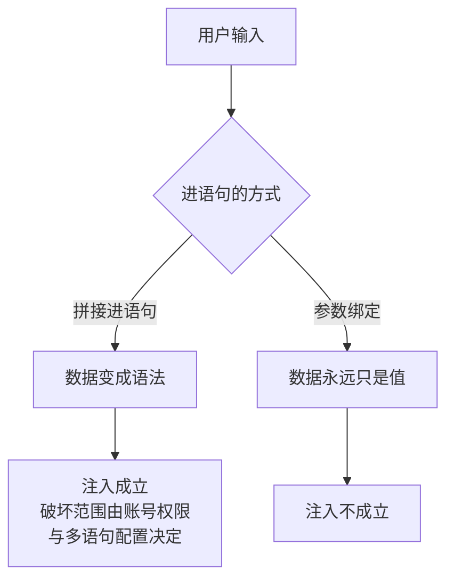

# SQL注入是把数据当代码执行：参数绑定为唯一根治

**SQL 注入（SQL injection，用户输入被拼进 SQL 语句并被数据库当成语法执行）的本质是数据与代码的分界被抹掉**。 读完你能回答：**为什么转义引号是打补丁、参数绑定为什么在协议层根治**、`LIKE` 子句与 `ORDER BY` 为什么绑定不了、堆叠查询如何一击多库。

## 要解决的问题

业务代码里最常见的写法：

```python
cursor.execute(f"SELECT * FROM users WHERE name = '{name}'")
```

`name` 来自请求。当 `name = ' OR '1'='1` 时，数据库收到：

```sql
SELECT * FROM users WHERE name = '' OR '1'='1'
```

条件恒真，全表返回。**数据越过了边界，变成语句的一部分——单引号在 SQL 语法里是字符串定界符，它到了数据库手里就是代码，不管它从哪个字段来**。

## 机制：三种防线按根治程度排序

### 参数绑定：在协议层隔开代码与数据

参数化查询（parameterized query，SQL 模板先发、参数单独发的执行方式）把语句结构与参数值分两个通道送进数据库。**参数槽位 `?` 或 `$1` 是结构里留给参数的洞，参数走独立的二进制通道**：

```python
cursor.execute("SELECT * FROM users WHERE name = %s", (name,))
```

数据库收到的 `name` 永远是一个待填充的值，**哪怕内容是 `' OR '1'='1`，它也只是那个字符串本身，不会再被解析成语法**。**绑定发生在数据库驱动与服务器之间的协议层，转义在应用层模拟这条边界——这就是两者可靠性的差距：转义要追上每一种上下文的特殊字符，绑定让「数据进语句」这条路物理上不存在**。

### 转义与白名单：绑定不了的上下文的补法

两类位置参数绑定管不到，因为**它们是语句结构，值本身就是语法**：

- `LIKE` 的通配符 `%`、`_`：**值绑定是安全的，但通配符语义还在，需要单独转义**（`ESCAPE` 子句）。
- `ORDER BY` 的列名、表名：**标识符不能参数化，必须白名单映射**——`sort_field in {"name", "created_at"}` 查表取真列名，**直接拼用户给的标识符等于把表结构交出去**。

**白名单（whitelist，只允许列举出来的值通过）比黑名单可靠的原因：黑名单追新增的攻击 payload 永远滞后，白名单的拒绝集是无限的**。

### 堆叠查询与最小权限：限制注入成功的爆炸半径

部分驱动（如 SQL Server 的默认配置）允许一次提交多条语句，`; DROP TABLE logs; --` 直接执行。**防线两层：连接串关掉多语句（PostgreSQL 默认不允许，属于安全默认值），数据库账号只授业务必需权限**——**注入即使发生，写权限与跨库访问被账号边界挡住**。**这与最小权限原则同源：注入防的是「能不能进来」，账号权限防的是「进来之后能走多远」**。



## 案例：Equifax 的 1.47 亿条记录

2017 年 Equifax 被注入攻击拖走约 1.47 亿美国人的身份信息。直接原因是 **Apache Struts 的反序列化漏洞**（CVE-2017-5638）放攻击者进了 Web 应用；**进去之后，数据库连接账号权限过宽、内网横向无隔离，才把一次入口突破放大成全库泄露**。**教训的结构值得记住：入口漏洞决定能不能进，凭据与权限决定进来之后能拿走多少**。 案例五里 Vert.x CVE-2024-8391（gRPC 消息无上限导致 OOM）**不同在缺陷类型，相同在结构——依赖带的缺陷在上线前就在代码里，扫描与升级是常态动作而不是事件响应**。

## 怎么测

- **用 sqlmap 或手写 payload 对全部接口过一遍**：`' OR '1'='1`、`; --`、`UNION SELECT` 变体，**预期全部失败且无 SQL 错误回显**。
- **代码审计代替品：grep 全库 `execute(f"`、`execute(" +`、`f"SELECT`，拼接式调用清单要能归零或逐条说明绑定不了的上下文**。
- **权限核对：`SHOW GRANTS` 确认应用账号无 `DROP`、无跨库权限**。
- **错误信息：构造非法 SQL，确认响应不含数据库报错原文（报错回显帮攻击者调试）**。

## 哪些认识一看就错

- **「ORM 就不会注入」——ORM 的原生 SQL 片段、`order_by(raw_string)`、`extra()` 同样拼字符串；ORM 绑定的是值路径，绕过它走原生拼接照样出事**。
- **「存储过程一劳永逸」——过程内部字符串拼接照样注入，`EXECUTE` 动态 SQL 是存储过程里的经典漏洞位**。
- **「输入校验能防注入」——校验减小攻击面，姓名里的撇号是合法输入，黑名单校验注定不全；根治手段只有绑定**。
- **「数字型字段不用引号所以安全」——`id` 拼接 `1 OR 1=1` 不需要任何引号，数字上下文照样注入**。

## 效果从哪来、要付什么代价

参数绑定把「数据成为代码」的通道在协议层移除，白名单处理绑定不了的结构位，账号权限限制成功注入后的爆炸半径。**代价几乎为零：绑定写法与拼接写法的代码量相同，性能在预编译后持平或更快**。**它属于工程里罕见的「根治手段成本低于一切补丁」的案例——正因为成本低，「历史遗留没法改」从来不是成立理由**。

关系：[[工程知识/软件构建：让变化可以理解、验证与交付/语言与运行时/Python数据访问必须显式拥有连接与事务]] —— 连接与事务的显式管理是绑定执行的上游，数据访问的边界纪律在这一篇展开。[[工程知识/后端系统：在并发、失败与变化中维持服务/安全与鉴权/密码存储把可逆的难题变成不可逆的常数]] —— 注入防的是入口，密码存储防的是入口失守后的二次泄露，两者构成 Web 安全的地基两面。[[工程知识/缺陷分析：从个案到体系/安全/最小权限把爆炸半径变成设计输入：从能力枚举到撤权闭环]] —— 账号权限收窄的完整方法论。
