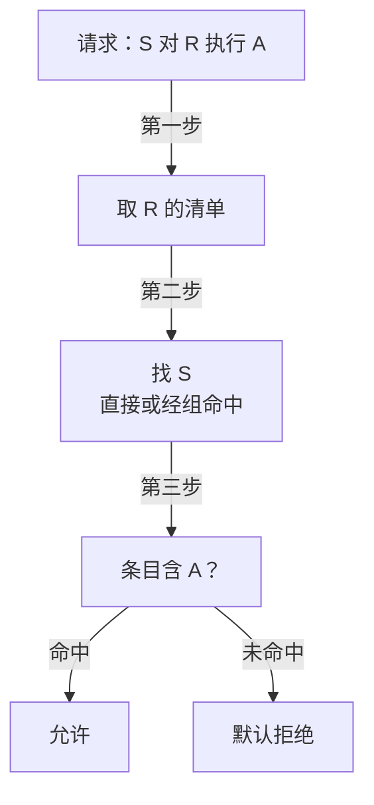
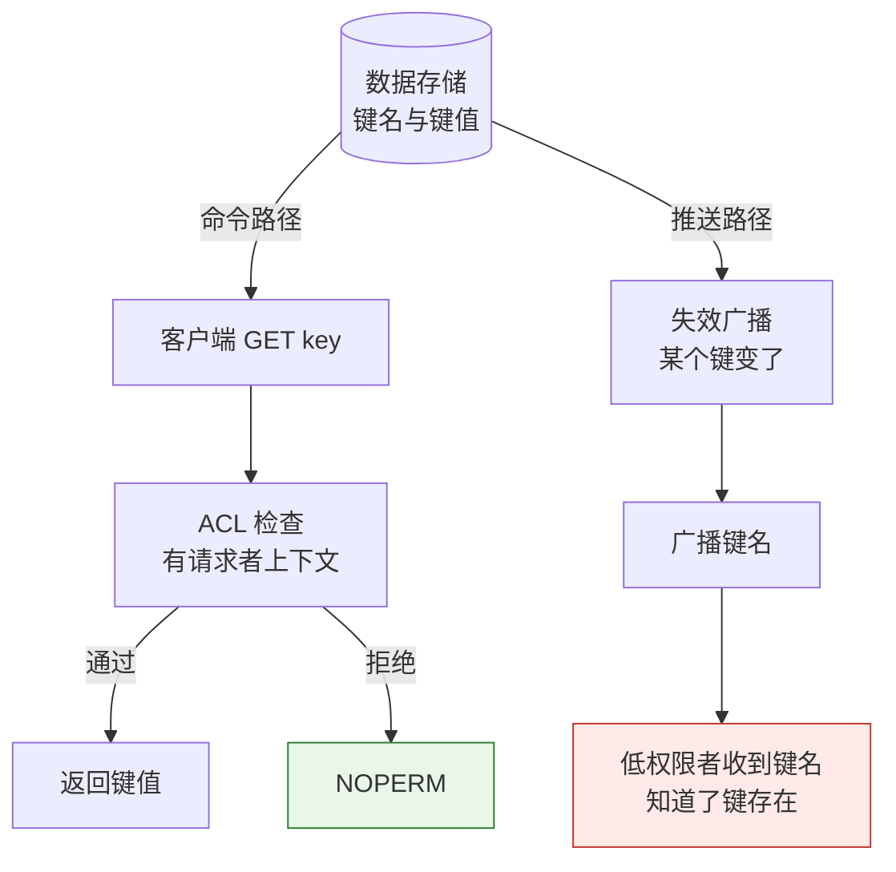
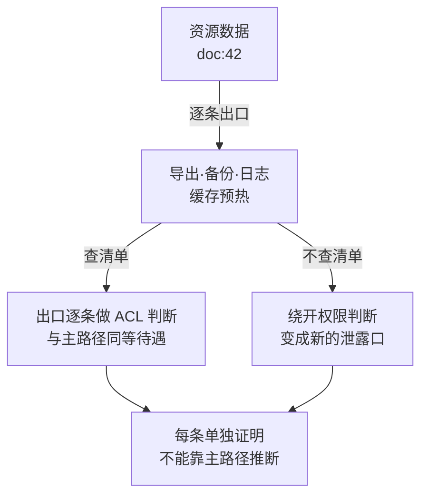

# ACL把权限挂在资源上

**ACL（Access Control List，访问控制列表）** 回答"谁能对这个资源做什么"：**每个资源自带一份清单，逐条列出主体与允许的动作**。判断权限时，**拿发起请求的用户（或组、服务账号）去这份清单上查**。

RBAC（Role-Based Access Control，基于角色的访问控制）把权限挂在**角色**上——权限像胸牌上的职务，进门看你是经理还是普通员工；ABAC（Attribute-Based Access Control，基于属性的访问控制）靠**属性**算——权限像按身份、时间、环境等属性临时计算的进门条件；**ACL 挂在资源上**。这两个比喻只说明权限挂在角色或属性上；具体怎么配角色、怎么算属性，看后面的对照表。

**三者的差别在于权限记录在哪里**。这一页要回答的问题是：**ACL 的结构长什么样、它天然擅长什么、它为什么会悄悄失效**。读完你能判断自己的系统该不该用 ACL。

与 [[工程知识/后端系统：在并发、失败与变化中维持服务/服务设计/认证授权决定请求能看什么和做什么]] 是同一层的两个视角：那一页分别讲认证与授权、比较 RBAC/ABAC/ReBAC（Relationship-Based Access Control，基于关系图的访问控制，按主体与资源之间的关系判断权限）；这一页把 ACL 单独讲透。

## ACL 为什么是贴在资源上的名单：本质与要解决的问题

打个比方：ACL 像贴在每间房门上的名单——门上写着"张三能进、李四能读不能改"，**谁进哪间房看门上的名单就知道，不用去问张三自己是什么级别**。这个比喻到"权限挂在资源上"为止：和角色授权怎么配合、继承怎么算、规模大了怎么管，要看正文。

一个文档系统，`doc:42` 是一份合同。系统里存着这样一份清单：

```
doc:42
  alice@example.com   read, write
  bob@example.com     read
  team:legal          read
```

Alice 请求写入 `doc:42`：查清单，有 `write`，放行。Carol 请求读取：清单上没有她，拒绝。

权限信息**跟着资源走**，不跟着用户走。想知道谁能访问这份合同，**翻它的清单即可**；想撤销 Bob（清单里持有 read 权限的那位成员）的访问，**从这份清单上删掉一行**。

这就是 ACL 的全部形态。**它的所有优点与所有麻烦，都来自"清单贴在资源上"这一件事**。

"清单贴在资源上"有现成的实物：门禁读卡器装在门上，权限名单就贴在"这扇门"上——**你能不能进这扇门，问的是这扇门的读卡器，而不是你的工牌全局有效**。换一扇门，名单就换一份；撤销一个人的门禁，是从这扇门的名单上删一行。这个实物只说明权限随门走、不随工牌走；组、继承、规模管理仍看正文。


*图源：Wikimedia Commons，Sezeruludag，CC BY 4.0，https://commons.wikimedia.org/wiki/File:BioAffix_Cardreader_Wall.png。*

## 三种挂法差在哪：对照

| 模型 | 权限记录在哪 | 判断方式 | 典型形态 |
| --- | --- | --- | --- |
| **ACL** | 资源上 | 查这个资源的清单里有没有我 | 文件系统、Redis（内存键值数据库，常当缓存与排行榜用） ACL、对象存储 bucket policy（存储桶策略，挂在存储桶这份资源上的清单） |
| **RBAC** | 角色上 | 我的角色含不含这个权限 | 后台管理系统、企业内部系统 |
| **ABAC** | 规则里 | 我的属性与资源属性是否满足条件 | 动态策略、合规规则 |

换成同一件事来看差别——"只有订单的买家能看这个订单"：

| 模型 | 表达方式 | 结果 |
| --- | --- | --- |
| ACL | `order:7` 的清单上写着 `buyer:alice read` | 自然 |
| RBAC | 给"买家"角色加"查看订单" | 那样能看所有订单，表达不了 |
| ABAC | 规则 = `user.id == order.buyer_id` | 自然 |

**ACL 与 ABAC 都能表达资源归属，RBAC 不能**。 **这是 ACL 至今仍被广泛使用的核心原因**——共享类场景（文档协作、网盘、消息队列的主题）天然是"这个资源允许谁"的形态。

## 一条 ACL 判断怎么走：从 0 开始

一次 ACL 判断到底走了几步？**四个动作依次发生：先取资源的清单，再在清单上定位主体**（记作 S，本人或经由组间接命中；资源记作 R，动作记作 A），再看命中条目里含不含动作 A，最后若无命中则默认拒绝——**这是走到头仍无命中时的归宿**。



链上前三步各有各的失败方式，**而失败都汇到同一个终点**：清单取不到、主体没命中、动作不在条目里，**三种情况的结局都是最后那一步的默认拒绝**。

工业级的权限系统把同一条判断链画成了全景图：AWS（Amazon Web Services，亚马逊云服务）IAM（Identity and Access Management，身份与访问管理）的策略评估流程里，请求经身份认证后，身份类策略（identity-based，跟着请求者走的策略）、资源类策略（resource-based，跟着资源走的策略）与其他策略逐层参与判定，最后落到具体的 Actions 与 Resources。ACL 四步与这张图的对应关系：取清单对应身份类策略的加载，定位主体对应资源类策略的归属判定，命中动作对应落到具体的 Actions 与 Resources：


*图源：AWS 官方文档《Identity-based policies and resource-based policies》配图，https://docs.aws.amazon.com/IAM/latest/UserGuide/access_policies_identity-vs-resource.html。*

前三步里每一步都有具体的坑（第 4 步是前三步都没命中时的归宿）。

### 第 1 步：一份清单到底从哪里取出来

**清单的存放位置决定了它的行为边界**。

| 存放方式 | 代表 | 特点 |
| --- | --- | --- |
| 资源元数据里 | POSIX（可移植操作系统接口标准）文件的 `mode + uid/gid`、扩展 ACL | 与资源一体，删除资源即删除清单 |
| 独立的权限表 | 数据库里的 `acl` 表 | 可查询、可批量修改，但要自己保证与资源同步 |
| 集中的配置 | Redis ACL、Kafka ACL（Kafka：分布式消息队列，靠日志追加支撑高吞吐的发布订阅） | 服务端统一加载，判断快，但配置本身是攻击面 |

**关键约束：清单的生命周期必须与资源一致。** 资源删了清单还在，**就是残留权限**；资源重建了清单没跟上，**新资源可能继承了旧的权限**。

### 第 2 步：一个请求里的主体怎么在清单上找到

主体很少是单个人，通常是用户、组、服务账号的混合。匹配要考虑三类问题：

**间接成员**：Carol 本人不在 `doc:42` 的清单上，但她所在的 `team:legal` 在，她经组间接命中。判断是否命中要展开组关系，而组可能嵌套。**嵌套展开有成本，也可能成环**。

**通配符与模式**：Redis ACL 允许 `~cache:*` 这样的键模式（`*` 是通配符，匹配任意字符序列），让一条规则覆盖一批键。方便，但**模式语法本身就是解析复杂度的来源**——模式写错可能匹配到预期外的键。

**优先级与冲突**：同一主体既在允许条目里、又在拒绝条目里时听谁的。多数系统的约定是**显式拒绝优先**，但必须明确定义并写下来，不能靠实现顺序。

### 第 3 步：动作粒度定多细才够

动作定义得粗放，ACL 就表达不了细粒度需求；定义得详细，**清单条目数量会爆炸**。

| 粒度 | 动作集合 | 代价 |
| --- | --- | --- |
| 粗粒度 | read / write | 表达不了"能读但不能列出" |
| 细粒度 | read / list / write / delete | 表达力强，条目变多 |

一个常被忽略的动作是 **list（列举）**。只给 `read` 不给 `list`，**用户就无法枚举资源空间**——这是最小权限（只给完成工作所需的最少权限）的常见做法。

## ACL 为什么会悄悄失效

ACL 结构这么简单，为什么仍会失效？下面是几类超出"清单写错了"的失效。

### 清单查了，数据为什么还能从别的路出去

**权限检查发生在正确的位置，而数据从另一个位置出去了**——这是最严重也最常见的一类失效。先看 Redis 的一个真实病例：客户端缓存的失效广播会把"某个键变了"推送给订阅者。命令路径上每次访问都过 ACL 检查，**但推送路径上没有"接收方是谁"这个上下文**——代码只排除了发起修改的连接，没有按每个订阅者的权限逐键过滤。结果是低权限账号收到了自己无权读取的**键名**——**检查点（定期保存进度、故障后从最近一次保存处恢复）和数据出口不在同一条路径上**。

泄露的内容要看清：低权限账号进不去那个键（GET（HTTP 读取资源的请求方法）照样返回 NOPERM），但它知道了这个键存在。**泄露的是元数据，不是数据内容**。

```text
门禁（命令路径）：好使 —— 刷不开 B 栋 202
公告栏（推送路径）：没查门禁 —— 看见了 "B栋202" 这个门牌号
```

把两条路径画在一起，失效位置就很明显：检查点在命令路径上，而数据从推送路径出去了，两条路径共享同一份数据却各自决定是否校验。



绿色分支说明 ACL 本身配置正确，红色分支说明同一份数据还有一条不带权限上下文的出口。排查这类问题时，**逐一列举数据的所有出口（命令、推送、备份、导出、日志、缓存预热）比反复检查清单内容更有效**。

这类缺陷的形态是：**每一条路径都要单独证明自己查了 ACL，而不能因为"主路径查了"就认为整条链路安全**。缓存、广播、搜索索引、导出、备份、日志——**每一条都是独立的数据出口**。

命令与广播两条路前文已经画过，剩下的出口同样从资源数据分出去。每条出口要么逐条查清单，要么不查清单就放行，两种去向分开看：逐条查清单的出口没事，跳过清单检查的那几条会变成新的泄露口：



### 清单自己会不会被污染

ACL 配置通常是字符串或模式表达式，需要被解析。解析路径如果缺少校验，非法配置会被存进去，然后在**下一次读取时**炸掉。

同一个 Redis 模块的另一个病例：`ACL SETUSER` 收下了一个权限位缺失的裸模式 `%`。存进去时没报错，之后任何一次 `ACL LIST` / `GETUSER` / `SAVE` 触发解析，**实例直接崩溃，全部客户端断连**。

两个要点：**配置写入时要当场拒绝非法值，而不是等到解析时才失败**；以及**错误配置的破坏可能延迟到读取时才发生**，这让它的影响面从**"一次写操作"变成"整个实例"**。

### 为什么清单管得了许可、管不了访问发生

ACL 是静态的判断依据，**它不记录自己被怎样使用**。于是产生一类盲区：无法回答**"这个资源最近被谁访问过"、"这条权限条目最后一次命中是什么时候"**。

缺少这层信息，就无法发现权限过度授予——一条 `alice: write` 挂了三年没人用过，**从 ACL 本身看不出它该被收回**。**审计日志必须独立于 ACL 存在**。

### 清单为什么会膨胀没人清

共享类场景里，ACL 条目随协作增长。一个人离职，他在几百份文档清单上的条目不会自动消失。这与 [[工程知识/缺陷分析：从个案到体系/正确性/案例二十九：离开的人还占着座位——机架信息的陈旧映射]] 是同构的问题：**离开是被动判定，散落在多个模块，没人认领清理责任**。

## 哪些 ACL 写法一看就错

**错误 1：主路径查了 ACL，就认为整条链路安全**

缓存、广播、导出、搜索、备份**都是独立出口**。**逐条证明，不能靠推断。**

**错误 2：认为"进不去"等于"没泄露"**

键名、ID、存在性都是信息。**元数据泄露独立于越权（访问了权限范围之外的资源）访问存在。**

**错误 3：非法配置存进去，等读取时才发现**

写入时当场校验并拒绝。**错误配置的破坏会延迟放大。**

**错误 4：无权限返回 403**

这会确认"资源存在"，可用于枚举。返回 404（与 [[工程知识/后端系统：在并发、失败与变化中维持服务/服务设计/认证授权决定请求能看什么和做什么]] 中的结论一致）。

**错误 5：条件查询时先查后判**

**应当把权限条件写进查询条件，而不是取出来再判断**。后者容易漏，且泄漏了"存在性"。

**错误 6：把 ACL 当成审计记录**

**ACL 回答"能不能"，不回答"有没有"**。**审计要独立建。**

**错误 7：默认允许**

清单上没有条目时，**必须是拒绝**。**默认允许会让所有漏配变成漏洞。**

**错误 8：忽略 list 权限**

能读不等于能列举。**最小权限要区分 read 与 list。**

## ACL 判断对不对怎么测：验证

```yaml
- name: 未授权访问
  action: 清单外的用户请求资源
  assert: 404，且响应与"资源不存在"不可区分

- name: 元数据泄露
  action: 低权限用户订阅广播 / 列表接口
  assert: 响应中不含任何无权访问的资源标识

- name: 组嵌套展开
  action: 用户通过三层嵌套的组获得权限
  assert: 正确命中；成环时不进入无限循环

- name: 非法权限配置
  action: 提交语法错误的模式串
  assert: 写入时被拒绝，且不残留部分生效的状态

- name: 权限回收
  action: 从清单移除条目后立即访问
  assert: 立刻失效（不依赖 TTL——Time To Live，存活时间）或缓存自然过期

- name: 资源删除后的清单
  action: 删除资源，再用同名重建
  assert: 新资源不继承旧清单

- name: 动作粒度
  action: 只有 read 权限的用户调用列举接口
  assert: 被拒绝
```

ACL 在业界最大规模的实现是 Amazon S3（Simple Storage Service，AWS 的对象存储服务）：对象 ACL 与存储桶策略（即前文的 bucket policy）各自是一份贴在资源上的清单，S3 官方文档把一次对象请求的判定画成 user/bucket/object 三个上下文的串联评估——每个上下文由资源方（父账户、存储桶拥有者、对象拥有者）各自拿着自己的清单判定，任何一环明确拒绝即拒绝，全部通过才放行：


*图源：[AWS 官方文档《How Amazon S3 authorizes a request for an object operation》](https://docs.aws.amazon.com/AmazonS3/latest/gsg/access-control-auth-workflow-object-operation.html)。*

「显式拒绝优先」在这张图里是实线分支（Explicitly denied? → Access denied），与本文第 2 步的约定一致——它多份清单并存时保持判定可预期的必要规则，而不是一个风格选择。

## 什么场景该选 ACL

| 场景 | 适合度 | 原因 |
| --- | --- | --- |
| 文档/文件共享 | 高 | 天然是"这个资源允许谁" |
| 消息主题、队列 | 高 | 资源数量有限，清单可控 |
| 键值存储的键空间 | 中高 | 靠模式匹配批量授权，模式本身要小心 |
| 多租户数据隔离 | 中 | **ACL 每行都要配清单会爆炸，且数据库层无法统一拦截**；更推荐行级安全（数据库自带的功能，按行配置过滤条件，每条查询自动带上），让数据库强制 |
| 企业内部功能权限 | 低 | RBAC 更合适，ACL 条目会爆炸 |
| 需要动态规则（时间、合规） | 低 | **ABAC 更合适**——动态规则要按时间、合规等属性实时计算，**ACL 的静态清单表达不了** |

**判断依据：权限主要随"资源"变化还是随"人的角色"变化**。 前者用 ACL，后者用 RBAC，需要按属性动态计算则用 ABAC。

关系：[[工程知识/后端系统：在并发、失败与变化中维持服务/服务设计/认证授权决定请求能看什么和做什么]] · [[工程知识/后端系统：在并发、失败与变化中维持服务/服务设计/API接口约定定义输入输出和演进边界]] · [[工程知识/缺陷分析：从个案到体系/安全/案例二十六：公告栏没查门禁——Redis 的 ACL 键名泄露与解析崩溃]] · [[工程知识/缺陷分析：从个案到体系/安全/最小权限把爆炸半径变成设计输入：从能力枚举到撤权闭环]]