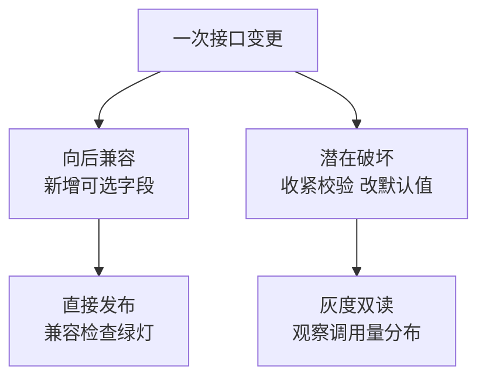
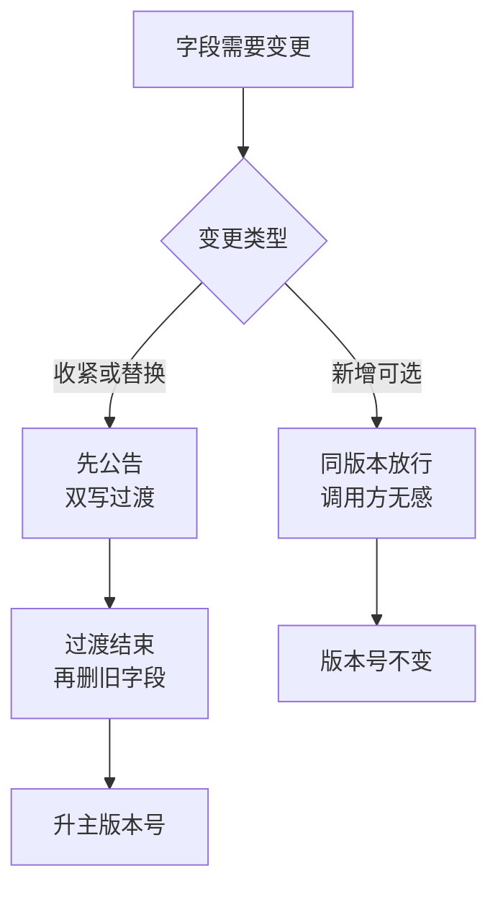

# API接口约定定义输入输出和演进边界

接口约定的作用，是**把调用方与提供方对输入、输出、错误和演进的期望写成机器可校验的形式**。读完你能对每次接口改动**先判定破坏级别**，再用兼容检查与弃用度量约束演进。它要解决的问题很具体：没有约定时，任何一次"很小的字段调整"都要靠人肉通知所有调用方，**调用方只能通过线上报错发现**。约定写清楚只是起点，机制上的关键是**能被自动校验**：能跑一次兼容检查就判定某次改动是否破坏，契约（即这份接口约定，下文统称契约）才真的约束得住演进。

## 约定到底要写清哪四块内容

| 块 | 要写清什么 | 校验方式 |
|---|---|---|
| 输入 | 字段、类型、是否必填、取值约束、未知字段策略（收到未定义字段时，是严格拒绝还是忽略） | JSON Schema / OpenAPI 校验 |
| 输出 | 字段稳定性承诺（哪些保证一直有）、空值语义、分页与排序 | 契约测试、快照（某一时刻的完整只读副本）比对 |
| 错误 | 状态码分类 + 稳定 `code`，Problem Details 结构（RFC 9457 标准错误格式，用 type/title/status 等字段描述错误） | 错误用例覆盖 |
| 演进 | 版本号策略、弃用流程、破坏性改动的通告期 | 兼容检查 + 变更门禁（阻止不兼容改动合入的发布流程关卡） |

这套约定写成标准形态就是 OpenAPI Description：OpenAPI Initiative 官方规范 4.1.2 节对它的定义是"formally describes the surface of an API and its semantics"——**一份描述文档正式地描述 API 的表面（端点、参数、响应）与语义**，可以单文档也可以按 URI 引用分布到多文档，解析行为由规范定义。**约定写到这个程度，四块内容里的每一项都成了机器可校验的字段**：


*图源：[OpenAPI Specification v3.2.1 §4.1.2 OpenAPI Description Structure](https://spec.openapis.org/oas/latest.html)，OpenAPI Initiative 版权（Apache 2.0），文档引用。*

输入侧的**未知字段策略**常被忽略：**严格拒绝未知字段能让拼写错误立刻暴露，代价是调用方升级受限**；忽略未知字段则相反。**选哪个要写进约定，不能两种行为混在不同的接口上**。

## 哪三类改动算破坏性、怎么判定

打个比方：API 像两家公司的收货标准——约定好"箱子多大、标签贴哪、写错了怎么退"，以后谁改了内部流程都不影响对方；但想改箱子尺寸就得提前打招呼（版本演进）。这个比喻到"约定管什么"为止：兼容性怎么分级、废弃怎么做、契约怎么测，要看正文。


- **向后兼容**（可直接发）：新增可选字段、新增接口、新增枚举值但调用方必须容忍未知值、放宽校验。
- **潜在破坏**（需要灰度——新版本先放一小部分流量验证，逐步放大到全量）与双读：收紧校验、改变默认值、调整排序稳定性、字段语义微调（在预训练模型上用小数据继续训练以适配具体任务）。
- **破坏性**（需新版本或协商）：删除或重命名字段、改类型、改必填性、把成功改成失败、收窄枚举。

判据是**调用方代码会不会在不知情的情况下行为改变**：**新增字段安全，因为老代码不读它；删除字段不安全，因为老代码可能读它**。枚举值尤其危险——**声明封闭集合的客户端遇到未知枚举值会按错误处理**，所以服务端新增枚举值对它就是破坏，**约定里要写"客户端必须容忍未知枚举值"**。

三类改动按风险各走一条路径，路径上配的保护措施不同：



## 版本迭代与弃用该按什么节奏走



版本号的升降取决于**变更是否要求调用方跟着改**——不要求就留在同版本，要求则升主版本号；节奏上，**弃用与停用都要提前公告**：

弃用通知与停用日期之间的关系可以直接画成时间轴。下图上半条是接口从上线到进入过渡期再到停用的三段，下半条是月份刻度：接口上线后一直正常服务，从发出 Deprecation 与 Sunset 头部（HTTP 响应头，分别声明接口已弃用与最终停用日期）那一天起进入过渡期，过渡期内照常响应只是响应里带告警头部，到 Sunset 日期那一刻停用：


*图示：接口从正常服务到弃用通告再到停用的阶段划分，横轴为月份刻度，过渡期是通告与停用之间的窗口。图源：adesso 博客《Deprecating APIs – kill switches and dead man's switches》，https://www.adesso.ch/en/news/blog/deprecating-apis-kill-switches-and-dead-man-s-switches.jsp。*

图上**过渡期的长度就是通告期的长度，它决定调用方还有多少时间迁走**。**通告期定得太短，调用方来不及改；定得太长，旧字段与旧版本要一直维护**。**可观测的调用量是定这个窗口的依据**。

- **版本只在大版本边界引入**（URL 前缀 `v1`/`v2` 或头部协商），不要为每个小改动加版本——**版本越多，维护矩阵越难收敛**。
- **弃用要有可观测的度量**：记录每个被弃用字段的调用量与调用方标识，`Deprecation` / `Sunset` 头部给出时间线（RFC 8594 的 `Sunset`、RFC 9745 的 `Deprecation`）。
- **移除前先过通告期**，通告期内该字段仍然工作，只是响应里带告警头部；**没有调用量再移除**。

## 这套约定怎么用、怎么判断

看完本篇应能做的判断：拿到一次接口变更，**先按「调用方代码会不会在不知情的情况下行为改变」分类**——**新可选字段直接发，收紧校验或调默认值走灰度双读，删字段改类型走新版本**；然后核对三件事：**OpenAPI 描述与实现同步了吗、CI（Continuous Integration，持续集成：代码合并后自动构建与测试）兼容检查有结论吗、被弃用字段的调用量归零了吗**。还没有写成机器可校验约定的老接口，不必一次补齐全部描述，**先给最高频的三个接口补上 schema 校验与弃用度量，让漂移可观测，再逐步收口**。

「改接口前先核兼容」的实物原型是老式保险丝盒：换保险丝前先核对额定电流——安数不对的保险丝要么频繁烧断（误伤正常负载），要么该断不断（烧毁下游线路），额定值就是调用方与线路之间的约定。这个比喻只到「换件前必须核对额定值」为止，具体命令与退出码看正文：


*图源：Wikimedia Commons，作者 ktulu87，CC BY-SA 3.0，https://commons.wikimedia.org/wiki/File:Fuse_box_in_old_house.JPG。*

接口约定的兼容检查就是这个核对动作：`openapi-diff --fail-on-incompatible` 在合并前把"换上去的保险丝"与"线路额定值"比一遍——**向后兼容是同安数替换（直接发），潜在破坏要灰度双读（先并一段），破坏性改动必须换新配电箱（新版本）**；**跳过核对直接换，烧的就是调用方的生产环境**。

## 错误在接口约定里占什么位置

错误也是契约的一部分，变动它等于变动接口。稳定结构：

```json
{
  "type": "https://api.example.com/problems/insufficient-stock",
  "title": "库存不足",
  "status": 409,
  "detail": "sku A-1 当前可用 2，请求 5",
  "instance": "/v1/orders/42",
  "request_id": "8f2c..."
}
```

要点：`status` 与 HTTP 状态码一致（分类交给协议层，见 [[工程知识/后端系统：在并发、失败与变化中维持服务/服务设计/HTTP语义的分层：方法、状态码与头部的约定角色]]），`type` 是稳定的机器可读标识——**调用方只能按 `type` 分支，不能按 `title` 或 `detail` 匹配文案**，否则**文案本地化就是一次破坏性改动**。

## 这套说法在哪儿会失效

- 契约描述**结构**，不描述业务规则的正确性：**字段范围能校验，"这个订单能不能成立"要靠业务测试**。
- 契约测试（[[工程知识/软件构建：让变化可以理解、验证与交付/测试与交付/接口约定测试的适用边界：消费者驱动与提供者验证]]）**覆盖结构，不覆盖语义、性能与数据状态**。
- **契约不能替代领域边界**：两个服务共享一张表时，**再严格的接口约定也挡不住隐式耦合**，边界划分见 [[工程知识/后端系统：在并发、失败与变化中维持服务/服务设计/微服务划分的判据：从团队认知到数据边界]]。

## 怎么自己动手验证

```bash
# 1) 结构校验：用 OpenAPI 描述跑一次请求/响应的 schema 校验
npx @stoplight/spectral-cli lint openapi.yaml

# 2) 兼容性检查：对比新旧描述，破坏性改动必须非零退出
npx openapi-diff old.yaml new.yaml --fail-on-incompatible

# 3) 线上抽样：真实流量里的响应是否仍满足契约（抽样 1% 即可暴露漂移）
#    判据：schema 校验失败率应为 0；出现失败说明实现已偏离契约
```

验证路径的预期是**三步全绿**：结构校验、兼容检查、线上抽样各自通过；**任何一步对不上，说明实现已经偏离契约或契约需要走演进流程，合并动作暂停**。实施判据：**任何一次接口改动，CI 里的兼容检查必须给出明确结论**；破坏性改动要么走新版本，要么拿出"调用量为 0"的实测证据。**两条都不满足就合并，等于把发现问题的成本转嫁给调用方的生产环境**。