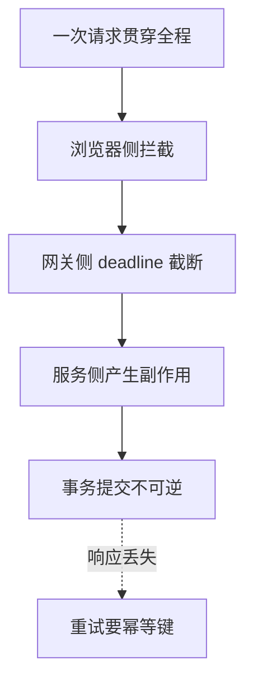

# HTTP 请求穿过浏览器、网络与服务端边界

**一个 HTTP 请求要穿过浏览器、网络和服务端三层，每层都有自己的规则**。
**Web（万维网，浏览器加服务器构成的应用形态）系统的关键在浏览器安全模型、HTTP 约定、状态归属和数据在各层的编码边界，框架与模板语法只占其中一小部分**。

读完这一页你能沿浏览器、网络、入口、服务到事实源逐层确认状态归属，判断请求究竟有没有到达、数据是否已提交、客户端能不能安全重试。

**同一个 `/api/report` 请求，可能先被浏览器的同源策略（浏览器限制不同来源的文档互相读取）拦截，再被网关（站在客户端与后端服务之间的入口层，集中处理路由、鉴权与协议转换）的超时截断，最后在服务端已经提交后丢失响应**；**排障必须沿浏览器、网络、入口、服务和事实源（真正记录业务数据的系统，如数据库，只有它才能确认副作用是否已提交）逐层确认，不能只看浏览器控制台的「failed」**。

这条边界链决定了**请求究竟有没有到达、数据是否已提交**，以及客户端能否安全重试；**任何一层的状态都不能替代端到端证据——就像快递不能只凭某一站的扫件记录断定已签收，必须看收件人那端的签收回执**。这个比方到「逐站证据不可信」为止——快递丢件找快递公司，调用链路断在哪一层要按层排查，排查顺序看正文。

「到达」的物理形态就是机架上的服务器：请求穿过运营商网络与托管机房，最终落到某一台机器的端口上——每一跳的状态都值得单独取证：


*图源：Wikimedia Commons，David Monniaux，CC BY-SA 3.0，https://commons.wikimedia.org/wiki/File:Paris_servers_DSC00190.jpg。*

浏览器看到的错误只是最后一个观测点——**报错通常只说明响应没收到，而请求早已到达、可能已被服务端处理，所以没收到响应不等于**没有副作用**；必须把每一跳的状态、超时和 request ID 串起来**。

## 浏览器安全模型到底管什么

请求从浏览器发出到服务端处理完成，中间经过多层。**这一节要解决的问题是：出问题时无法判断状态归属在哪一层、数据在哪个位置发生了编码变化、安全边界由谁负责**。**本篇回答：浏览器安全模型约束了什么、HTTP 约定里哪些语义必须遵守、状态保存在各层的哪一侧，以及跨层传递时编码与解码在什么地方发生**。

## 请求链路怎么走

打个比方：一次 HTTP 请求像寄一封挂号信——从你家信箱（浏览器）出发，经过几个中转站（DNS、CDN、网关；CDN 即内容分发网络，把内容复制到离用户近的边缘节点），最后到了收信人手上（服务端）。这个比喻到"中间有几站"为止：每一站具体做什么、信会不会被拆看或改道，要看正文。

一次页面访问在协议栈里要穿过好几层，HTTP 只占其中一层，各层职责见下图：

键入网址到页面显示的全过程，从小林 coding 的图解开始（DNS → TCP → HTTP → 渲染）：


*图源：小林 coding《键入网址到网页显示，期间发生了什么？》配图，https://www.xiaolincoding.com/network/1_base/what_happen_url.html，小林 coding 原创图，转载注明出处。*

第一步域名解析要问谁、按什么顺序问，DNS（Domain Name System，域名系统：把域名解析成 IP 地址） 的层级结构给出了答案：


*DNS 层级解析图示来源同上（小林 coding 原创图，转载注明出处）。*

拿到 IP 之后、发出 HTTP 请求之前，TCP（传输控制协议，负责把数据完整、有序地送达）三次握手（TCP 建立连接前、双方交换三个报文确认彼此收发能力的流程）是绕不开的第一道边界：


*图源：小林 coding《TCP 三次握手与四次挥手（TCP 断开连接时、双方交换四个报文释放资源的流程）面试题》配图，https://www.xiaolincoding.com/network/3_tcp/tcp_interview.html，小林 coding 原创图，转载注明出处。*

而在这一层之上，浏览器实际发出的是一串请求而不是一个，来源见下图：

一层里的每次请求耗时不同，各层的耗时也互不相同，**混在一起看总数就看不出卡在哪，所以"请求慢"要先分清是哪一层、哪一次请求的耗时**。

```text
用户事件 -> 浏览器 DOM（Document Object Model，浏览器把网页组织成可操作的树）/状态 -> fetch/form/navigation
        -> DNS/TCP/TLS/HTTP -> 网关/路由 -> 鉴权/业务/数据库
        -> HTTP 状态/headers/body -> 浏览器解析 -> DOM 更新
```

每一层协议各加各的头，报文是一层层套出来的，套法如下图：


*数据包封装图示来源同上（小林 coding 原创图，转载注明出处）。*

SSR（server-side rendering，服务端渲染）在服务端生成初始 HTML，CSR（client-side rendering，客户端渲染）由浏览器 JavaScript 获取数据并更新页面；两者可混合。**AJAX（Asynchronous JavaScript and XML，页面不刷新的异步请求技术）/fetch 是异步 HTTP 调用方式（AJAX 是这类技术的统称，fetch 是浏览器现在标准的调用接口），不是渲染架构**。**选择依据是首屏、SEO（搜索引擎优化，指页面能不能被搜索引擎收录并排在结果前列）、交互复杂度、缓存、团队和运行成本**。

## HTTP 有哪些约定

- **方法表达语义：安全读取与有副作用（操作对外部状态产生的额外影响）写入分开；重试写操作需要幂等键（让同一笔写重复执行只生效一次的标识）或条件更新**。
- **状态码区分客户端错误、权限、冲突、限流（控制单位时间放进来的请求数量，超过配额就拒绝）和服务端故障；不要全部返回 200 再在字符串里写失败——那会把失败藏进响应体，重试逻辑与监控系统都按成功处理，真正的**错误被掩盖**。
- **请求/响应使用版本化 schema，验证类型、长度、枚举和未知字段；错误返回稳定 `code + message + details + request_id`**。
- **超时分连接、读取、单次下游和总 deadline（最后期限）；调用链剩余预算（这次请求整体还剩多少时间可用，每层扣掉自己的耗时后把剩下的传给下一层）逐层传递**。
- **分页使用稳定排序与 cursor；大结果支持流式/异步任务和取消**。

## 同源策略与 CORS是什么关系

**同源由 scheme、host、port 共同决定。浏览器限制脚本读取跨源响应；CORS（跨源资源共享，服务端用响应头声明允许哪些来源的页面读自己的响应）是服务端通过响应头授予特定 origin 的读取权限，不是认证机制，也不限制非浏览器客户端**。

当请求方法/headers/content-type 不属于 CORS safelisted（浏览器默认的「简单请求」白名单，如 GET（HTTP 读取资源的请求方法） 加少数几个头部，命中则不发预检）范围时，**浏览器先发送 `OPTIONS` preflight，确认允许的方法、headers 和 credentials**。正确做法：

- **允许明确 origin，不把带凭据请求与 `*` 混用**；
- **`Access-Control-Allow-Credentials` 只在确有 cookie/认证需要时启用**；
- **预检缓存用 `Access-Control-Max-Age`，但同时考虑策略变更**；
- **服务端仍做认证、授权、CSRF（跨站请求伪造：别的网站借用户已登录的身份发请求）和输入校验；preflight 通过不代表业务请求被授权**。

一次跨源写请求实际发了两趟，两趟的字段在下面时序图上逐条对得上：


来源：MDN（Mozilla Developer Network，Web 技术权威文档站） 官方文档「Cross-Origin Resource Sharing (CORS)」。**图上的两趟报文就是 preflight 的开销来源：第一趟 OPTIONS 只问权限不传数据，`Access-Control-Max-Age: 86400` 决定了这趟多久可以省一次**——「预检缓存用 Max-Age，但同时考虑策略变更」的取舍点就在这里；图里 POST 的响应仍带 `Access-Control-Allow-Origin`，**说明授权判定在每一趟都要成立，preflight 通过不等于业务请求被授权**。

详见 [MDN CORS](https://developer.mozilla.org/zh-CN/docs/Web/HTTP/CORS) 与 [same-origin policy](https://developer.mozilla.org/zh-CN/docs/Web/Security/Same-origin_policy)。

## 模板、DOM 与 XSS 是什么关系

- **XSS（跨站脚本攻击：攻击者把恶意脚本混进页面，让其他用户的浏览器误执行）是模板转义要防的东西。模板默认转义用户内容；只有经过可信 sanitizer 且语境正确的 HTML 才能标记 safe**。
- **HTML（网页标记语言）、属性、URL（网址）、CSS（样式表）和 JavaScript 字符串是不同编码上下文，不能用同一种转义替代**。
- **DOM（浏览器把页面解析成的对象树，脚本来操作它）更新优先 `textContent` 和安全组件 API，避免把不可信字符串交给 `innerHTML`**。
- **CSP（内容安全策略，服务端用响应头限制页面能加载哪些来源的脚本与资源）是纵深防御，不替代输出编码和依赖安全**。
- **服务端校验是最终边界；前端校验只改善体验**。

## 任务状态与健康检查怎么配


浏览器控制台的一句 failed 横跨五层，而「副作用是否已提交」只有事实源那一层能回答——把判定点沿 request_id 排开：



**判定因此不能停在浏览器：沿 request_id 逐层确认到达与提交，才能回答客户端这次能不能安全重试**。

**长任务返回 task ID，由 [[工程知识/后端系统：在并发、失败与变化中维持服务/分布式可靠性/健康检查只能提供有时效的失败证据]] 的轮询/Webhook/流式机制获取结果**。**状态接口与 liveness/readiness（存活探针与就绪探针：前者失败就重启实例，后者失败就不放流量进来）分离：任务状态是业务事实，健康检查决定实例是否接流量，心跳（节点定期互发的存活信号，超时收不到就判定故障）只反映最近通信**。

**边界行为要与两端对账——同一请求在浏览器侧（curl（命令行 HTTP 客户端）复现）与服务端侧（访问日志）各记一份时序，两份对账才能定位延迟与错误发生在哪个边界，对不上的段就是缓存层或代理层在改行为**。

## 动手验证要准备哪些东西

- [ ] **API schema、错误码、权限、幂等、超时和取消已定义**。
- [ ] **浏览器 CORS、cookie SameSite（cookie 的站点限制属性，控制跨站请求带不带 cookie）、CSRF 和服务端授权分别测试**。
- [ ] **用户数据在 HTML/属性/URL/JS 等正确上下文编码**。
- [ ] **SSR/CSR 边界不重复请求、泄漏秘密或造成 hydration（服务端生成的 HTML 到浏览器后由 JS 接手、把页面变成可交互状态的过程）不一致**。
- [ ] **trace/request ID 串起浏览器、网关、服务端和下游**。


## 效果从哪儿来，要付什么代价

**沿浏览器、网络、入口、服务与事实源逐层确认，换来的是请求是否到达、副作用是否已提交这两件事有各自的证据，客户端重试与幂等（同一操作执行多次与执行一次效果相同）键的作用范围可以据此确定**。**代价是每一跳都要有可关联的标识与超时配置**，**跨层排查依赖请求标识贯穿，缺少任何一段都会让判定重新退回控制台的错误提示**。

## 接着读哪几篇：同在后端系统里的相邻问题

- [[工程知识/性能工程：从用户等待到资源瓶颈/存储与网络/端到端网络延迟来自排队、协议、传输与处理]]、[[工程知识/后端系统：在并发、失败与变化中维持服务/服务设计/流量入口只负责路由与连接，不负责业务正确性]]、[[工程知识/软件构建：让变化可以理解、验证与交付/测试与交付/测试策略从风险选择证据]]。
