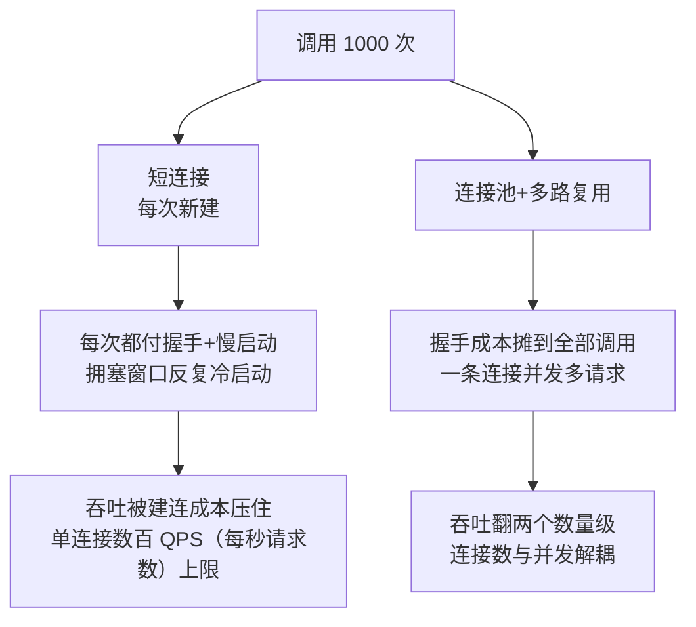
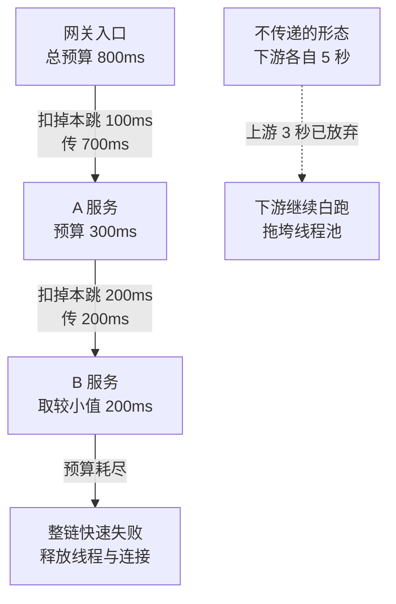

# RPC框架的通用骨架：序列化连接管理与超时传递

## 要解决的问题

RPC（远程过程调用）要解决的问题，是**把"调用隔壁进程的函数"伪装成"调用本地的函数"**。这个伪装是**跨进程、跨机器、跨语言的**：**参数要变成字节流过网络，连接要复用才养得起高并发，调用要有明确时限才不会拖垮调用方**。

分开看，任何 RPC 框架（gRPC、Thrift、Dubbo，以及各家自己攒的变体）都是**同一条骨架上的三块骨头**：**序列化**（把内存对象转成可存储或传输的字节格式的过程）、**连接管理**、**超时传递**。HTTP 语义的分层[[工程知识/后端系统：在并发、失败与变化中维持服务/服务设计/HTTP语义的分层：方法、状态码与头部的约定角色.md]]解决的是"浏览器到服务端"的约定，**RPC 骨架解决的是"服务到服务"的高频调用**——**两者是同一问题的两个场景**。

## 这套骨架由哪几块组成，各管什么

这套骨架的机制本质是**三条独立机制的组合：序列化解决数据怎么跨边界**，**连接管理解决传输成本怎么摊薄**，**超时传递解决故障预算怎么沿调用链分配**。这套骨架在 gRPC（Google 开源的高性能接口调用框架）官方的语言栈图里可以逐层对照。

最上面是各语言的应用与 Stubs（调用桩：protoc 从 .proto 接口描述文件生成的本地代理代码，应用调用它就像调用本地函数）。往下穿过统一的拦截器层，拦截器是框架预留的钩子，请求进出时可以插入超时、鉴权、日志这类通用处理。

再往下压在 gRPC C Core 之上，**C Core 是 C 语言核心，负责连接、多路复用（一条连接上并发跑多个请求）与 HTTP/2 编码**。最底下是**可替换的传输选项**：TCP（传输控制协议，负责把数据完整、有序地送达）走网络；**Unix Domain Socket 是同一台机器里两个进程之间的本地通信通道**；**进程内直连即调用方和被调方在同一个进程里，直接内存访问**。**序列化、连接管理、超时传递三块骨头分别落在这些层的不同位置**：


*图示来源：[gRPC 官方博客 Visualizing gRPC Language Stacks](https://gRPC.io/blog/grpc-stacks/)（2026-09-27 取）。C 核心把 HTTP/2 编码与连接管理做成公共层，Python、C++（在 C 基础上增加面向对象等特性的编程语言）、C# 等语言只是这颗核心上的薄封装——这正是「框架骨架统一，语言按需生成」的实物形态。*

Go 版和 C 核心版的主要区别是没有 C 核心的中间层，HTTP/2（HTTP 第二版，多条流复用一条连接）实现直接站在传输层上——用"摊得更平"形容这套摆法，指的是层数更少、中间层更薄。官方对 Go 栈的画法从上到下依次是应用、生成桩、gRPC Go Core 与拦截器、HTTP/2、TLS（Transport Layer Security，传输层加密协议，HTTPS 里的 S）/ALTS（Application Layer Transport Security，谷歌内部使用的传输层认证协议）安全层、传输层：


*Go 语言栈图示来源：同上 gRPC 官方博客（2026-09-27 取）。Go 栈没有 C 核心的中间层，HTTP/2 实现直接站在传输层上——同一条骨架在不同语言里的实现厚度不同，连接管理这层的取舍也随语言生态变化。*

序列化、连接管理、超时传递这三块拼在一起，才构成一个能用的 RPC 框架。gRPC 的官方结构图把调用方、服务实现与底层传输的分层关系画了出来，三块骨头分别落在哪一层可以直接对照。前两张是语言栈的纵向分层，这张是调用一次请求的横向流转，两张对照能看清三块骨头在纵横两个方向的位置：


*图源：[gRPC 官方文档](https://grpc.io/docs/)。*

**序列化：对象怎么变字节**。**IDL（接口定义语言）是一份数据结构说明书：双方各写一次约定，工具就能自动生成编解码代码，省去每对服务手写字节解析逻辑**。常见文件是 .proto 和 .Thrift（Facebook 的 RPC 序列化框架），分别对应 Protobuf（谷歌开源的二进制序列化方案）与 Thrift。**约定先行的好处是跨语言（Java 写的服务，Go 写的客户端，只要都认约定）与演进可控（字段加编号，旧版本跳过不认识的字段）**。**选型轴在编解码速度与可读性之间：Protobuf 二进制快但人眼不可读，JSON 可读但体积与速度都吃亏**。**服务间高频调用几乎都选二进制，人要读时靠工具反解**。

**连接管理：养一条路走千次**。**每次调用建一条 TCP 连接太贵（握手毫秒级、慢启动、拥塞窗口冷启动）**，所以**连接复用是标配：连接池 + 多路复用**。TCP连接建立与断开的状态机[[工程知识/后端系统：在并发、失败与变化中维持服务/基础设施/TCP连接建立与断开的状态机：握手挥手与异常路径.md]]里建连的握手成本，**被复用摊到成千上万次调用上**。**HTTP/2 与 gRPC 的多路复用更进一步：一条连接上并发跑多个请求（每个请求流有自己的编号，叫 stream id，靠编号区分谁是谁），连接数从并发数解耦**。

短连接每调用一次就付一次握手成本，复用把这笔税摊到成千上万次调用上。一张图看清两种做法各自要付什么钱：



**超时传递：时限沿链路走**。**入口请求带 deadline（如 500ms），每经一跳，剩余时间从头部读出、扣掉本跳耗时、传给下一跳**。超时的层次设计[[工程知识/后端系统：在并发、失败与变化中维持服务/分布式可靠性/超时的层次设计：连接、读写与整链路的预算分配.md]]展开过这条预算链的完整纪律。**RPC 框架的价值是把传递做成默认行为：应用不写一行超时代码，deadline 自动走完链路，预算耗尽时整链快速失败**。


来源：[博客园《多图详解 TCP 连接管理，太全了!!!》](https://www.cnblogs.com/cxuanBlog/p/14679563.html)（CC 4.0 BY-SA）


## 它从哪儿来，要付什么代价

1984 年 Birrell-Nelson 的论文定义了 RPC 的原始承诺——**"让分布式调用像本地调用一样透明"**。三十年的实践把这个承诺推翻了一半：**完全透明是不可能的（网络会断、超时会来、延迟数量级不同），但"接口形态像本地"保留了下来**。今天的 RPC 框架是**"半透明"的**——这个说法指**调用写法像本地调用一样简单，但网络故障不会自动消失：超时、错误码、重试策略都要当成显式配置来处理**。它替代的旧路线是**每对服务手写 socket 协议**（每个团队自己的字节格式、自己的超时、自己的重试），**骨架统一后这些变成框架的一次性工程**。

为什么超时传递值得单独说一段？因为它决定了**链路里每一跳的预算从哪儿来**。gRPC 的 deadline**默认沿整条调用链传递**；Dubbo 需要应用在配置里手动打开才传递。**不开启的链路里预算断在第一跳——底层还在跑，顶层已经放弃，白烧资源**。**把传递做成默认行为，是"框架替应用守住纪律"的设计哲学**。代价：**IDL 约定是持续维护成本**（改接口要同步改两端生成代码）、**连接池是新的故障源**（池耗尽时的排队与超时要单独治理）、**框架本身是重依赖**（升级、安全补丁、与语言生态的绑定）。**传递的纪律一句话：下游超时必须取「自己的配置」与「上游剩余」的较小值，否则上游已经放弃、下游还在白算**。



图的上半演示预算怎么一站一站扣：请求从网关（站在客户端与后端服务之间的入口层，集中处理路由、鉴权与协议转换）出发时带着 800ms 总预算，网关扣掉自己这一跳的 100ms，把剩余 700ms 往下传；**每个服务收到后都拿「自己的超时配置」跟「上游传来的剩余」比大小，只按较小的那个干活**——A 这一跳用掉 200ms，把剩余 200ms 传给 B；**预算在哪一站耗尽，整条链就从哪一站快速失败，线程与连接立刻释放**。虚线那侧是断链的形态：**下游各配 5 秒、上游 3 秒超时放弃，下游听不到放弃信号继续白跑**，上游全挂时这些无人认领的计算把下游线程池（预先建好一组线程反复取用、避免频繁创建销毁）占满。两侧的差别不在超时数值，在于**「剩余预算有没有随请求一起走」**。

## 这套说法在哪儿会失效

- **RPC 不适合浏览器直连场景**。**gRPC 的 HTTP/2 传输在浏览器里要 grpc-web 转换层（浏览器不暴露 HTTP/2 帧）**，对外 API 仍以 HTTP/REST 为主，**RPC 留给内网服务间**。选型时这条线划分内外。
- **序列化演进有坑**。**Protobuf 字段删除后编号不可复用（旧版本会把它当未知字段保留）**，**约定演进纪律要写进团队规范**。见 [[工程知识/后端系统：在并发、失败与变化中维持服务/服务设计/服务发现与负载均衡决定请求发往哪里.md]] 的寻址层与本层的编解码层是正交的。
- **连接复用改写故障模式**。**单连接多路复用时，一条连接抖动（性能指标不稳定的起伏）影响所有并发请求（HTTP/1.1 的连接池反而隔离性好）**。**头部阻塞（head-of-line blocking，队头阻塞：同一个队列里前面一个请求卡住，排在后面的请求只能跟着等）在 HTTP/2 的流级别仍存在**，QUIC（基于 UDP 的新传输协议，把连接建立与加密握手合并，减少往返次数）/HTTP3（基于 QUIC 的第三代 HTTP 协议）才在传输层解掉，见 [[工程知识/性能工程：从用户等待到资源瓶颈/存储与网络/QUIC把传输握手与加密合流到用户态.md]]。
- **重试语义框架各有默认**。**有的框架默认重试（危险，非幂等操作即执行一次和执行多次效果不一样的操作，比如重复转账会多扣一次钱，会双执行）**，**有的默认不重试（安全但慢恢复）**。**选用框架时第一件事是核对默认值**，重试纪律见 [[工程知识/后端系统：在并发、失败与变化中维持服务/分布式可靠性/重试的正确姿势：退避、抖动与重试预算.md]]——此类默认值差异属于框架的隐式行为，**核对动作要写进选型清单**。

## 怎么自己动手验证

- **链路预算验证**：三层调用链（A→B→C）入口设 300ms deadline，在 C 侧注入 500ms 延迟，预期：**A 在 300ms 处超时返回，C 的处理被取消（trace 里看 cancellation），B、C 不继续白跑**。若 C 跑完了全程，说明**超时传递断在某跳，查该跳的框架配置**。
- **连接复用验证**：压测单客户端 100 并发，`ss -tan` 看连接数，预期：**多路复用框架下连接数是个位数（1-4 条），不是 100**。**连接数等于并发数说明复用没生效**。
- **约定演进演练**：给 .proto 加一个字段后新旧客户端混跑，预期：**旧客户端跳过新字段不报错、新客户端读旧响应时新字段为零值**。对不上就停下查：**字段编号是否复用了删除过的编号**。

## 动手跑一遍会看到什么：骨架的账

```text
一次调用在 RPC 骨架三块骨头里的推演（通用形态）：

  序列化层：调 user.get(id) → 方法号 + 参数编码成字节
    协议升级的账：旧字段删了但老客户端还在发 → 编解码要容缺（未知字段跳过）
    压缩的账：二进制编码比 JSON 小 3-5 倍，万级 QPS 下带宽差出 G 级
  连接管理层：长连接 + 连接池（单连接多路复用）
    单连接串行时 1ms RTT + 2ms 序列化 = 300 QPS 上限
    多路复用后同一连接并发 64 请求，单连接吞吐翻两个数量级
  超时传递层：整链路预算 800ms，网关 100ms、A 服务 300ms、B 服务 200ms
    下游超时 = min(自己的预算, 上游剩余) → 否则上游已放弃，下游还在白算
```

**序列化不兼容的实录**——服务端删字段未走两版过渡，**老客户端反序列化直接抛异常**（**滚动发布窗口内新旧并存是常态，协议变更按加字段-废弃-删除三步走**）。**超时不传递的实录**——网关超时 3 秒、下游各自 5 秒，**上游全挂时下游线程池被"上游已经不要了的请求"拖垮**；**下游取剩余预算后（3 秒总预算下各层实际可用时间递减），雪崩（一处故障沿依赖链放大成级联失效）时的无效计算消失**。骨架与调用语义的衔接见 [[工程知识/后端系统：在并发、失败与变化中维持服务/分布式可靠性/超时、重试与幂等共同定义调用语义.md]]（三要素账本）、与 HTTP 语义的关系见 [[工程知识/后端系统：在并发、失败与变化中维持服务/服务设计/HTTP语义的分层：方法、状态码与头部的约定角色.md]]（同为约定层）。

## 接着读哪几篇：对外约定与对内骨架的分界

- [[工程知识/后端系统：在并发、失败与变化中维持服务/服务设计/HTTP语义的分层：方法、状态码与头部的约定角色.md]] —— 对外约定与对内骨架的分界
- [[工程知识/后端系统：在并发、失败与变化中维持服务/分布式可靠性/超时的层次设计：连接、读写与整链路的预算分配.md]] —— 超时传递的完整纪律
- [[工程知识/后端系统：在并发、失败与变化中维持服务/基础设施/代理与网关的谱系：正向反向与sidecar各自解决什么.md]] —— RPC 流量过 sidecar 时的治理插入点
- [[工程知识/后端系统：在并发、失败与变化中维持服务/基础设施/服务网格控制面与数据面：mTLS与流量治理.md]] —— 网格接管治理前的 RPC 骨架形态
- [[工程知识/性能工程：从用户等待到资源瓶颈/存储与网络/TCP不提供消息边界：成帧是应用层协议自己的责任.md]] —— 序列化只管对象变字节，字节怎么组成消息归成帧管
