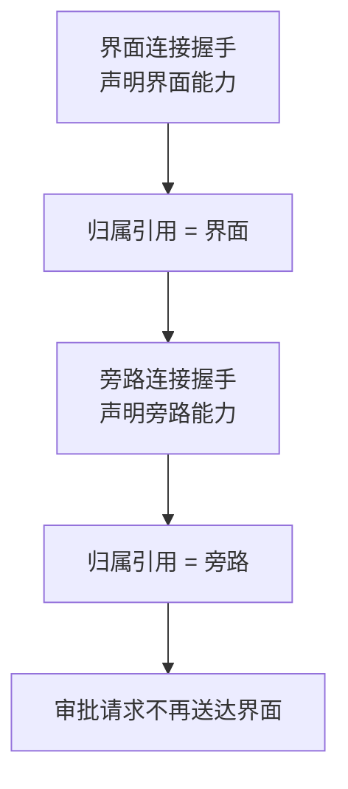
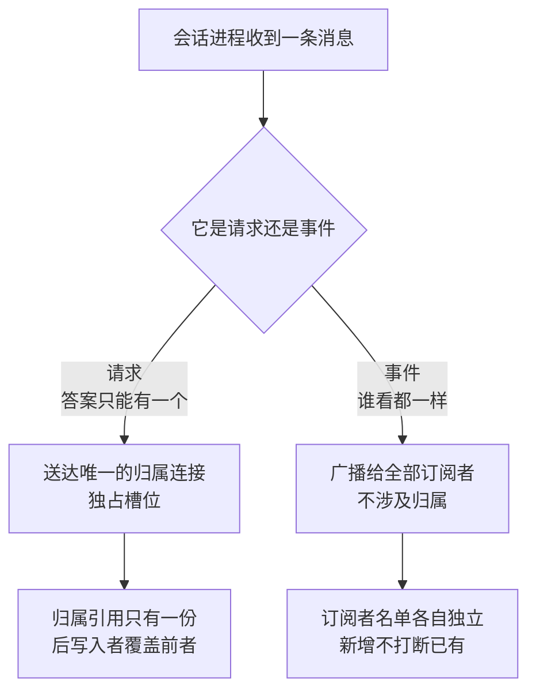
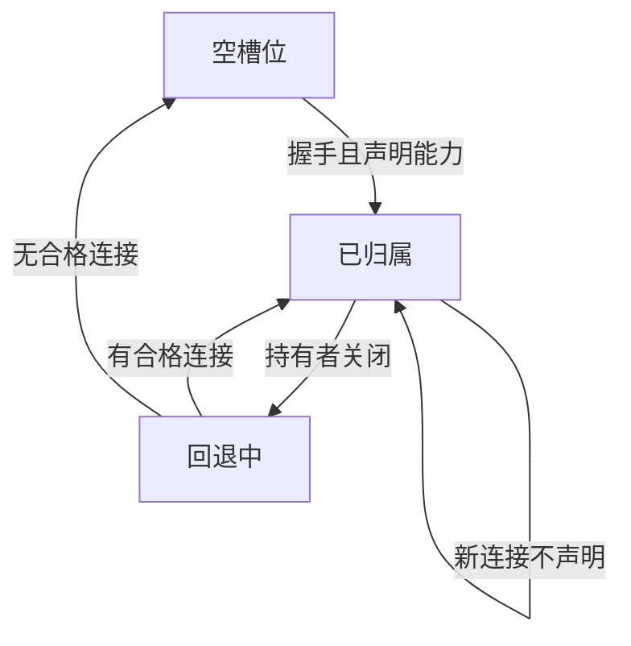

# 一路会话只能有一个回复归属：多客户端接入时的所有者绑定

带界面的会话都有一次「把问题交到人面前」的动作：这次改动放不放行、这几个选项选哪一个、要不要执行这条命令。**这类请求与普通的流式输出不同，它会一直等到有人回答才继续。既然要等一个答案，就必须确定答案从哪来 —— 一次会话在同一时刻只能有一个回复归属。**

读完这一篇，你能判断多客户端接入时回复归属是否稳定，并知道归属判定与交还该怎么设计。界面工具把这条规则写进了规范。语言服务器协议 LSP（Language Server Protocol，编辑器与语言工具的通信标准）规定服务器在一次会话中只服务一个客户端；模型上下文协议 MCP（Model Context Protocol，模型与外部工具和数据源之间的开放协议）的会话同样绑定到建立它的那条连接。**规则本身没有争议，出问题的地方在实现：这个归属怎么建立、怎么维护、怎么交还。**

这篇要解决的问题：多客户端接入同一条会话时，回复归属的判定与交还怎么设计才稳定。

LSP3.17 官方规范把这条规则的表述定格在 Base Protocol 一节："The protocol currently assumes that one server serves one tool. There is currently no support in the protocol to share one server between different tools."（协议目前假设一个服务器只服务一个工具，不支持多个工具共享同一服务器）。会话内所有请求、响应与通知都走建立时那条连接，规范层面就没有多客户端共享同一会话的语义。

旁路（绕开主流程的备用路径）程序（指不直接和用户交互、想接入已有会话读取或干预数据的独立程序，比如自动放行审批的脚本）要接入，**正确形态是建立自己的会话，抢已有会话的应答权在协议里没有位置**：


*图源：[Language Server Protocol 3.17 Specification（Microsoft 官方）](https://microsoft.github.io/language-server-protocol/specifications/lsp/3.17/specification/)，Microsoft 版权（CC BY 4.0），文档引用。*

## 多客户端接入时，回复归属会出什么问题

一个会话可能被多条连接接入。常见的形态有三类：编辑器的界面连接、一个想自动放行审批的旁路程序、一个想读取进度的监控面板。它们各自建立连接，各自声明能力。

如果「回复归属」用的是「最后一个完成握手的连接」，那么**后接入的旁路程序会直接接管应答权。**此时：

- **真实界面收不到请求，用户看到的界面不再弹出审批；**
- **旁路程序若只打算旁观，没有应答实现，请求就停在原地；**
- **旁路程序中途断开，但归属记录没有绑定连接关闭事件、不会自动清理，于是归属还指着它，后续所有请求都投给一条已经关闭的连接。**

三种情况的结果都是同一个：**工具调用一直等待，日志里只有一条「查无状态」（请求发往已注销连接时系统报出的告警）的警告。用户看到的界面上什么都没有发生。**

## 回复归属怎么建立与维护：一个槽位，多个写入者的机制

多个写入者抢一个槽位，结果取决于谁先到。竞争消费者（并发编程的一种模式：多个消费者抢同一个队列里的消息，每条消息只被其中一个消费者取走）是同一个结构的良性版本。说它良性，是因为**归属槽位同样是多个写入者抢一个位置，但抢完之后归属确定、不会再有第二个写入者覆盖**——一条消息只被其中一个处理，**归属在取到的那一刻就确定了。**

对讲机频道是"一个会话一个说话人"的天然教具：同一频道同一时刻只容一个人按键说话，两人同时按下就是两段互相盖掉的杂音——所以通话纪律是明确的"over"交接，说话权在一刻只有一个归属。会话的回复归属槽位就是这条频道纪律：归属引用指向谁，谁才被允许应答。这个比方到「同一时刻只有一个说话人」为止——对讲机频道是物理信道，归属槽位是进程内的引用变量，后者可以随时改指向：


*图源：Wikimedia Commons，Wtshymanski，公有领域，https://commons.wikimedia.org/wiki/File:Recreational_Walkie_Talkies.jpg。*


回复归属通常实现成一个进程内的引用，握手完成时写入，发送请求时读取。这类引用多是一个全局变量，配一个 `setConnection` 方法负责写入：连接握手完成就调用它把这个连接设为当前应答者，发送请求时再读出来。



这套结构有**三个必须回答的问题，每一个都决定了它可靠与否。**

**写入判据是什么。** 若判据只是「连接建立」，**那么任何接入者都能当选。**合理的判据是「这个连接声明了处理交互的能力」，即能力协商（连接建立时双方交换各自支持的功能列表，LSP 与 MCP 规范都定义了相应字段）的结果参与归属判定。**规范里能力字段的作用正是区分「能接界面的连接」与「只订阅事件的连接」，实现里把这个信息丢掉，归属就退化成了时序竞争。`setConnection` 只做一次赋值，它本身不区分调用者是谁，覆盖与否由写入前的判据决定。**

**归属是独占还是可共享。** 请求与事件是两类东西。**事件流可以广播给所有订阅者，新增订阅者不影响已有订阅者；请求必须送到唯一的收件人手里，因为答案只能有一个。把两者当作同一件事处理，会导致旁路接入必然打断主界面。**可以把它想成广播和快递：广播谁都能收，快递只有一个收件人。这个比方到「收件人唯一」为止，快递丢了还能补送，**旁路接入抢走的是这条会话的所有权，抢走之后原界面收不到回执。**

同一条链路上跑着请求与事件两种消息，请求要求收到确定的回复，事件只是单向通知，两者的投递规则完全相反：



**两类消息共用一条连接，投递规则却不能共用一套。归属槽位是给请求准备的，事件流根本不该进这个槽位——很多实现把两者混在一起处理，于是"多了一个订阅者"被错误地实现成"换了一个应答者"。**多端接入的策略设计里，这条区分同样成立（[多端登录不是功能，是账号策略·腾讯云开发者社区](https://cloud.tencent.com/developer/article/2662727)）。

槽位只有三个稳态：**「握手且声明交互能力」是唯一能写入的边**，不声明能力的新连接走自环（状态图术语：指向自身、不离开当前状态的转移边）那条边，**不覆盖归属**，持有者关闭后**要么回退到上一个合格连接，要么回到空槽位当场报错**：



交还挂在连接关闭事件上而不是定期探测上，正是为了让「空槽位」这个状态立刻可见——探测留下时效盲区时，请求就发往了已经关闭的连接。

**何时交还。** 归属应当**绑定在连接的存活状态上：连接关闭就清理，回退到上一个仍存活的合格连接；没有合格连接时归属置空，投递当场失败。**依靠定期探测判断持有者是否还在，**会存在时效盲区**，理由见 [[工程知识/后端系统：在并发、失败与变化中维持服务/分布式可靠性/健康检查只能提供有时效的失败证据]]。

有一类设计可以绕开这些争论：**让旁路不建立自己的连接。**旁路改成读取会话已经持久化的记录（日志文件、事件流水），**完全不进入归属槽位。代价是数据有延迟，用定期探测判断「此刻是否卡住」会不准；收益是主界面的应答权丝毫不受影响。**这与 [[工程知识/缺陷分析：从个案到体系/并发/只读旁观者不能改变被观察对象的状态]] 是同一个取舍：**接入方是否写入共享状态，决定了它是旁观还是参与。**

## 这条规则管不到哪些情况

**能力协商是连接级的，不是会话级的。** 同一份配置换一个客户端就可能少挂载一类工具，因为**新客户端的能力声明不同。**比如同一份 MCP配置，用声明了格式化能力的客户端能见到格式化工具，换一个只声明只读能力的客户端就看不到这类工具。**排查「工具为什么不见了」时，先核对握手阶段的声明，再查归属。**

**归属的唯一性只覆盖需要回复的请求。** 流式输出、进度通知、状态变更这些单向消息**可以同时推给多个订阅者，不受归属约束。把两者混在一起考虑，会得出「多客户端接入必然冲突」的错误结论。**

**断开行为没有统一规定。** 规范通常描述正常时序，**通道断开后等待中的请求如何处理由实现决定。这就是「工具挂起、日志只有一条警告」的来源。**

**归属判定过松等于没有判定。** 若判据是「连接存在且未关闭」，**一条刚刚建立、没有声明任何能力的连接依然可以接管。判据需要具体到能力字段。**

## 怎么验证归属稳不稳

核对归属是否稳定，用连接标识采样（只采集一部分数据以控制记录开销）三次：会话开始、接入一个旁路之后、旁路断开之后。

```bash
grep -o 'connectionId=[^ ]*' "$CLIENT_LOG" | sort | uniq -c
```

**预期**是三次采样里承接请求的连接标识保持为界面连接那一个，**接入旁路与旁路断开都不改变它。对不上**说明归属被写入过，**回到写入判据上查是哪一个条件没有区分能力。**

验证的第二步，是重新核对一遍「查无状态」这条告警有没有出现：

```bash
grep -c 'No state found' "$CLIENT_LOG"
```

**预期**是零。**这条告警出现的含义是请求发往了一条已经不在连接注册表（记录当前存活连接的登记表）里的连接，属于归属错误已经发生的直接证据。**

## 绑定归属换来了什么、又付出了什么

- **归属绑定到能力声明**：多客户端接入不再互相打断，**代价是接入方必须如实声明自己的能力，声明错了就没有功能。**
- **归属绑定连接关闭事件**：清理及时，**代价是必须保证关闭事件在所有退出路径上都被触发。**
- **旁路走日志与流水**：主界面零影响，**代价是观测数据有延迟，不能用于判断实时状态。**
- **请求投递加上超时与就地报错**：最坏情况有界，**代价是调用方必须有处理失败的分支，否则只是把等待换成上游出错**，处理策略见 [[工程知识/AI 系统工程：从模型能力到生产能力/质量与运营/失败要分类才能对症下药]]。

## 动手从哪一步开始

1. **先定义能力字段**：**区分「能接交互的连接」与「只订阅事件的连接」，让归属判据有可用的输入。**
2. **再收窄写入条件**：**归属槽位接受声明了交互能力的连接写入；旁路连接只订阅事件流。**
3. **再绑定交还**：**归属清理挂在连接关闭事件上，回退到上一个合格连接，没有则置空。**
4. **最后加兜底**：**等待回复的请求加超时，超时后就地报错并说明客户端已断开。**


相关（归属失效之后）：[[工程知识/缺陷分析：从个案到体系/稳定性/订阅者断线之后路由指向谁：请求被静默丢弃的识别]] —— 槽位没有清理或回退时，请求发往已删除连接并被静默丢弃

## 接着读哪几篇：同在后端系统里的相邻问题

- [[工程知识/AI 系统工程：从模型能力到生产能力/质量与运营/投递指针的选举与失效：连接注册表的四个健壮性缺陷]] · [[工程知识/AI 系统工程：从模型能力到生产能力/生态与选型/编辑器与编码代理的通信通道：能力协商与连接归属]] · [[工程知识/AI 系统工程：从模型能力到生产能力/质量与运营/AI 客户端会话需要守护：审批、委托与断线的接管层]]
