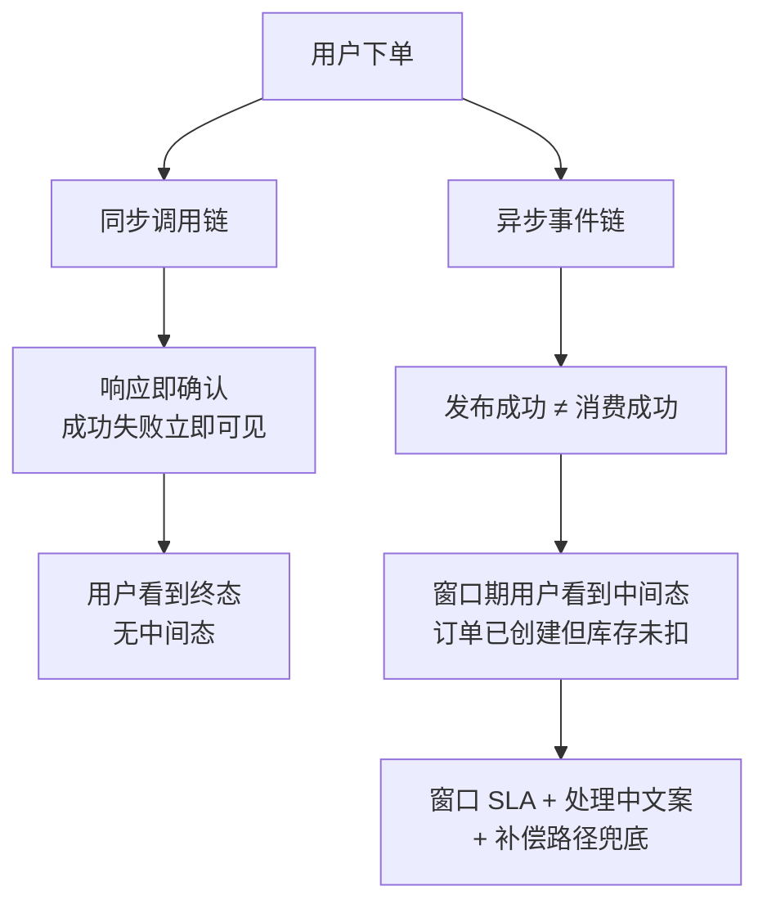
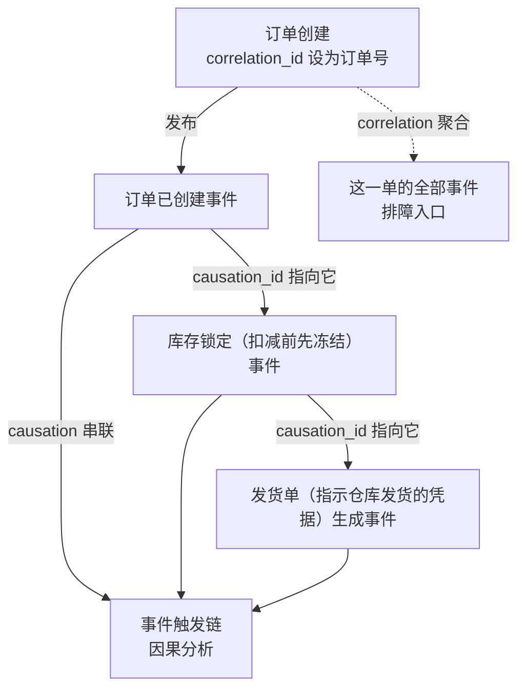

# 事件驱动架构的解耦代价：最终一致与可追溯性

## 解耦之后丢了哪些东西：要解决的问题

读完这篇你能判断**自己的系统该不该上事件驱动**，以及上了之后**一致性窗口与可追溯性怎么补**。服务间调用从同步的 RPC（Remote Procedure Call，远程过程调用：像调本地函数一样调远端服务） 链改成异步的事件总线——一个中转事件的中介，发布方只管往里发、订阅方只管从里取，两边互不直连：发布方发事件不等人、订阅方按自己节奏消费，**两方解耦到不知道彼此存在**。

收益硬（削峰、隔离故障、独立演进），代价也硬：**调用链变成时间上分离的两段，一致性从「同步可见」降级为「最终一致」，排障从「一条链路 trace」变成「跨时间跨服务的拼图」**。要解决的问题是把这个代价显式化：解耦换来了什么、最终一致的窗口如何管理、可追溯性如何重建。这是队列和流系统[[工程知识/后端系统：在并发、失败与变化中维持服务/任务与并发/队列和流系统用时间与容量换取解耦.md]]的架构级展开。

图：发布方与订阅方之间由事件代理隔开，两边互不感知，这是解耦收益与一致性代价的共同来源。来源：Microsoft Learn《Architectural styles》。

## 解耦的代价从哪来：机制

先把形状说成一件事：同步调用像打电话办事（对方接了、办没办成当场有回话），事件驱动像往公告栏贴条子（贴完就走，谁来抄、什么时候抄你不知道）。松快是松快了：你不被电话占线拖住即削峰（用队列缓冲瞬时洪峰、让下游按能力匀速消费），对方不在也不影响你继续贴即隔离故障。代价跟着来：回话没了（确认延迟到消费，"贴了"不等于"办了"）、条子可能被两个人各抄一遍或谁都没抄——重复与丢失要自己防；出了事你要顺着公告栏和时间线拼出"到底谁抄没抄"——可追溯性要重建。这个比喻到"拼图"为止——现实里解耦还分三档松紧——通知、带状态、溯源，各自的耦合点不同，下面展开。

解耦之后，同一个事件会被多个消费者各自处理一遍。多个消费者各自拉取、各自推进，没有任何一方能决定彼此的处理次序，于是这一跳的代价是**顺序不再有保证**，谁先谁后**只能由你额外定义**。

**解耦分哪三档：通知、携带状态、溯源？**
- 事件通知（event notification）：发布方只说「发生了 X」，订阅方自己来查详情。最松耦合（发布方不知道谁消费、消费什么），**但消费方要回查（额外往返 + 回查时状态可能已变）**。
- 事件携带状态（event-carried state transfer）：事件里带全部数据，订阅方无需回查，**耦合从「调用耦合」变成「数据格式耦合」**——发布方的 schema 即事件里字段的格式与含义，变更时会影响全部订阅方。
- 事件溯源（event sourcing）：事件是事实的唯一源，状态是事件的折叠，最强形态——**完整审计 + 从任意历史事件重放出当时的全部状态**——这是把事件序列重新折叠出来的效果，代价是**查询要额外建投影视图**；**查询复杂、认知负担重**。

**最终一致的窗口管理**。**同步调用的响应即确认（成功/失败立即可见），事件驱动的确认延迟到消费（发布成功 ≠ 消费成功 ≠ 处理成功）**。窗口内的状态：用户下单（发布方视角）已成功、库存扣减（消费方视角）还没发生——**中间态对外可见（用户看到订单但库存查询还是旧值）**。**窗口管理有三项纪律**。第一，**给窗口时长定 SLA（Service Level Agreement，服务质量承诺），并把 P99（把所有请求响应时间从小到大排，第 99 百分位的值，99% 的请求比它快）消费延迟纳入监控**。第二，**中间态要有产品文案（「处理中」状态显式化）**。第三，**留好补偿路径（消费失败的重试与死信，配合幂等设计）与重试**[[工程知识/数据系统：在并发与故障中保存事实/数据管道与流处理/数据编排要保证依赖、重试与幂等.md]]。

同步与异步的确认时点分开走，用户在两条链路里看到的状态会不同——同步调用立即返回结果，异步事件要等消费方处理完才生效：

**跨队列的 trace 断了，怎么把因果重新接起来？**同步链路有 trace（一个请求 ID 串全程），事件链路的 trace 断在队列两侧**（发布方的 trace 到 broker 为止，消费方新开 trace）。**重建手段：因果 ID 的传播（事件头带 causation_id 指向触发它的事件、correlation_id 贯穿业务流），事件总线上的链路追踪（broker 的消息 ID + 两端的关联）**。工具成熟度：OpenTelemetry（OTel，一套分布式追踪与埋点的开放标准）的 messaging 语义约定在完善，**跨队列的 trace 拼接仍要工程补齐。

**多服务业务流怎么组织：编排还是协同？**多服务的业务流（下单 → 扣库存 → 发货）两种组织方式：协同（choreography，各服务订阅各自关心的事件、各自反应，无中心）与编排（orchestration，一个协调者发命令、监结果，流程显式）。协同的流程逻辑散在各订阅方（新功能要改多方、排障要拼全链），编排的协调者是新单点（但流程可视化）**。大流程用编排：Saga（把长事务拆成一串本地事务、每步配一个补偿动作的模式） 协调者**把长流程拆成多步本地事务、每步配一个补偿动作来回滚，见 [[工程知识/后端系统：在并发、失败与变化中维持服务/分布式可靠性/Saga把长事务变成补偿链，代价是**失去隔离性.md|Saga 补偿链]]**；小联动用协同，即一两个订阅方的局部反应。

来源：[腾讯云开发者社区《消息队列：听我解释，我真的不是只有Kafka！》](https://cloud.tencent.com.cn/developer/article/1866156)（CC 4.0 BY-SA）

来源：[博客园《解密 Raft 算法》](https://www.cnblogs.com/traditional/p/12588733.html)（CC 4.0 BY-SA）

## 这套架构怎么来的、付什么价：背景与代价

事件驱动架构的思想源头是企业集成模式（EIP，Enterprise Integration Patterns，Hohpe 与 Woolf 2003 年的著作），消息中间件MQ（Message Queue，消息队列：异步传递消息的中间件）系列是 2000s 的企业标配。微服务潮（2014+）让它复兴（服务间异步解耦），Kafka（2011 诞生，2014+ 普及）把日志型事件流做成基础设施（回放、多订阅者、持久化）。Martin Fowler 的事件模式三分类（通知/携带状态/溯源，2017 整理）是概念澄清的标志。

**correlation_id 把「业务流」与「技术链路」分开追踪。**同步世界的 trace ID 只描述技术链路（一次调用链），而事件驱动的业务流跨多次发布与消费、跨多个服务、跨时间（分钟到天）**。为什么需要两个 ID？因为业务流与技术链路在这里分离了：correlation_id（业务流 ID，如订单号）贯穿全程，causation_id记录事件间触发关系。两个 ID 的分工可以这样理解：correlation_id 用来找「这单业务的全部事件」（排障入口），causation_id 用来还原「事件触发链」（因果分析）。这一笔承认**异步世界的可追溯性需要业务语义的 ID（纯技术 ID 追不到跨队列的因果）**，与同步世界「一个 trace ID 走天下」的做法分道。代价：最终一致的窗口是产品代价（用户看到中间态），**窗口 SLA 与产品文案要协同设计**（技术说 P99 5 秒，产品文案「处理中」，两边同步）；**事件 schema 的演进是持续税**（订阅方越多、schema 变更的影响面越大，schema registry 的兼容策略要前置）；**协同式流程的可理解性随订阅方数量下降**（事件风暴图是补丁不是解药，超过 5 个服务的协同流要考虑编排化）；死信（多次消费失败的消息转入的兜底队列）与重试的堆积是慢性病（消费失败的事件堆在死信队列 DLQ（Dead Letter Queue，放处理失败消息的地方），无人治理的 DLQ 会变成**失败被静默吞掉、再也没人看见的地方——每周清点、按错误类型归因、修不完的进工单）。

图里两个 ID 各管一条线：correlation_id 用业务身份（订单号）把跨服务、跨时间、跨多次发布消费的事件归成「这一单的全部事件」，是排障时的入口；causation_id 记录事件之间的触发关系，把「谁引发谁」还原成因果链。单看一个事件时两者都只是头部字段，聚合起来才成为跨队列的可追溯性**——同步世界一次调用链一个 trace ID 就够，**异步世界必须靠业务语义 ID 把时间上分离的两段接起来。

## 事件驱动不适合什么场景：边界

- **解耦的收益要用「变化频率」衡量**。发布方与订阅方独立演进（变化不同步）收益大；两方总是同步变（schema 联动改）解耦是假的**（改 schema 要改双方 + 全量重放）。判断：**过去半年两方发布节奏是否独立？
- **事件携带状态 vs 回查的选择**。携带状态省往返但 schema 耦合深（订阅方依赖发布方的数据形状）；回查松耦合但消费方要调发布方（「解耦」退化成「延迟耦合」**）。**高吞吐场景携带状态（省回查的放大），低频关键场景回查（保证读到最新状态）。
- **死信队列不是垃圾桶是待办清单**。DLQ 的事件要有 Owner 与 SLA，监控 DLQ 深度与错误分类。无主 DLQ 等于把失败静默化。
- **编排与协同不是信仰是规模函数**。2-3 个服务的流程协同够用（少一层协调者的维护），5+ 服务的流程要编排（流程可视化与失败恢复集中化）**。**从协同起步、到规模再编排化，是常见演化路径。

## 代价管住了怎么验证：验证

- **一致性窗口实测**：发布事件到订阅方处理完成的端到端延迟分布（P50/P99）**。预期：**正常时段秒级、堆积时段分钟级（窗口的动态性）。窗口 SLA 的实测锚点。
- **trace 拼接演练**：一次业务流的全部事件按 correlation_id 聚合、按 causation_id 连因果链。预期：聚合后可完整还原业务流（谁触发谁、哪步慢、哪步失败）**。**可追溯性重建的可行性证据。
- **DLQ 治理审计**：统计 DLQ 的错误类型分布与年龄。预期：多数错误集中在少数模式（schema 不兼容、下游 bug），年龄长的积压说明治理缺位**。**治理优先级的依据。

## 接着读哪几篇：长流程的编排化方案

- [[工程知识/后端系统：在并发、失败与变化中维持服务/任务与并发/队列和流系统用时间与容量换取解耦.md]] —— 队列机制的展开
- [[工程知识/后端系统：在并发、失败与变化中维持服务/分布式可靠性/Saga把长事务变成补偿链，代价是**失去隔离性.md]] —— 长流程的编排化方案**
- [[工程知识/数据系统：在并发与故障中保存事实/数据管道与流处理/数据编排要保证依赖、重试与幂等.md]] —— 消费侧的重试与幂等（同一操作执行多次与执行一次效果相同）
- [[工程知识/软件构建：让变化可以理解、验证与交付/架构与代码/领域建模的实施路径：从事件风暴到聚合边界.md]] —— 聚合间靠事件同步，代价在事件驱动链路篇展开
- [[工程知识/后端系统：在并发、失败与变化中维持服务/服务设计/微服务划分的判据：从团队认知到数据边界.md]] —— 划分后簇间靠事件同步，代价一起算进划分的账