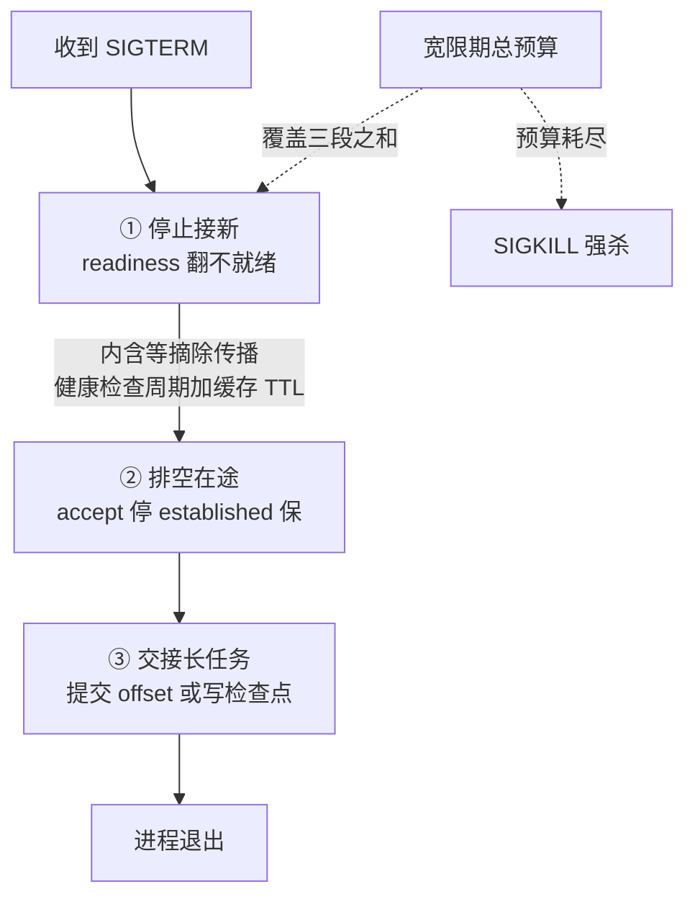
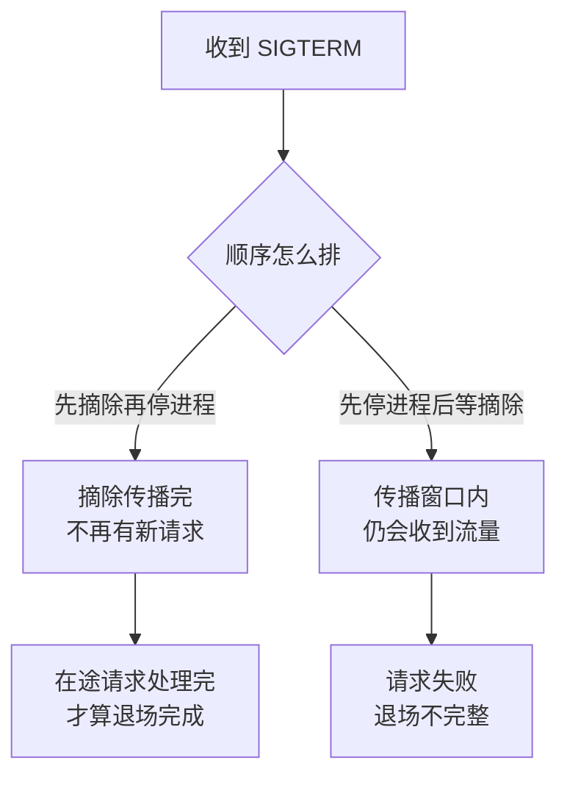
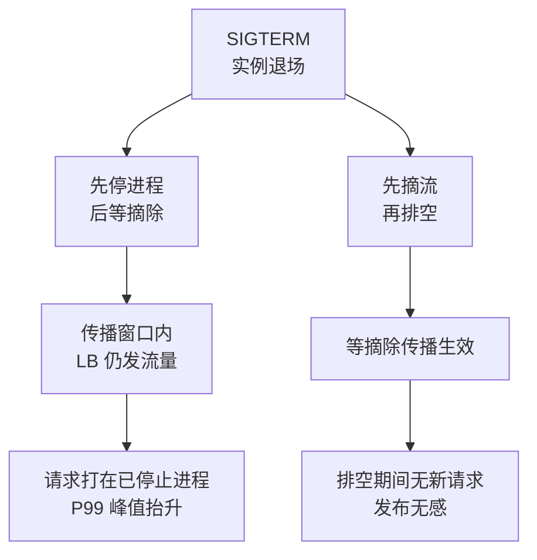

# 优雅停机的完成语义：排空连接与任务交接

## 要解决的问题是什么

滚动部署、缩容、节点维护都要停服务实例，但「停」有讲究：**直接 SIGKILL（操作系统发出的强制终止信号，进程收到后无法捕获、立即退出）让在途请求半路中断（用户看到 5xx、数据写一半）、消息消费者的任务丢（消息处理到一半没 ack，重投后重复消费）、后台任务断（导出到一半的文件残留）**。

优雅停机（收到停止信号后先停止接新请求、把手头请求做完再退出）要解决的问题是**把「停机」从瞬时切断变成有序退场**：**停止接新、排空旧的、交接长任务**的三个阶段，**每个阶段有明确的完成判据**。为什么说这是部署流水线（部署与发布的分离，见 [[工程知识/软件构建：让变化可以理解、验证与交付/测试与交付/配置与特性开关分离部署与发布.md]]）的**实例层保障**？

因为**部署与发布分离要求下线实例不丢在途请求，三阶段的退场顺序正好满足这条底线**。这篇的三阶段与第 33 行的验证清单对接起来，就是**一套每次发布都不会丢请求的退场顺序**。

它又与健康检查三层语义[[工程知识/后端系统：在并发、失败与变化中维持服务/服务设计/健康检查的三层语义：存活就绪与深度.md]]的 readiness 语义衔接——**摘流量是排空的前半步，readiness 翻走流量、排空收尾**。

读完这一篇，你能**给手上的服务写出一套每次发布都不会丢请求的退场顺序**。

这套流程像一家准备关门的店：**先停止让新客人进门（摘流量）、把已经坐下的客人服务完（排空在途请求）、把手上没做完的活儿交给下一班（任务交接），最后才拉闸**。

这个比喻到"交接失败怎么办"为止——**客人服务完就走了，而长任务（比如跑一小时的离线导出）没法等，交接不了就必须有明确的超时上限和补偿方式，否则关店时它会被一刀切断**。

## 有序退场分哪三个阶段

**三阶段退场**。
- **停止接新**：readiness 翻不就绪（LB（Load Balancer，负载均衡器）摘除、注册中心下线），**新请求不再来**。**这一步要等 LB 的摘除传播完成——摘除不是瞬时的，要算上 LB 轮询周期与缓存 TTL（Time To Live，存活时间：到期后自动失效或删除）**。
- **排空在途**：存量请求处理完（HTTP 请求等到响应、RPC——Remote Procedure Call，远程过程调用：像调本地函数一样调远端服务——等到完成）。**判据：在途计数归零或超时（最长等待 = 请求 SLA——服务级别协议约定的响应时间上限）**。**排空期间进程拒绝新连接但继续服务旧连接：accept（接收新连接的系统调用）停、established（已建立好的连接保持）——停掉前者只拦新客，不影响正在服务的旧客**。
- **交接长任务**：处理不完的（长任务、消息消费）**按语义交接**——**消息消费者的未 ack（acknowledgement，消费方处理完一条消息后向队列回执确认，没回执的会被认为没处理完）消息停止拉取、等当前消息处理完再退出（重平衡机制接手）**；**后台任务靠检查点（checkpoint，把任务进度写到磁盘的存档点，重启后从存档点继续）续跑**，或者**把任务设计成可重跑、出事就回滚（把系统恢复到上一个可用版本）**；**在写数据的原子提交点退出（不留半写状态）**。

**信号和超时是怎么编配出总预算的？SIGTERM（请求进程正常退出的终止信号）触发优雅流程，宽限期（grace period）是总预算**：停新（等摘除传播，1-10s）+ 排空（等在途，10-30s）+ 交接（等长任务，任务依赖）。**预算耗尽 SIGKILL 强杀（强杀是不可达 SLA 的兜底，不是常规路径）**。**宽限期的设置要贴着最长的常规路径（消息处理的 P99 尾延迟加重平衡时间）**：**排空等的是最慢那条在途消息的 P99（99% 的请求耗时不超过这个值），交接等的是消费组（一组消费者共同订阅一个主题、分区分配给组内成员消费）把任务让给别人的重平衡（成员增减时把分区重新分配给消费者的过程）耗时，两者相加才是退场真正会卡住的总时长**。**所以默认 30s 是拍的、靠不住**。

收到 SIGTERM 之后三步是**串行**的：**先翻 readiness 停止接新（里面还含等摘除传播），再排空在途（accept 停、established 保），最后交接长任务（提交 offset——消息队列里标记已消费位置的游标）或写检查点**；而**宽限期是从外面扣住这三段总时长的一个预算**：



Kubernetes（容器编排平台，负责容器的部署、调度与自愈）把这套编配**标准化成了终止宽限期**：**preStop 钩子先跑，这是等摘除传播的标准挂点**，SIGTERM 随后发给主进程，**宽限期计时结束仍未退出则 SIGKILL 强杀**。CNCF（Cloud Native Computing Foundation，托管 Kubernetes 等项目的基金会）博客的这张时间轴把三个事件点画在同一条容器生命周期上：**preStop 的 sleep 时长与宽限期预算，直接决定三段退场的切分**：


*图源：[CNCF 博客《Decoding the Pod Termination Lifecycle in Kubernetes: A Comprehensive Guide》](https://www.cncf.io/blog/2024/12/19/decoding-the-pod-termination-lifecycle-in-kubernetes-a-comprehensive-guide/)，Fairwinds，2024。*

**不同协议的连接在排空时各要注意什么？**
- **HTTP**：LB 摘除后等在途连接（keep-alive：同一条 TCP 连接上复用多次请求响应的机制）连接的排空要**显式关：Connection: close 响应头让客户端不复用**。
- **gRPC（Google 开源的高性能接口调用框架）**：**goaway 帧（server 主动告知「我要关了」，客户端重连到别的实例）**，**goaway 后的在途 RPC 等完成**。
- **消息消费者**：**停止拉新（revoke 分配）、处理完手上的、提交 offset、退出**。Kafka（分布式消息队列，靠日志追加支撑高吞吐订阅）的 **cooperative rebalance 让交接平滑，不引发 rebalance 风暴**。
- **数据库连接**：**还回池、关闭（不留在途事务——长事务的回滚代价要算进宽限期）**。

排空的流量背景是负载均衡器把终端请求分给多台服务器：**摘除一台，只是把发往它的那份流量转给其余实例**：


「停止接新」改变的就是这张图上**负载均衡器到被摘实例的那条边**——**摘除传播完成前，这条边上仍会有新请求进来，这正是排空窗口要覆盖传播延迟的原因**。

**跑不完的长任务怎么交接给下一班？**长任务（超过宽限期）的交接靠**检查点**：**任务的进度写入磁盘（已完成的部分 + 剩余部分），新实例从检查点续跑**。没有检查点的长任务（不可分段）只有两条路：**停机前等它完成（停机窗口避开任务运行时段）**，或者**接受中断重跑——重跑不丢数据的前提是幂等（同一个操作执行一次和执行多次的结果相同，重复执行不会产生额外副作用）设计兜底**，见幂等。


来源：[博客园《多图详解 TCP 连接管理，太全了!!!》](https://www.cnblogs.com/cxuanBlog/p/14679563.html)（CC 4.0 BY-SA）


再一处图源：[小林coding《TCP 三次握手与四次挥手面试题》](https://www.xiaolincoding.com/os/1_hardware/tcp_interview.html)（CC 4.0 BY-NC-SA）


## 这套退场流程付出了什么代价

优雅停机随滚动部署（2010s 云原生）成为必修：**蓝绿与滚动要求「下线的实例不留尾巴」**。**Kubernetes 的 terminationGracePeriodSeconds（默认 30s）与 preStop 钩子把三阶段流程标准化**。**gRPC 的 goaway、Kafka 的 cooperative rebalance（2019）是协议层的配合**。**ECS（亚马逊的容器编排服务）/Nomad 把 deregister（从服务发现摘除）与 drain（排空在途任务）分成两个独立动作，与上面三阶段的思路同构**。

**「摘除传播的等待」被显式设计进停机窗口**。直觉的停机是「收到 SIGTERM 就开始排空」，但 **LB 的摘除有传播延迟（健康检查周期、缓存 TTL），提前排空的实例仍会收到新请求（LB 还认为它健康）——排空「完成」后新请求又来，排空永远完不成**。解法是 **preStop 钩子里 sleep（等摘除传播）或应用层的双重确认（摘除生效信号后才进排空阶段）**。这个设计把**分布式系统里「状态的传播需要时间」这个基本事实编进停机协议**，与「删除一个服务前先下线它的全部调用方」的治理动作同构。代价：**优雅停机拉长部署时间（每实例宽限期 30s × 滚动批次，大集群的部署窗口分钟级到十分钟级）**，频繁部署的团队要在**部署速度与完整性之间选平衡（小宽限期快但险，大宽限期稳但慢）**；**宽限期内的资源占用是双份（旧实例没退、新实例已起，滚动期间的容量要算重叠）**；**长任务的检查点机制是开发成本（每个长任务都要实现断点续跑，不做检查点的任务只能赌宽限期够长）**。

## 这套说法在哪儿会失效



摘除顺序决定退场是否完整：**若先停进程再等 LB 摘除生效，传播窗口内新请求仍会被转发到这台正在退场的实例并直接失败**，所以**必须先摘流量、等窗口过去、再停进程**：


- **宽限期要与真实路径匹配，默认值靠不住**。**消息消费者的宽限期 = 消息处理 P99 + 提交 offset 时间；HTTP 服务的宽限期 = 摘除传播 + 在途 P99**。K8s（Kubernetes 的常用简称、容器编排系统） 默认 30s 对多数场景不够，**摘除传播慢的 LB 尤其如此，要按协议实测**。
- **「处理完手上再退」是消息消费者的底线**。退出时**未 ack 的消息会重投（至少一次语义）**，**重复消费要求处理逻辑幂等**。**停机流程不改变投递语义（at-least-once 不因停机变 at-most-once）**，**幂等是停机安全的伙伴**。
- **强杀是兜底策略之外的最后一手**。宽限期耗尽的 SIGKILL 意味着**退场失败**（在途请求中断、事务断），**要当作事故复盘（为什么宽限期不够），不属于「正常选项」**。**频繁触发强杀说明宽限期设置或任务设计有问题**。
- **连接的排空要区分协议语义**。HTTP keep-alive 的复用连接、gRPC 的长连接、WebSocket（浏览器与服务端之间的双向长连接协议）的会话连接，**排空机制不同（close 头、goaway 帧、会话迁移提示）**。**统一按「HTTP 短连接」处理会漏长连接（排空判据失真）**。

## 怎么自己动手验证

- **滚动部署零错误实测**：正常负载下滚动部署全量实例，观测 5xx 与消息重复消费数。预期：**优雅停机配置正确时 5xx = 0、重复消费可被幂等吸收**。**退场完整性的直接证据**。
- **宽限期压测**：注入长请求（P99 超过宽限期）的滚动部署。预期：**宽限期耗尽触发强杀、在途请求 5xx（宽限期不足的边界暴露）**。**边界数据是宽限期调整依据**。
- **摘除传播时延实测**：标记 SIGTERM 时刻与 LB 实际停止发流量的时刻，统计间隔。预期：**间隔 = 健康检查周期 + 缓存 TTL，preStop sleep 时长据此设定**。**传播时延的量化证据**。

## 拿一次滚动发布怎么对账

```text
一次滚动的推演账（通用形态）：

  信号账：SIGTERM 到达 → 停止接新请求（从注册表摘除 + 就绪探针失败）
    → 等在途请求做完（排空窗口，如 30s）→ 关资源 → 退出
  摘流先行的账：摘除有传播延迟（注册表缓存 10-30s）
    → 新实例已起、旧实例已摘，但调用方缓存里还有旧地址 → 仍会打进来
    → 排空窗口要覆盖最长传播延迟，连接层面也要拒绝新连接
  任务交接账：批处理/异步任务没法 30 秒做完 → 检查点续跑（重启后从断点继续）
    或任务外置队列（实例退出，任务不退出）
  强杀兜底账：SIGKILL 前的宽限期要配好，排空卡死时要有止损手段
```

**摘流不先行的实录**——发布时先停进程再等 K8s 摘 endpoint，**传播窗口里的请求全打在已停止的进程上，每次发布 P99 峰值显著抬升**；**改为收到 SIGTERM 先摘流再排空后发布无感**。**排空不够长的实录**——排空窗口 10 秒，长连接推送场景里连接建立要慢握手，**窗口内没排完的用户收到断连重试风暴（排空窗口按最长请求 + 连接特性算，拍脑袋定 10 秒是隐患）**。**任务丢档的实录**——批处理（把多个请求合并成一批同时计算、提高硬件利用率）实例被滚动重启，**跑了一半的任务直接消失，数据停在中间状态（任务改外置队列 + 检查点续跑后滚动发布与批处理共存）**。摘流量顺序的操作细节见 [[工程知识/性能工程：从用户等待到资源瓶颈/存储与网络/滚动重启的摘流量顺序：先停新请求，再让旧请求做完.md]]、注册表缓存的传播延迟见 [[工程知识/后端系统：在并发、失败与变化中维持服务/服务设计/服务发现与负载均衡决定请求发往哪里.md]]、探针（向系统注入的检测点或检测请求）与摘流的配合见 [[工程知识/后端系统：在并发、失败与变化中维持服务/服务设计/健康检查的三层语义：存活就绪与深度.md]]。

SIGTERM 到达后摘流先做还是后做，发布窗口的流量各走一条链：



## 接着读哪几篇：readiness 摘除是排空前半步

- [[工程知识/后端系统：在并发、失败与变化中维持服务/服务设计/健康检查的三层语义：存活就绪与深度.md]] —— readiness 摘除是排空前半步
- [[工程知识/数据系统：在并发与故障中保存事实/数据管道与流处理/数据编排要保证依赖、重试与幂等.md]] —— 消息交接的幂等兜底
- [[工程知识/软件构建：让变化可以理解、验证与交付/测试与交付/配置与特性开关分离部署与发布.md]] —— 部署与发布的分离
