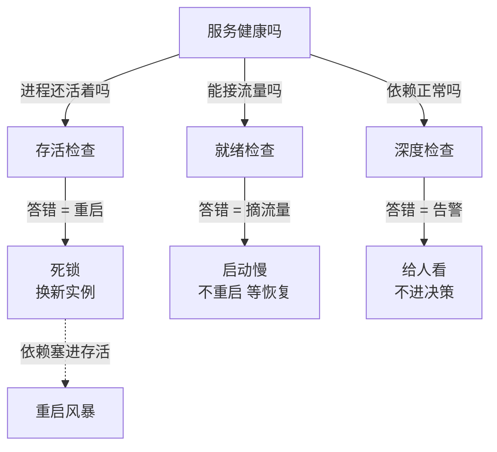
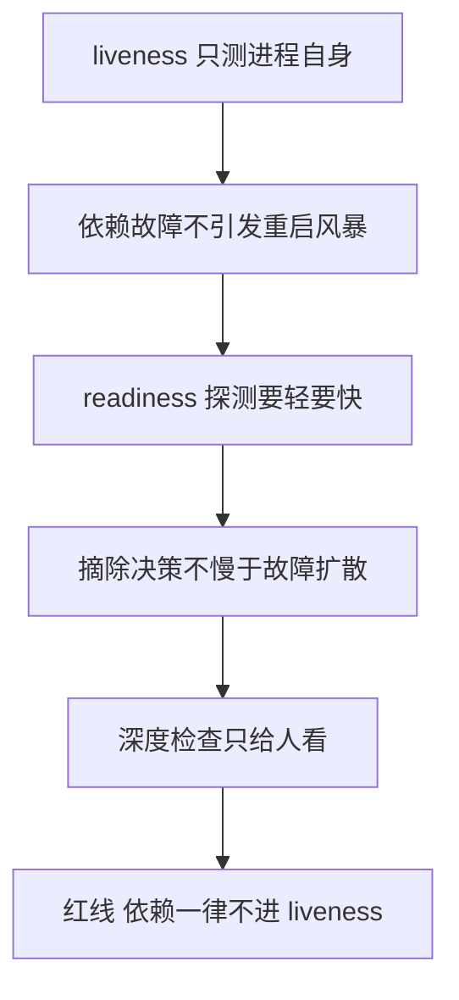
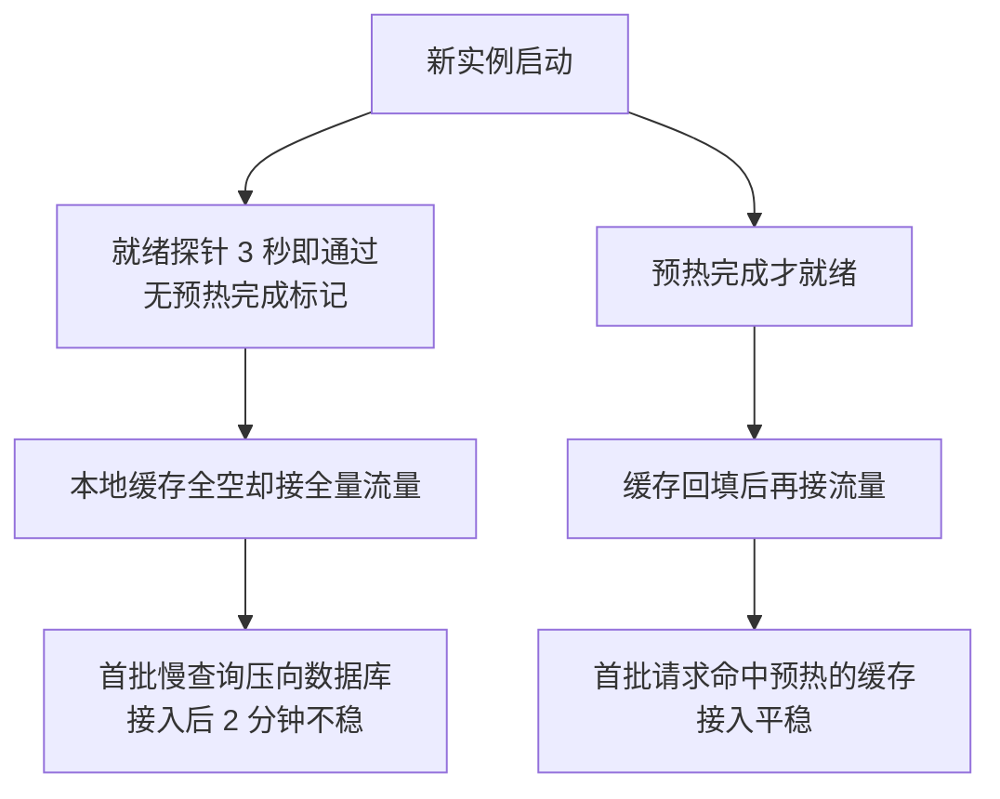

# 健康检查的三层语义：存活就绪与深度

## 要解决的问题是什么

「服务健康吗」这一个问句至少混了**三层完全不同的问题**：进程还活着吗（liveness）、能接流量了吗（readiness）、依赖都正常吗（deep/dependency health）。读完这篇，你能按语义把健康检查拆成三层，知道**哪层该重启、哪层该摘流、哪层只告警**。混用的代价：**用一个「总健康」端点做全部决策**——编排器（负责调度并重启实例的平台，如 Kubernetes）看它重启进程（实际是依赖故障，**重启雪上加霜**）、负载均衡看它摘节点（实际是启动中，**误摘**）。

要解决的问题是**把健康检查按语义分成三层**，每层有不同的**被问者**（谁问）、不同的**判断**（测什么）、不同的**后果**（答错怎么办）。这三层可以想成医院体检的三个项目：**心跳**（节点定期互发的存活信号，超时收不到就判定故障）回答还活着吗，**能否出院干活**回答力气恢复了吗，**各项化验指标**回答内脏功能正常吗——混成一项就会把"心脏还在跳"当成"能上班"。这个比方只用来区分三层各自问的是哪件事，探针（向系统注入的检测点或检测请求）怎么配、**失败几次才摘除**要看正文。

这个比喻到"答错的后果"为止——体检做错了顶多误诊，探针答错了会让编排器杀掉好进程或把流量打到没准备好的实例上。

这是服务发现与负载均衡（见 [[工程知识/后端系统：在并发、失败与变化中维持服务/服务设计/服务发现与负载均衡决定请求发往哪里.md]]）的**摘除决策依据**，与限流（限制单位时间内放行的请求数量）、熔断（错误率过高时暂时断开调用快速失败）构成过载防御的搭档——限流控制单位时间放进来的请求数量、超过配额就拒绝，熔断连续失败次数超阈值就暂时切断调用，见 [[工程知识/后端系统：在并发、失败与变化中维持服务/任务与并发/限流熔断与隔离控制故障半径.md]]：熔断按错误率摘除依赖调用，健康检查按状态摘除实例，**三者各管一段**。

## 三层探针各自回答什么问题

三层语义的分工：**存活决定要不要重启，就绪决定要不要接流量，深度决定依赖是不是真的通**。前两层由编排平台定时调用，监控服务从外部独立观察——**不问应用自己说没说真话**。


*图源：Microsoft Learn 中文文档，CC BY 4.0，https://learn.microsoft.com/zh-cn/azure/architecture/patterns/health-endpoint-monitoring。*


**这三层各自回答什么问题？**
- **存活（liveness）**：进程还能干活吗，看事件循环（反复取出队列里的回调执行的调度机制）是否活着、有没有**死锁**（多个执行流互相等待对方释放资源）。测法：**进程内自检**（一个只回报自身状态、不查依赖的轻量接口，如内存端点、心跳线程）。答错后果：**重启**（编排器杀掉重启）。Kubernetes 的 liveness probe。**liveness 测「自己」，不测依赖**——依赖挂了重启自己没用。
- **就绪（readiness）**：现在能接用户的流量吗（**初始化完成、关键依赖可用、队列没满**）。测法：**初始化标志**（启动完成后置位的变量，表示已准备就绪）+ 关键依赖的轻探测。答错后果：**摘出负载均衡**（不重启，等恢复——实例还活着，只是暂时不接客）。Kubernetes 的 readiness probe。
- **深度（deep health）**：整棵依赖树的状态。它把数据库、缓存、下游服务**逐个探一遍**，汇总成一张完整的依赖健康图。测法是**逐依赖探**，每个探测带**超时与缓存**，避免探测本身拖垮依赖。被问者：**人与监控**——深度信息给排障的人看、给监控系统采集，**不做自动决策**（依赖故障 ≠ 自己该重启/摘除，**深度检查是诊断信息不是决策信号**）。

**三层混用会引发哪三种事故？**
- liveness 里测依赖：数据库抖动 → 全实例 liveness 失败 → 全实例被重启 → **冷启动**（缓存或服务刚启动、还没有数据与连接的状态）风暴（大量实例同时重启，集中重连数据库、重加载缓存，瞬间打满资源）+ **数据库连接风暴**（重启后重连）→ 数据库更抖——重启引发更多重连，重连让数据库更抖、触发更多重启，这就是**失控的正反馈螺旋**（原因与结果互相加强、越滚越大）。
- readiness 里做重活：就绪探测里逐个探全部依赖（每个 200ms 超时）→ **探测慢** → 编排器判「不就绪」摘流量 → **实际服务正常。误摘事故**。
- 深度检查挂到负载均衡：依赖故障 → 深度失败 → 全部节点摘除 → **服务整体下线**（单点依赖故障放大成全服务下线）——一个依赖的**爆炸半径**（故障波及的范围）失去控制，**从单点扩散到全局**。

**配置探针要注意哪些工程细节？**
- **探测的成本要小**（liveness 每几秒一次，探测本身不能成为负载）。
- **探测的超时要短**（超时的探测 = 探测自身故障，决策依据丢失）。
- **探测结果要缓存**（依赖探测 500ms 结果缓存 5s，避免每次探测全打依赖）。
- **语义要暴露给问者**（HTTP 码区分：200 活/就绪，503 不就绪，探深度给结构化 JSON）。编排器与 LB（Load Balancer，负载均衡器，把请求分发到多个实例的中间层）各取所需：**编排器只认 liveness 结果，LB 只认 readiness 结果**。
Kubernetes 把三层语义各做成一个探针，Google Cloud 官方博客用两张动图演示了 Service 视角下的两种判定：存活探针通过（Liveness PASS）证明进程还在干活，实例保持 Ready 继续接流量：


*图：Kubernetes liveness 存活探针在容器重启前后状态翻转的演示动图。来源：Google Cloud Blog GIF，https://storage.googleapis.com/gweb-cloudblog-publish/original_images/google-kubernetes-probe-livenessae14.GIF，亦见博客园《Kubernetes 中的健康检查机制》转引。*

就绪探针通过（Readiness PASS）才有资格进 Service 的端点列表，两个实例同时就绪时流量分给两者：


*图：Kubernetes readiness 就绪探针把 Pod（Kubernetes 调度的最小部署单元，可含一个或多个共享网络的容器） 移入移出负载均衡的演示动图。来源：Google Cloud Blog GIF，https://storage.googleapis.com/gweb-cloudblog-publish/original_images/google-kubernetes-probe-readiness6ktf.GIF，亦见博客园《Kubernetes 中的健康检查机制》转引。*


## 探针机制付出了什么代价

健康端点放多深是个取舍：**太浅，进程活着但业务已经不可用了；太深，一个下游抖动（性能指标不稳定的起伏）就把实例摘掉，雪崩（一处故障沿依赖链放大成级联失效）反而更快**。服务内的资源也按用途切分，**故障被限制在自己的隔间里**。

「一盏灯管一件事，灭一盏不黑全宅」的实物原型是宅院里的红灯笼：门口的、廊下的、库房门前的各挂各的杆，各点各的烛——库房那盏灭了，门口与廊下照常亮；巡夜人看哪盏灭、灭到什么程度，决定报火还是换烛（liveness 重启与 readiness 摘流的分工）。这个比方只用来说明资源按用途切分、故障不跨区扩散；灯笼怎么挂、巡夜人怎么走，都不影响正文对探针的配置要求：


健康检查的思想最早来自负载均衡器的**后端探活**——1990 年代的 LVS（Linux 虚拟服务器，Linux 内核层的四层负载均衡）与 F5（硬件负载均衡设备）就开始周期性探测后端节点存活，**Kubernetes（2015+）把 liveness/readiness 二分法写进编排标准**（startup probe 是 2020 补充，解决慢启动应用的误杀）。Google SRE（Site Reliability Engineering，网站可靠性工程：用软件方法做运维）手册（2016 年出版，谷歌站点可靠性工程团队的实践总结）明确**「健康检查要便宜、可聚合、语义明确」**。

深度检查的定位讨论（是否进决策路径）是 2018+ 的共识收敛：依赖状态做诊断，不做摘除依据（摘除决策只看「我能不能服务」，不看「为什么不能」）。

**readiness 与 liveness 的后果分离。**为什么同为「不健康」，后果要截然不同？因为**不就绪摘流量是保护用户、不伤自己，不存活重启是修复自己、不管流量**——**故障类型不同，对的修复动作就不同**。分离后两类故障各自走对路：启动慢与依赖抖动走摘除，恢复后自动回归；死锁与内存崩走重启，换新实例。混在一起时后果错配：**依赖故障被重启、死锁被摘除留着耗资源**，错配的连锁即重启风暴，**比原故障更伤**。

这一笔把故障类型的判定接到了修复动作上，与熔断器的半开设计（断路器在故障后先小流量试探，探测到恢复才全部放行）**同构：恢复路径是探测出来的，不是猜出来的**。代价：三层端点的**维护成本**（依赖清单要持续同步：新依赖上线忘了登记，深度信息残缺——依赖下线没清理，深度检查永久红）；探测的**调优是持续工程**（**间隔、超时、阈值的三元组按应用特性调**，默认值只是起点）；**「深度检查不进决策」的纪律要守**：人看见指示灯变红就想把它接进自动化，这是人性倾向，但**深度红一旦接进自动摘除，就会一触发就全实例摘除、形成连锁反应**，所以深度红（某个依赖被探到不健康）的正确响应是**告警给人看，由人决定下一步动作**。



图把混在一个端点里的三层问题拆开，每层配一个动作：存活不通过走重启（换实例），就绪不通过走摘流量——不重启，待恢复后自动回归；深度不通过只告警——给人看，不进决策路径。这张图的价值在动作与故障类型的匹配——虚线标出的错配形态正是事故来源：把依赖探测塞进存活检查，数据库抖动会让全部实例同时重启，重连风暴再回头压数据库，把 30 秒的抖动放大成十分钟的故障。三层的问者即谁来看这个信号，后果即信号触发什么动作，各不相同：问者是编排器、负载均衡与排障的人，后果分别是重启、摘流与告警。混用等于让一个信号同时触发重启与摘除两种动作。

## 这套说法在哪儿会失效

- **liveness 只测进程自身，依赖一律不进**。依赖故障时 liveness 保持绿——自己仍在运行——让 readiness 摘流量。**这条红线防的是重启风暴的正反馈**。
- **readiness 的探测要轻、要快、要缓存**。就绪判断的 SLA（服务等级协议，对外承诺的可用性与响应目标）是**秒级（摘除要快）**，探测里做重活逐个真连依赖，让**摘除决策比故障还慢**。就绪探测 = **标志位 + 最多一个关键依赖的缓存探测**。
- **深度检查只给人看，不接自动决策**。它的价值是**排障——一眼看到哪个依赖红了**，接进自动摘除会**放大单点故障**。监控告警按深度分片（依赖红告警给对应 Owner，健康页聚合展示）。
- **启动期的专用通道（startup probe）**。慢启动应用（JVM 即 Java 虚拟机的预热、缓存回填）用 startup probe 保护（**启动期间不跑 liveness**，避免没启动完就被判定为异常）。**启动完成前 readiness 不就绪、不接流量**，启动完成后切正常探测。

四条边界各自切断一种正反馈——每一条都挡住「小故障被探针误判放大成全实例故障」的传导路径：



**第一条是红线**：依赖故障时 liveness 保持绿，让 readiness 摘流量——**这条红线防的是重启风暴的正反馈**，依赖一抖就把所有实例一起重启，**重启又加重依赖负担**。**第三条常被误用**：深度检查的价值是排障时一眼看到哪个依赖红了，接进自动摘除会**把单点故障放大成全局故障**，正确做法是**告警按依赖分片、健康页聚合展示**。

## 怎么自己动手验证

- **依赖故障演练**：下游依赖注入故障，观测三层检查的行为。预期：深度红即诊断正确，readiness 不就绪即摘流量正确，liveness 保持绿即不重启正确。三层语义分明的直接证据。
- **重启风暴复现**：故意把依赖探测放 liveness（错误配置），注入依赖抖动。预期：实例批量重启、连接风暴、依赖加剧抖动，形成正反馈螺旋。这是反模式的实证，有教学价值。
- **摘除与恢复时延实测**：实例故障到 LB 摘除的时延、恢复到重新接入的时延。预期：摘除时延小于探测间隔加超时，秒级；恢复时延受就绪探测节奏约束。决策链路的时延预算证据。

## 拿一次故障怎么对账

```text
三层探针错配的推演账（通用形态）：

存活（liveness）答"进程要不要重启"：只查进程自己（死锁、无响应）
    错配账：把下游依赖塞进存活检查 → 下游抖动触发全量重启风暴
  就绪（readiness）答"能不能接流量"：查自身关键路径（线程池、缓存预热）
    错配账：启动预热 60 秒但就绪检查 1 秒通过 → 流量打进未预热实例全部超时
  深度检查答"业务是否真的健康"：带真实依赖读（拨测类），频率低、报警而非摘流
  发布联动账：就绪不通过 → 摘流量但不重启；存活失败 → 重启（重启是最后手段）
```

**下游依赖进存活检查的实录**——缓存集群抖动 30 秒，存活探针失败触发全实例重启，**恢复时间从 30 秒变 10 分钟**（重启风暴叠加）；存活只查进程自身、依赖降级（主动牺牲部分功能或精度，保住核心链路）走业务逻辑后**同类故障消失**。**预热（上线前提前加载数据或建立连接，避免初期变慢）缺失的实录**——新实例启动 3 秒过就绪，本地缓存全空，**前 2 分钟慢查询压挂数据库**；就绪检查挂上**预热完成标记**（预热做完才把标记置位，就绪探针查这个标记）后平稳。**就绪不摘流的实录**——**实例无响应但探针端口还在应答**（应用线程池满、探针独立线程），流量继续打进已经失效的实例；就绪检查要占业务线程池（预先建好一组线程反复取用、避免频繁创建销毁）或**查队列水位**（队列或资源的当前占用程度）。摘流量与重启的顺序配合见 [[工程知识/性能工程：从用户等待到资源瓶颈/存储与网络/滚动重启的摘流量顺序：先停新请求，再让旧请求做完.md]]、对外部依赖的探测纪律见 [[工程知识/性能工程：从用户等待到资源瓶颈/存储与网络/依赖服务的健康检查要带拨测与退避：探测结果决定流量去留.md]]。

新实例接入流量前，就绪检查挂不挂预热标记，首批流量各走一条链：



## 读完这篇该接着读哪几篇

- [[工程知识/后端系统：在并发、失败与变化中维持服务/服务设计/服务发现与负载均衡决定请求发往哪里.md]] —— 摘除决策的下游机制
- [[工程知识/后端系统：在并发、失败与变化中维持服务/任务与并发/限流熔断与隔离控制故障半径.md]] —— 错误率侧的摘除搭档
- [[工程知识/后端系统：在并发、失败与变化中维持服务/服务设计/背压的传递链路：从下游饱和到上游减速.md]] —— 过载防御的链路视角
- [[工程知识/后端系统：在并发、失败与变化中维持服务/服务设计/优雅停机的完成语义：排空连接与任务交接.md]] —— readiness 摘除是排空前半步
