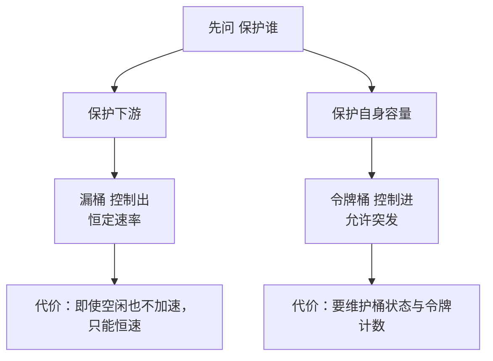
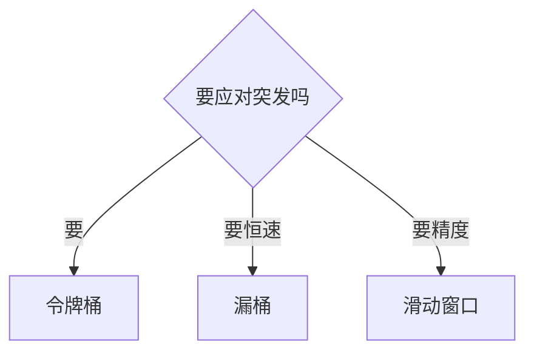
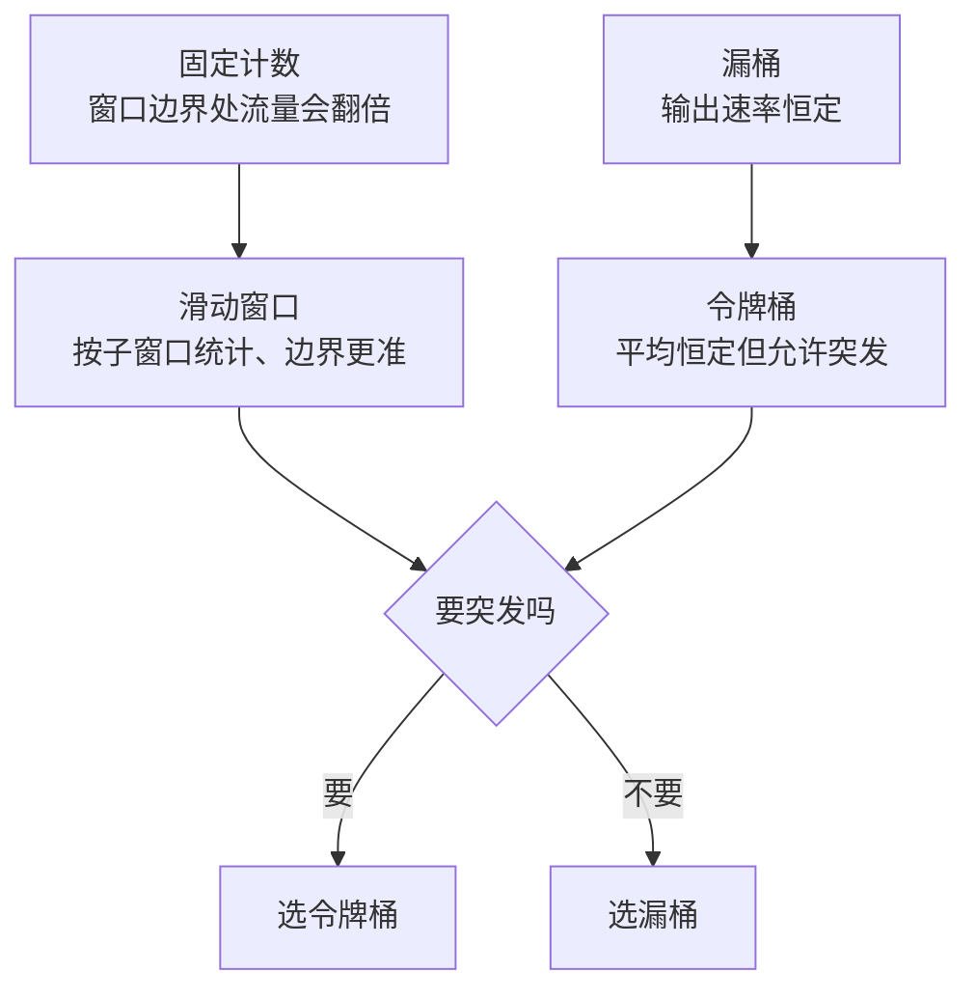
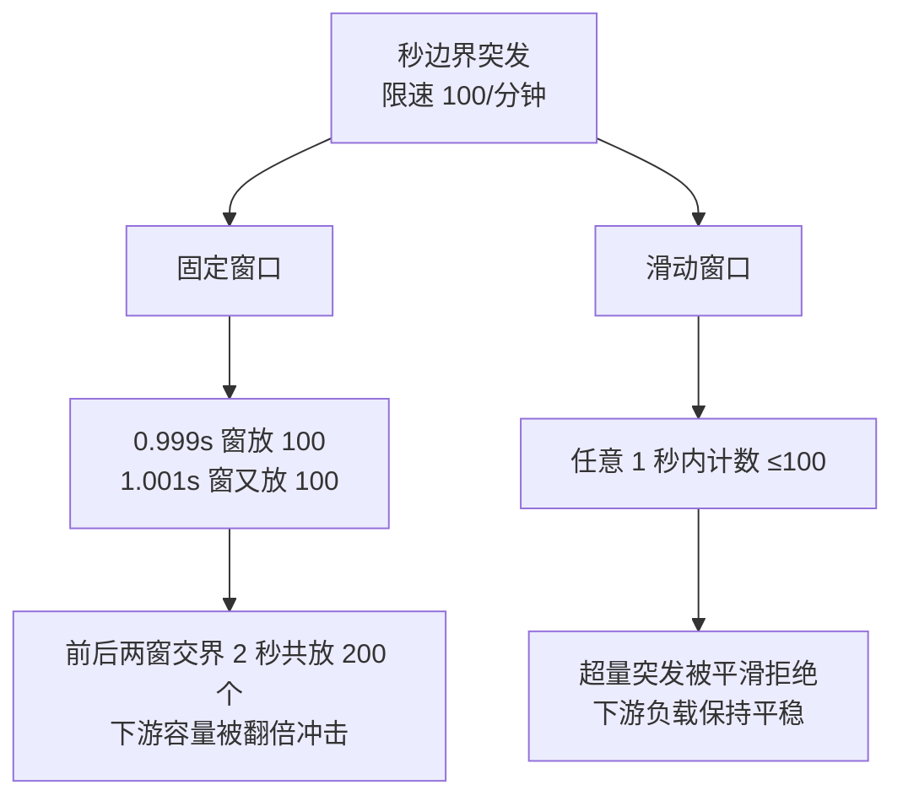

# 分布式限流的四种算法：计数漏桶令牌与滑动窗口

## 这四种算法分别解决什么场景的问题

**秒杀开抢的那一秒，接口 QPS 从平时的三千跳到三十万，数据库连接池两秒内耗尽，所有请求一起超时。**入口层此时只剩一个决策：**放哪些请求进来，拒绝哪些请求。**这就是限流——**过载保护的入口层，流量超过容量时按规则拒绝以保护后端，或把流量整形平滑。**读完这篇你能**按下游承受力和突发需求选对算法，并避开窗口边界突刺这类暗坑。**

先看清限流在整套过载防护里的位置，才好选算法：它跟熔断（依赖持续报错时暂时不再调用它，直接走失败路径）、隔离[[工程知识/后端系统：在并发、失败与变化中维持服务/任务与并发/限流熔断与隔离控制故障半径.md]]同属一层，**又在算法层替它们做精细的流量取舍**；与背压（下游处理不过来时把压力传回上游减速）[[工程知识/后端系统：在并发、失败与变化中维持服务/服务设计/背压的传递链路：从下游饱和到上游减速.md]]则构成「拒绝与减速」两种过载响应。

**四种算法各有形状：固定窗口计数简单但有边界突刺，滑动窗口平滑但有内存代价，漏桶把流量整形到恒速，令牌桶允许突发。**要解决的问题是**按场景选对算法**：**API 网关（统一接收 API 调用并按路由规则分发到后端的入口层）的配额、下游保护的整形、公平性防个别调用方无法获得服务，每种需求对应不同的算法形状。**

## 它是怎么做到的

**固定窗口计数（fixed window）**。时间切窗口，每分钟一个，窗口内计数达上限即拒。**实现最简**（用 Redis 的 INCR 做自增计数 + EXPIRE 设置过期时间，Redis 是常见的内存键值数据库），但**边界突刺：两分钟交界处（前一窗末 + 后一窗首）可放过 2× 上限的量（前一窗最后 1 秒与后一窗最初 1 秒合计可放行 200 个，是上限的两倍），对突发敏感的下游会踩进暗坑**——暗坑指**边界突刺发生在两窗交界处，按分钟统计的监控看不出异常，下游在毫无预警下被冲垮。**

**滑动窗口（sliding window）**。**任意时刻回看最近 W 时间内的计数即真实窗口，无边界突刺。**实现代价：**精确滑窗要记每个请求的时间戳，用 ZSET（redis 的有序集合结构，按分数排序的成员表，这里用时间戳当分数）类结构，内存随 QPS（每秒查询数，系统每秒处理的请求量）涨**；近似滑窗把大窗切小格——如 1 分钟切 6 个 10 秒格——**内存省但精度降，格间仍有小突刺。**分布式实现的一致性代价：**多实例的计数同步（Redis 集中计数 vs 本地计数 + 周期同步）。**

**漏桶（leaky bucket）**。请求进桶，桶以恒速漏出即处理速率恒定，桶满即拒。形状：**强整形（输出速率严格恒定），适合保护脆弱下游（下游只能承受恒速）。**代价：**不允许任何突发（健康流量也被削峰）**，桶深是缓冲上限：**请求在桶里排队等待以恒速漏出，桶越深、排的队越长，等待时长就是用户能感知到的延迟。**

桶的进出速率关系在图上很直观：进水口是忽大忽小的请求流，桶体是缓冲队列，底部小孔是恒定的处理速率，桶满则新请求被拒。看下图对照：


*图源：Wikimedia Commons《LeakyBucket.png》，作者 Lserni at en.wikipedia，Public domain，https://commons.wikimedia.org/wiki/File:LeakyBucket.png。*
来源：Wikimedia Commons「Leaky bucket」条目图。上端不规则的流入与下端恒定的漏出之间的差就是「整形」的含义：出口速率与入口突发无关，桶深只决定能缓冲多少——「排队延迟进用户路径」对应的是桶里积压的那部分水位，桶满即拒的判定发生在水位触顶的那一刻。

**令牌桶（token bucket）**。恒速产令牌入桶（桶满丢弃），请求取令牌（无令牌即拒）。形状：**允许突发（桶内积攒的令牌一次性取用），平均速率受控（产令牌速率）。**适合"平均低但偶发突发"的流量（API 调用方的正常画像）。**漏桶与令牌桶是镜像：漏桶整形输出（出口恒速），令牌桶容忍入口突发（入口可突发）。**

限流挡住的形态，微软 Azure 架构中心的限流模式图给了一张全景：客户端请求先过限流器，超速的部分被拒在门外，应用按自己能承受的速率消费——限流器与应用之间的那个「按速率放行」的闸门就是上面四种算法要实现的东西：


*图源：Microsoft Azure Architecture Center《Throttling pattern》，CC BY 4.0，https://learn.microsoft.com/en-us/azure/architecture/patterns/throttling。四种算法都是这个闸门的不同实现：计数器挡瞬时洪峰、漏桶把出口整成恒速、令牌桶容忍入口突发、滑动窗口削平边界毛刺（延迟曲线上偶发的短时尖峰）——算法选择就是在「挡多严」（多狠地挡住过量流量）与「放多匀」（放行的流量要均匀到什么程度）之间选位置。*

**分布式的一致性与故障模式**。集中式（Redis）：**精确但 Redis 是新依赖**（Redis 挂了限流怎么办——**fail-open 放行 vs fail-close 拒绝，可用性与保护的权衡**）。本地式（每实例独立限流，配额 N/实例数）：**无依赖但配额切分静态——负载均衡（把请求分摊到多台服务器、避免单点过载）不均时有的实例早用完配额被限流（饿），有的实例配额还大量剩余（闲），整体配额利用率差。**分层式（网关粗限 + 服务细限）：**每层管自己的尺度（网关管租户级，服务管自身保护级）。**

**公平性维度**。限流键的选择（全局 vs 按用户 vs 按租户）是公平性设计：**全局限流保护系统但单租户洪峰殃及全体——这就是 Noisy Neighbor（吵闹的邻居：一个多租户系统里，某个租户的过量请求把共享资源占满，拖累其他无辜租户）问题；按租户限流隔离爆炸半径但键空间爆炸（百万租户的计数管理）。**优先级与权重（付费用户高配额）是商业维度的公平性。**限流拒绝的多余请求要有去处**，线程池（预先建好一组线程反复取用、避免频繁创建销毁）的四种拒绝策略是同一问题的不同答案；被限流冲击的下游，其入口排队形态与 TCP（传输控制协议，负责把数据完整、有序地送达）握手队列同构：


来源：[美团技术团队《Java线程池实现原理及其在美团业务中的实践》](https://tech.meituan.com/2020/04/02/java-pooling-pratice-in-meituan.html)（CC 4.0 BY-SA）

限流触发后系统怎么处置多出来的请求，与线程池满时的拒绝策略是同一问题：直接报错、悄悄丢弃、丢掉最旧的腾位置，各有适用场景（上图）。下游入口的排队则是另一条时间线：连接先进半连接队列握手、再进全连接队列等应用取走，队列被打满就是限流要防的场景（下图）：


来源：[小林coding《TCP 三次握手与四次挥手面试题》](https://www.xiaolincoding.com/os/1_hardware/tcp_interview.html)（CC 4.0 BY-NC-SA）

## 它从哪儿来，要付什么代价

四种算法都源于网络工程（QoS，即服务质量 Quality of Service，网络对流量做优先级与速率管理的领域）：漏桶（1990s ATM——Asynchronous Transfer Mode，异步传输模式——网络的流量整形）、令牌桶（Cisco 的 committed access rate）先用于路由器，应用层限流（API 时代）把它们搬来。Stripe 的限流器博客（2017）是工程视角的经典（他们选滑动窗口 + Redis 的决策过程公开）。分布式限流的难点（一致性 vs 可用性）在 2020s 的多活架构讨论中深化（限流状态本身不能是单点）。

**令牌桶的「突发预算」设计**。纯速率限制（每秒 N 个）对真实流量太苛刻（健康用户也有秒级突发），**令牌桶把「长期平均」与「短期突发」分开管：平均速率 = 产令牌速度（长期约定），突发预算 = 桶容量（短期容忍）。双参数设计承认流量的突发性是常态**（典型如 TCP 的 BDP 与 API 的批处理调用；BDP 即带宽时延积，链路能容纳的在途数据量），**用两个参数替代一个参数，能表达的流量形状多出一个台阶：想卡平均速率就调产令牌速度，想放开多长的突发就调桶容量。**漏桶没有这个自由度（恒速整形），**所以漏桶适合下游脆弱场景（严格的恒速保护），令牌桶适合用户侧配额（容忍正常突发）。**

代价：**分布式限流的精度与依赖成正比——精确限流（集中 Redis）引入单点与延迟（每次请求一次 Redis 往返，P99 尾延迟增加几毫秒），本地限流无依赖但配额静态（实例间负载不均时误差大）；fail-open/fail-close 的选择没有免费答案（放行 = 过载风险，拒绝 = 可用性事故），按业务定（对外 API 接近 open 保口碑，内部保护接近 close 保稳定）；四种算法的内存与 CPU 形状不同（滑窗的 ZSET 随 QPS 膨胀，令牌桶的懒计算最省，选型要算资源账不只算语义账）。**

## 这套说法在哪儿会失效

- **算法选择先问「保护谁」**。**保护下游不被冲垮（下游脆弱 → 漏桶整形）、保护自身容量（容量硬顶 → 令牌桶/滑窗）、配额管理（多租户公平 → 滑窗 + 租户键）。**一个系统常要多层限流（网关层配额 + 服务层保护），**每层不同算法。**
- **fail-open 的默认值要显式决策**。**Redis 故障时放行是多数系统的隐式选择（可用性优先），但这个决策要显式（写进设计文档与 runbook），并配监控（Redis 故障期间的真实流量记录，事后校准容量假设）。**
- **固定窗口的边界突刺要按下游承受力核对**。选固定窗口（简单）前算一下：**2× 上限的突发下游扛得住吗（下游容量余量 >2× 时可以，否则换滑窗）。**
- **限流的键空间爆炸要有治理**。**百万级键的 Redis 内存与过期管理要提前设计**：TTL 策略负责键的到期作废，TTL（Time To Live，存活时间）；**冷键清理回收长期不被访问的键。键设计（user_id vs IP vs API key）影响公平性与成本，键的粒度是设计决策不是实现细节。**

四种算法的差别可以收敛到一个问题：**限的是进还是出**。



腾讯云开发者社区的 [API 限流：微服务架构的"安全阀"](https://cloud.tencent.com/developer/article/2614322) 与 [熔断限流实战指南](https://cloud.tencent.cn/developer/article/2611797) 给出了同一套对照：令牌桶因支持突发且控制平滑，被 Spring Cloud Gateway 与 Sentinel 等框架采用；漏桶平滑输出，适合保护数据库与第三方接口这类下游。极客时间 [流量控制：从原理到实现](https://time.geekbang.org/column/article/468255) 把这条判据说得更直白——令牌桶控制进、漏桶控制出，要保护自己的系统用令牌桶，要保护别人的系统用漏桶。

第三条边界「固定窗口的边界突刺要按下游承受力核对」正是这张图的用法：选固定窗口之前先算 2× 上限的突发下游扛不扛得住，扛得住才可以用简单方案换掉复杂度。

## 怎么自己动手验证算法选型对不对



四种算法的差别集中在突发与精度两个维度上：前者问能不能容忍瞬时高峰，后者问计数要花多少内存才准。对照见下表：




把这两组对照放到窗口边界与突发容忍两个维度上看：固定窗口在边界处流量会翻倍，滑动窗口靠子窗口统计把边界抹平；漏桶不放行突发，令牌桶以恒定速率取票、允许突发：


- **算法形状对照**：四种算法在同一突发负载（1 秒 200 请求，限速 100/分钟）下的接受/拒绝时序。**预期：固定窗口边界双倍放行、滑窗平滑拒绝、漏桶恒速处理、令牌桶放行突发后限速。**形状差异的直接可视化。
- **Redis 故障演练**：集中式限流依赖故障（断 Redis），观测 fail-open/fail-close 的行为。**预期：fail-open 全放行（保护失效、可用性保住）、fail-close 全拒（保护住、可用性事故）。**权衡的实证。
- **多实例配额实验**：本地限流的 N 实例部署，负载不均（热点 key 打单实例）时观测实际配额利用率。**预期：静态切分下利用率低（饿的实例配额闲置），集中式无此问题。**切分误差的量化。

## 动手跑一遍会看到什么：限流的账

```text
四种算法在同一流量下的推演账（通用形态，限 100 次/秒）：

固定窗口计数：秒边界双倍突发 → 0.999s 和 1.001s 各放 100 次，瞬时 200
  滑动窗口：任意 1 秒窗口内 ≤ 100 → 边界突发消失，精度随桶数增加
  漏桶：恒定速率放行 → 削平突发，但突发友好场景（如批量查询）被误伤
  令牌桶：桶容量允许攒 burst → 平均线稳定、瞬时弹性，最常用

分布式账：计数器放单点 Redis → Redis 抖动 = 限流失效或全量拒绝
    集群限流要按实例配额二次分桶（总配额按副本数摊，本地先行）
热点账：全局限流键太粗（全接口一个键）→ 低频接口被高频接口长期压制
```

**固定窗口边界的实录——秒杀开抢瞬间 QPS 翻倍压垮库存服务（0.999/1.001 双窗口各放满配额）；换滑动窗口后边界突发消失。Redis 单点的实录——限流计数器全压在一个 Redis 上，Redis 主从（一台主节点负责写入、其他从节点同步数据的部署形态）切换的 20 秒里限流服务全量报错（集群限流要本地先行 + 中心校准的分层结构）。**

**键太粗的实录——全接口共用一个全局限流键，大促时报表查询把交易下单的配额吃光（按接口重要性分键 + 权重配额）。**兜底口径见 [[工程知识/后端系统：在并发、失败与变化中维持服务/服务设计/服务降级是有损服务，损什么损多少要变成业务决策.md]]、全局限流值的容量换算见 [[工程知识/性能工程：从用户等待到资源瓶颈/存储与网络/节流参数与容量匹配：全局限流值要按单点容量乘副本数算.md]]、入口层的限流位置见 [[工程知识/后端系统：在并发、失败与变化中维持服务/服务设计/流量入口只负责路由与连接，不负责业务正确性.md]]。

同一波秒边界突发，固定窗口与滑动窗口各走一条链，下游承受的量差一倍：



## 接着读哪几篇：限流在过载防御中的位置

- [[工程知识/后端系统：在并发、失败与变化中维持服务/任务与并发/限流熔断与隔离控制故障半径.md]] —— 限流在过载防御中的位置
- [[工程知识/后端系统：在并发、失败与变化中维持服务/服务设计/背压的传递链路：从下游饱和到上游减速.md]] —— 拒绝与减速的两种响应
- [[工程知识/后端系统：在并发、失败与变化中维持服务/服务设计/连接池的容量数学：池大小与排队等待的权衡.md]] —— 池作为隐式限流器
