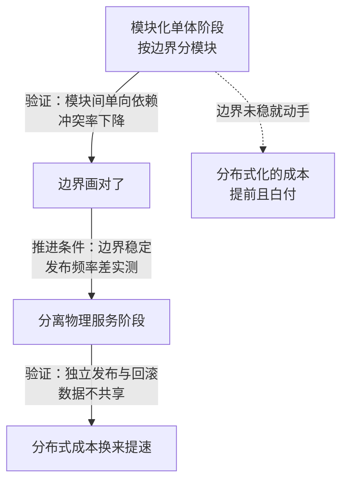
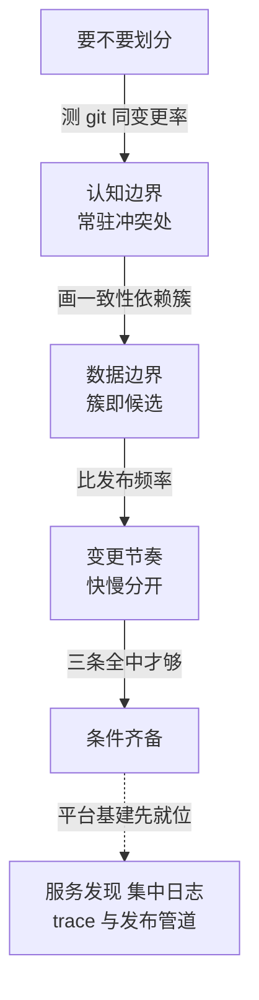

## 单体该不该划分、在哪划分、划分到多细

一个跑得好好的单体，要不要划分、在哪划分、划分到什么粒度？这篇给出三条划分判据，读完你能判断手上的**单体该不该划分、边界画在哪、全中之后还缺什么**。

拍脑袋决定的结局两边都见过：动手晚了——团队在同一个代码库里互相踩脚——**改一处冲突、发布互相等待，迭代速度被协调成本吃掉**；动手早了——**一堆服务共享一个数据库，分布式事务、联调成本、运维复杂度全来了，收益没见着，事故翻了几番**。问题的本质：**划分是组织结构与系统结构的对应决策（康威定律的工程化——康威定律指一个组织的沟通结构会原样映射成它设计的系统模块边界，什么样的小组划分就长出什么样的服务划分），判据不在技术时髦度，而在团队认知边界与数据所有权这两个不可绕开的条件**。判据摆出来之前，"要不要划分"没有答案。

## 三条判据怎么用：机制

先把形状说成一件事：划分微服务像合租房改独立公寓——室友的生活节奏实在合不到一起（一人昼伏夜出、一人朝九晚五）、公共区域的账算不清（冰箱里谁的东西谁付钱）、作息冲突天天发生，而不是因为独立公寓时髦（卫生间排队）。**搬开的前提是：各自的房间（数据所有权）能完全划清、各自的作息（发布节奏）互不干扰、每个人守得住自己那间（团队认知半径）**。三条判据对应的正是这三件事。这个比喻到"搬开"为止——合租改公寓是搬一次家就完，服务划分之后还有**分布式调试、最终一致性、运维矩阵这些持续要付的账**，背景与代价一节展开。

**把一个服务拆成几个之后，多实例扩容才用得上**：拆分前，一份工作只能在这一个单体内部排队，加副本帮不上忙；拆分后，同一份工作放进一个共享队列，多个实例各自取走一部分处理，**实例数增加、吞吐量就上去——这是拆分之后能拿到收益的前提**。

划分完成后的典型形态长这样：客户端只访问 UI（User Interface，用户界面）微服务，领域各自成服务（搜索、支付、评价）互相比邻协作，每个服务背后是各自的数据与团队：

*一个电商域划分成三个领域服务的形态（图源：Wikimedia Commons，Igabriel85 绘，CC BY-SA 4.0）*

图上每个框都是一条判据的落点：**框与框之间不共享数据库（判据二），每个框能独立发布（判据三），每个框能被一个团队完整持有（判据一）**。

**判据一：认知边界（团队的认知负载）**。单体到某个规模后，无人能理解全貌，每个开发者只敢动自己那块（改别人的代码要读三天上下文）。信号：**新功能开发的上下文加载时间**（读代码时间超过写代码时间）、**跨模块改动的冲突率**（Git 冲突频率是耦合度的可测量代理）、**发布协调成本**（一次发布要 N 个团队协商窗口）。**划分的认知判据：一块业务能被一个团队完整持有**——**理解它、修改它、运维它的知识全部装在这个团队的认知半径内，不用跨团队借脑子**；**边界就画在认知过载的地方——两个团队改同一段代码常驻冲突，是划分的第一信号**。AWS（Amazon Web Services，亚马逊云服务）拆分单体指南给出的官方示例就是按业务能力画的：一个保险单体被分解成 Sales、Customer、Compliance、Marketing 四个微服务，每个框是一条业务能力、一个团队的持有范围——**按能力划的边界稳定（业务能力比技术层少变），按技术层划的边界（一个 UI 服务、一个逻辑服务、一个数据服务）每一次业务变更都要跨服务改**：

*图源：[AWS Prescriptive Guidance《Decompose by business capability pattern》](https://docs.aws.amazon.com/prescriptive-guidance/latest/modernization-decomposing-monoliths/decompose-business-capability.html)。*

**判据二：数据边界（所有权的完整性）**。**服务划分的第一原则是数据随之划分：每个服务独占自己的数据存储（Database per Service），跨服务不直连对方的库**。**数据边界的判据是"不变量的归属"**：**一组必须一起保持一致的业务规则（订单与订单明细、账户与余额）该归一个服务**；**数据被两个业务域高频读写（同一张表被订单团队和库存团队都改 schema），说明边界划错了地方（数据是共享的就必然耦合，划分服务而不划分数据是表面上的划分）**。判据的实操：**先画数据模型的关系簇（外键、事务、一致性依赖成簇），簇与簇之间靠事件（而非共享表）同步，簇即服务边界的候选**。

**判据三：变更节奏（发布的独立性）**。两块业务的变化频率差一个量级（秒杀活动周周改、账户规则一年不动），捆在一个发布单元里，**快的被慢的拖住（等窗口、等回归）**。变更节奏判据：**发布频率差异显著 + 各自回滚（把系统状态退回到改动之前的版本）独立**，划分开之后快的块提速。反例：两块业务总是一起变（一次需求两边都改），分成两个服务只增加一次联调——**耦合度看变更历史，不看代码长相**（**Git log 里两个模块的同变更率是耦合的真实度量**）。

**应该先画边界再分服务，粒度收在哪？**顺序：**先模块后服务（单体内部先按边界分模块、模块间强制单向依赖——验证边界画得对不对的最便宜方式），边界稳定后再分离出物理服务（分布式化的运维成本一次性付清）**。粒度：**从"能独立发布的最小单元"往上收，每个服务至少一个完整持有它的团队**（低于团队粒度的服务像拆得过碎的零件，没有团队愿意认领，出了故障没人修——这条边界到「无人持有」为止）。**"微"指的是团队认知半径，不是代码行数**。

两阶段的推进链怎么走？每一段各验证一件事：第一阶段验证边界画得对不对，第二阶段验证运维付得起付不起；每一段各有一个推进条件，条件不满足就停在原地：

## 它从哪儿来，要付什么代价

微服务潮（2014 前后，Fowler 与 Lewis 的定义文章、Netflix/Amazon 的实践输出）把服务划分推成主流；反思潮（2018-2022 年的"分布式单体"反思潮：表面是多个服务，实际共用一个数据库与一套发布流程）的批评、Monolith First 的倡导——Fowler 2015 就写了先单体后划分的文章、Shopify/StackOverflow 的大单体反例、Basecamp 的 Modular Monolith 路线——把判据拉回冷静。**康威定律（1968）的逆推（组织决定架构）**与 Team Topologies（2021，Skelton 与 Pais 著）给划分决策提供了组织侧的操作系统。

划分完成后各服务怎么协作、与遗留单体怎么共存，Microsoft Learn 的设计模式关系图把常搭配的模式画在一张图上：绞杀者模式在客户端与新旧系统之间渐进引流，API 网关（统一接收 API 调用并按路由规则分发到后端的入口层）做路由与聚合，每个服务持有自己的数据，防腐层（一层转换代码，把新旧系统的数据模型差异挡在自己这里，防止旧模型渗透进新服务）隔开遗留系统的模型——正对本文后面边界一节的提醒（**拿不准时用绞杀者渐进**）：

*图源：[Microsoft Learn《微服务设计模式》](https://learn.microsoft.com/zh-cn/azure/architecture/microservices/design/patterns)，CC BY 4.0。*

## 判据全中还缺哪些东西：代价与边界

**把划分判据锚在"变更与数据的真实流"而非架构图的美感上**：Git（分布式版本控制系统）同变更率、数据一致性簇、发布窗口冲突——**三个可测量的信号替代了"高内聚低耦合"的口号**。**判据可测量，划分决策就可以复盘**（决定之前预测的解耦收益，完成之后用同变更率、故障隔离性对账），**架构决策从信仰变成工程**。代价：**划分的真实成本在完成之后**——分布式调试（一个请求穿三个服务，排障要跨服务 trace 基建）、最终一致性（原来一个事务变成事件驱动的补偿链）、运维矩阵（每个服务一套部署监控告警，平台基建先于划分存在才付得起）；**判据是必要条件不是充分条件**——认知、数据、节奏三条全中，还要组织能力兜底（服务治理、平台工程、on-call 轮值值班响应线上故障），**能力缺位的划分是把复杂度从代码转移到组织，总量不减反增**。适用判定：**单体协调成本已实测可见（冲突率、联调时间且平台基建就绪，可以推进；两者缺一，先补弱的那个）**。

三条判据各自对应一个可测信号：认知边界看 Git 同变更率（两个模块的改动是否常驻冲突），数据边界看一致性依赖成簇（必须同一个事务保持一致的规则归一个服务），变更节奏看发布频率差与回滚是否独立。三条都指向同一件事——**划分的依据是变更与数据的真实流动，不是架构图上的分层好看**。虚线是准入条件：**平台基建（服务发现、集中日志、分布式 trace、统一发布管道）必须在划分之前就位**，否则拆出来的服务没有可观测性（通过系统对外输出判断内部状态的能力）与治理能力，等于把复杂度从代码搬进组织。

## 这套说法在哪儿会失效

- **共享库与共享数据的两个表面划分形态**：服务 A、B 共享一个公共业务库（版本地狱：改库要同时发两个服务）或共享一个数据库（表结构是隐含约定，改表炸别人）。真正划分的检验：**每个服务能独立重构自己的数据模型而不通知别人**。
- **"为了性能而划分"多半是错的方向**：单机的进程内调用（ns 级）变成跨服务网络调用（ms 级），性能方向是变差的。**性能问题的正解通常是划分数据（分库分表、读写分离）或分进程（同机多进程），不是划分服务**。**性能诉求的分离只在一类场景成立：资源隔离**（某模块的流量洪峰不吃掉别人的资源——但那是部署隔离，模块化单体加独立部署也能做到）。
- **先划分后补基建的顺序陷阱**：服务发现、集中日志、分布式 trace、统一发布管道——**这些平台件在单体时代可以后补，划分后是空气**。划分计划里平台基建的前置项要打勾，否则划分即事故季。
- **划分可以回头吗**：**可以但代价高**（服务合回单体是数据与发布的双重回迁）。判据拿不准时用"绞杀者模式"渐进（新功能在外围新服务生长，旧单体逐步抽干），保留回退余地——**一次性的大爆炸改造（big bang rewrite）是最高风险形态**。

## 怎么自己动手验证

- **同变更率测量**：对候选划分的两个模块，统计 git 历史里两者的同 commit 变更率（近 6 个月）。预期：**边界清晰的模块对同变更率低（<10%，各自独立演进），纠缠的对高（>50%，划分开只会增加联调）**。判据一的数据化实测。
- **数据簇划分演练**：对数据模型做一致性依赖分析（事务边界、外键、同事务更新的表集），输出关系簇。预期：**簇的数量与形态跟业务域对得上（订单簇、库存簇、账务簇），簇间靠事件同步可行**；出现"桥接表"跨两个簇的，即边界争议点，需要人工决策。判据二的方法验证。
- **划分收益对账**：找一次已完成的划分，对比前后的发布频率、变更冲突率、故障隔离案例（A 服务的故障是否不再拖垮 B）。预期：**判据选对的划分，三项全改善或两项改善一项持平**；对不上的划分（分开之后更慢、事故更多），复盘判据哪条漏了。决策方法的回路校验。

## 接着读哪几篇：聚合边界是数据边界的建模方法

- [[工程知识/软件构建：让变化可以理解、验证与交付/架构与代码/领域建模的实施路径：从事件风暴到聚合边界.md]] —— 聚合边界是数据边界的建模方法，划分判据二的实现工具
- [[工程知识/后端系统：在并发、失败与变化中维持服务/服务设计/事件驱动架构的解耦代价：最终一致与可追溯性.md]] —— 划分后簇间靠事件同步，事件驱动的代价要一起算进划分的账
- [[工程知识/软件构建：让变化可以理解、验证与交付/架构与代码/架构适应度函数：把架构约束写成可执行检查.md]] —— 划分后的边界纪律（不许跨服务直连库）可用适应度函数持续检查
